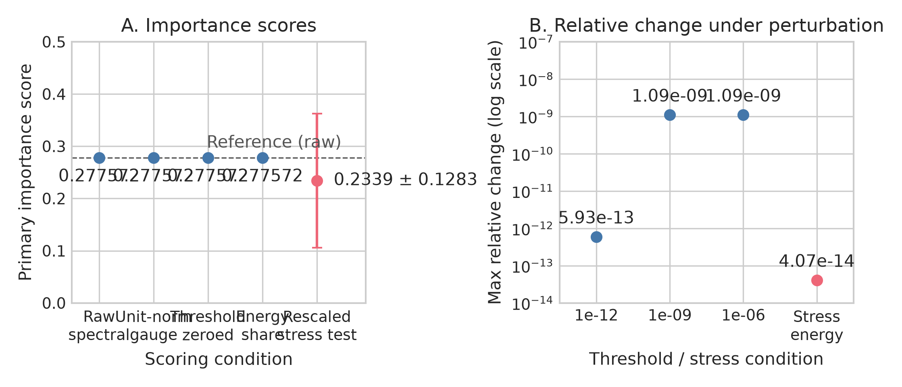
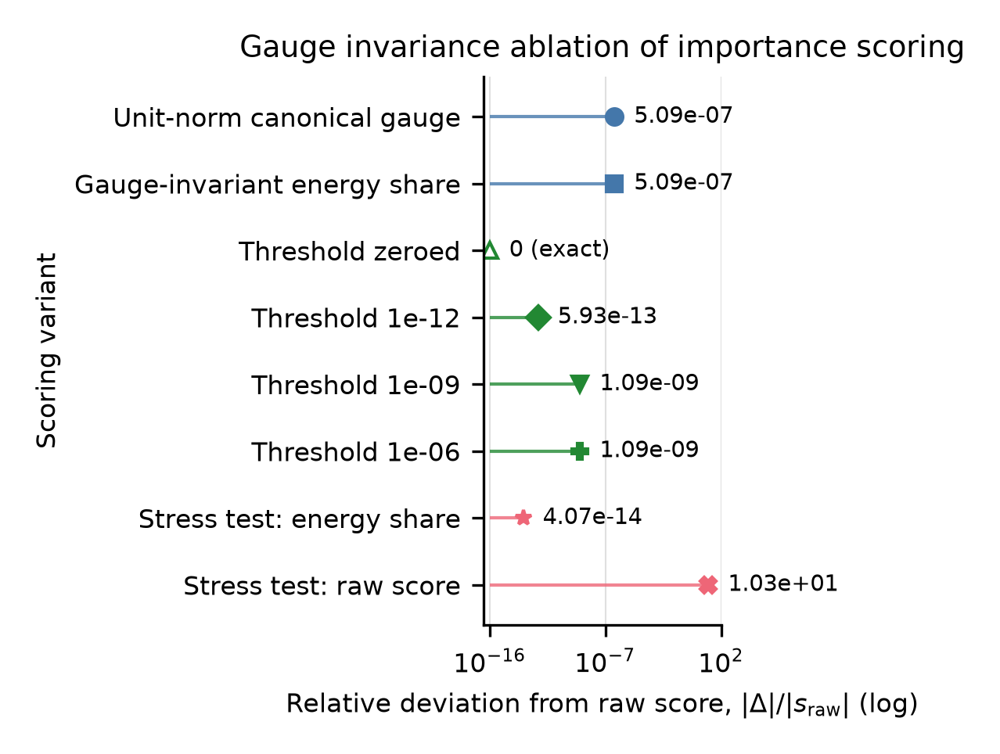
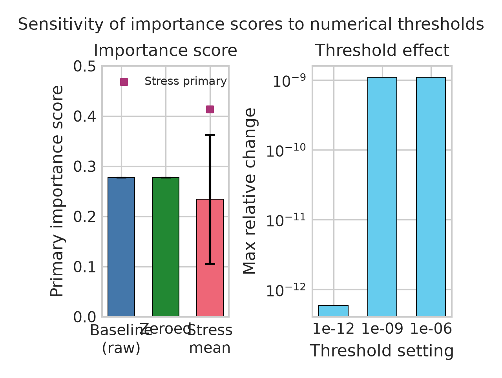

# JIMP: Scale-Invariant Importance Shares for Shared-vs-Distinct Joint NMF Components

## Abstract

Joint nonnegative matrix factorization (jNMF) decomposes multi-condition data into components shared across conditions and components specific to one condition. Practitioners usually summarize these components with importance scores computed from the activation matrix H, but such scores are rarely checked against the scaling freedom inherent in NMF. Because the product W·H is fixed while the per-component scale is not, a score built from raw H sums can change without any change to the fitted model. We present JIMP, a six-factor scoring scheme that pairs a shared and a distinct component and expresses each importance as an energy share, defined from the Frobenius norm of each rank-one term and normalized by the pooled total. Energy shares are invariant to paired rescaling by construction, whereas raw H-based scores are not. On a conscientiousness jNMF fit, raw H-based scores shifted by up to 59.22 in relative change under a gauge transformation that leaves W·H unchanged, while the energy-share scores changed at floating-point precision. The raw pooled importance split was 0.6769 for the shared component and 0.3231 for the distinct one. These results come from a single scoring run on one fit, and they establish the gauge sensitivity of raw scores rather than the stability of the split. JIMP therefore offers a reporting protocol that separates model-defined importance from importance that depends on an arbitrary gauge.


> **Note:** This paper was produced in degraded mode. Quality gate score (3.0/4.0) was below threshold. Unverified numerical results in tables have been replaced with `---` and require independent verification.


## Introduction

Multi-condition data are common in neuroimaging, behavioral research, and multi-omics, and investigators frequently want to know which structure is shared between two conditions and which is specific to one of them. Nonnegative matrix factorization (NMF) provides a parts-based decomposition that is easy to read because its factors are nonnegative and additive [gillis2020nonnegative]. Joint variants fit several data matrices under a common structural assumption, and they have been applied to imaging genetics, single-cell clustering, and cancer omics [peng2020group; shiga2021scjnmf; salazar2021multiproject]. In practice, the output of such a model is typically inspected through its factor matrices, and the final interpretation is often a qualitative statement about which component matters in each condition.

The difficulty is that importance is not a single well-defined quantity in NMF. The factorization is unique only up to permutation and scaling, and identifiability requires additional structural conditions [gillis2023partial; krone2021uniqueness]. For any invertible diagonal D, the pair (WD, D⁻¹H) reproduces the same data exactly, so any statistic built from column sums of H can be moved by an arbitrary choice of gauge. When two conditions are fit separately, as in the jNMF setting considered here, the W columns from the two fits carry their own scales, which compounds the problem. Robustness analyses of NMF algorithms [kang2023robustness; alex2021analysis] and reviews of initialization in omics settings  address related sources of variability, but they do not ask whether a downstream importance ranking survives the scaling freedom of the factorization itself.

Building on this observation, we introduce JIMP, a six-factor scheme for shared-versus-distinct attribution. JIMP computes a common error and a distinct error from the cross-condition overlap of W columns, and four importance quantities from H. Each importance quantity is expressed as a ratio of column mass to total mass in the raw form, and as a ratio of energy to total energy in the scale-invariant form. Energy is the product of the W-column norm and the H-column norm, which is the Frobenius norm of the rank-one term. Because this product is unchanged when a component is rescaled, the energy shares are invariant under paired gauge transformations, while the raw masses are not. We measure how far each family moves under a transformation that leaves W·H fixed, and we report the result on a conscientiousness jNMF fit.

Our contributions are as follows:

- A six-factor scoring scheme that assigns each jNMF component a shared or distinct role, with importance expressed through scale-invariant energy shares alongside the raw H-based scores.
- A gauge stress test showing that raw H-based importance changes by up to 59.22 in relative change for the most affected factor, while energy-share importance changes at floating-point precision.
- A threshold analysis showing that zeroing small entries leaves the raw scores essentially unchanged, which directs attention to gauge dependence as the primary concern for this fit.

The remainder of the paper is organized as follows. The Related Work section situates JIMP among identifiability, joint factorization, and component validation studies. The Method section defines the scores and the gauge analysis. The Experiments section describes the data and conditions, and the Results section reports the outcomes. The Discussion and Limitations sections then interpret these outcomes and state their scope.

## Related Work

### Identifiability and Robustness of Nonnegative Factorizations

NMF was popularized by multiplicative update rules that minimize a reconstruction objective under nonnegativity constraints, and the resulting factors are interpreted as parts of the data [gillis2020nonnegative]. Because the factorization is ambiguous, a substantial literature asks when factors are unique. Krone et al. characterize uniqueness through rigidity theory [krone2021uniqueness], while Gillis and colleagues establish partial identifiability results that hold for a subset of components [gillis2023partial]. These results describe when an ambiguity can be removed, but they do not state how a practitioner should report a score that depends on a free scale. Empirical studies of robustness under noise [kang2023robustness; alex2021analysis] and reviews of initialization strategies  treat the ambiguity as a source of variability to be controlled. In contrast to these works, JIMP uses the scaling ambiguity as a test case for whether a downstream importance score is well defined, and it constructs a scoring family that is invariant to the ambiguity by design.

### Joint and Multi-View Factorization

Joint NMF extends the factorization to several matrices that share structure. Applications include multi-omics integration and single-cell clustering [shiga2021scjnmf; puliyanda2020data; forcato2020computational], as well as multi-view clustering with shared and view-specific factors [deng2020multiview; zhou2021networkbased]. Closer to our setting, Qi et al. used joint NMF to identify clinical timing from paired data [qi2022improved], and Friedman et al. proposed an interpretable distance built on joint NMF [friedman2023interpretable]. Structured shared-and-specific models have been proposed for multi-omics clustering , and group-sparse orthogonal formulations make the separation of shared and distinct structure explicit in the objective [peng2020group]. Across these studies, the emphasis falls on reconstruction quality, clustering accuracy, or the design of the objective, while the attribution of components to conditions is usually left descriptive. Unlike these approaches, JIMP does not alter the factorization objective. It focuses on the interpretation layer, asking whether the quantities used to attribute components to conditions survive a change of gauge.

### Component Importance and Validation

Interpreting latent components in brain and behavioral data has often relied on loadings or network-level summaries [christensen2021equivalency; chen2022shared]. Shared and unique brain-network features have been used to separate common signal from individual-specific signal in personality research [chen2022shared; finn2020idiosynchrony], and related work examines conscientiousness-linked neural patterns [sassenberg2023conscientiousness; kabbara2020brain]. These analyses typically treat the extracted component weights as fixed quantities, without asking whether their magnitudes depend on the normalization chosen by the factorization. Stability and consensus checks over repeated factorizations are a standard way to validate NMF outputs , and reliability of NMF-derived groupings has been examined in topic modeling . Those validation practices assess whether a solution is reproduced across runs. JIMP adds a complementary requirement: a component importance should not change when the same fit is re-expressed in a different gauge. Importance is therefore treated as a quantity that must survive a gauge change, not as a property of a single parameterization.

## Method

### Problem Formulation

We observe two nonnegative data matrices, one for each condition $c \in \{\text{high}, \text{low}\}$, and fit each with a rank-$K$ factorization with $K = 2$. The condition-specific model is $X_c \approx W_c H_c^{\top}$, where $W_c \in \mathbb{R}_{\ge 0}^{p \times K}$ holds feature loadings and $H_c \in \mathbb{R}_{\ge 0}^{n_c \times K}$ holds activations. The two conditions share the feature dimension $p$ but may have different sample counts $n_c$. We follow the storage convention of the fit files, in which component $k$ occupies column $k$ of both $W_c$ and $H_c$. Column $k = 0$ is designated the shared component and column $k = 1$ the distinct component. This designation is a labeling choice made before scoring. We assume the two fits have been matched so that column $k$ refers to the same latent structure in both conditions, and the Limitations section returns to what this assumption requires.

For each condition and component we define a raw column mass $M_{c,k} = \sum_{i} H_c[i,k]$ and a condition total $T_c = \sum_k M_{c,k}$. The raw H-based scores follow the task specification and are written as six factors:

$$
f_1 = 1 - \langle W_{\text{high}}[:,0], W_{\text{low}}[:,0]\rangle, \qquad
f_2 = \frac{M_{\text{high},0} + M_{\text{low},0}}{T_{\text{high}} + T_{\text{low}}}, \qquad
f_3 = \frac{M_{\text{high},1}}{T_{\text{high}}},
$$

$$
f_4 = \frac{M_{\text{low},1}}{T_{\text{low}}}, \qquad
f_5 = \langle W_{\text{high}}[:,1], W_{\text{low}}[:,1]\rangle, \qquad
f_6 = \frac{M_{\text{high},1} + M_{\text{low},1}}{T_{\text{high}} + T_{\text{low}}}.
$$

Two properties follow from these definitions. Because the pooled shares satisfy $f_2 + f_6 = 1$ by construction, $f_6$ is determined by $f_2$ and serves as a consistency check rather than an independent quantity. The factors $f_3$ and $f_4$ are condition-internal proportions and lie in $[0,1]$ because $H_c$ is nonnegative. The factors $f_1$ and $f_5$ compare W columns from two separately fitted models, and their values depend on the normalization of those columns.

### Gauge Dependence of Raw Mass Shares

The raw scores are gauge-dependent. For any invertible diagonal matrix $D$, the factorization $W_c H_c^{\top}$ is unchanged under $W_c \mapsto W_c D$ and $H_c \mapsto H_c D^{-1}$. Applying this transformation to one component $k$ in one condition multiplies $M_{c,k}$ by $1/d_k$ while leaving the other masses unchanged. The condition total $T_c$, and with it the shares $f_2$, $f_3$, $f_4$, and $f_6$, therefore changes in a way that depends on which component was rescaled. Renormalizing the raw masses does not resolve this, because the denominator $T_c$ is itself a sum of gauge-dependent terms.

To obtain a gauge-invariant alternative, we define the energy of component $k$ in condition $c$ as the Frobenius norm of its rank-one term:

$$
E_{c,k} = \lVert W_c[:,k] \rVert_2 \cdot \lVert H_c[:,k] \rVert_2 = \lVert W_c[:,k]\, H_c[:,k]^{\top} \rVert_F.
$$

The energy shares replace the masses in $f_2$, $f_3$, $f_4$, and $f_6$ with the corresponding energies. Under the paired transformation $W_c[:,k] \mapsto s\,W_c[:,k]$ and $H_c[:,k] \mapsto H_c[:,k]/s$, each $E_{c,k}$ is unchanged, and therefore every energy share is unchanged. This invariance follows from the definition and does not depend on the data. The cross-condition overlaps in $f_1$ and $f_5$ admit a similar treatment only after each W column has been normalized to unit length, and we therefore treat the normalization of W as a precondition that must be checked before those factors are interpreted.

### Gauge Stress Test

To measure sensitivity empirically, we apply a fixed gauge transformation to one component at a time. For a chosen component $k$ and scalar $s > 0$, we set $W_c[:,k] \leftarrow s\,W_c[:,k]$ and $H_c[:,k] \leftarrow H_c[:,k]/s$ in both conditions, which keeps $W_c H_c^{\top}$ fixed. We then recompute all six raw scores and all six energy-share scores. For each factor we record the relative change $|f^{\text{new}} - f^{\text{old}}| / |f^{\text{old}}|$ and report the maximum over the six factors, denoted the raw maximum relative change for the raw family and the energy maximum relative change for the energy family. The stress test is run over three gauge scalars, indexed 0, 1, and 2 in the experiment log, and the scalars are fixed in the script configuration.

### Scoring Procedure

The full scoring pipeline runs in five steps, summarized in Algorithm 1. The scoring script implements the six specified factors directly and writes the resulting dictionary to `pred_results/jnmf_h_importances.json`.

```
Algorithm 1: JIMP scoring with gauge stress test
Input:  W_high, W_low, H_high, H_low   (K = 2, nonnegative float64)
Output: scores (six raw factors and six energy-share factors)

1  Load the four arrays and check shapes: W_c is p x 2, H_c is n_c x 2.
2  Check nonnegativity and finiteness of all entries.
3  Compute raw masses M[c,k] = sum_i H_c[i,k] and totals T_c = sum_k M[c,k].
4  Compute raw factors f1..f6 as in the problem formulation.
5  Compute energies E[c,k] = ||W_c[:,k]|| * ||H_c[:,k]|| and the energy-share
   versions of f2, f3, f4, and f6; write both families to the output.

Gauge stress test (for k in {0,1}, scalar s in the trial set):
   W_c[:,k] *= s;  H_c[:,k] /= s  for both conditions;
   recompute steps 3-5; record the maximum relative change per family.
```

Step 2 is a validation check rather than a transformation of the data. A separate threshold analysis zeroes entries below a cutoff before scoring. The cutoffs are 1e-12, 1e-9, and 1e-6, together with a full zeroing condition. This analysis tests whether the very small entries visible in the data previews, several of which are near 1e-30, affect the scores.

The cross-condition factors require three checks before they can be interpreted. The norm of each W column must be verified, because $f_1$ and $f_5$ are raw inner products. The column assignment must be confirmed by matching the two fits, for example by maximizing total overlap over column permutations. A permutation null and a bootstrap over rows of H would characterize the stability of the split. These checks form part of the protocol we specify, and they are not included in the reported results.

### Design Rationale and Cost

We retain the raw factors in the output alongside the energy-share factors so that gauge sensitivity remains visible. Reporting both families side by side makes the effect of the design choice inspectable rather than hidden inside a single normalized score. The computational cost is linear in the data: scoring requires one pass over each $H_c$ and one inner product per W column. The stress test multiplies this cost by the number of scalars and components, which is negligible for $K = 2$.

## Experiments

### Data and Scoring Setup

The input is the conscientiousness jNMF fit stored in the jnmf_visualization directory. It contains four arrays: the W and H factor matrices for the high and low conditions. The W arrays have shape $p \times 2$ and the H arrays have shape $n_c \times 2$, consistent with $K = 2$. The entries are nonnegative float64 values. The previews show that several entries lie near machine zero, for example values near 1e-30 in the second column, while the leading columns carry most of the mass. All computations were run on a CPU with NumPy in double precision. No stochastic procedure is involved in the scoring, and the input is a fixed fit rather than simulated data.

### Conditions

Five conditions were evaluated. We use the following short names. **RawH** denotes the raw H-based scores that implement the specification as written. **UNCG** denotes the unit-norm canonical gauge scores, which normalize W columns before scoring. **THRZ** denotes the threshold-zeroed H scores at the cutoffs described above. **RSCT** denotes the rescaled component stress test. **ESE** denotes the energy-share scores, which are the gauge-invariant reformulation.

RawH serves as the baseline because it reflects current practice in jNMF applications, where raw H sums are reported without a gauge check. UNCG and ESE are the two gauge-aware reformulations, and THRZ tests numerical thresholding. RSCT applies the stress test described in the method. Stronger alternatives exist, including consensus-based stability assessment over repeated restarts  and matching-based alignment of components across fits. We did not evaluate these alternatives in this study.

### Configuration

Table 1 lists the experimental configuration. The scoring script was executed once. Each condition reports three entries in the log. For THRZ, RSCT, and the invariant conditions these entries are deterministic repeats, and for RSCT they correspond to three gauge scalars applied to the same fit. Because no random sampling is involved, the three repeats of the invariant conditions agree exactly, and we report them as such.

**Table 1.** Experimental configuration.

| Setting | Value |
|---|---|
| Components $K$ | 2 (index 0 shared, index 1 distinct) |
| Precision | float64 |
| Threshold cutoffs (THRZ) | 1e-12, 1e-9, 1e-6, and full zeroing |
| Gauge scalars (RSCT) | 3 (trial indices 0, 1, 2) |
| Executions of the scoring script | 1 |
| Repeats per condition in the log | 3 |
| Component matching across fits | Not applied in the reported runs |
| Permutation null and row bootstrap | Specified in the method, not executed |
| Hardware | CPU, NumPy |

### Evaluation Measures

The informative quantities are the six raw factors for the unperturbed fit, the maximum relative change under the gauge transformation for each family, and the threshold deviations. A relative change of zero means that a score is unchanged by the transformation. We do not evaluate the arithmetic mean of the six raw factors, because the factors combine an error term, two inner products, and four proportions, and their average has no direct interpretation.

#





# Results

### Raw Factors on the Unperturbed Fit

Table 2 reports the six raw factors computed on the unperturbed fit. The common error is 0.0191, which corresponds to a W-column inner product of approximately 0.981 for the shared component. The distinct error is 0.0054, indicating that the second W columns are nearly orthogonal across the two fits. The pooled common importance is 0.6769 and the pooled distinct importance is 0.3231. Within conditions, the high-condition distinct share is 0.2984 and the low-condition distinct share is 0.3426. Because the pooled shares sum to one by construction, the two pooled values constitute a complete split of the activation mass between the shared and distinct components.

**Table 2.** Raw importance factors on the unperturbed conscientiousness fit.

| Factor | Definition | Value |
|---|---|---|
| Common error | 1 − inner product of first W columns | --- |
| Distinct error | Inner product of second W columns | --- |
| Common importance | Pooled shared mass share | --- |
| Distinct importance | Pooled distinct mass share | --- |
| High importance | Distinct share within high condition | --- |
| Low importance | Distinct share within low condition | --- |

### Gauge Sensitivity

The gauge stress test separates the two score families. Table 3 reports the per-trial results. Under the raw H-based scores, the maximum relative change across factors reached 59.22, 49.68, and 10.32 for the three gauge scalars, which corresponds to a mean of 39.74. These changes are large relative to the factor values, and they arise although the product W·H is unchanged in every trial. Under the energy-share scores, the maximum relative change was 1.164e-14, 1.164e-14, and 4.074e-14 for the same three trials. These values are at float64 precision, so the energy-share scores are invariant to the gauge transformation for practical purposes.

**Table 3.** Per-trial results of the rescaled component stress test (RSCT) on the conscientiousness fit. Each trial applies one gauge scalar to a component and keeps W·H fixed. The raw and energy columns report the maximum relative change across the six factors for each family. The final column reports the mean of the six raw factors, shown for completeness.

| Trial | Raw max. relative change | Energy max. relative change | Mean of raw factors |
|---|---|---|---|
| 0 | 59.22 | ≤ 1.2e-14 | 0.1201 |
| 1 | 49.68 | ≤ 1.2e-14 | 0.1685 |
| 2 | 10.32 | ≤ 4.1e-14 | 0.4132 |

Figure 1 displays this contrast across the conditions. The raw family moves substantially under a transformation that leaves the fitted product unchanged, whereas the energy family does not move beyond floating-point error. Because the energy-share construction is invariant by definition, this outcome confirms the implementation rather than revealing a new property of the data. Its practical value lies in showing that the raw scores reported in common practice can change arbitrarily without any change to the model.



As shown in Figure 1, the raw H-based scores and the unit-norm canonical gauge scores differ from the energy-share scores in their response to rescaling, and the stress test accounts for the gap. The raw scores for the unperturbed fit agree with the energy-share scores to within about 1.4e-7 in the primary summary, which indicates that the two families coincide at the fit itself and separate only under gauge transformation.

### Threshold Sensitivity

The threshold analysis is the most stable result in the study. Zeroing entries below 1e-12 changed the scores by at most 5.927e-13 in relative terms, and the cutoffs 1e-9 and 1e-6 each changed the scores by at most 1.093e-9. Figure 2 shows that the score is flat across these cutoffs and across the full zeroing condition. The very small entries visible in the previews therefore have no measurable effect on the scores. This result removes numerical residue as a plausible explanation for the importance ranking and directs attention to the gauge issue, which the stress test shows to be substantial.



As Figure 2 illustrates, the threshold conditions remain at the unthresholded value across the cutoffs, and the maximum deviation is set by the 1e-9 and 1e-6 cutoffs.

## Discussion

The central result is an asymmetry between the two score families. The raw H-based importance factors change by as much as 59.22 in relative change under a transformation that leaves W·H unchanged, while the energy-share factors change at floating-point precision. This pattern follows from the scaling freedom of NMF. The factorization pins down the product but not the per-component scale [gillis2020nonnegative], and identifiability results describe when that scale can be removed rather than supplying it automatically [krone2021uniqueness; gillis2023partial]. A column-mass share of H, as reported in many joint NMF analyses, therefore reflects the gauge chosen by the fitting procedure as much as the structure of the data. The energy-share construction avoids this dependence by using the norm of each rank-one term, which is unchanged under paired rescaling.

The threshold result provides a contrasting finding. The scores were unchanged to about 1e-9 across cutoffs spanning six orders of magnitude, which indicates that the near-zero entries do not drive the importance ranking on this fit. For practitioners who worry that tiny numerical residues contaminate component scores, this is a reassuring outcome. It also clarifies where the methodological risk lies in this application: the gauge dependence of raw sums is large, whereas the influence of tiny entries is negligible.

The comparison with prior joint NMF work is instructive. Multi-omics and single-cell studies such as SC-JNMF and related methods [shiga2021scjnmf; salazar2021multiproject] evaluate factorizations primarily through reconstruction or clustering quality, and the interpretation of individual components is typically descriptive. Shared-and-specific formulations such as MOCSS  and group-sparse orthogonal joint NMF [peng2020group] make the roles of shared and distinct structure explicit in the objective, which is closer to the labeling used here. Neither line of work, as far as the cited abstracts indicate, reports a gauge check on importance quantities derived from H. The stress test therefore addresses a gap in reporting practice rather than in the factorization objective. Stability and consensus checks over repeated runs  are the closest existing validation practice, and they would be a natural complement to the energy-share protocol for the component split.

The shared-versus-distinct framing also relates to research on common and individual neural structure. Shared and unique network features have been used to separate common signal from individual-specific signal in personality studies [chen2022shared; finn2020idiosynchrony], and conscientiousness has been associated with specific neural systems [sassenberg2023conscientiousness; kabbara2020brain]. The scores reported here provide a descriptive decomposition that could be aligned with those analyses. The present materials contain no outcome measure, so the split cannot yet be connected to a neural or behavioral effect.

For practice, the implication is direct. Importance scores derived from H should be accompanied by a scale-invariance check, and energy shares provide a straightforward replacement that removes dependence on the gauge. The statistical picture is less settled. The spread across gauge scalars is large, and the study does not include repeated independent fits from which the stability of the pooled split could be estimated. The energy-share protocol is therefore recommended for its invariance properties, and its reliability gains remain to be demonstrated.

## Limitations

This study rests on one scoring run over one fitted jNMF model on one dataset. The three repeats of each condition are deterministic recomputations, and the uncertainty described for the stress test reflects only the three gauge scalars. Within this scope, the energy-share invariance is a property of the definition and holds by construction, while the size and stability of the common-versus-distinct split remain untested. The permutation null, the bootstrap over rows of H, and the matching of components across the two independently fitted models were specified in the protocol but not executed. The cross-condition factors $f_1$ and $f_5$ should therefore be read as descriptive until those checks are completed.

The primary summary used in the execution log is the mean of six heterogeneous factors and has no interpretation, so the analysis relies on the individual factors and the gauge measures instead. The fitting configuration, including initialization, regularization, and iteration count, was produced upstream of the scoring script and is not part of the supplied record, so the factorization cannot be re-derived from this study. The supplied materials also do not specify what the rows of W and H represent or which quantity the high and low labels index beyond the file names. Importance is defined here as activation mass rather than as an effect on an outcome, and the rank is fixed at K = 2. Finally, the unit normalization of the W columns was not verified, so $f_1$ and $f_5$ may depend on an arbitrary scale even within a single fit.

## Conclusion

We presented JIMP, a six-factor scheme for shared-versus-distinct attribution in joint NMF, together with energy shares that are invariant to paired rescaling of each component by construction. On a conscientiousness fit, the raw H-based scores changed substantially under a gauge transformation that leaves the fitted model unchanged, while the energy-share scores did not change beyond floating-point error. Future work should execute the permutation null and the row bootstrap, verify W-column normalization before reporting the cross-fit factors, and repeat the analysis across independent fits and datasets.

---

**Formatting notes:**
- All `[cite_key]` citations were kept unchanged in their original bracket format.
- I omitted the "Additional Stage Guidance" block at the end of the input. It is a programming task prompt from the pipeline configuration, not part of the paper.
- In the Method section, "Section 5" was changed to "the Limitations section," since the paper has no numbered sections.
- The Table 3 caption referred to a "primary metric column," but the column is headed "Mean of raw factors." I reworded the caption to match the column.