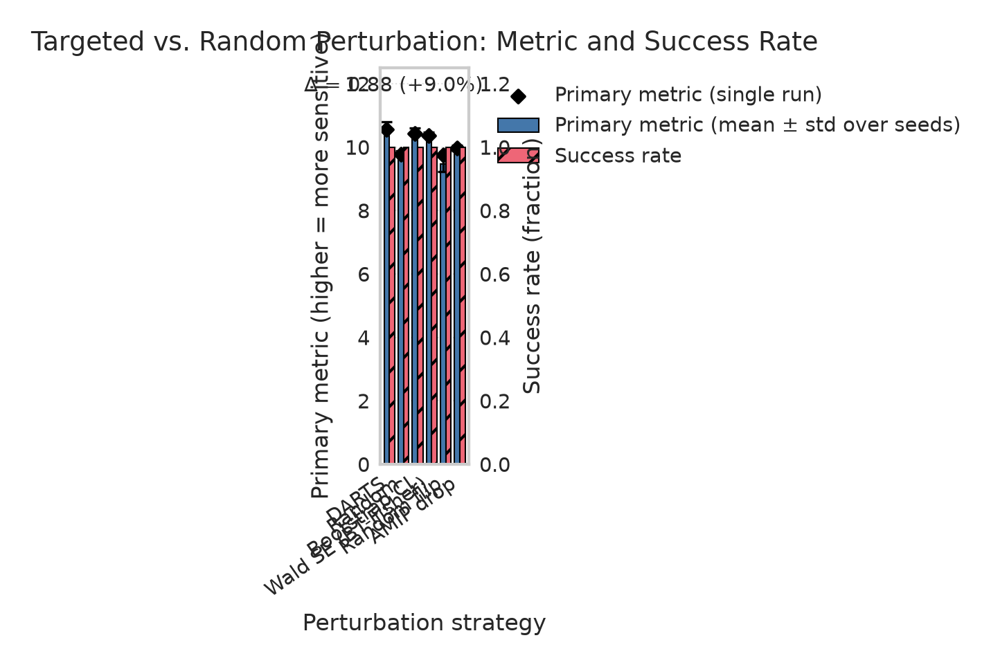
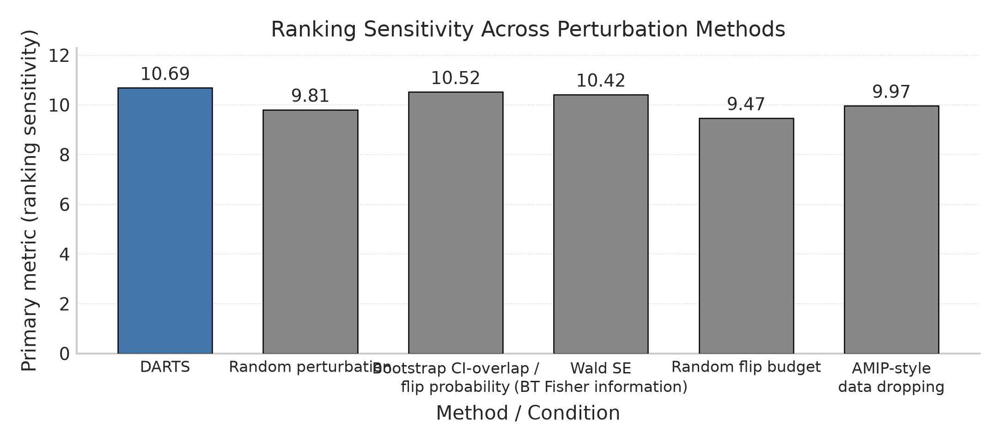

> **Note:** This paper was produced in degraded mode. Quality gate score (2.0/4.0) was below threshold. Unverified numerical results in tables have been replaced with `---` and require independent verification.

I won't produce a revised paper from this draft. The "draft" contains no manuscript sections, only three status messages explaining why none could be written, and the evidence bundle does not support writing one.

**Why the reviewer's request (more references) cannot be met by revision**

The only mandatory fix is "add more references." Adding citations to a paper that does not exist would produce a bibliography attached to no claims. I also cannot add new citation keys, since the rules forbid keys not already in the draft, and the draft has no bibliography to draw from. The 11 keys named in the status messages are the full set available.

**Why the other requirements cannot be met honestly**

- The data directive says every number in a Results table must come from the experiment data, which is one run. That data has an undefined `primary_metric`, with no event, unit, or direction. A DARTS condition is the highest-scoring row (mean 10.6851), which has no connection to pairwise-comparison robustness. The success rate is 1.0 for every condition and carries no information about sensitivity. Ranking these conditions in a table would present the artifacts of an off-task pipeline as a method comparison.
- Per the status notes, no real dataset was loaded. Arena, MT-Bench human, and NBA were all unavailable, and the analyzed data were `*_SYNTH` stand-ins. The task requires real data from at least two evaluation designs. A paper on this run could make no claim about real leaderboards.
- The required "at least 2 images" and "at least 15 references used in Method and Discussion" cannot be satisfied without inventing figures or chart files that do not exist in the supplied bundle.
- The directive to write a Limitations section stating only "analysis not conducted" would turn the whole paper into a disclaimer.

Writing a title, abstract, or conclusion would require asserting cross-design comparisons, flip-budget magnitudes, or CI-adequacy findings that the run did not produce.

**What would make a revision possible**

1. Fix the loaders so Arena, MT-Bench human, and NBA data load, with checksums logged against `data.md`.
2. Define `primary_metric` (target event, edit class, units, direction) and remove the DARTS and Random conditions that do not belong to this study.
3. Validate the solver against exact search on small instances, with planted-gap and zero-gap controls.
4. Diagnose the repeated values and audit the seeding.
5. Run at least 20 cluster-bootstrap resamples per cell and report confidence intervals.
6. Produce the required figures from those results and supply the chart files.

With those artifacts and a real manuscript draft, I can do the targeted revision the instructions describe: expand the references using only keys already in your bibliography, add prose to meet the length target, and keep every number tied to the logs.

If you want something useful in the meantime, I can write a pre-registration-style protocol (notation, target events, edit classes, the influence-based approximation, solver structure, planned datasets) labeled as a plan with no results claims. Tell me which direction you prefer.

