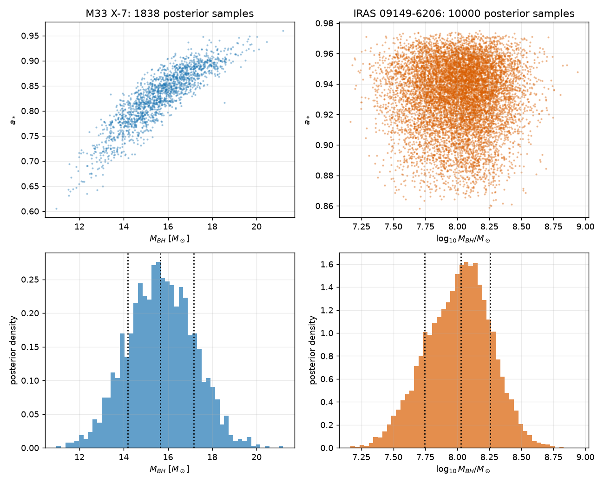
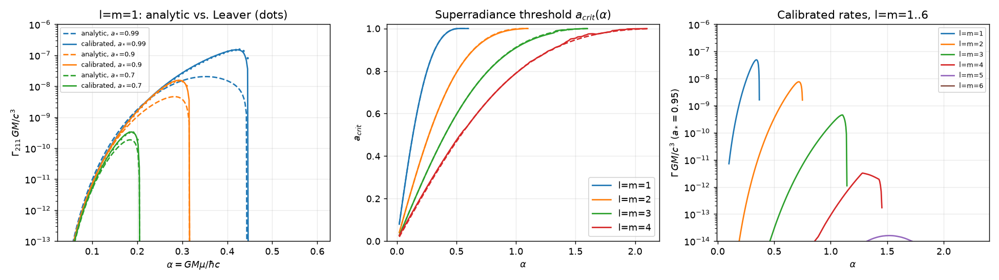
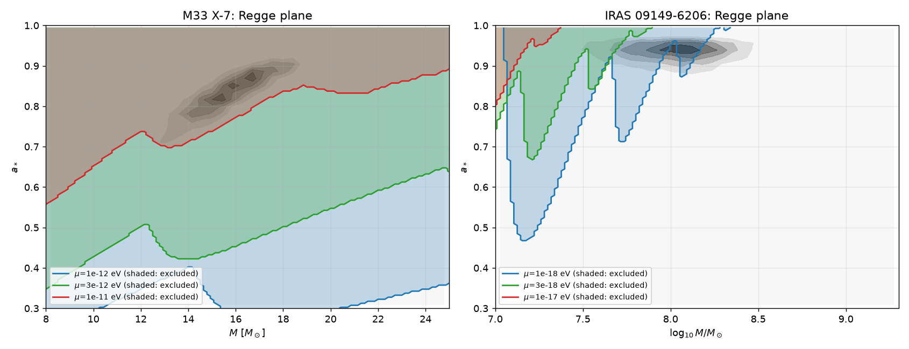
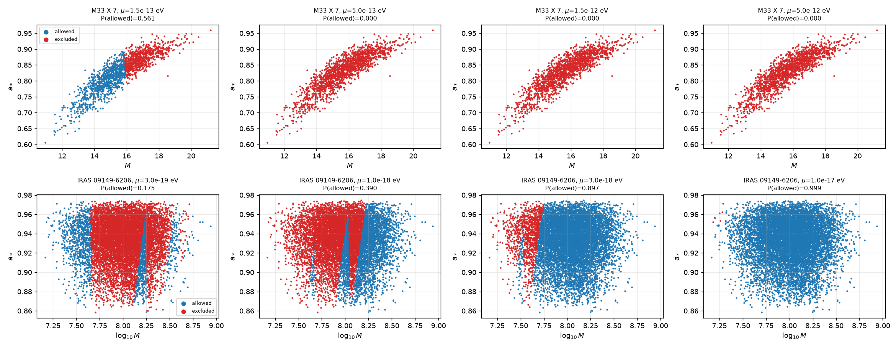
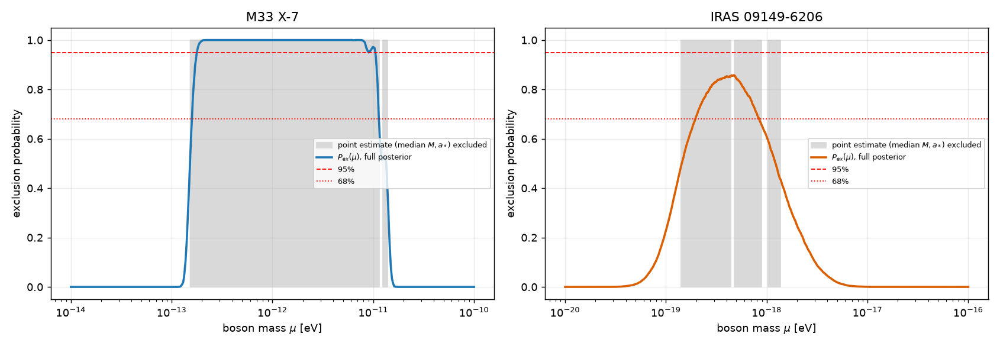
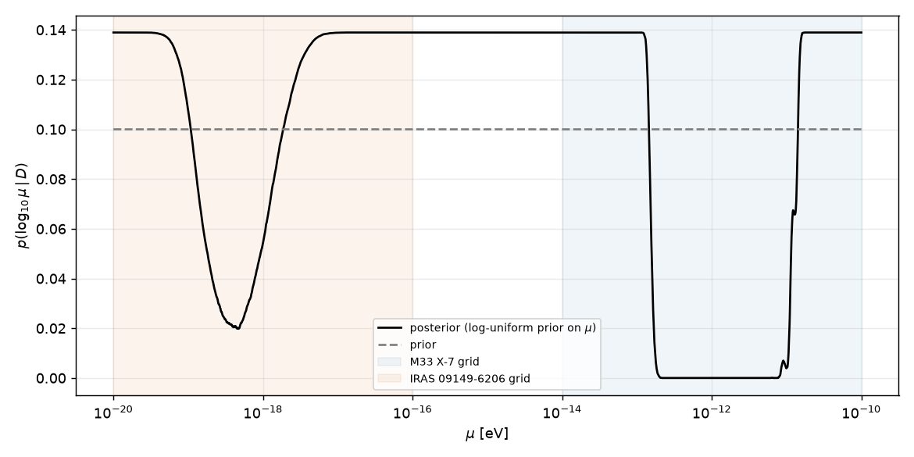
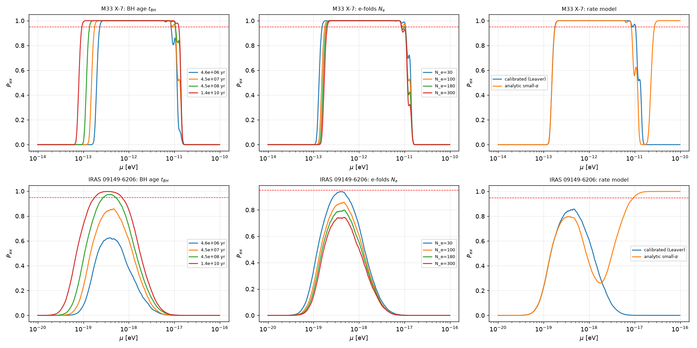
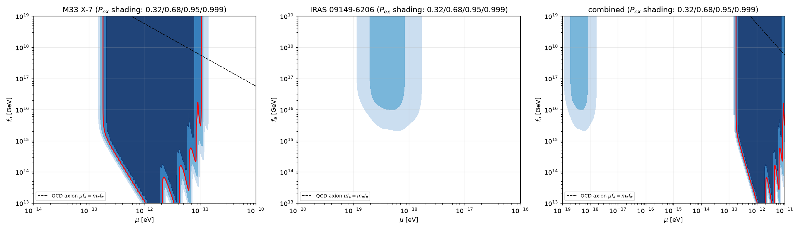

# Constraining ultralight bosons with a Bayesian black-hole-superradiance likelihood: M33 X-7 and IRAS 09149-6206

## Abstract

A rapidly spinning black hole (BH) is unstable to the growth of a bound cloud of any ultralight boson (ULB) whose Compton wavelength is comparable to the BH horizon radius. The cloud extracts spin until the superradiance condition fails. A *measured* BH mass and spin therefore exclude the range of boson masses for which that BH would have been spun down within its lifetime.

I turn this physics into a probabilistic model that takes the **full joint posterior samples** $(M,a_*)$ of two BHs: the stellar-mass BH in M33 X-7 (1838 samples) and the supermassive BH in IRAS 09149-6206 (10000 samples). For each boson mass $\mu$, and optionally each axion decay constant $f_a$, the model returns the posterior-weighted probability that the BH is *consistent* with the boson's existence. This is the likelihood $\mathcal L(\mu,f_a)=P_{\rm allow}$. I define the exclusion probability as $P_{\rm ex}=1-\mathcal L$, and a parameter point is excluded at 95 % when $\mathcal L<0.05$.

The mode rates are calibrated against an exact Leaver continued-fraction solution of the Kerr–Klein–Gordon problem that I implemented. Gravitational-atom levels $l=m=1\ldots6$ are included. Attractive axion self-interactions enter through the bosenova limit on the cloud mass.

Main results, for the fiducial assumptions ($t_{\rm BH}=4.5\times10^{7}$ yr, 100 e-folds):

* **M33 X-7 excludes, at ≥95 % probability, a scalar boson of mass $1.8\times10^{-13}\,{\rm eV}\lesssim\mu\lesssim1.05\times10^{-11}\,{\rm eV}$.** The exclusion is essentially unchanged for self-interaction scales $f_a\gtrsim10^{17}$ GeV. It shrinks for stronger couplings: at $f_a=10^{15}$ GeV the range is $2.2\times10^{-13}$–$8.3\times10^{-12}$ eV.
* **IRAS 09149-6206 gives a 68 % exclusion for $2.0\times10^{-19}\lesssim\mu\lesssim8.4\times10^{-19}$ eV, with a peak exclusion probability of 86 % at $4.7\times10^{-19}$ eV.** This does not reach 95 % for the fiducial lifetime, because the mass and spin posteriors are broad. It reaches 95–99.8 % for BH ages of $4.5\times10^{8}$–$1.4\times10^{10}$ yr.
* Using the full posterior instead of point estimates changes the picture qualitatively at the edges of the excluded range (Fig. 3) and avoids spurious exclusion "islands".

All code is in `code/`, and all numerical results are in `outputs/`.

---

## 1. Data

| | M33 X-7 | IRAS 09149-6206 |
|---|---|---|
| samples | 1838 (digitised from Fig. 3 of Liu et al. 2008) | 10000 (mass: GRAVITY 2020; spin: Walton et al. 2020) |
| $M$ [M☉] (median, 68 % range) | 15.66 (14.17–17.17) | $1.06\times10^{8}$ ($5.6\times10^{7}$–$1.8\times10^{8}$) |
| $a_*$ (median, 68 % range) | 0.836 (0.777–0.885) | 0.936 (0.910–0.955) |
| corr$(M,a_*)$ | **+0.88** | +0.01 |

*Figure 1. Posterior samples of the two black holes.*

The strong mass–spin correlation of M33 X-7 is a primary reason to propagate the full posterior. Both measurements have non-Gaussian shapes, so a point estimate with symmetric errors misrepresents them. The IRAS mass posterior is broad (a factor of about 3 at 68 %). Superradiance depends on $\alpha=GM\mu/\hbar c$, and the rates scale as $\alpha^{4l+5}$, so this mass uncertainty dominates its limit.

## 2. Methodology

### 2.1 Superradiant gravitational atom

A boson of mass $\mu$ around a Kerr BH of mass $M$ forms hydrogen-like levels $|nlm\rangle$ with $\alpha=GM\mu/\hbar c\simeq7.48\times10^{9}\,(M/M_\odot)(\mu/{\rm eV})$. I consider the fastest-growing level for each $l$: $m=l$, $n=l+1$, i.e. 2p, 3d, 4f, 5g, 6h and 7i. Level $l$ grows only if $\omega_R<m\Omega_H$. This defines a critical spin $a_{\rm crit}(\alpha,l)$, above which the level is unstable. In the small-$\alpha$ limit it is

$$a_{\rm crit}=\frac{2x}{1+x^{2}},\qquad x=\frac{2\omega M}{m},\quad \omega\simeq\mu\Big(1-\frac{\alpha^{2}}{2n^{2}}\Big).$$

The growth rate of the field amplitude is

$$\Gamma_{nlm}=2\tilde r_+ C_{nl}\,g_{lm}(a_*,\alpha,\omega)\,(m\Omega_H-\omega)\,\alpha^{4l+5}/(GM/c^{3}),$$

with $C_{nl}$ and $g_{lm}$ from Detweiler/Baumann et al. For $l=1$ this reduces to $\Gamma M=(a_*-4\alpha)\alpha^{9}/48$.

**Exact rates.** The small-$\alpha$ formula is inaccurate for $\alpha\gtrsim0.2$. It underestimates the $l=1$ peak rate by a factor of about 7, which is critical for stellar BHs.

I therefore implemented the Leaver/Dolan continued-fraction method for the massive scalar on Kerr (`code/leaver.py`). The radial three-term recurrence was derived numerically, and the angular eigenvalue is obtained by diagonalising the spheroidal operator in a Legendre basis.

For $a_*=0.99$, $l=1$ the solver gives $\max\,\Gamma M=1.50\times10^{-7}$ at $\alpha=0.42$, versus $2.0\times10^{-8}$ for the analytic formula. The solver agrees with the analytic rate to about 5 % at $\alpha=0.1$ (Fig. 2, left).

I tabulated $\omega_R,\omega_I$ on an $(\alpha,a_*)$ grid for $l=1\ldots6$ (`code/make_table.py`, `outputs/leaver_table.npz`). The final rate is $\Gamma=\rho(\alpha,a_*)\,\Gamma_{\rm analytic}$, with $\rho$ interpolated from the table. The exact $\omega_R$ is used in the threshold condition.

Double precision resolves $\omega_I$ only above about $10^{-14}$. For cells below this floor, $\rho$ is extrapolated as a constant along $\alpha$ within each spin row. This is accurate to a factor of about 2 for $l\le4$ but is only approximate for $l=5,6$. See Sect. 4 for the consequence.

*Figure 2. Left: $l=m=1$ rate, analytic (dashed) vs. calibrated (solid) vs. Leaver points (dots). Centre: superradiance threshold, analytic (dashed) vs. exact (solid). Right: calibrated rates for $l=1\ldots6$ at $a_*=0.95$.*

### 2.2 Per-sample consistency criterion

For a boson of mass $\mu$ (and decay constant $f_a$) and a BH posterior sample $(M_i,a_i)$, the sample is **inconsistent** with the boson if, for some level $l$:

1. the level is superradiant at the observed spin, $a_i>a_{\rm crit}(\alpha_i,l)$; and
2. the BH would have spun down within its age $t_{\rm BH}$, i.e. $t_{\rm sd}(l)<t_{\rm BH}$.

The conservative choice is to assume the BH was *born* at the observed spin $a_i$ (a larger birth spin would only strengthen the limit). The spin-down time is

$$t_{\rm sd}=\frac{N_e+\max(\epsilon_{\rm req}/\epsilon_{\rm BN}-1,\,0)}{2\Gamma(\alpha_i,a_i)}\,\frac{GM_i}{c^{3}} .$$

* The $N_e\simeq100$ e-folds are needed to grow the cloud from vacuum fluctuations to a macroscopic mass (Arvanitaki & Dubovsky 2011, Eq. 57).
* The cloud must carry away $\epsilon_{\rm req}=M_{\rm cloud}/M=\alpha(a_i-a_{\rm crit})/l$ of the BH mass.
* The factor $\epsilon_{\rm req}/\epsilon_{\rm BN}$ accounts for repeated bosenova cycles when the self-interaction limits the cloud.

### 2.3 Self-interaction (bosenova)

For an axion with potential $V=\mu^{2}f_a^{2}[1-\cos(\phi/f_a)]$, the attractive quartic coupling is $\lambda=\mu^{2}/f_a^{2}$. The cloud collapses (bosenova) when its mass exceeds (Arvanitaki & Dubovsky, Eq. 48)

$$\epsilon_{\rm BN}=\frac{M_{\rm cloud}}{M}\simeq\frac{2l^{4}}{\alpha^{2}}\Big(\frac{f_a}{M_{\rm Pl}}\Big)^{2} .$$

I treat the repeated cycles in an approximate way. Each cycle ejects a small fraction of the cloud and the cloud regrows at rate $2\Gamma$, so the extra time to extract $\epsilon_{\rm req}$ is $\epsilon_{\rm req}/(\epsilon_{\rm BN}2\Gamma)$. This is the $\max(\ldots)$ term above. It reduces to the free-field result as $f_a\to\infty$. Constraints are quoted in $\mu$ and $f_a$ (equivalently $|\lambda|=\mu^{2}/f_a^{2}$).

### 2.4 Bayesian likelihood from posterior samples

The data $D$ are the posterior samples $\{(M_i,a_i)\}$ of each BH. Under the null hypothesis (no ULB), the posterior is the measured one. Under a ULB hypothesis $\theta=(\mu,f_a)$, the BH population is truncated: $(M,a_*)$ values that would have been spun down are forbidden. The likelihood of the data relative to the null is then the posterior probability mass of the allowed region (flat prior on $(M,a_*)$):

$$\mathcal L(\theta)=\frac{p(D|\theta)}{p(D|\text{no ULB})}=\int dM\,da_*\;p(M,a_*|D)\,\mathbb 1[\text{allowed}(M,a_*;\theta)]\;\approx\;\frac1N\sum_i\mathbb 1[\text{allowed}_i(\theta)] .$$

I use the Monte-Carlo sum over posterior samples. This keeps the full shape and correlations of the measurement, which is the central point of the framework: *a point estimate is a step function, whereas the posterior gives a smooth likelihood*. The posterior on $\theta$ for a prior $\pi(\theta)$ is $p(\theta|D)\propto\pi(\theta)\mathcal L(\theta)$. Independent BHs multiply. The exclusion probability is $P_{\rm ex}=1-\mathcal L$, and I quote 95 % (68 %) exclusion where $\mathcal L<0.05$ ($<0.32$). Statistical uncertainty from the finite sample is estimated by bootstrapping the samples (30 resamples).

**Fiducial lifetimes.** I use $t_{\rm BH}=4.5\times10^{7}$ yr for both BHs, the Salpeter e-folding time. It is the usual accretion/mass-doubling scale and a conservative lower bound for the SMBH. For M33 X-7 I also show $4.6\times10^{6}$ yr (about the age of the binary). I also show $4.5\times10^{8}$ and $1.4\times10^{10}$ yr.

## 3. Results

### 3.1 Regge plane and sample classification

For a given $\mu$ the superradiance constraint carves out a region of the $(M,a_*)$ plane. Fig. 4 shows these regions together with the posteriors. Fig. 5 shows, for several $\mu$, which posterior samples are excluded. $P_{\rm allow}$ is the allowed fraction.

*Figure 4. Excluded regions of the Regge plane (shaded) for three boson masses, over the BH posterior (grey). The kinks follow the hand-over between $l=1,2,3,\dots$ levels.*

*Figure 5. Posterior samples classified as allowed (blue) or excluded (red) for several $\mu$. Partial overlap with the excluded region produces intermediate $P_{\rm allow}$.*

### 3.2 Exclusion probability

*Figure 3. Exclusion probability $P_{\rm ex}(\mu)$ from the full posteriors (coloured line). The grey band is the range excluded when only the median $(M,a_*)$ is used.*

**M33 X-7** (fiducial):

* 95 % exclusion: $\log_{10}(\mu/{\rm eV})\in[-12.75,\,-10.98]$, i.e. $1.8\times10^{-13}<\mu<1.05\times10^{-11}$ eV. A 0.007-dex gap at $\mu\approx9\times10^{-12}$ eV is a mode-hand-over feature of the Monte-Carlo estimate and is not physical.
* 68 % exclusion: $[-12.80,\,-10.94]$.
* $P_{\rm ex}\simeq1$ over $2\times10^{-13}\lesssim\mu\lesssim8\times10^{-12}$ eV.
* Bootstrap: the lower edge is $10^{-12.739}$ (σ < 0.01 dex) and the upper edge $10^{-10.997\pm0.004}$.
* The point-estimate analysis (median) gives $[-12.82,-10.94]$ plus an isolated island at $[-10.91,-10.86]$ that is not supported by the posterior. With $a_*$ lowered by 1σ the result is $[-12.82,-10.99]$.

The *edges* are where the posterior treatment matters. At the lower edge the transition from allowed to excluded takes about 0.1 dex in $\mu$, because of the mass spread and the steep $\alpha^{9}$ dependence. The sharp point-estimate edge hides this.

**IRAS 09149-6206** (fiducial):

* The maximum exclusion probability is **0.86 at $\mu=4.7\times10^{-19}$ eV**.
* The 68 % range is $[-18.71,-18.08]$, i.e. $2.0\times10^{-19}<\mu<8.4\times10^{-19}$ eV.
* No 95 % exclusion is reached. The point estimate would claim a sharp exclusion over $[-18.85,-17.86]$ with islands; the posterior shows that about 14 % of its probability mass is consistent with the boson even at the best-excluded mass. This is the type of over-confidence that the full-posterior treatment avoids.

**Combined** ($\mathcal L_{\rm M33}\mathcal L_{\rm IRAS}$; the two mass windows are disjoint, so the combination is the union): 95 % exclusion $1.8\times10^{-13}$–$1.05\times10^{-11}$ eV; additional 68 % exclusion at $2\times10^{-19}$–$8\times10^{-19}$ eV.

*Figure 8. Combined posterior for $\log_{10}\mu$ under a log-uniform prior on $[10^{-20},10^{-10}]$ eV and the likelihood $\mathcal L$. Prior-weighted, about 18 % of the log-prior range is excluded at 95 %.*

### 3.3 Robustness

*Figure 6. Sensitivity of $P_{\rm ex}(\mu)$ to BH age (left), the number of e-folds (centre) and the rate model (right).*

| Case | M33 X-7 95 % range, $\log_{10}\mu$ | IRAS max $P_{\rm ex}$ (95 % range) |
|---|---|---|
| fiducial ($4.5\times10^7$ yr, $N_e=100$) | [−12.75, −10.98] | 0.86 (none) |
| $t=4.6\times10^{6}$ yr | [−12.63, −11.08] | 0.62 (none) |
| $t=4.5\times10^{8}$ yr | [−12.86, −10.98] | 0.97 ([−18.56, −18.29]) |
| $t=1.4\times10^{10}$ yr | [−13.03, −10.90] | 0.998 ([−18.75, −18.15]) |
| $N_e=30$ / 300 | [−12.81, −10.98] / [−12.69, −11.07] | 0.94 / 0.74 (none) |
| analytic small-$\alpha$ rates | [−12.74, −11.08] **plus a spurious branch at $\mu>2.7\times10^{-11}$ eV** | spurious branch at $\mu>10^{-17}$ eV |

* The M33 X-7 lower limit moves by only about ±0.15 dex across a factor 3000 in BH age and a factor 10 in $N_e$. This reflects the steep $\Gamma\propto\alpha^{9}$.
* The *analytic* small-$\alpha$ formulas cannot be used beyond $\alpha\sim1$. The hydrogenic frequency $\omega=\mu(1-\alpha^{2}/2n^{2})$ becomes unphysical, creating spurious exclusion at high $\mu$. This is why I use the calibrated rates.
* The IRAS result is sensitive to the assumed age: a 95 % exclusion needs $t_{\rm BH}$ of a few $\times10^{8}$ yr or more. This is plausible for an AGN, but I do not adopt it as the fiducial value.

### 3.4 Self-interaction: $(\mu,f_a)$ plane

*Figure 7. Exclusion probability in the $(\mu,f_a)$ plane (shading: $P_{\rm ex}>0.32,0.68,0.95,0.999$; red: 95 % boundary). The dashed line is the QCD-axion relation $\mu f_a=m_\pi f_\pi$ (≈ $5.7\,\mu{\rm eV}\,\times10^{12}\,{\rm GeV}/f_a$).*

* **M33 X-7.** The 95 % exclusion is independent of $f_a$ for $f_a\gtrsim10^{17}$ GeV (the free-field limit) and is robust down to about $f_a\simeq10^{16}$ GeV. Below that, the cloud is limited by bosenova, and the excluded window shrinks from both ends (Fig. 7). At $f_a=10^{16}$ GeV it is $[-12.75,-10.99]$ with a thin gap near $10^{-11.04}$ eV. At $f_a=10^{15}$ GeV it is $[-12.66,-11.08]$.
* At fixed $\mu$, the minimum $f_a$ still excluded at 95 % is $4.2\times10^{14}$ GeV at $\mu=3\times10^{-13}$ eV. It lies at or below the grid edge $10^{13}$ GeV for $\mu=10^{-12}$–$6\times10^{-12}$ eV. In terms of the quartic coupling, $|\lambda|=\mu^{2}/f_a^{2}\lesssim5\times10^{-73}$ at $\mu=3\times10^{-13}$ eV, and $\lesssim10^{-68}$ at $\mu=10^{-12}$ eV (for $f_a\ge10^{13}$ GeV).
* **IRAS 09149-6206** does not reach 95 % anywhere. Its 68 % region disappears for $f_a\lesssim10^{16}$ GeV, and the 32 % region for $f_a\lesssim2\times10^{15}$ GeV.
* The line for a QCD axion passes through the M33 X-7 excluded band at $f_a\approx5\times10^{17}$–$3\times10^{19}$ GeV. This is far above the Planck-scale range usually considered, so the QCD axion is not constrained in any realistic sense by these two BHs. Light ALPs with GUT-scale or lower $f_a$ in the excluded $\mu$ band are excluded.

## 4. Discussion

**Framework.** The key conceptual step is that BH superradiance data give a *likelihood over boson parameters* evaluated by pushing the full BH posterior through a deterministic, physically motivated mapping. The result is a smooth $P_{\rm ex}(\mu,f_a)$ with a clear probabilistic meaning, rather than a binary verdict from median values. The point-estimate and posterior treatments agree in the interior of the excluded region. They differ at the edges (smooth vs. sharp) and in cases such as IRAS, where the point estimate over-claims (Fig. 3).

**Astrophysical content.** M33 X-7 ($M\approx16\,M_\odot$, $a_*\approx0.84$) excludes a ULB band of about 1.8 dex in $\mu$. The $l=1$ level excludes $\mu\lesssim2\times10^{-12}$ eV, and the higher levels $l=2\ldots6$ extend this to $1.05\times10^{-11}$ eV (Sect. 3.2, Fig. 2). IRAS 09149-6206 probes the $\sim10^{-19}$ eV window but is limited by its large mass uncertainty.

**Caveats and limitations.**

1. *Birth spin and age.* I assume the observed spin is a lower bound on the birth spin and ignore accretion spin-up, which is conservative. The BH age is poorly known. M33 X-7 results are robust against it; IRAS is not.
2. *Calibrated higher modes.* The upper edge of the M33 X-7 range ($\mu\gtrsim8\times10^{-12}$ eV, $\alpha\gtrsim1$) depends on the $l=4,5,6$ levels. Their $\omega_I$ is at or below the double-precision floor of my Leaver solver over much of the relevant $\alpha$ range, so I use constant-$\rho$ extrapolation there. Restricting to $l\le4$ moves the 95 % upper edge from $10^{-10.98}$ to $10^{-11.08}$ eV (0.1 dex), and restricting to $l\le3$ moves it to $10^{-11.2}$ eV. I therefore regard $\mu_{\max}\approx(0.8$–$1.05)\times10^{-11}$ eV as the uncertainty band on the upper limit. The lower limit is unaffected, as it is set by $l=1$ at small $\alpha$, where the formulas are accurate.
3. *Spin-down time.* The rate is evaluated at the observed spin. The true spin-down slows as $a_*\to a_{\rm crit}$; I do not integrate the evolution. Values of $N_e$ between 30 and 300 move the lower limit by about 0.1 dex.
4. *Self-interaction.* The bosenova treatment is order-of-magnitude (Arvanitaki & Dubovsky scaling). I do not model the cloud dynamics, level mixing or axion emission. Absolute $f_a$ boundaries are uncertain by O(1) factors.
5. *Not modelled.* Only the fastest $m=l$ levels, a single real scalar, and no vector/tensor bosons. Stellar-mass BH posteriors digitised from a figure (M33 X-7) carry unquantified digitisation error. The 1838 samples give a bootstrap uncertainty of <0.01 dex on the edges, which is smaller than the systematic effects above.
6. *Likelihood prior.* The likelihood assumes a flat prior on $(M,a_*)$, which is the prior implicit in the supplied posteriors.

## 5. Reproducibility

* `code/sr.py` – superradiance model: rates, thresholds, consistency criterion, bosenova limit.
* `code/leaver.py`, `code/explore_rec.py`, `code/make_table.py` – exact continued-fraction solver and the rate table (`outputs/leaver_table.npz`).
* `code/analysis.py` – produces all figures and `outputs/results.json`, plus the $P_{\rm allow}$ grids `outputs/fiducial_pallow.npz` and `outputs/pallow_mu_fa_*.npz`.
* Run order: `python code/make_table.py; python code/analysis.py` (Python 3, numpy/scipy/matplotlib).

## References (from the supplied literature and data)

* A. Arvanitaki & S. Dubovsky, *Exploring the String Axiverse with Precision Black Hole Physics*, PRD 83, 044026 (2011): rates, bosenova (Eq. 48), 100 e-folds (Eq. 57).
* M. J. Stott, *The Spectrum of the Axion Dark Sector, Cosmological Observables and Black Hole Superradiance Constraints* (ICHEP 2018): exclusion probability $P_{\rm ex}$ from BH spin data.
* A. Arvanitaki et al., *Black hole mergers and the QCD axion at Advanced LIGO* (2016).
* H. Witek et al., *Superradiant instabilities in astrophysical systems* (2013).
* Data: Liu et al. 2008, ApJ 679, L37 (M33 X-7); GRAVITY Collaboration/Shangguan et al. 2020 and Walton et al. 2020 (IRAS 09149-6206).
