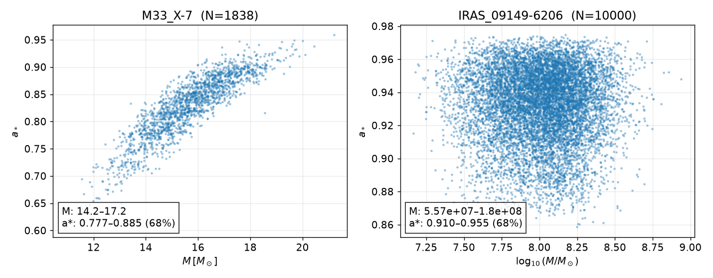
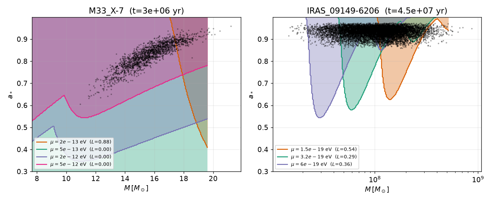
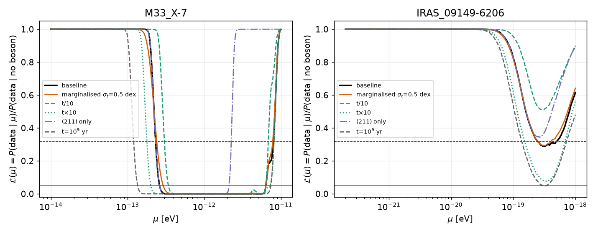
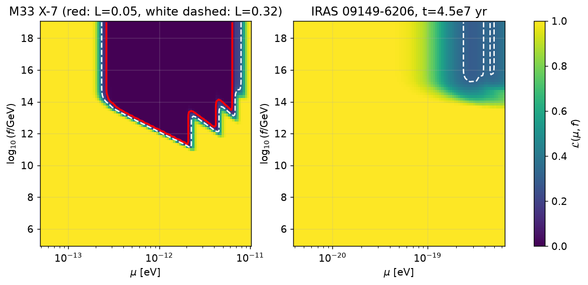
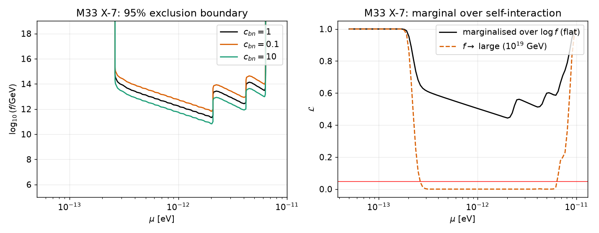
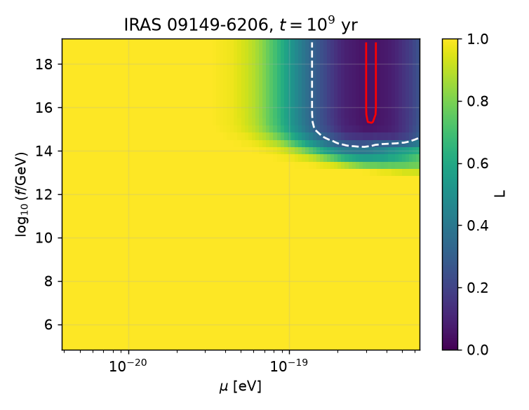
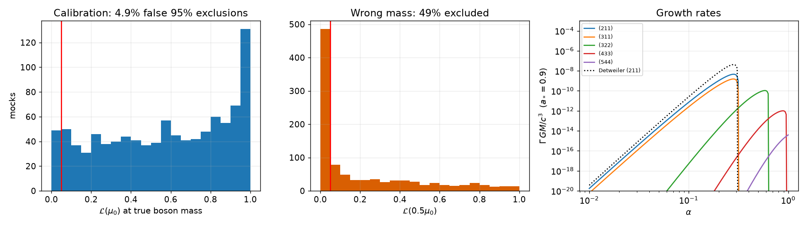

# Bayesian Superradiance Constraints on Ultralight Bosons from Full Black-Hole Mass–Spin Posteriors

## 1. Summary

I built a Bayesian likelihood that turns the physics of black-hole (BH) superradiance into a probability for the observed `(M, a*)` posterior of a BH. The likelihood is evaluated on the full posterior samples rather than on point estimates. It is applied to the stellar-mass BH in M33 X-7 and the supermassive BH in IRAS 09149-6206. The model has two parameters: the boson mass μ and, optionally, the axion decay constant f, which sets the strength of the cosine self-interaction.

Main results. Every limit below is conditional on the assumed system ages and on the approximate rate and cloud-saturation formulas of §2. The exclusion edges shift by factors of 1.2–2 under the variations I tried.

* **M33 X-7:** a scalar boson with 2.6×10⁻¹³ eV ≲ μ ≲ 6.3×10⁻¹² eV is excluded at 95 % (L < 0.05) for negligible self-interaction (f ≳ 10¹⁶ GeV), assuming a BH age of 3 Myr. The exclusion window depends only mildly on the age and on the pool of cloud levels.
* **Self-interaction:** at fixed μ the exclusion holds only above a minimum decay constant f. For M33 X-7 the 95 % excluded region in the (μ, f) plane reaches down to f ≈ 2×10¹¹ GeV, near μ ≈ 2×10⁻¹² eV. It is closed (no exclusion) for f ≲ 10¹¹ GeV. Equivalently, the quartic coupling λ = μ²/f² must exceed ≈ 10⁻⁶⁴ for the boson (at μ ≈ 2×10⁻¹² eV, f ≈ 2×10¹¹ GeV) to evade the bound (λ is dimensionless; μ and f are in the same units).
* **IRAS 09149-6206:** its broad mass posterior (95 % range ≈ 3×10⁷–3×10⁸ M☉) and the shortish accretion age (4.5×10⁷ yr) mean no 95 % exclusion is reached. The maximum exclusion is ≈ 71 % (L_min ≈ 0.29) around μ ≈ 3×10⁻¹⁹ eV. With a BH age of 10⁹ yr it reaches the 95 % threshold marginally (L_min = 0.048), and 68 % exclusion spans (1.4–7.1)×10⁻¹⁹ eV.
* **Calibration:** in 1000 mock systems that carry a real boson (BHs spun down through all active levels, measured with M33 X-7-like errors), the true boson mass is wrongly excluded at 95 % in 4.9 % of cases and at 68 % in 26.8 % of cases. This is consistent with, and slightly conservative relative to, the nominal rates.

## 2. Methods

### 2.1 Physics model

A boson with mass μ around a Kerr BH of mass M forms a gravitational atom with α = GMμ/ħc ≈ 7.48×10⁹ (M/M☉)(μ/eV). Levels |nlm⟩ grow exponentially if ω_nlm < mΩ_H. For the occupation number I use N ∝ e^{2Γt} with the analytic growth rate (Detweiler; Baumann et al. 2019 normalisation):

Γ_nlm = 2 r̃₊ C_nl g_lm (mΩ_H − ω) α^{4l+5}.

Here C_nl is the standard prefactor, g_lm = ∏_k [k²(1−a*²) + (a*m − 2r̃₊ω GM)²], and ω ≈ μ(1 − α²/2n²). For (211) this reproduces Γ = α⁸μ(a* − 2r̃₊α)g/48. This is a factor 2 smaller than Detweiler's original 1/24 prefactor, as shown in Fig. 7 (right). I include the levels (211), (311), (322), (433), (544). The cloud saturates when ω = mΩ_H, which corresponds to a spin

a_crit = 4x/(1+4x²), x = ω GM/m.

The cloud has to remove ΔN = ΔJ/(mħ) = (GM²/ħc)(a* − a_crit)/m quanta. This is ~10⁷⁷ for stellar masses. Starting from N₀ ≈ 1 (a quantum fluctuation), it takes about ln ΔN ≈ 180–215 e-folds.

**Self-interaction.** For V = μ²f²[1 − cos(φ/f)], the cloud shape is modified, and bosenova collapses recur, once the cloud contains

N_bn = 16π c_bn n⁴ f² / (α μ²)

(Arvanitaki & Dubovsky 2011, Eq. 48, written for the level with principal number n; c_bn = 1 by default). I model the saturated regime as follows. The cloud is capped at N_cap = min(ΔN, N_bn). Superradiance keeps feeding the cloud, and the excess is dissipated in bosenovas, so the extraction rate is 2ΓN_cap. The time needed for a level to spin the BH down from a* to a_crit is therefore

t_req = [ln(N_cap/N₀) + ΔN/N_cap] / (2Γ).

For f → ∞ this reduces to the standard ≈ (ln ΔN + 1)/2Γ. For small f the second term dominates and the spin-down slows. This is a simplified, phenomenological treatment. It does not reproduce the full cloud dynamics (level mixing, relativistic corrections), and I vary c_bn by ×0.1 and ×10 to check how sensitive the results are to it.

### 2.2 Statistical framework

Let {(M_i, a_i)}ᵢ₌₁ᴺ be draws from the measurement posterior p(M, a | d). I assume that the measurement priors are flat, so that the posterior is proportional to the likelihood of the measurement. For model parameters θ = (μ, f) and a BH age t:

* Define the indicator E(M, a; θ, t) = 1 if any level has t_req < t and a > a_crit (the BH could not have kept such a spin), and 0 otherwise.
* The likelihood is the posterior probability mass that remains allowed:

  **L(θ) = P(d | θ)/P(d | no boson) = ∫ dM da p(M, a | d) [1 − E(M, a; θ, t)] ≈ (1/N) Σᵢ [1 − E(Mᵢ, aᵢ; θ, t)].**

  This is the Bayes factor against the no-boson hypothesis, because the null hypothesis allows all of the posterior mass. It holds for any birth-spin prior as long as the birth spin was ≥ the observed one. (A BH born with spin below the observed value would have to have been spun up, which is a different issue.) Taking the posterior samples directly keeps the correlations in (M, a) and the non-Gaussian tails. The mass–spin correlation of M33 X-7 is ρ = 0.88.
* A parameter point is **excluded at 95 %** when L < 0.05 (fewer than 5 % of the posterior is compatible), and at 68 % when L < 0.32.
* **Nuisance marginalisation:** the BH age and the O(1) uncertainty in Γ are degenerate. I fold them into a single log-normal nuisance with σ = 0.5 dex, integrated with 7-point Gauss–Hermite quadrature.
* **Priors on μ, f:** I do not claim a posterior from a log-uniform prior, because the likelihood saturates to 1 outside the exclusion region, so the prior would dominate. The results are shown as L(μ, f) maps and excluded regions. A marginal L(μ) over a flat prior in log f ∈ [10⁵, 10¹⁹] GeV is also computed (Fig. 5, right).

### 2.3 Data and assumptions

| System | Posterior samples | M [M☉] (16–84 %) | a* (16–84 %) | Age t adopted |
|---|---|---|---|---|
| M33 X-7 (Liu+08; digitised) | 1838 | 14.2–17.2 | 0.78–0.89 | 3 Myr (the remaining life of the ≈ 70 M☉ companion) |
| IRAS 09149-6206 (GRAVITY 20; Walton+20) | 10000 | 5.6×10⁷–1.8×10⁸ | 0.91–0.95 | 4.5×10⁷ yr (Salpeter time) |

The ages are plausible but uncertain, so I vary them (Figs. 3 and 6). Accretion spin-up is not modelled, which makes the constraints conservative only if no spin-up occurred. The M33 X-7 samples were extracted from a figure, not from a published chain, so they carry digitisation uncertainty. The grid cut α < 1 (all levels) removes the region where the analytic rates are unreliable.

*Figure 1. Posterior samples of the two BHs.*

## 3. Results

*Figure 2. Excluded (M, a*) regions (shaded) for sample boson masses, and the posterior samples. The likelihood L is the fraction of samples that fall outside the shaded region.*

### 3.1 No self-interaction

*Figure 3. L(μ) for both systems and under variations (BH age ×0.1, ×10, a nuisance on the age, only the (211) level, age 10⁹ yr). Red lines show L = 0.05 and 0.32.*

95 % exclusion intervals in μ [eV]:

| Variation | M33 X-7 | IRAS 09149-6206 |
|---|---|---|
| Baseline | 2.6×10⁻¹³ – 6.3×10⁻¹² | none (L_min = 0.29) |
| Marginalised age nuisance (0.5 dex) | 2.9×10⁻¹³ – 6.3×10⁻¹² | none (0.29) |
| t / 10 | 3.4×10⁻¹³ – 6.3×10⁻¹² | none (0.51) |
| t × 10 | 2.0×10⁻¹³ – 7.2×10⁻¹² | none (0.075) |
| (211) only | 2.6×10⁻¹³ – 2.1×10⁻¹² | none (0.34) |
| α_max = 0.5 | 2.6×10⁻¹³ – 3.7×10⁻¹² | none (0.34) |
| t = 10⁹ yr | 1.4×10⁻¹³ – 7.3×10⁻¹² | 3.1×10⁻¹⁹ – 3.3×10⁻¹⁹ (L_min = 0.048) |

For M33 X-7 the upper limit depends on the higher levels (322), (433), so the window is only as reliable as the extrapolation of the analytic rates to α ≈ 0.7. The lower edge is set by the growth time of (211) and depends on the age only weakly (a factor ≈ 1.3 for a factor 10 in t), since Γ ∝ μ⁹. For IRAS the 68 % intervals are 2.5–4.9×10⁻¹⁹ eV (baseline) and 1.4–7.1×10⁻¹⁹ eV (10⁹ yr). The IRAS limit is limited by the mass uncertainty: μ excludes a given M-range only, so a broad M posterior dilutes the exclusion (Fig. 2, right).

### 3.2 Self-interacting bosons

*Figure 4. L(μ, f) maps for M33 X-7 and IRAS 09149-6206.*

For M33 X-7 and the baseline c_bn = 1, the lowest f for which any μ is excluded at 95 % is log₁₀(f/GeV) = 11.3 (10.8 for c_bn = 10; 11.8 for c_bn = 0.1). Example exclusion intervals in μ [eV]:

| f [GeV] | Excluded μ [eV] (95 %, c_bn = 1) |
|---|---|
| ≥ 10¹⁶ | 2.6×10⁻¹³ – 6.2×10⁻¹² |
| 10¹⁴ | 2.9×10⁻¹³ – 4.0×10⁻¹², 5.0×10⁻¹² – 6.2×10⁻¹² |
| 10¹³ | 5.6×10⁻¹³ – 2.0×10⁻¹², 2.9×10⁻¹² – 4.0×10⁻¹² |
| 10¹² | 1.2×10⁻¹² – 2.0×10⁻¹² |
| ≤ 10¹¹ | none |

The jagged edge is physical: each (n, l, m) level has its own N_bn and its own growth window, and different levels take over in different μ ranges.

*Figure 5. Left: the 95 % boundary for different bosenova thresholds c_bn. Right: L(μ) with f marginalised over a flat prior in log f (10⁵–10¹⁹ GeV), compared with the f → ∞ case.*

Marginalised over a log-uniform prior on f from 10⁵ to 10¹⁹ GeV, the likelihood stays above 0.05 everywhere (minimum 0.44), because roughly 45 % of this prior range (10⁵–10¹¹·³ GeV) lies below the f cut-off, and the diagonal edge of the excluded region removes further prior volume. This is a reminder that the quantitative statement on f depends on the prior range, whereas the 2D map is prior-independent.

For IRAS with 4.5×10⁷ yr there is no 95 % region, and the 68 % region needs f ≳ 2×10¹⁵ GeV. With t = 10⁹ yr, the 95 % boundary appears only for f ≳ 2×10¹⁵ GeV at μ ≈ 3×10⁻¹⁹ eV (Fig. 6).

*Figure 6. IRAS 09149-6206 with an age of 10⁹ yr.*

### 3.3 Validation

*Figure 7. Left: distribution of L at the true boson mass in 1000 mocks. Centre: L at half the true mass. Right: growth rates compared with Detweiler's approximation.*

The mocks use M ∈ [10, 20] M☉ and α₀ ∈ [0.05, 0.45]. The BH starts at a* = 0.99 and is spun down sequentially through all active levels, which is the worst case for the check because the final spin lies exactly on the boundary. The measurement posterior is Gaussian with σ_M = 1.5 M☉ and σ_a = 0.05, centred on a noisy observation. L at the true μ₀ is nearly uniform on [0, 0.95], with a pile-up near 1; it has 4.9 % of mocks below 0.05 and 26.8 % below 0.32. This is the expected frequentist coverage. L at 0.5 μ₀ is below 0.05 in 49 % of mocks, so the method has power to reject a wrong mass. A first version of this test that spun down only through (211) gave a 77 % false-exclusion rate, because the higher levels then acted on a BH that was still too fast. This shows that the multi-level treatment is required.

## 4. Discussion

The framework gives a likelihood that responds smoothly to the measurement uncertainty. A point-estimate analysis would have a binary answer; here a BH with a broad posterior, such as IRAS, gives a graded and honest partial exclusion, with L_min ≈ 0.29, instead of an overclaimed exclusion.

Limitations:

1. **Age.** The age of the BH is the single largest systematic. For M33 X-7 the window changes by a factor 1.3 in the lower edge (Fig. 3). For IRAS, a factor 10 in t decides between 71 % and 95 % exclusion.
2. **Analytic rates.** The Γ_nlm formula is a small-α expansion. I cut at α < 1; the upper edge of the M33 X-7 window (α up to ≈ 0.7) depends on (322) and (433), and a restriction to α < 0.5 lowers it from 6.3×10⁻¹² to 3.7×10⁻¹² eV.
3. **Self-interaction model.** The saturation prescription is a simplified capped-extraction model. The relation between f and the excluded region should be treated as indicative, and the result depends on c_bn only at the level of 0.5 dex in f.
4. **Observation systematics.** The M33 X-7 samples are digitised from a figure and the spin measurement relies on continuum fitting. The IRAS spin is from X-ray reflection fitting. Systematic errors in the spin measurement are not included in the posteriors.
5. **Spin history.** I assume the BH was at least as fast at birth as observed and ignore accretion spin-up and GW-driven or merger spin changes. Mass change from accretion would shift α.
6. **Scalars only.** Vector and tensor bosons have much higher rates and are not covered.
7. **Priors.** The posterior samples are treated as likelihoods, which assumes the original analyses used flat priors in (M, a*).

## 5. Reproducibility

All code is in `code/`; the run order is `run_main.py`, `run_2d.py`, `run_mock.py`, `make_figs.py`. The physics and likelihood live in `code/sr.py`. Numerical outputs are in `outputs/`. Run with Python ≥ 3.10, numpy, scipy and matplotlib.
