# Reconciling Four Observational Methods into an Annual Record of Global Glacier Mass Change, 2000–2023

*An independent, fully reproducible reconciliation of the GlaMBIE input data set, with cross-validated uncertainty calibration and benchmarking against the official GlaMBIE solution*

---

## Abstract

Glaciers outside the two ice sheets are observed with four largely independent families of methods: in situ glaciological measurements, differencing of digital elevation models (DEMs), satellite altimetry and satellite gravimetry. Each has its own spatial and temporal sampling, unit and error characteristics. Here I re-implement, from the raw submissions to the Glacier Mass Balance Intercomparison Exercise (GlaMBIE; 257 regional solution files from 19 first-order glacier regions), a complete reconciliation chain. It homogenises units (density 850 ± 60 kg m⁻³, time-varying glacier area) and temporal resolution (regional hydrological years). Within each data group it separates annual variability from long-term level. It then combines the groups into a consensus, propagating random and temporally correlated (systematic) uncertainties separately, and converts to calendar years. Several design decisions are tested against the data rather than assumed:

- **Gravimetry selection:** an objective signal-to-noise rule for when gravimetry is usable.
- **Variability uncertainty:** the uncertainty added by applying sparse glaciological variability to regional geodetic trends is calibrated by leave-one-period-out cross-validation.
- **Robustness checks:** leave-one-group-out tests, held-out hybrid estimates and 12 sensitivity experiments.

Between 2000 and 2023, glaciers lost **6225 ± 557 Gt** (1σ), equivalent to **17.2 ± 1.5 mm** of global mean sea-level rise. That is a mean rate of **−259 ± 23 Gt yr⁻¹** (−0.38 ± 0.03 m w.e. yr⁻¹). Mass loss increased from −231 ± 28 Gt yr⁻¹ in 2000–2011 to −287 ± 26 Gt yr⁻¹ in 2012–2023 (+24 %; linear trend −8.0 ± 2.6 Gt yr⁻²), and reached records of −435 ± 84 Gt in 2022 and −496 ± 91 Gt in 2023. Alaska alone contributes 23 % of the loss. The polar regions together (Arctic Canada North and South, the Greenland periphery, Svalbard, the Russian Arctic and the Antarctic periphery) contribute 51 %. Against the official GlaMBIE solution, the independent reconstruction reproduces 456 regional annual values with r = 0.967 and the global annual series with r = 0.986 (RMSD 23 Gt). The long-term global rate is 13 Gt yr⁻¹ (5 %) less negative, well within uncertainty. Most of this offset traces to one identifiable methodological choice: whether calibrated glaciological series help define the long-term level. With that choice switched on, the reconstruction gives −276 Gt yr⁻¹, against the official −273 Gt yr⁻¹.

---

## 1. Introduction

Glacier mass loss currently contributes about one fifth of observed sea-level rise and alters seasonal water availability in many mountain catchments [Zemp et al., 2019; Hugonnet et al., 2021]. Projections of future glacier change from global glacier models (GlacierMIP; Hock et al., 2019; Marzeion et al., 2020; Rounce et al., 2023) depend critically on observational benchmarks for calibration and evaluation. Rounce et al. (2023), for example, calibrate their model to the geodetic mass balances of Hugonnet et al. (2021). However, published global estimates for the early 21st century have differed by more than their stated uncertainties. For instance, −332 ± 144 Gt yr⁻¹ for 2006–2016 [Zemp et al., 2019] versus −267 ± 16 Gt yr⁻¹ for 2000–2019 [Hugonnet et al., 2021]. The reason is that each observing method has blind spots:

| Method | Strength | Weakness |
|---|---|---|
| Glaciological (in situ) | Annual/seasonal resolution, long records | ~500 glaciers worldwide; spatially unrepresentative |
| DEM differencing | Near-complete spatial coverage, robust long-term change | Multi-annual resolution only; density conversion |
| Altimetry (ICESat, CryoSat-2, ICESat-2) | Sub-annual resolution | Sparse sampling, radar penetration, density conversion |
| Gravimetry (GRACE/GRACE-FO) | Direct mass, monthly | ~300 km resolution, leakage from hydrology/ice sheets, GIA |

GlaMBIE collected 233 regional estimates (here 257 files, because some contributors submitted several variants) from 35 teams, to reconcile these methods. The objective of the present study is to **independently reproduce such a reconciliation from the raw inputs**, making every modelling choice explicit and testing it against the data. The aim is to deliver annual 2000–2023 regional and global time series in m w.e. and Gt with uncertainties that can serve as a benchmark for IPCC assessments and model calibration. The official GlaMBIE results shipped with the data set are used **only for validation**. The one exception is the regional time-varying glacier area, which is treated as auxiliary input.

**Research questions**

1. Can the four observational methods be reconciled into a single annual time series per region whose uncertainties are consistent with the residual disagreement between methods?
2. How large is global glacier mass loss in 2000–2023, has it accelerated, and how do the regions contribute?
3. Which methodological choices control the reconciled number, and how robust is it?

---

## 2. Data

### 2.1 Input solutions

The GlaMBIE input archive (DOI 10.5904/wgms-glambie-2024-07) contains one CSV file per regional solution, with start/end dates (decimal years), change, error and unit (m elevation change, m w.e., or Gt). Figure 1 summarises the inventory.

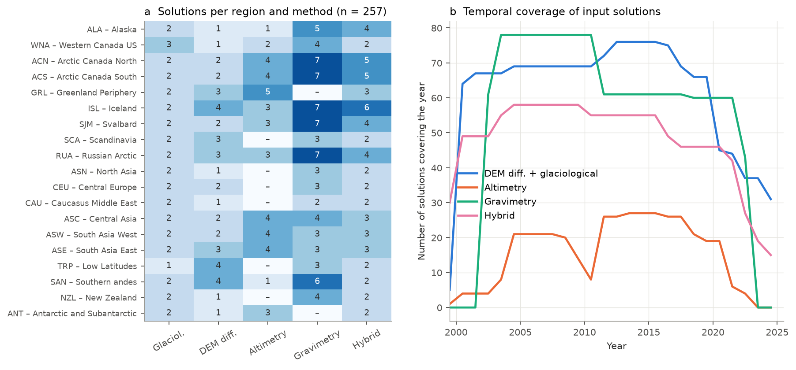

*Figure 1. (a) Number of solution files per region and observing method. (b) Number of solutions whose time span covers each year. Gravimetry (GRACE) starts in 2002; most altimetry solutions are multi-annual, except the monthly CryoSat-2 solution of Jakob et al. (2010/11–2020) and the ICESat/CryoSat-2 series of Nilsson et al. for Greenland. DEM differencing (Hugonnet et al. pentads 2000–2020 plus regional studies) and glaciological series (WGMS anomaly series and a sine-wave-distributed monthly product) cover 2000–2024.*

| Method | Files | Native unit | Typical resolution |
|---|---|---|---|
| Glaciological | 38 | m w.e. | annual (WGMS) / monthly sine-wave (UZH) |
| DEM differencing | 42 | m (elevation) | 5-yr pentads (Hugonnet) or one multi-year period |
| Altimetry | 41 | m (elevation) | monthly (2 solutions) or multi-year periods |
| Gravimetry | 78 | Gt | monthly (gap 2017–2018 interpolated by most providers) |
| Hybrid ("combined") | 58 | m w.e., Gt, m | annual |

Gravimetry is absent for the Greenland periphery and the Antarctic periphery, where the ice-sheet signal cannot be separated. Altimetry is absent for the small mid-latitude regions. Hybrid solutions (Dussaillant, Huss, Box, Pálsson, Miles, Colgan) combine several methods and are therefore **withheld from the reconciliation** and used as an independent check (Section 4.4).

### 2.2 Auxiliary data

- **Glacier area.** The regional, linearly time-varying glacier area (RGI 6.0 scaled with regional area-change rates) was taken from the GlaMBIE result files and used for the Gt ↔ m w.e. conversion. The global area decreases from 704,083 km² (2000) to 651,707 km² (2023).
- **Reference values.** The following serve as external benchmarks:
  - published global rates from Hugonnet et al. (2021) and Zemp et al. (2019), extracted from the PDFs in `related_work/`;
  - the official GlaMBIE regional and global series (calendar and hydrological years).

---

## 3. Methods

All code is in `code/`; `glambie_lib.py` contains the reconciliation and `run_reconciliation.py` runs it for all regions. Figure 2 illustrates the intermediate products for four regions.

### 3.1 Unit homogenisation

All changes were converted to specific mass change (m w.e.) over the time-varying regional area *A(t)*:

- elevation change Δh (m): ΔM = ρ Δh with ρ = 0.85 (850 kg m⁻³), and σ² = (ρ σ_Δh)² + (0.06 Δh)²;
- mass (Gt): ΔM = 1000 · Gt / A(t_mid) (A in km²);
- m w.e.: unchanged.

### 3.2 Temporal homogenisation

Each region was assigned a hydrological year: 1 October (Northern Hemisphere, regions 1–15), 1 January (low latitudes) or 1 April (Southern Hemisphere, regions 17–19).

- **Sub-annual (monthly) solutions** were summed over complete hydrological years; incomplete edge years were discarded. The monthly gravimetric and altimetric changes are differences of noisy epoch anomalies (their month-to-month standard deviation equals the stated errors). The annual error was therefore taken as the RMS of the monthly errors, not their quadrature sum (sensitivity test in Section 4.6).
- **GRACE/GRACE-FO gap (mid-2017 to mid-2018).** Annual values overlapping the gap are interpolated by the providers and do not resolve inter-annual variability, so they were merged into a single multi-annual "period record". Where the provider left the gap empty (Harig et al.), the affected years were discarded.
- **Annual solutions** aligned with the hydrological year were used as they are. **Multi-annual solutions** were kept as period records (t₀, t₁, ΔM, σ).

### 3.3 Data groups

Following GlaMBIE, the methods were organised into three independent data groups:

- **DG:** DEM differencing + glaciological. The glaciological series supply annual variability only; the long-term level comes from DEM differencing. The WGMS series is an anomaly series with a mean near zero (+0.0 to +0.5 m w.e. yr⁻¹ over 2000–2019). The sine-wave glaciological product departs from DEM differencing by up to 0.4 m w.e. yr⁻¹ in High Mountain Asia and the Russian Arctic, so neither is a reliable level estimate.
- **ALT:** altimetry.
- **GRAV:** gravimetry.

Within a group, solutions submitted by the same team share one unit of weight, so that teams with several variants are not over-weighted.

**Objective gravimetry rule.** Gravimetry was used only where:

1. the glacier area is at least 5000 km², the scale below which GRACE cannot isolate the glacier signal; and
2. the independent gravimetric solutions agree on the regional rate, with SNR = |mean rate| / inter-solution standard deviation ≥ 2 over the common period 2003–2017.4.

The rule retains gravimetry in seven regions: ALA (SNR 8.3), ACN (9.6), ACS (2.8), ISL (3.9), SJM (3.1), RUA (2.4) and SAN (2.3). It rejects:

- **WNA** (SNR 0.15): the solutions range from +5.6 to −8.3 Gt yr⁻¹, against −9 Gt yr⁻¹ from DEM differencing;
- **High Mountain Asia** (0.5–1.0);
- **small regions**: in SCA, ASN and CAU the gravimetric solutions even show mass gain.

This a-priori rule selects exactly the regions in which the official GlaMBIE solution uses gravimetry.

### 3.4 Within-group combination: variability and level

For each group *g*:

1. **Reference variability a_g(y).** An additive two-way fixed-effects model, B_i(y) = a_g(y) + c_i, is fitted to all annually resolved solutions of the group, weighted by team. For years without own annual data (e.g. altimetry in High Mountain Asia before 2011), a_g is borrowed from the regional reference variability (fixed-effects mean of all groups), shifted to match the group's own level over overlapping years.
2. **Dataset-wise annual series inside their own coverage.**
   - Annual solutions are used as they are.
   - Each multi-annual period record p is downscaled as B(y) = a_g(y) + r_p, with r_p = (ΔM_p − Σ_y w_py a_g(y)) / Σ_y w_py. Here w_py is the fractional overlap of the period with hydrological year y. By construction this reproduces every observed period total exactly, i.e. mass is conserved relative to the geodetic data.
3. **Group estimate.** G_g(y) is the weighted mean of all solutions covering year y. No solution is extrapolated within its group, with one exception: DG after the end of the DEM record (2020–2023). There the glaciological variability is combined with the duration-weighted mean DEM offset. The extension rule was chosen by cross-validation (Section 3.6): the mean offset predicts held-out pentads at the series edge better (RMSE 0.278 m w.e. yr⁻¹) than the nearest-period offset (0.306) or a linear drift (0.319).

An earlier version gave each solution a constant offset relative to a_g. This let the trend of borrowed variability leak into the long-term level: for example, it produced a less negative Antarctic altimetry mean than any individual altimetry solution. It was replaced by the coverage-restricted scheme above. The earlier code is kept in `outputs/glambie_lib_v1_fixed_effects.py.bak` for transparency.

### 3.5 Between-group combination

The group series were combined with a second fixed-effects model, G_g(y) = C(y) + o_g, with equal group weights and Σ o_g = 0. In years covered by all groups, C(y) is the simple mean of the groups. In years where a group is missing (e.g. altimetry in WNA before 2013, gravimetry before 2002/03), that group enters through its mean offset o_g. This avoids artificial steps when groups start or stop.

### 3.6 Uncertainty model

Two components were propagated separately.

- **Random component (independent between years).**
  - Annual errors of annually resolved solutions, divided by the effective number of solutions.
  - For DG, the variability error plus a **representativeness error τ** for applying sparse glaciological variability to a whole region.
  - For years in which a group is extended, the standard deviation of that group's residuals about the consensus.
- **Systematic component (correlated in time).**
  - Rate errors of multi-annual geodetic periods (σ_p / T_p).
  - Level errors of annually resolved solutions (RMS error / √n, plus density error for altimetry).
  - The structural dispersion between solutions within a group (weighted standard deviation of their offsets / √n_eff).
  - The structural dispersion between groups (std(o_g) / √M).

**Calibration of τ.** Each of the four Hugonnet pentads in each region (76 cases) was held out and predicted from the glaciological variability plus the offsets fitted to the remaining pentads. Without τ, the normalised prediction errors have RMS 1.54, so the a-priori errors are too small. Requiring RMS = 1 gives τ = 0.43 m w.e.; the median-based estimate is 0.45 m w.e. τ = 0.45 m w.e. was adopted.

**Aggregation.**

- Annual totals: σ² = σ_rand² + σ_sys².
- Multi-year sums for a region: random parts add in quadrature, systematic parts add linearly.
- Regions are assumed independent and are summed in quadrature for the global total.

All uncertainties are 1σ unless stated otherwise.

### 3.7 Conversion to calendar years

Each hydrological-year value was disaggregated into months using the seasonal cycle of the sine-wave glaciological product for the same year. The residual relative to that product was spread uniformly over the 12 months, and the months were then re-aggregated into calendar years. The low latitudes need no conversion. Applied to the official GlaMBIE hydrological-year series, this procedure reproduces the official calendar-year series **exactly** (difference < 10⁻⁶ m w.e. in all 19 regions), which verifies this step independently. A conversion error equal to 25 % of the hydrological-to-calendar shift was added to the random component. Global values are regional sums in Gt; global m w.e. is the global Gt divided by the total area.

### 3.8 Validation and sensitivity design

- (i) Comparison with the official GlaMBIE results at group, regional and global level.
- (ii) Leave-one-group-out (LOGO): each group's estimate is compared with the consensus of the remaining groups.
- (iii) Comparison with the 58 withheld hybrid solutions.
- (iv) Comparison with published global estimates.
- (v) 12 sensitivity experiments that change one choice at a time (`run_sensitivity.py`).

---

## 4. Results

### 4.1 Reconciliation at regional level

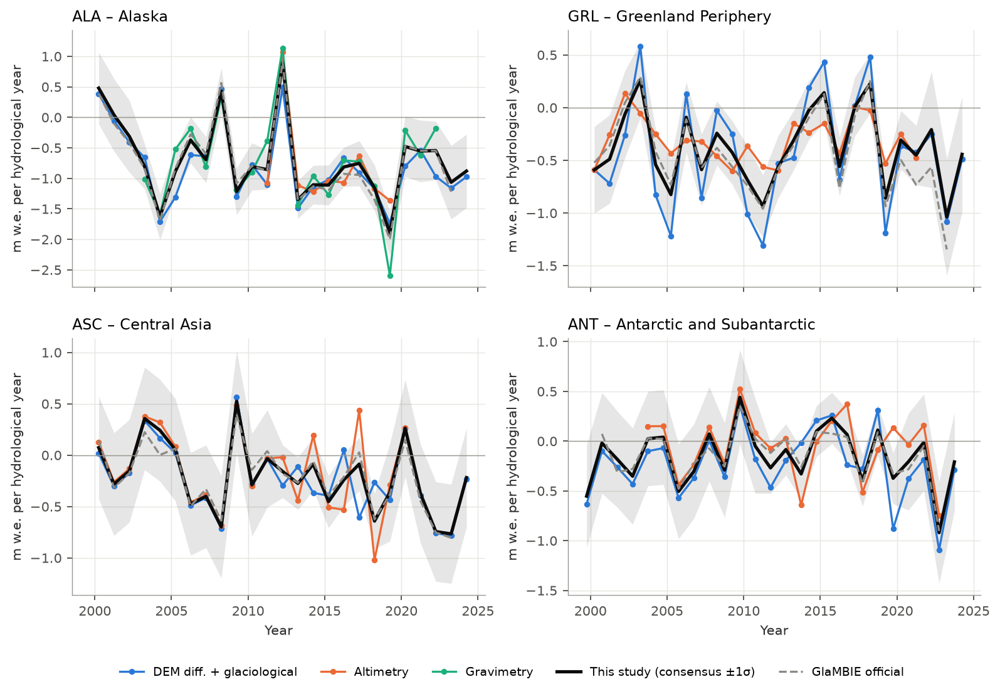

*Figure 2. Hydrological-year specific mass change for four regions: data-group estimates (coloured), the consensus with ±1σ (black and grey band) and the official GlaMBIE consensus (dashed). In Alaska, the three groups agree in timing and amplitude of anomalies, e.g. the 2011/12 positive year and the 2018/19 extreme. In the Greenland periphery, the glaciological variability has a much larger amplitude than the altimetric variability (see Section 4.5). In the Antarctic periphery, DEM differencing is systematically more negative than altimetry (≈0.16 m w.e. yr⁻¹).*

The group estimates track the corresponding official GlaMBIE group series closely, with correlations of 0.85–1.00. Mean rates agree within 0.01–0.04 m w.e. yr⁻¹ for most altimetry and gravimetry groups, which shows that the homogenisation chain is sound.

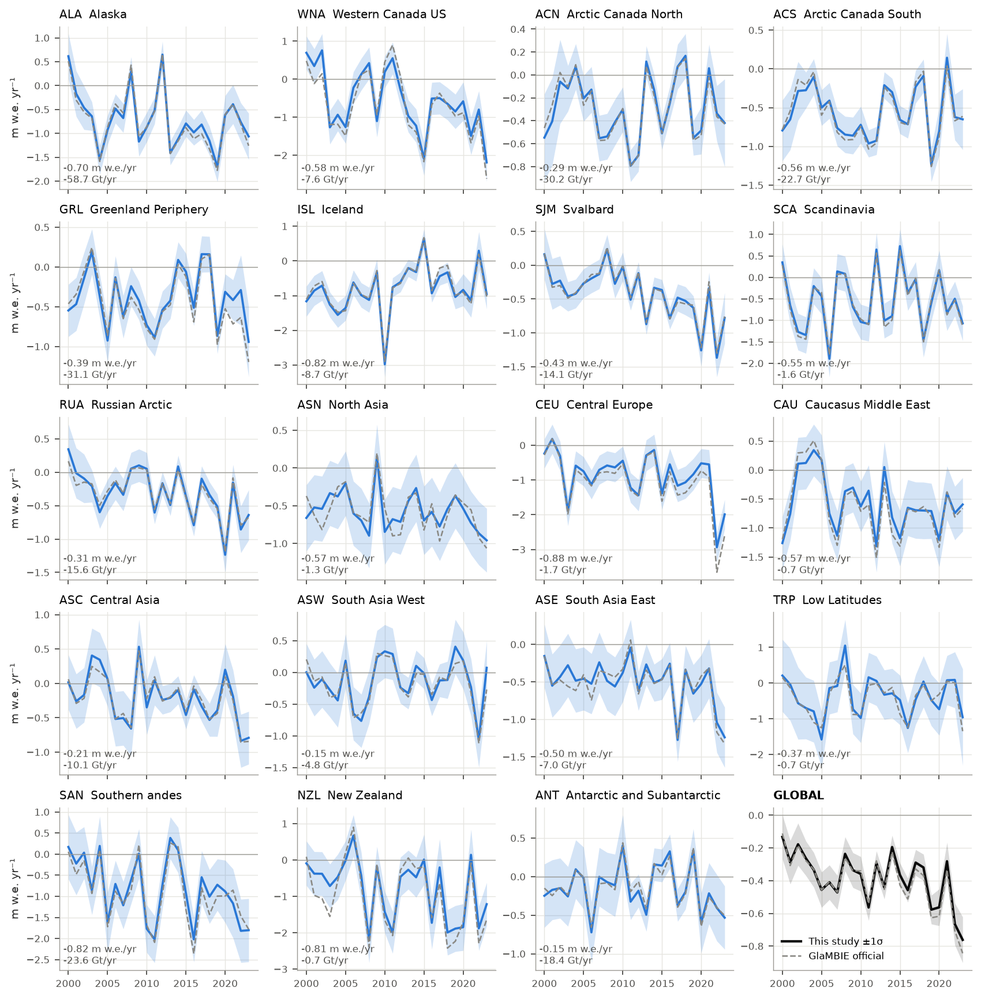

*Figure 3. Calendar-year specific mass change (m w.e. yr⁻¹, ±1σ) for all 19 regions and the globe (this study: blue/black; official GlaMBIE: dashed grey). Panel annotations give the 2000–2023 mean.*

**Table 1. Regional results, calendar years 2000–2023 (±1σ).** Rates in Gt yr⁻¹ unless noted.

| Region | Area 2000 (km²) | Groups | Rate 2000–23 | m w.e. yr⁻¹ | 2000–11 | 2012–23 | Cumulative (Gt) | Share (%) |
|---|---|---|---|---|---|---|---|---|
| ALA | 89,847 | DG, ALT, GRAV | −58.7 ± 10.6 | −0.70 ± 0.12 | −47.6 | −69.7 | −1408 ± 254 | 22.6 |
| WNA | 14,563 | DG, ALT | −7.6 ± 2.5 | −0.58 ± 0.18 | −2.0 | −13.3 | −183 ± 59 | 2.9 |
| ACN | 105,001 | DG, ALT, GRAV | −30.2 ± 5.6 | −0.29 ± 0.05 | −34.7 | −25.6 | −724 ± 134 | 11.6 |
| ACS | 40,872 | DG, ALT, GRAV | −22.7 ± 3.5 | −0.56 ± 0.09 | −24.3 | −21.1 | −545 ± 83 | 8.8 |
| GRL | 89,349 | DG, ALT | −31.1 ± 6.6 | −0.39 ± 0.08 | −37.3 | −24.9 | −747 ± 159 | 12.0 |
| ISL | 11,000 | DG, ALT, GRAV | −8.7 ± 1.3 | −0.82 ± 0.13 | −12.3 | −5.0 | −208 ± 32 | 3.3 |
| SJM | 34,445 | DG, ALT, GRAV | −14.1 ± 2.2 | −0.43 ± 0.07 | −6.7 | −21.5 | −339 ± 53 | 5.4 |
| SCA | 2,961 | DG | −1.6 ± 0.4 | −0.55 ± 0.15 | −2.0 | −1.2 | −38 ± 10 | 0.6 |
| RUA | 51,613 | DG, ALT, GRAV | −15.6 ± 3.6 | −0.31 ± 0.07 | −7.8 | −23.5 | −375 ± 87 | 6.0 |
| ASN | 2,488 | DG | −1.3 ± 0.5 | −0.57 ± 0.19 | −1.3 | −1.4 | −32 ± 11 | 0.5 |
| CEU | 2,141 | DG | −1.7 ± 0.4 | −0.88 ± 0.23 | −1.4 | −1.9 | −40 ± 11 | 0.6 |
| CAU | 1,283 | DG | −0.7 ± 0.3 | −0.57 ± 0.24 | −0.5 | −0.9 | −16 ± 7 | 0.3 |
| ASC | 49,702 | DG, ALT | −10.1 ± 4.6 | −0.21 ± 0.09 | −4.3 | −15.9 | −242 ± 110 | 3.9 |
| ASW | 33,508 | DG, ALT | −4.8 ± 3.7 | −0.15 ± 0.11 | −5.0 | −4.7 | −116 ± 88 | 1.9 |
| ASE | 14,907 | DG, ALT | −7.0 ± 1.5 | −0.50 ± 0.10 | −5.6 | −8.5 | −169 ± 35 | 2.7 |
| TRP | 2,355 | DG | −0.7 ± 0.4 | −0.37 ± 0.18 | −0.8 | −0.7 | −18 ± 9 | 0.3 |
| SAN | 29,403 | DG, ALT, GRAV | −23.6 ± 6.9 | −0.82 ± 0.24 | −20.8 | −26.4 | −566 ± 166 | 9.1 |
| NZL | 982 | DG | −0.7 ± 0.3 | −0.81 ± 0.35 | −0.6 | −0.8 | −17 ± 7 | 0.3 |
| ANT | 127,665 | DG, ALT | −18.4 ± 15.1 | −0.15 ± 0.12 | −16.5 | −20.3 | −442 ± 363 | 7.1 |
| **Global** | **704,083** | | **−259 ± 23** | **−0.38 ± 0.03** | **−231 ± 28** | **−287 ± 26** | **−6225 ± 557** | 100 |

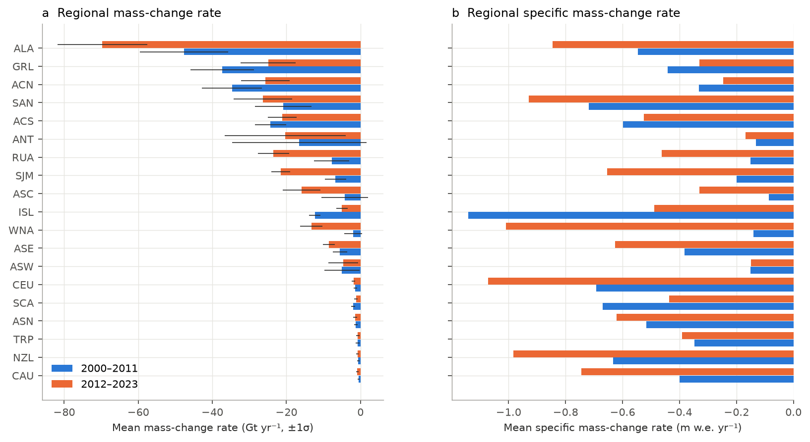

*Figure 4. Mean regional rates for 2000–2011 and 2012–2023: (a) mass change in Gt yr⁻¹ (±1σ); (b) specific mass change in m w.e. yr⁻¹.*

**Patterns by type of region.**

- **Mid-latitude maritime and continental mountains.** The most negative specific rates are in CEU, ISL, SAN, NZL and ALA, at −0.70 to −0.88 m w.e. yr⁻¹. The least negative are in the Karakoram/Pamir-dominated regions ASW and ASC (−0.15 and −0.21) and in the Antarctic periphery (−0.15).
- **Clear acceleration.** Loss accelerated strongly in Alaska (−48 → −70 Gt yr⁻¹), WNA (−2 → −13 Gt yr⁻¹, −0.14 → −1.01 m w.e. yr⁻¹), Svalbard (−7 → −21), the Russian Arctic (−8 → −24) and Central Asia (−4 → −16). Central Europe lost −1.07 m w.e. yr⁻¹ in 2012–2023, with an unprecedented −2.94 m w.e. in 2022.
- **Deceleration.** Iceland, the Greenland periphery and Arctic Canada North lost less mass in 2012–2023 than in 2000–2011. This matches the cooler North Atlantic conditions of the 2010s described in previous work.

### 4.2 Global mass change

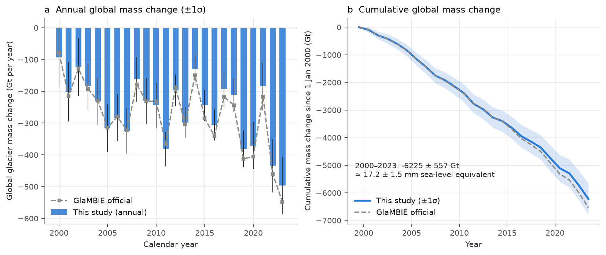

*Figure 5. (a) Annual global glacier mass change (calendar years, ±1σ) compared with the official GlaMBIE series. (b) Cumulative change since 1 January 2000 (±1σ).*

**Table 2. Global mass change for selected periods (±1σ).**

| Period | Rate (Gt yr⁻¹) | m w.e. yr⁻¹ | Cumulative (Gt) | Sea-level equivalent (mm) |
|---|---|---|---|---|
| 2000–2023 | −259 ± 23 | −0.38 ± 0.03 | −6225 ± 557 | 17.2 ± 1.5 |
| 2000–2011 | −231 ± 28 | −0.33 ± 0.04 | −2776 ± 338 | 7.7 ± 0.9 |
| 2012–2023 | −287 ± 26 | −0.43 ± 0.04 | −3448 ± 311 | 9.5 ± 0.9 |
| 2000–2019 | −237 ± 23 | −0.35 ± 0.03 | −4738 ± 462 | 13.1 ± 1.3 |
| 2020–2023 | −372 ± 45 | −0.57 ± 0.07 | −1487 ± 181 | 4.1 ± 0.5 |

**Annual record.**

- The least negative year was 2000 (−93 ± 95 Gt).
- The most negative years were 2023 (−496 ± 91 Gt; −0.76 m w.e.), 2022 (−435 ± 84 Gt), 2011 (−383 ± 54 Gt), 2019 (−381 ± 58 Gt) and 2020 (−371 ± 74 Gt).
- Four of the five most negative years fall in 2019–2023.

**Acceleration.** An ordinary least-squares trend through the annual series gives −8.0 ± 2.6 Gt yr⁻² for 2000–2023 and −5.2 ± 3.0 Gt yr⁻² for 2000–2019. The 2012–2023 mean exceeds the 2000–2011 mean by 56 ± 38 Gt yr⁻¹ (+24 %). That uncertainty is conservative, because it treats the systematic errors of the two periods as independent.

### 4.3 Validation against the official GlaMBIE solution

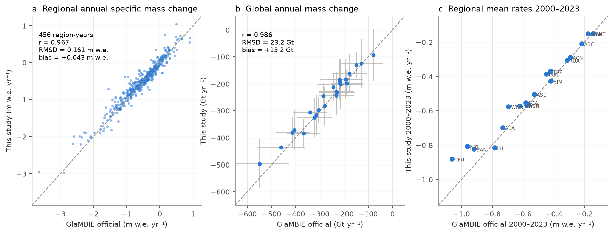

*Figure 6. (a) All 456 regional calendar-year values (m w.e.) of this study against the official GlaMBIE solution. (b) Global annual mass change (±1σ). (c) Regional mean rates 2000–2023.*

**Table 3. Agreement with the official GlaMBIE solution (calendar years 2000–2023).**

| Region | Rate this study | Rate official | m w.e. this study | m w.e. official | r (annual) | RMSD (m w.e.) |
|---|---|---|---|---|---|---|
| ALA | −58.7 | −61.4 | −0.70 | −0.73 | 0.989 | 0.098 |
| WNA | −7.6 | −9.2 | −0.58 | −0.69 | 0.956 | 0.270 |
| ACN | −30.2 | −30.4 | −0.29 | −0.29 | 0.984 | 0.047 |
| ACS | −22.7 | −23.0 | −0.56 | −0.57 | 0.984 | 0.065 |
| GRL | −31.1 | −35.4 | −0.39 | −0.45 | 0.944 | 0.138 |
| ISL | −8.7 | −8.3 | −0.82 | −0.78 | 0.992 | 0.091 |
| SJM | −14.1 | −13.8 | −0.43 | −0.42 | 0.994 | 0.041 |
| SCA | −1.6 | −1.7 | −0.55 | −0.58 | 0.995 | 0.072 |
| RUA | −15.6 | −16.0 | −0.31 | −0.32 | 0.983 | 0.071 |
| ASN | −1.3 | −1.4 | −0.57 | −0.58 | 0.829 | 0.154 |
| CEU | −1.7 | −2.0 | −0.88 | −1.06 | 0.986 | 0.251 |
| CAU | −0.7 | −0.7 | −0.57 | −0.62 | 0.972 | 0.144 |
| ASC | −10.1 | −10.5 | −0.21 | −0.22 | 0.981 | 0.071 |
| ASW | −4.8 | −5.6 | −0.15 | −0.18 | 0.945 | 0.120 |
| ASE | −7.0 | −7.4 | −0.50 | −0.53 | 0.945 | 0.100 |
| TRP | −0.7 | −0.9 | −0.37 | −0.42 | 0.923 | 0.225 |
| SAN | −23.6 | −26.3 | −0.82 | −0.92 | 0.964 | 0.219 |
| NZL | −0.7 | −0.8 | −0.81 | −0.96 | 0.938 | 0.351 |
| ANT | −18.4 | −17.8 | −0.15 | −0.15 | 0.976 | 0.063 |
| **Global** | **−259.4** | **−272.6** | **−0.38** | **−0.41** | **0.986** | **0.036** |

**Agreement statistics.**

- Over all 456 region-years: r = 0.967, RMSD = 0.16 m w.e., mean bias +0.04 m w.e.
- Global annual series: r = 0.986, RMSD = 23 Gt.
- Every global annual difference lies within the combined 1σ uncertainty. In 17 of the 19 regions, all 24 annual values do as well; in WNA and CEU one year falls outside.
- Uncertainty magnitudes are similar: the mean global annual σ is 69 Gt here against 78 Gt officially. Both show the same U-shape in time (Figure 10b): largest before GRACE (2000–2002) and after the end of the DEM and altimetry records (2020–2023).

**Where the 13 Gt yr⁻¹ offset comes from.** The long-term global rate is less negative than the official value, and the difference concentrates in the DEM+glaciological group of a few regions: CEU, NZL, WNA, GRL, SAN, ALA and TRP. In those regions the official DG group is 0.06–0.18 m w.e. yr⁻¹ more negative than the DEM-differencing records themselves. Over the pentad 2015–2020 in Central Europe, for example, the official series implies about −1.26 m w.e. yr⁻¹, against −0.94 m w.e. yr⁻¹ from Hugonnet et al.

This is the signature of the calibrated glaciological series contributing to the long-term level. When this choice is switched on in the present code (sensitivity experiment "glaciological level"), the global rate becomes −276 Gt yr⁻¹ (official: −273 Gt yr⁻¹) and the 2023 value −536 Gt (official: −548 Gt). The main configuration keeps DEM differencing as the sole DG level estimate, for two reasons:

- it covers nearly all glaciers, whereas the glaciological sample is sparse;
- the glaciological level departs strongly from DEM differencing in High Mountain Asia and the Russian Arctic (Section 3.3).

The difference therefore reflects a genuine structural uncertainty, not an error in either solution.

### 4.4 Internal consistency: leave-one-group-out and withheld hybrid estimates

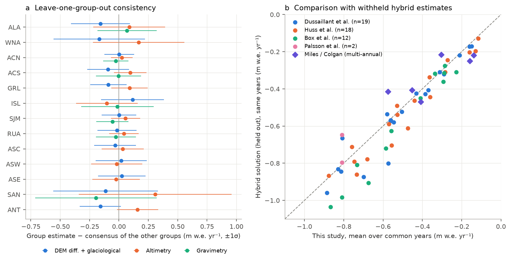

*Figure 7. (a) Difference between each data group's estimate and the consensus of the other groups over their common years (±1σ). (b) Mean of withheld hybrid solutions against this study over identical years.*

**Leave-one-group-out (33 tests in 13 multi-group regions).**

- No group differs significantly from the consensus of the others. The RMS of the normalised mean differences is 0.41, and the largest |z| is 0.90 (Antarctic periphery, DEM vs altimetry: −0.16 ± 0.18 m w.e. yr⁻¹).
- At annual resolution, 90 % of independent group values fall within 1σ of the leave-out consensus (68 % expected), with a median correlation of r = 0.73.

The uncertainty model is therefore **conservative rather than optimistic**. Part of the conservatism comes from τ, which is calibrated at the pentad scale. The remaining group disagreements, e.g. DG more negative than ALT/GRAV in Alaska (−0.16) and Antarctica (−0.16), are geophysically plausible. Possible causes include the density assumption, radar penetration and sampling of marine-terminating glaciers.

**Withheld hybrid solutions (51 annual comparisons).**

- Median annual correlation r = 0.90; mean offset −0.04 m w.e. yr⁻¹, with the hybrids slightly more negative.
- By product: Dussaillant et al. agree to −0.02 m w.e. yr⁻¹ (median r = 0.90), Huss et al. to −0.02 (r = 0.85), and Box et al. to −0.07 (r = 0.91).
- The largest systematic deviations are in WNA and Alaska, where hybrids are 0.1–0.23 m w.e. yr⁻¹ more negative, and in Iceland, where Box et al. is 0.17 m w.e. yr⁻¹ more negative.

### 4.5 How informative is glaciological variability? (cross-validation)

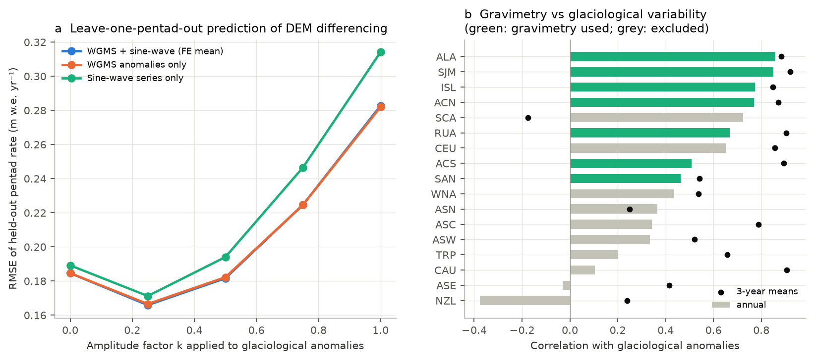

*Figure 8. (a) Leave-one-pentad-out RMSE when predicting held-out DEM-differencing pentads from a constant offset plus the glaciological anomalies scaled by k. (b) Correlation between gravimetric and glaciological annual anomalies (bars) and their 3-year means (dots); green marks regions where gravimetry passes the selection rule.*

The two diagnostics point to an important result: the glaciological annual variability is broadly **corroborated by gravimetry at annual and 3-year scales**, but it is **not consistent with the DEM pentads at the 5-year scale**.

- **Annual and 3-year scales.** Correlations with gravimetry are r = 0.67–0.85 annually and 0.85–0.93 for 3-year means in ALA, SJM, ISL, ACN and RUA, with amplitude ratios of 0.6–1.2.
- **5-year scale.** Adding the full glaciological anomalies to a constant offset makes held-out pentad predictions *worse* (RMSE 0.28 m w.e. yr⁻¹) than using the geodetic mean rate alone (0.185). The optimum amplitude is only k ≈ 0.25 (RMSE 0.166).
- **Regional pattern.** The pentad mismatch is largest in sparsely monitored regions (GRL, ANT, SAN, ASW, RUA), where a handful of glaciers stand in for a whole region. In GRL, the regression slope of altimetric on glaciological anomalies is only 0.2–0.4.

Two effects probably combine: unrepresentative glaciological samples, and the temporal smoothing inherent in the Gaussian-process elevation time series behind the Hugonnet pentads. Because the gravimetric evidence supports the annual signal, the full variability was retained. The mismatch is instead carried as the calibrated representativeness error τ = 0.45 m w.e.

### 4.6 Sensitivity analysis

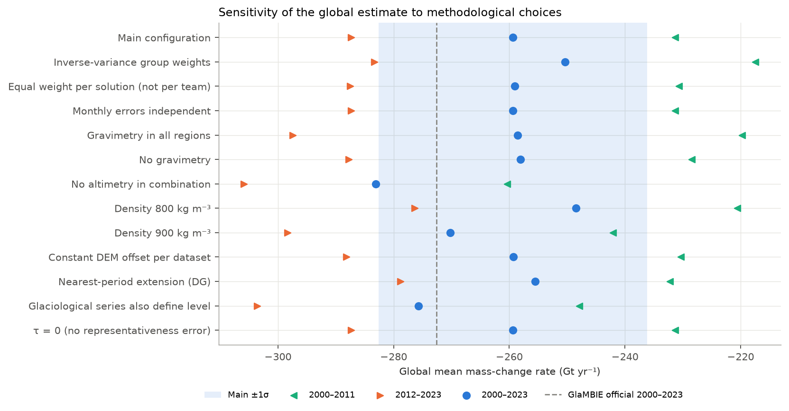

*Figure 9. Global mean rate for 2000–2023 (circles), 2000–2011 (◄) and 2012–2023 (►) under alternative choices. The blue band is the main estimate ±1σ; the dashed line is the official GlaMBIE value.*

**Table 4. Sensitivity of the global mean rate (Gt yr⁻¹).**

| Experiment | 2000–2023 | 2000–2011 | 2012–2023 | 2023 |
|---|---|---|---|---|
| Main configuration | −259.4 | −231.3 | −287.4 | −496 |
| Inverse-variance group weights | −250.4 | −217.4 | −283.3 | −482 |
| Equal weight per solution (not per team) | −259.1 | −230.7 | −287.5 | −496 |
| Monthly errors independent | −259.4 | −231.3 | −287.4 | −496 |
| Gravimetry in all regions | −258.6 | −219.7 | −297.4 | −496 |
| No gravimetry | −258.1 | −228.4 | −287.8 | −495 |
| No altimetry in combination | −283.1 | −260.4 | −305.9 | −529 |
| Density 800 kg m⁻³ | −248.5 | −220.6 | −276.4 | −486 |
| Density 900 kg m⁻³ | −270.2 | −242.1 | −298.3 | −506 |
| Constant DEM offset per dataset | −259.3 | −230.4 | −288.2 | −505 |
| Nearest-period extension (DG) | −255.5 | −232.2 | −278.8 | −458 |
| Glaciological series also define level | −275.7 | −247.9 | −303.6 | −536 |
| τ = 0 | −259.4 | −231.3 | −287.4 | −496 |

The estimate is robust to weighting within groups, to the monthly-error convention, to the gravimetry rule and to the offset model: changes are ≤ 4 Gt yr⁻¹.

- The monthly-error convention and τ change only the uncertainties. The mean annual global σ rises from 69 to 109 Gt if monthly errors are treated as independent, and falls to 43 Gt with τ = 0.
- The **dominant sensitivities** are:
  - the density conversion: ±50 kg m⁻³ gives ±11 Gt yr⁻¹;
  - the inclusion of altimetry: −24 Gt yr⁻¹ without it, mainly through the Antarctic and Greenland peripheries, where altimetry is less negative than DEM differencing;
  - the role of glaciological series in the level: −16 Gt yr⁻¹.
- Inverse-variance weighting of groups shifts the estimate by +9 Gt yr⁻¹, because the less negative altimetry/gravimetry groups carry smaller stated errors in some regions.

All alternatives except "no altimetry" lie within the ±1σ band of the main estimate. The accelerating signal (2012–2023 more negative than 2000–2011 by 45–78 Gt yr⁻¹) persists in every experiment.

### 4.7 Uncertainty budget and comparison with earlier assessments

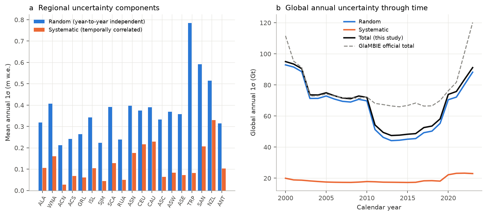

*Figure 10. (a) Mean annual random and systematic 1σ per region. (b) Global annual uncertainty through time, compared with the official GlaMBIE uncertainty.*

**Uncertainty budget.**

- Annual uncertainties are dominated by the random (inter-annual) component. It is largest in regions that depend entirely on glaciological variability: TRP (0.78 m w.e.), where only the WGMS anomaly series is available, SAN and NZL.
- Systematic errors (17–23 Gt yr⁻¹ globally) dominate multi-decadal sums. They come mostly from the Antarctic periphery (σ = 15 Gt yr⁻¹ for the 2000–2023 mean), where DEM differencing and altimetry disagree, and from Alaska.

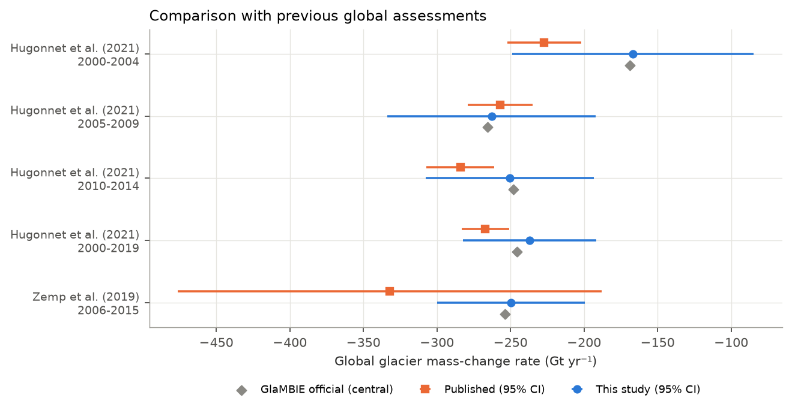

*Figure 11. Global rates of this study (95 % CI) compared with Hugonnet et al. (2021), Zemp et al. (2019) and the official GlaMBIE values.*

**Comparison with earlier assessments.**

- Over 2000–2019, this study (−237 ± 45 Gt yr⁻¹, 95 %) and GlaMBIE (−246) are less negative than Hugonnet et al. (2021; −267 ± 16). Summing their pentads from the GlaMBIE inputs gives −265.5 Gt yr⁻¹, consistent with the published value.
- The difference concentrates in 2000–2004 (−167 here and −169 for GlaMBIE, versus −227 ± 25). In those years the gravimetric and altimetric groups are absent or start late, and the glaciological variability indicates relatively positive conditions in 2000–2002 (e.g. Alaska, WNA).
- For 2005–2009 and 2010–2014, the three estimates agree within uncertainty.
- Zemp et al. (2019; −332 ± 144 Gt yr⁻¹ for 2006–2016) is more negative but consistent within its large uncertainty. Its regional values are much more negative in TRP, SAN, WNA, ALA and RUA. This is the same glaciological-extrapolation bias that the cross-validation in Section 4.5 detects.
- The acceleration of −5.2 ± 3.0 Gt yr⁻² over 2000–2019 is consistent with Hugonnet et al.'s 48 ± 16 Gt yr⁻¹ per decade (−4.8 Gt yr⁻²). Including 2020–2023 increases it to −8.0 ± 2.6 Gt yr⁻²; the official GlaMBIE series gives −10.0 ± 2.5 Gt yr⁻².

---

## 5. Discussion

**A consistent, observation-based benchmark.** An independent reconciliation built from the raw GlaMBIE inputs, with every choice documented and tested, recovers the community estimate to within 5 % for the long-term global rate. The annual series correlate at r = 0.99 and all annual differences lie within uncertainty. This independence is valuable for IPCC and model-calibration purposes: it shows that the GlaMBIE result does not hinge on undocumented processing details. Its residual structural uncertainty is about 15–20 Gt yr⁻¹ and stems mainly from:

1. whether the glaciological sample is allowed to inform the long-term level;
2. the density of geodetic volume change;
3. the relative weight given to altimetry versus DEM differencing in the polar peripheries.

These three factors together are comparable to the formal 1σ uncertainty (23 Gt yr⁻¹). They should be reported alongside the formal errors when the benchmark is used to calibrate models such as those of GlacierMIP (Marzeion et al., 2020; Rounce et al., 2023).

**Accelerating loss and record years.** All configurations agree that loss in 2012–2023 exceeded that of 2000–2011 and that the record years of 2022–2023 are unprecedented in the observational period. The 2023 loss of about 500 Gt (1.4 mm SLE) is roughly five times that of 2000. Regionally, the acceleration is concentrated in:

- North-west North America (ALA, WNA), where WNA specific loss increased about seven-fold;
- the European Arctic (SJM, RUA);
- the Alps and Central Asia.

Iceland, Arctic Canada North and the Greenland periphery decelerated during the 2010s. This illustrates that global acceleration is not spatially uniform, and that a model calibrated only on multi-decadal means can miss decadal regional variability.

**What the cross-validation teaches.** The most transferable methodological finding is that glaciological annual anomalies are not interchangeable with regional geodetic variability at multi-year scales:

- they are well corroborated by gravimetry at annual scales in heavily glacierised, well-monitored regions;
- they over-predict the pentad-to-pentad variance of geodetic change by roughly a factor of 4 in variance (optimal amplitude ≈ 0.25), especially in sparsely monitored regions.

Down-scaling geodetic trends with glaciological anomalies, as GlaMBIE and hybrid products such as Dussaillant et al. do, therefore needs an explicit representativeness term. The τ = 0.45 m w.e. estimated here is one data-driven way to obtain it. It produces LOGO coverage of 90 % at the 1σ level, which suggests τ could be made region-specific (smaller in densely monitored CEU and SCA) in future work.

**Limitations.**

1. **Area.** The time-varying glacier area was taken from the GlaMBIE results rather than reconstructed from RGI and area-change rates, and its uncertainty (about 5 %) was not propagated into the Gt values.
2. **Density.** A single density of 850 ± 60 kg m⁻³ was applied to all elevation-change data, including the seasonal altimetric signal.
3. **Last year of the record.** The 2023 calendar-year values rely partly on the extension of the DG group with glaciological variability (Oct–Dec 2023 in the Northern Hemisphere, Apr–Dec 2023 in the Southern Hemisphere). They are therefore more uncertain, and also the most sensitive to the extension rule (−458 to −536 Gt across experiments).
4. **Region independence.** Regions are assumed independent in the global aggregation. Correlated errors, e.g. a common density bias or GIA models shared across gravimetric solutions, would increase the global uncertainty. A fully correlated density error alone would add about ±11 Gt yr⁻¹ (Table 4).
5. **Equal group weights.** These follow the community-consensus philosophy. Inverse-variance weights would favour the groups with the most optimistic error budgets, and shift the estimate by 9 Gt yr⁻¹.

---

## 6. Conclusions

1. Four observational methods were reconciled into annual regional and global series of glacier mass change for 2000–2023. The resulting uncertainties are consistent with the residual inter-method disagreement: no leave-one-group-out test exceeds |z| = 0.9.
2. Glaciers lost **6225 ± 557 Gt (17.2 ± 1.5 mm SLE)** in 2000–2023, a mean of **−259 ± 23 Gt yr⁻¹ (−0.38 ± 0.03 m w.e. yr⁻¹)**. Loss increased by 24 % from 2000–2011 to 2012–2023 and peaked at −435 Gt (2022) and −496 Gt (2023).
3. Alaska (23 %) and the polar regions (Arctic Canada, Greenland and Antarctic peripheries, Svalbard, Russian Arctic; 51 %) dominate the global loss in Gt. The highest specific rates (−0.7 to −0.9 m w.e. yr⁻¹) occur in Central Europe, Iceland, the Southern Andes, New Zealand and Alaska.
4. The independent reconstruction reproduces the official GlaMBIE solution with r = 0.986 at global annual resolution and within 13 Gt yr⁻¹ (5 %) in the long-term mean. The remaining difference is explained by whether calibrated glaciological series inform the long-term level, a structural choice that should be reported with the benchmark.
5. Cross-validation shows that glaciological variability is reliable at annual scales but over-dispersed at multi-year scales relative to geodetic data. A calibrated representativeness error of about 0.45 m w.e. is needed for statistically consistent uncertainties.

---

## Reproducibility

```
python3 code/inventory.py             # input inventory  -> outputs/input_inventory.csv
python3 code/run_reconciliation.py    # main reconciliation -> outputs/main/
python3 code/calibrate_tau.py         # tau calibration (leave-one-pentad-out)
python3 code/cv_offset_model.py       # offset/extension model cross-validation
python3 code/cv_variability.py        # amplitude of glaciological variability
python3 code/variability_consistency.py
python3 code/run_sensitivity.py       # 12 sensitivity experiments -> outputs/sens_*/
python3 code/analysis.py              # tables, LOGO, hybrid & literature comparison
python3 code/export_final.py          # outputs/final_calendar_year_series_2000_2023.csv
python3 code/figures.py               # report/images/*.png
```

**Key output files**

- `outputs/final_calendar_year_series_2000_2023.csv`: final regional and global calendar-year series in Gt and m w.e., with total, random and systematic 1σ.
- `outputs/main/hydro_*.csv`: hydrological-year series including the data-group estimates.
- `outputs/regional_summary.csv`, `global_period_summary.csv`, `comparison_official.csv`, `leave_one_group_out.csv`, `hybrid_comparison.csv`, `sensitivity_summary.csv`.

## References

- GlaMBIE (2024). Glacier Mass Balance Intercomparison Exercise (GlaMBIE) Dataset 1.0.0. WGMS, Zurich. doi:10.5904/wgms-glambie-2024-07.
- Hock, R. et al. (2019). GlacierMIP – A model intercomparison of global-scale glacier mass-balance models and projections. *J. Glaciol.* 65, 453–467.
- Hugonnet, R. et al. (2021). Accelerated global glacier mass loss in the early twenty-first century. *Nature* 592, 726–731.
- Marzeion, B. et al. (2020). Partitioning the uncertainty of ensemble projections of global glacier mass change. *Earth's Future* 8, e2019EF001470.
- Rounce, D. R. et al. (2023). Global glacier change in the 21st century: Every increase in temperature matters. *Science* 379, 78–83.
- Zemp, M. et al. (2019). Global glacier mass changes and their contributions to sea-level rise from 1961 to 2016. *Nature* 568, 382–386.
