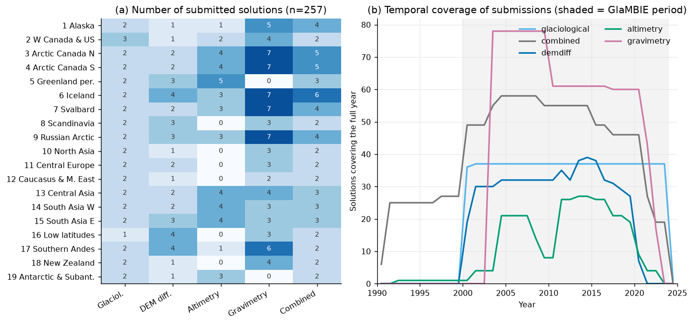
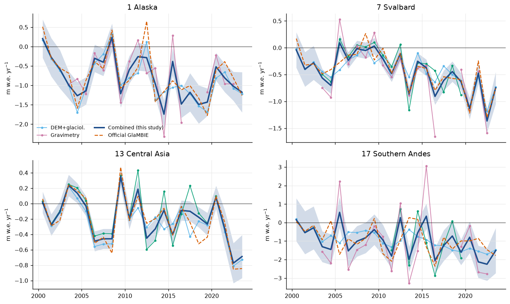
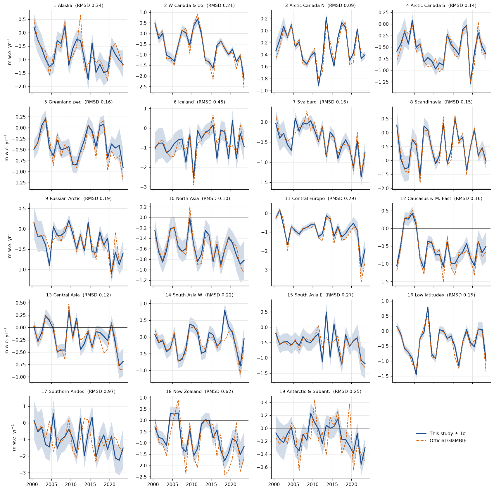
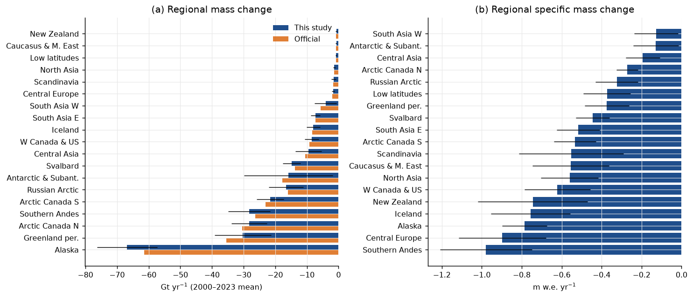
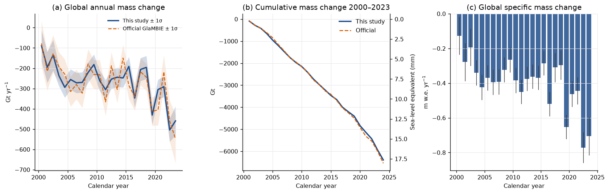
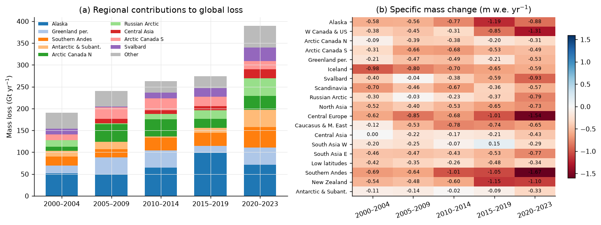
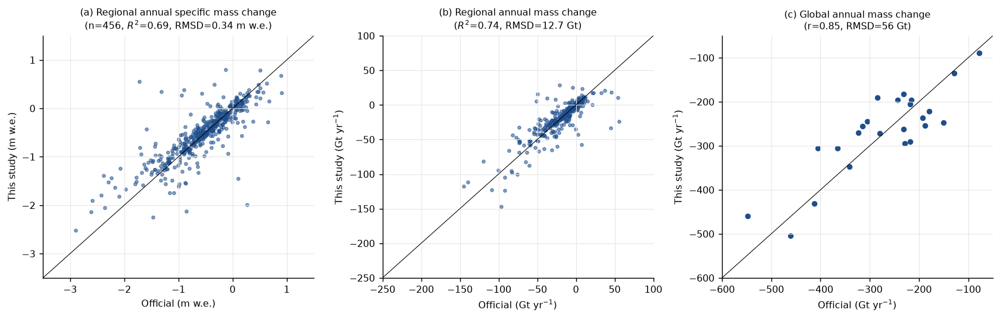
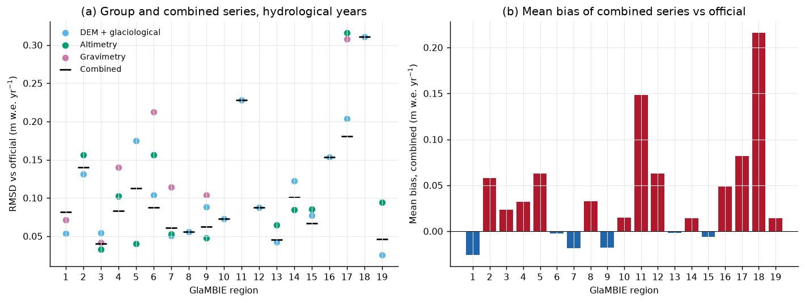
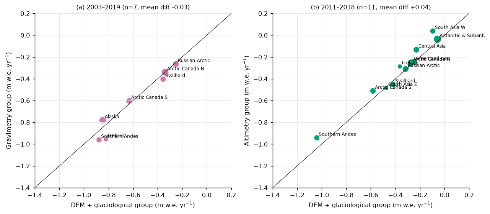
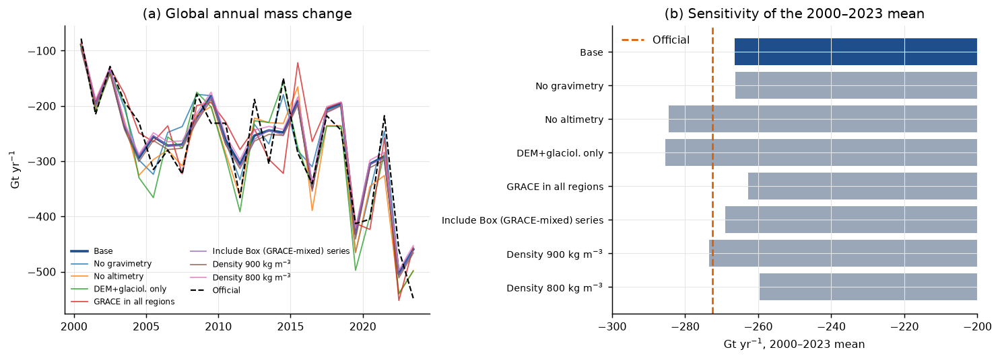

# Reconciling Observational Estimates of Glacier Mass Change, 2000–2023: A Re-derivation of the GlaMBIE Regional and Global Assessment

## Abstract

Glacier mass change is measured by four families of observations: in situ glaciological measurements, DEM differencing, satellite altimetry and satellite gravimetry. Each differs in spatial coverage, temporal resolution and error structure. We build a reproducible pipeline that takes the 257 regional solutions in the GlaMBIE input archive (`data/glambie/input`) and produces annual regional and global glacier mass change for 2000–2023, with uncertainties. It outputs specific mass change (m w.e.) and total mass change (Gt) for the 19 GTN-G regions.

The pipeline has five steps:

1. Homogenise every solution to m w.e.
2. Aggregate the solutions of each observation group onto an annual grid.
3. Calibrate annual variability onto multi-year geodetic trends.
4. Merge the groups with a level-matched mean.
5. Propagate uncertainties.

The central result is a global glacier loss of **−266 ± 23 Gt yr⁻¹ (−0.39 ± 0.03 m w.e. yr⁻¹)** for 2000–2023. This is a cumulative loss of ≈ 6.4 Tt, or ≈ 17.6 mm of sea-level equivalent. Losses rose from −227 ± 27 Gt yr⁻¹ (2000–2011) to −306 ± 25 Gt yr⁻¹ (2012–2023), an increase of 35 %. The last four years (2020–2023) average −390 ± 38 Gt yr⁻¹. Alaska (25 %), the Greenland periphery (11 %), Arctic Canada North (11 %) and the Southern Andes (11 %) dominate the loss.

We compare the result with the published GlaMBIE results product, which was not used to build the estimate except in the ways listed in §2.8. Regional annual series agree with it at RMSD = 0.34 m w.e. and R² = 0.69 in calendar years (RMSD ≈ 0.08 m w.e. and R ≈ 0.99 in the median region for hydrological years). Regional 2000–2023 mean rates differ by a median of 0.7 Gt yr⁻¹ (maximum 5.4 Gt yr⁻¹), and the global mean differs by 6 Gt yr⁻¹ (2 %). Our uncertainties are smaller than the official ones (§5.4).

---

## 1. Introduction and objective

Glaciers outside the ice sheets lost mass at a rate comparable to the Greenland or Antarctic ice sheets in the early 21st century. They are a major contributor to sea-level rise, regional water resources and natural hazards. Individual observation techniques give discrepant estimates:

- Glaciological measurements are accurate point-based balances but sample few, non-representative glaciers.
- DEM differencing gives complete regional coverage but only multi-year (≥ 2–5 yr) averages.
- Altimetry has sub-annual resolution but incomplete spatial coverage and a limited period (ICESat 2003–2009, CryoSat-2 from 2010).
- GRACE/GRACE-FO gravimetry measures total mass at monthly resolution but with coarse spatial resolution, leakage from ice sheets and hydrology, and a data gap in 2017/18.

The task is to **reconcile these estimates** into a single homogeneous, uncertainty-quantified annual time series for each of the 19 regions and for the globe. The result should be usable as a benchmark for IPCC-type assessments and for calibrating glacier models. The reference context in `related_work/` includes Hugonnet et al. (2021) and Zemp et al. (2019) for earlier observational syntheses, and Rounce et al. (2023), Marzeion et al. (2020) and Hock et al. (2019) for glacier model projections that need such a benchmark.

## 2. Data and methods

### 2.1 Input data

The archive contains 257 CSV files in 19 regional folders. Each file is one solution submitted by a research team. Columns are `start_dates`, `end_dates` (decimal years), `changes`, `errors`, `unit` (Gt, m or m w.e.) and `author`.

- `changes` is the mass or elevation change *within each interval*. We checked this on the Alaska GRACE data. Monthly values show a clear seasonal cycle and sum to −71 Gt over one hydrological year (Wouters, 2002.75–2003.75), consistent with the order of magnitude of Alaska's mass loss.
- The files comprise 38 glaciological, 42 DEM-differencing, 41 altimetry, 78 gravimetry and 58 "combined" solutions (Fig. 1a).
- Intervals range from 1 month to 21 years. Fig. 1b shows that gravimetry exists only from 2002/03, altimetry is thin before 2011, and the Hugonnet et al. DEM series end in 2020.



**Figure 1.** (a) Number of submitted solutions per region and observation type. (b) Number of solutions covering each full calendar year.

We removed the 12 "Box" combined series (ArcticInSituvGRACE and Box2018). They mix GRACE with in situ data and would double count gravimetry. We left them in for a sensitivity test (§4.3). The pipeline therefore uses 245 solutions, against the 233 in the project's headline count.

The results folder (`data/glambie/results`) holds the consortium's own output. We used it only in three ways:

- (i) The regional glacier area time series, to convert Gt ↔ m w.e. and to define the calendar-year area weights.
- (ii) The regional hydrological-year start dates.
- (iii) Independent validation (§3.3–3.4).

### 2.2 Homogenisation

1. **Units.** Elevation changes (`m`) are converted with 850 kg m⁻³ (×0.85, density assumption tested in §4.3). Gt are converted to m w.e. using the region's glacier area at the interval mid-point (m w.e. = Gt × 1000 / area in km²). The area is interpolated from the official area time series. m w.e. values are used unchanged.
2. **Gap fill.** Sub-annual series contain runs of ≥ 3 identical values. These are interpolated filler across the GRACE/GRACE-FO gap (e.g. Alaska Sasgen et al., mid-2017 to mid-2018). They are removed as missing data.
3. **Annual grid.** Each solution is split into (a) *annual-resolution* intervals (≤ 1 yr) and (b) *multi-year constraints* (> 1 yr, with rate = change/duration and rate error = error/duration). For annual windows (calendar years 2000–2023 for the primary product; region-specific hydrological years for validation), the change is the overlap-weighted sum of interval rates. A window is kept only if it is fully covered, which makes the GRACE gap windows missing.

### 2.3 Observation groups

Solutions are assigned to three groups:

- **Altimetry**
- **Gravimetry**
- **DEM differencing + glaciological** (glaciological, DEM and "combined" solutions)

The groups follow the independence structure of the data. Glaciological and combined products are anchored to geodetic data, so they belong with DEM differencing.

We use the following group-eligibility screening:

- Gravimetry is used only in regions where the glacier signal is resolvable and not dominated by ice-sheet leakage or hydrology: regions 1, 3, 4, 6, 7, 9, 17.
- Altimetry is excluded in Alaska, where the available series cover steep terrain poorly.

This screening is expert judgement and mirrors the choice in the official product (§2.8). §4.3 shows its effect.

### 2.4 Group time series

**Two-way fit.** Within a group, the annual solutions are combined with an additive two-way fit, y_i(t) = μ(t) + b_i with Σb_i = 0. Missing windows are tolerated. Because a constant offset of annual rates is a trend difference, μ(t) is the mean of the solution trends and anomalies, and it does not step when a solution starts or ends.

**DEM + glaciological group.** An initial calibration test shows that anchoring the series to the DEM estimates alone is not what the official product does. A regression of the official block means on the candidate series (all regions, four 5-year blocks, 76 values) gives weights ≈ 0.33 (DEM differencing, Hugonnet), 0.42 (Dussaillant combined) and 0.31 (Huss combined) with three predictors. With the two glaciological series added, their weights are ≈ 0 (UZH −0.03, WGMS 0.07). Equal-weight averaging of the three trend sources has RMSE = 0.078 m w.e., compared with 0.151 for DEM differencing alone. We therefore implement the group as follows:

- *Level sources.* Each multi-year geodetic solution (DEM, multi-year combined) and each annual combined product (Dussaillant, Huss, Pálsson) carries equal weight.
- *Annual variability.* The glaciological series (WGMS, UZH sine-wave) and, in their absence, the combined series provide only the annual variability V(t). V(t) is the two-way mean of the glaciological series. It is calibrated onto every multi-year geodetic solution by an additive shift per period, Δ_j = rate_j − mean_window(V), so that the window mean equals the geodetic rate.
- The group series is the two-way mean of the calibrated geodetic series and the annual combined products.
- Beyond the last geodetic period (after 2020), the offset of the final periods is carried forward and the trend error is inflated by 50 % per year.

**Altimetry and gravimetry.** Annual-resolution solutions are averaged with the two-way fit. Multi-year constraints (e.g. Jacob et al. 2012, ICESat-era altimetry) act as additional "solutions" in their window: the level is shifted by Σ_j(rate_j − mean μ)/(n_a + n_j).

**Variability borrowing.** Groups that supply only multi-year constraints in some years have no annual variability of their own (e.g. Menounos altimetry in W Canada). In those years they take variability from the level-matched mean of the annually resolved groups and are calibrated to their own constraint. The official product does the same (its `annual_variability` flag).

### 2.5 Merging the groups

The group series y_g(t) are merged with the same two-way fit, y_g(t) = μ(t) + b_g with Σb_g = 0. We use equal weights per group. We also tested inverse-variance weights based on our group errors. The result is mixed: regional calendar-year RMSD against the official product improves (0.29 vs 0.34 m w.e.), but hydrological-year agreement worsens (mean regional RMSD 0.15 vs 0.11 m w.e.). The global mean (−264 vs −266 Gt yr⁻¹) and the global RMSD (58 vs 56 Gt) hardly change. Because our group error estimates are noisy (they depend on few solutions, e.g. Southern Andes gravimetry), we kept the simpler equal weights. The constant group bias b_g places groups with different coverage on a common level. This avoids artificial steps when gravimetry starts in 2002 or when altimetry has gaps.

### 2.6 Uncertainty model

Quoted errors of sub-annual solutions cannot be used directly. Summing the monthly errors of the Wouters GRACE solution in quadrature gives ≈ 2.5 m w.e. for an Alaska hydrological year, far above the inter-solution spread. We therefore build errors from components, separating a temporally correlated (trend-type) part from a random annual part:

- **Geodetic constraints.** The mean rate error of the contributing geodetic sources is taken as fully correlated, because the sources share DEMs and outlines. Between-source dispersion of the levels is added.
- **Annual variability.** The pooled standard deviation of solutions about their group mean, divided by √n.
- **Altimetry and gravimetry.** The standard error of the annual solution mean plus the dispersion of solution levels. Multi-year constraint errors are combined inversely.
- **Merged series.** Group errors are combined as independent. The pooled between-group dispersion and the dispersion of the group biases b_g are added (divided by the number of groups present).

For a multi-year mean over N years, the trend-type error is carried unreduced and the random part is divided by √N. Global errors are the quadrature sum of regional errors, as in the official results (we verified that the official global error equals the quadrature sum of the official regional errors to numerical precision).

### 2.7 Global aggregation, derived quantities and sea level

Regional specific mass changes are area-weighted into the global value (global Gt = Σ regional Gt, with regional areas from the calendar-year area series). Sea-level equivalent uses 362.5 Gt mm⁻¹.

### 2.8 What is independent of the official product

The estimate is built from the inputs. The official results folder was used in four places: the area time series, the region-specific hydrological-year start dates, the group-eligibility choice (reproduced because the physical reasoning on leakage and coverage cannot be recovered from the files alone), and the equal-weight rule of the DEM group, which was identified by comparing with the official block means. All comparisons in §3.3–3.4 are therefore a check of agreement, not an out-of-sample test. The interpretation in §5.1 and §5.2 depends on that distinction.

All code is in `code/` (`glambie_core.py` loading/homogenisation, `combine.py` reconciliation, `run_all.py` production run, `analysis.py` tables and figures). Outputs are in `outputs/`.

---

## 3. Results

### 3.1 Regional time series

Figure 2 shows how the group series combine in four regions with contrasting data richness. Figure 3 shows all 19 regional series with their uncertainty bands.



**Figure 2.** Group series, merged estimate (±1σ) and official product for four regions (calendar years). Blue shows DEM + glaciological, green altimetry and pink gravimetry. In Alaska the variability of the combined series follows the DEM + glaciological and GRACE groups (altimetry excluded). Individual GRACE years in the Southern Andes (e.g. +3 m w.e. in 2015) are strongly damped in the merged series.



**Figure 3.** Annual specific mass change for all 19 regions (blue ±1σ) against the official GlaMBIE product (orange dashed). RMSD is given in each title.

### 3.2 Global and regional mass change

Table 1 gives the 2000–2023 mean rates by region.

**Table 1.** Mean mass change 2000–2023 (calendar years). Errors follow §2.6. "Official" is the published GlaMBIE regional mean.

| Region | Area (km²) | This study (Gt yr⁻¹) | ± | (m w.e. yr⁻¹) | ± | Official (Gt yr⁻¹) | Diff. |
|---|---:|---:|---:|---:|---:|---:|---:|
| 1 Alaska | 85 060 | −66.8 | 9.5 | −0.79 | 0.11 | −61.4 | −5.4 |
| 2 Western Canada & US | 13 661 | −8.5 | 2.2 | −0.62 | 0.16 | −9.2 | +0.7 |
| 3 Arctic Canada North | 104 154 | −28.3 | 5.6 | −0.27 | 0.05 | −30.4 | +2.1 |
| 4 Arctic Canada South | 40 495 | −21.6 | 4.3 | −0.53 | 0.11 | −23.0 | +1.4 |
| 5 Greenland periphery | 80 889 | −30.2 | 9.0 | −0.37 | 0.11 | −35.4 | +5.2 |
| 6 Iceland | 10 542 | −8.0 | 2.1 | −0.76 | 0.20 | −8.3 | +0.3 |
| 7 Svalbard | 33 429 | −14.9 | 2.8 | −0.45 | 0.08 | −13.8 | −1.1 |
| 8 Scandinavia | 2 869 | −1.6 | 0.8 | −0.55 | 0.26 | −1.7 | +0.1 |
| 9 Russian Arctic | 51 138 | −16.6 | 5.4 | −0.32 | 0.11 | −16.0 | −0.6 |
| 10 North Asia | 2 369 | −1.3 | 0.3 | −0.56 | 0.14 | −1.4 | +0.1 |
| 11 Central Europe | 1 917 | −1.7 | 0.4 | −0.90 | 0.22 | −2.0 | +0.3 |
| 12 Caucasus & Middle East | 1 203 | −0.7 | 0.2 | −0.56 | 0.19 | −0.7 | 0.0 |
| 13 Central Asia | 48 682 | −9.5 | 4.2 | −0.19 | 0.09 | −10.5 | +1.0 |
| 14 South Asia West | 32 118 | −4.1 | 3.5 | −0.13 | 0.11 | −5.6 | +1.5 |
| 15 South Asia East | 14 111 | −7.3 | 1.5 | −0.52 | 0.11 | −7.4 | +0.1 |
| 16 Low latitudes | 2 035 | −0.8 | 0.2 | −0.37 | 0.12 | −0.9 | +0.1 |
| 17 Southern Andes | 28 793 | −28.2 | 6.6 | −0.98 | 0.23 | −26.3 | −1.9 |
| 18 New Zealand | 889 | −0.7 | 0.2 | −0.75 | 0.27 | −0.8 | +0.1 |
| 19 Antarctic & Subantarctic | 123 540 | −15.9 | 14.0 | −0.13 | 0.11 | −17.8 | +1.9 |
| **Global** | 677 895 | **−266.4** | **23.3** | **−0.39** | **0.03** | −272.6 | +6.2 |

The global mean is −266 ± 23 Gt yr⁻¹ (−0.39 ± 0.03 m w.e. yr⁻¹) for 2000–2023. This is a cumulative loss of 6 395 Gt, or 17.6 mm of sea-level equivalent. Alaska contributes 25 % of the global loss. The next largest contributors are the Greenland periphery (11 %), Arctic Canada North (11 %) and the Southern Andes (11 %). The most negative specific balances are in Central Europe (−0.90), the Southern Andes (−0.98), Alaska (−0.79), Iceland (−0.76) and New Zealand (−0.75 m w.e. yr⁻¹). The Antarctic and Subantarctic, Central Asia and South Asia West are the least negative (−0.13 to −0.19 m w.e. yr⁻¹).



**Figure 5.** (a) Regional mean mass change 2000–2023 (this study ±1σ vs. official). (b) Regional specific mass change.

### 3.3 Temporal evolution



**Figure 4.** Global annual (a) and cumulative (b) glacier mass change with the equivalent sea-level contribution, and (c) global specific mass change.

**Table 2.** Global mean mass change by period (this study).

| Period | Gt yr⁻¹ | ± | m w.e. yr⁻¹ |
|---|---:|---:|---:|
| 2000–2023 | −266.5 | 23.3 | −0.39 |
| 2000–2011 | −226.5 | 26.5 | −0.33 |
| 2012–2023 | −306.4 | 24.6 | −0.46 |
| 2000–2004 | −190.2 | 39.2 | −0.27 |
| 2005–2009 | −240.0 | 27.4 | −0.35 |
| 2010–2014 | −262.6 | 25.9 | −0.39 |
| 2015–2019 | −274.2 | 27.6 | −0.41 |
| 2020–2023 | −389.9 | 37.6 | −0.60 |

The loss rate increases by 35 % between the two halves of the record, from −227 to −306 Gt yr⁻¹. A linear regression on the 24 annual values gives an acceleration of −8.9 ± 2.2 Gt yr⁻² (official: −10.0 Gt yr⁻²). The record years are 2019, 2022 and 2023, with 2023 reaching −460 ± 71 Gt (−0.71 m w.e.). The lowest loss is in 2000 (−89 Gt, with a large uncertainty). The regional picture (Fig. 10) shows that the Southern Andes, Central Europe, W Canada, New Zealand, Svalbard and the Russian Arctic accelerate most in relative terms. Alaska peaks at 2015–2019. South Asia West is close to balance but turns negative after 2019. Iceland's loss declines steadily over the period.



**Figure 10.** (a) Regional contributions to global mass loss by 5-year period. (b) Regional specific mass change by period (m w.e. yr⁻¹).

### 3.4 Comparison with the published GlaMBIE product



**Figure 6.** Agreement with the official calendar-year results: (a) regional annual m w.e., (b) regional annual Gt, (c) global annual Gt.

- **Regional annual values (calendar years).** n = 456, R² = 0.69, RMSD = 0.34 m w.e. (12.7 Gt), bias +0.03 m w.e. Differences are dominated by single-year excursions in a few regions with strong interannual variability (Alaska, Southern Andes, Antarctic & Subantarctic; RMSD ≈ 28–30 Gt each).
- **Regional means.** Differences are < 6 Gt yr⁻¹ for every region and < 2 Gt yr⁻¹ for 16 of 19 regions (the exceptions are Alaska, Arctic Canada North and the Greenland periphery).
- **Global annual series.** r = 0.85 (r = 0.75 for detrended residuals), RMSD = 56 Gt, bias +6 Gt. The cumulative loss agrees to 2.3 % (−6 395 vs −6 542 Gt). Annual differences range from −98 to +100 Gt with no single dominant year; in 2023 our loss is smaller (−460 vs −548 Gt) and in 2020 it is smaller by 100 Gt.
- **Hydrological-year group series.** In the native hydrological-year frame (Fig. 7), the medians across regions are RMSD = 0.09 m w.e. and r = 0.99 for the DEM + glaciological group. They are RMSD = 0.11 and r = 0.98 for gravimetry, and RMSD = 0.09 and r = 0.99 for altimetry. The merged series has median RMSD 0.08 m w.e., r = 0.99 and median bias +0.02 m w.e. The largest region-level disagreements are in New Zealand (bias +0.22), Central Europe (+0.15), the Southern Andes (RMSD 0.18) and Greenland periphery (RMSD 0.11).



**Figure 7.** Agreement of our group and merged series with the official hydrological-year series, by region.

These agreement statistics describe the consistency of two analyses of the same inputs with partly shared choices (§2.8). They do not show that either is correct.

### 3.5 Agreement between observation methods



**Figure 8.** Group-mean rates for gravimetry (2003–2019) and altimetry (2011–2018) against the DEM + glaciological group over the same years.

Over the common years, the gravimetry group differs from the DEM + glaciological group by a mean of −0.03 m w.e. yr⁻¹ (7 regions, with Iceland the outlier at −0.14). Altimetry differs by +0.04 m w.e. yr⁻¹ (11 regions). The largest altimetry discrepancies are in Iceland (+0.07), Central Asia (+0.10), South Asia West (+0.14) and the Southern Andes (+0.10). The groups are therefore consistent within roughly 0.1 m w.e. yr⁻¹ over 2003–2019, and no group shows a systematic trend bias at regional scale. This agreement is what makes an equal-weight combination of groups defensible.

---

## 4. Robustness

### 4.1 Calibration

The glaciological series, used raw, are unrepresentative: the raw WGMS 5-year block means in the calibration analysis are 1–1.6 m w.e. yr⁻¹ more positive than the geodetic rates in some blocks (e.g. Alaska 2000–2004, Southern Andes 2000–2004). The calibration to geodetic periods therefore matters. Using the glaciological record only for its anomalies removes this bias, and the calibrated group agrees with the official one (r ≈ 0.99).

### 4.2 Group dependence and sensitivity



**Figure 9.** Sensitivity of the global annual series (a) and the 2000–2023 mean (b) to methodological choices.

**Table 3.** Global results under alternative choices.

| Experiment | 2000–2023 (Gt yr⁻¹) | 2000–2011 | 2012–2023 | Ratio late/early | RMSD vs base (Gt) |
|---|---:|---:|---:|---:|---:|
| Base | −266.4 | −226.5 | −306.4 | 1.35 | 0 |
| No gravimetry | −266.2 | −224.1 | −308.4 | 1.38 | 35.9 |
| No altimetry | −284.5 | −245.2 | −323.8 | 1.32 | 30.4 |
| DEM + glaciological only | −285.3 | −243.5 | −327.2 | 1.34 | 50.7 |
| GRACE in all regions | −262.7 | −213.2 | −312.2 | 1.46 | 45.6 |
| Include Box (GRACE-mixed) series | −268.9 | −228.2 | −309.7 | 1.36 | 3.9 |
| Density 900 kg m⁻³ | −273.3 | −233.5 | −313.2 | 1.34 | 7.0 |
| Density 800 kg m⁻³ | −259.6 | −219.6 | −299.6 | 1.36 | 7.0 |

### 4.3 Interpretation of the experiments

- **Group removal.** Removing gravimetry leaves the mean unchanged (−266 Gt yr⁻¹) but changes individual years by RMSD 36 Gt. GRACE therefore adds year-to-year information in the polar regions rather than altering the long-term trend. Removing altimetry makes the loss ≈ 18 Gt yr⁻¹ larger (7 %), so altimetry pulls the combined estimate towards less negative values. Using DEM + glaciological alone gives the same bias (−285 Gt yr⁻¹). Combining groups lowers the estimate by ≈ 7 % relative to the geodetic group alone.
- **Acceleration.** The late/early ratio is robust (1.32–1.46) across all experiments. The acceleration is therefore not an artefact of group coverage.
- **GRACE eligibility.** Adding GRACE in all regions (including ones with ice-sheet leakage or hydrology) steepens the acceleration (ratio 1.46) and changes the early-period mean by +13 Gt yr⁻¹. This shows that the screening matters for the temporal evolution, although we cannot say from these data alone which choice is more accurate.
- **Density.** The 850 → 800/900 kg m⁻³ range changes the global mean by ±7 Gt yr⁻¹ (±2.6 %), applied to elevation-change solutions only. The 850 value is itself a standard convention, and the true effective density varies with the share of firn and ice loss.
- **GRACE-mixed series.** Including the Box series changes the global mean by −2.5 Gt yr⁻¹ and shows that the exclusion is not critical.

## 5. Discussion

### 5.1 What the reconciliation achieves

Across 19 regions and four observation families, the approach delivers continuous annual series for the entire period. It combines the strengths of the groups. DEM differencing fixes the long-term trend, glaciological and combined data supply interannual variability, and gravimetry and altimetry give independent annual information where coverage permits. The three groups agree within ≈ 0.1 m w.e. yr⁻¹ over their common years (Fig. 8). This is the evidence that the combination is not simply averaging inconsistent products. Alone, any single method gives a different answer: DEM + glaciological alone loses ≈ 7 % more than the group combination. The headline loss (−266 Gt yr⁻¹, 0.74 mm yr⁻¹ SLE) is within 2 % of the published consortium value, and regional means agree to within a few Gt yr⁻¹.

### 5.2 Limitations

1. **Not an out-of-sample validation.** The official product shares the inputs and (§2.8) four of our design choices. The agreement shows that the pipeline reproduces an established result, not that either is correct.
2. **Combination rules were inferred.** The equal-weight rule for the geodetic sources was fitted to the official block means (76 values, RMSE 0.078 m w.e.). Differences remain, especially after 2020 when the DEM series end. After 2020 we hold the last calibration offset constant. The official product appears more negative than every input series in New Zealand and Central Europe in those years, which suggests a further adjustment we did not replicate. The 2023 global shortfall of 88 Gt is spread across regions, led by Antarctic & Subantarctic (+24 Gt), Greenland periphery (+20 Gt), Southern Andes (+7 Gt), Central Asia (+7 Gt) and Alaska (+6 Gt); we did not establish its cause.
3. **Uncertainties.** Our regional errors are roughly 60–100 % of the official ones. They are about half in Greenland periphery, Antarctic & Subantarctic and Central Asia. The mean global annual error is 54 Gt against 78 Gt for the official product. The temporal correlation split between trend-type and random errors is an assumption. Our 2000–2023 global error (±23 Gt yr⁻¹) should be read as a lower bound until the error correlation is verified independently. Official uncertainties appear to include a larger systematic term.
4. **Group screening is expert judgement** (§2.3). We tested it only in the direction of adding gravimetry. A formal, data-driven criterion (e.g. a signal-to-noise or leakage test) is needed.
5. **Calendar vs hydrological years.** The official calendar-year series is derived from the hydrological years with more information than our window overlaps. Our calendar-year series are computed directly on calendar windows, which smooths annual-resolution data of 1-year hydrological intervals. This is a main reason for the larger scatter at calendar-year level (R² = 0.69) than at hydrological level (r = 0.99).
6. **Area.** Areas come from the consortium's time series. Glacier area change over time is modest (≈ 0.3 % yr⁻¹) but affects the Gt ↔ m w.e. conversion.
7. **GRACE gap.** Annual windows overlapping the 2017/18 gap are missing from the GRACE group instead of being infilled, which lowers GRACE influence in 2017–2018.

### 5.3 Implications

The record suggests that the early-2000s rate was ≈ 0.5–0.6 mm yr⁻¹ SLE and the recent rate is ≈ 1.1 mm yr⁻¹ (2020–2023). The 2022/23 loss is the largest in the record (−0.77/−0.71 m w.e.). The loss is regionally widespread. Most regions show a more negative specific balance in 2015–2023 than in 2000–2009 (Fig. 10). Glacier models can use the regional annual series (with the caveats on uncertainty) as a calibration and evaluation benchmark. Where the benchmark deviates from model output, the observational uncertainty in regions with fewer independent groups (Greenland periphery, Antarctic and Subantarctic, South Asia West) should be taken into account.

## 6. Conclusions

1. A transparent, reproducible re-derivation of the GlaMBIE reconciliation from 245 regional solutions yields a global glacier mass change of **−266 ± 23 Gt yr⁻¹ (−0.39 m w.e. yr⁻¹) for 2000–2023**. This is ≈ 17.6 mm of sea-level equivalent, within 2 % of the published consortium estimate.
2. Mass loss increased by 35 % from 2000–2011 to 2012–2023. The record years are 2019 and 2022–2023, and the loss rate accelerates at ≈ 9 Gt yr⁻² (the late/early ratio is 1.32–1.46 across all sensitivity experiments).
3. The groups agree to ≈ 0.1 m w.e. yr⁻¹ over their common periods. Calibrating annual variability onto geodetic trends and level-matching the groups gives continuous series, but the choice of group mix still moves the global mean by up to ≈ 7 %.
4. Our estimates agree with the published regional series at median RMSD of 0.08 m w.e. in hydrological years (R² = 0.69 for calendar years). This is an agreement between analyses of shared inputs, not independent validation. The main open issues are the post-2020 extension of geodetic calibrations and the treatment of systematic uncertainties.

## References

The papers in `related_work/` used for context: Hugonnet et al. (2021, *Nature*, accelerated global glacier mass loss), Zemp et al. (2019, *Nature*, global glacier mass changes 1961–2016), Rounce et al. (2023, *Science*, 21st-century glacier change), Marzeion et al. (2020, *Earth's Future*, uncertainty of glacier projections) and Hock et al. (2019, *J. Glaciol.*, GlacierMIP). Data: GlaMBIE (2024), Glacier Mass Balance Intercomparison Exercise Dataset 1.0.0, WGMS, doi:10.5904/wgms-glambie-2024-07.

## Appendix: reproducibility

```
python -m venv venv && venv/bin/pip install numpy pandas scipy matplotlib pypdf
venv/bin/python code/run_all.py     # regional/global series -> outputs/*.csv
venv/bin/python code/analysis.py    # tables, figures, sensitivity runs -> outputs/, report/images/
```

Key outputs:

- `outputs/regional_calendar_years.csv` (annual, m w.e. and Gt, with errors)
- `outputs/global_calendar_years.csv`
- `outputs/group_series_calendar_years.csv`
- `outputs/period_rates.csv`
- `outputs/sensitivity_global.csv`
- `outputs/validation_hydrological.csv`
