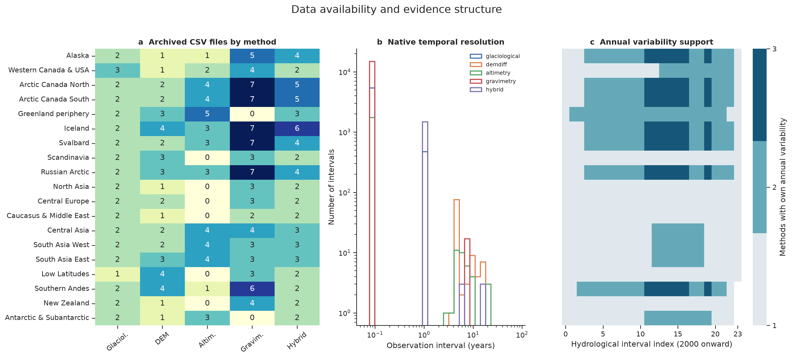
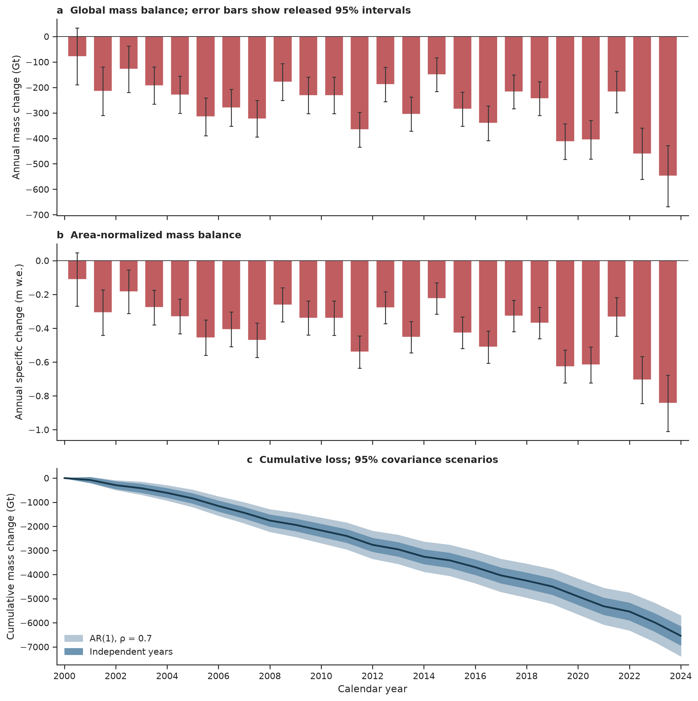
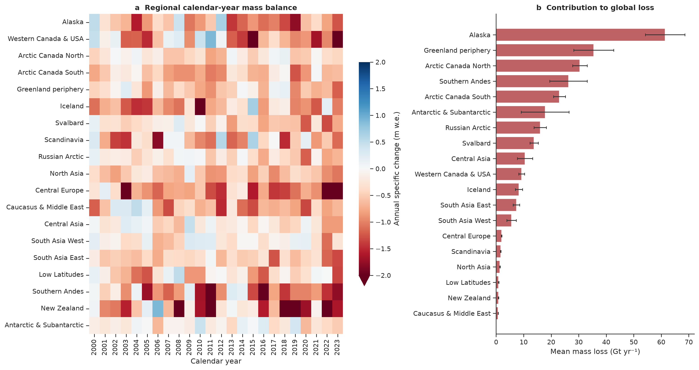
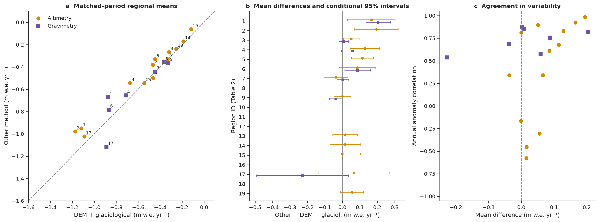
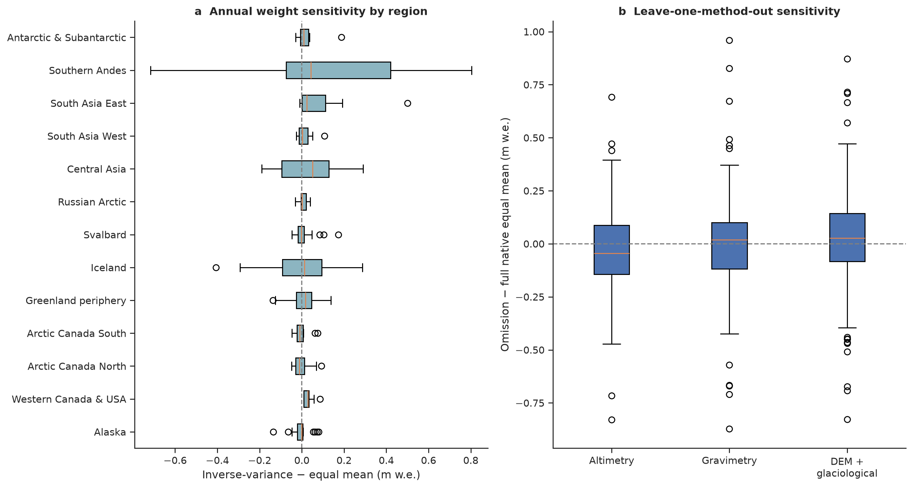
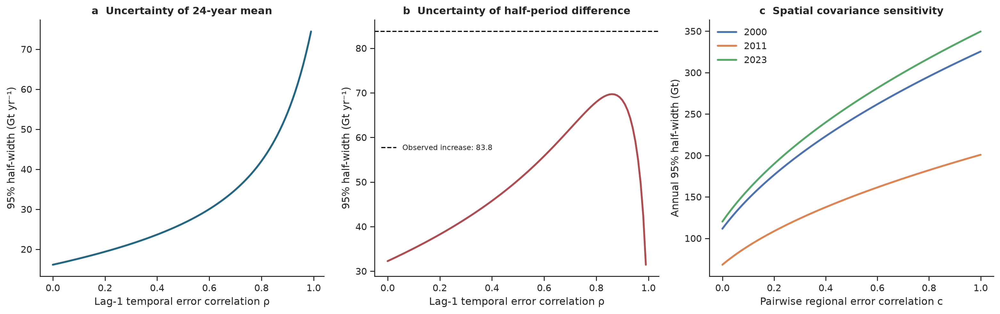
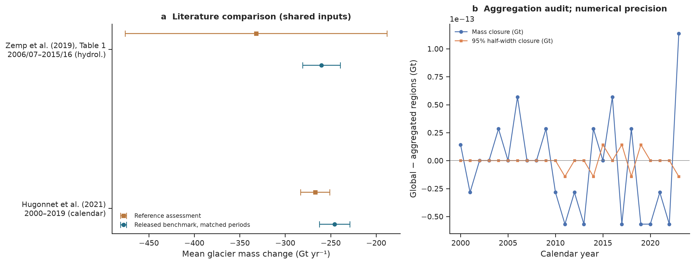
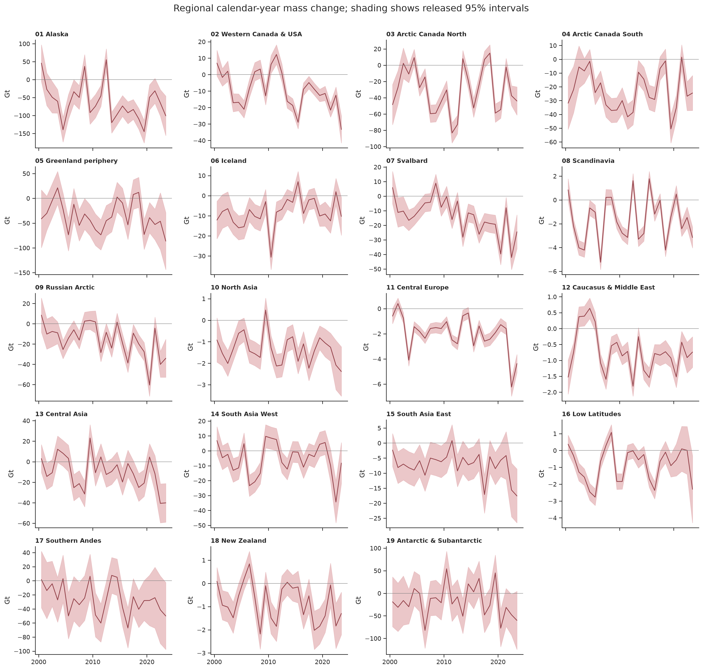

# Global glacier mass change, 2000–2023: an audited GlaMBIE benchmark and reassessment of observational uncertainty

**Research report · 28 October 2026**  
**Data:** GlaMBIE 1.0.0, release dated 16 July 2024, DOI: [10.5904/wgms-glambie-2024-07](https://doi.org/10.5904/wgms-glambie-2024-07).  
**Domain:** the 19 glacier regions, including ice-sheet peripheries and excluding the Greenland and Antarctic ice sheets.  
**Uncertainty convention:** every “±” and plotted error interval in this report denotes a **95% half-width**, unless explicitly stated otherwise. Derived period uncertainties are conditional on the specified covariance model.

## Abstract

Reconciling glacier observations requires preserving the complementary spatial and temporal strengths of glaciological measurements, digital elevation model (DEM) differencing, altimetry and gravimetry. This study audits and packages the released GlaMBIE consensus as a reproducible annual observational benchmark, then assesses its sensitivity to method weighting and error dependence. The supplied archive contains 257 input CSV files and 24,162 observation intervals; these archival counts differ from the 233 scientific estimates described by the GlaMBIE consortium. The delivered calendar-year product contains 456 regional and 24 global records for 2000–2023 in both gigatonnes and metres water equivalent. Global mass change is **-6,542 ± 387 Gt**, averaging **-272.6 ± 16.1 Gt yr⁻¹**, with a mean annual specific change of **-0.406 ± 0.023 m w.e. yr⁻¹** under independent-year propagation. Mean mass loss increases by **36.3%** between 2000–2011 and 2012–2023; the largest annual loss occurs in 2023. Five regions contribute 64.8% of total loss. Only 201 of 453 hydrological region-years have more than one method group flagged as providing its own annual variability. Inverse-variance weighting changes the equal-method estimate by a median absolute 0.031 m w.e., but the 95th percentile is 0.377 m w.e. Introducing lag-1 error correlation of 0.7 raises the 24-year mean's 95% half-width from 16.1 to 34.9 Gt yr⁻¹. A half-period common-error scenario makes the increase less precisely constrained. The results support substantial global loss while identifying covariance information and independent annual observations as priorities for improving benchmark precision.

## 1. Scientific context and research questions

Glacier observations constrain sea-level budgets, regional water resources and glacier evolution models. Zemp et al. (2019) combined temporal information from glaciological measurements with spatially extensive geodetic estimates, demonstrating both the value of this complementarity and the difficulty of representing sparsely observed regions [3]. Hugonnet et al. (2021) subsequently provided globally extensive DEM-derived changes, estimating 267 ± 16 Gt yr⁻¹ of loss during 2000–2019 [4]. Their observations resolve multi-year change more directly than annual fluctuations. The GlacierMIP comparisons document considerable model spread arising from glacier physics, calibration, initial conditions and climate forcing [5,6]. Rounce et al. (2023) show why a spatially resolved observational baseline is particularly valuable for calibrating projections and assessing temperature-dependent future loss [7].

The GlaMBIE Team (2025) established a community synthesis of 233 regional estimates from 35 research teams and approximately 450 contributors, with confidence screening and harmonized treatment of time, area and units [2]. Its released consensus and constituent method-group products are included in the supplied dataset. This report uses that consensus directly: the annual benchmark is an **audited redistribution and analysis of the published product**, with new method-support diagnostics and covariance sensitivity calculations. It does not represent an independent reduction of all scientific submissions or an independent validation of the consortium's observations.

Three questions guide the analysis. First, do the released regional and global series form an internally consistent annual benchmark in both physical units? Second, how sensitive are annual estimates to the available method groups and their weighting? Third, how strongly do assumptions about temporal and regional error correlations influence confidence in the long-term mean and the increase in mass loss? The working hypothesis is that the sign and large magnitude of global loss are more stable than the precision of its long-term rate or regional annual fluctuations.

## 2. Data overview and provenance

### 2.1 Supplied archive

Input observations reside in `data/glambie/input/`, with one subdirectory for each of the 19 regions. Files report interval start and end dates, changes, errors, units and author labels. **Changes are integrated over their reported intervals**, so a multi-year change must be divided by its duration to obtain a rate. Overlapping intervals from different solutions cannot be treated as successive mass increments. Native units include elevation change (`m`), specific mass change (`mwe`) and total mass change (`Gt` and lower-case `gt`). These distinctions are essential for interpreting the observations.

**Table 1. Actual archived input inventory.** Counts include auxiliary and alternative solutions and describe files and intervals rather than independent measurements.

| Archive method | CSV files | Observation intervals | Principal role in the released synthesis |
| --- | --- | --- | --- |
| Glaciological | 38 | 5,893 | Annual anomalies; includes seasonal auxiliaries |
| DEM differencing | 42 | 102 | Multi-year regional trends |
| Altimetry | 41 | 1,776 | Trends and annual variability where available |
| Gravimetry | 78 | 14,898 | Trends and variability in selected large regions |
| Hybrid (archive label: combined) | 58 | 1,493 | Components assigned to their constituent methods |

The sum is 257 files, with 43 distinct filename submission labels. Eighteen glaciological files are explicitly labelled `UZH_GlaciolSineWave` and provide seasonal-to-monthly auxiliary information. Excluding them leaves 239 files, still exceeding the publication's 233 scientific estimates. The archive also contains alternatives, including both surface-only and corrected Iceland solutions. The supplied CSV metadata does not provide a complete mapping of every file to the consortium's scientific count. Consequently, neither 257 files nor 24,162 intervals is used as an effective independent sample size. The paper reports that 195 of the 233 scientific estimates entered the final combination and 38 were excluded by expert evaluation [2]. This report preserves the resulting released selection.

Archived interval dates extend beyond the target period, from 1970.75 to 2025.0. These include auxiliary series and extrapolated temporal support; their presence does not establish independent observations through 2025. The benchmark analysis is restricted to the released 2000–2023 results.

The input audit identifies 130 missing change values and 133 missing errors, with 133 rows having at least one non-finite numeric field. Fifty error values are negative, all in the two Iceland hybrid files, and one error is zero. All interval durations are positive, and no within-file duplicate start/end intervals were found. These issues are recorded in the inventory; their scientific meaning cannot be inferred reliably from a filename or sign alone. The raw files remain unchanged. The released calendar-year product has finite values and positive error half-widths throughout, and supplies the quantitative benchmark used here.

### 2.2 Released products and time domains

The release contains 19 regional calendar-year files plus a global file, each with 24 intervals, and 19 regional hydrological-year files containing 453 intervals in total. Northern Hemisphere hydrological years run from October to September, Southern Hemisphere years from April to March, and tropical years follow the calendar. Three Southern Hemisphere regional hydrological files contain 23 intervals; the calendar-year release supplies 24 for every region. Endpoint treatment and seasonal alignment are inherited from the consortium's processing and are not independently re-estimated here.

The hydrological files expose three combined method groups: **DEM differencing plus glaciological variability**, **altimetry**, and **gravimetry**. Their annual-variability flags distinguish years in which a method supplies its own variability from years with a trend estimate and borrowed or unflagged variability. Altimetry appears in 13 regions and gravimetry in seven in the released combined method products. These coverages reflect the consortium's regional confidence screening, rather than simply whether an input file exists.



**Figure 1. Data availability and evidence structure.** (a) Number of archived CSV files by region and method. (b) Native interval durations on logarithmic axes; monthly gravimetric records dominate interval counts, while DEM observations are typically multi-year. (c) Number of method groups flagged as supplying their own annual variability, shown by hydrological interval index. White cells at the end of three Southern Hemisphere rows indicate absent hydrological intervals. These are counts of method groups, with no implication of statistically independent errors.

## 3. Methodology

### 3.1 Reconciliation embodied in the released benchmark

We adopt the GlaMBIE reconciliation framework [2]. Its central steps are:

1. **Homogenize observations** to common regional boundaries, time-variable glacier areas, units and regional hydrological years. Elevation changes are converted using a volume-to-mass density of 850 kg m⁻³, with increasing conversion uncertainty for shorter survey periods. Monthly or seasonal observations are aggregated to hydrological years; multi-year changes constrain trends.
2. **Separate the annual anomaly from the mean rate** over a common observation period. For series $i$, $\beta_{i,t}=B_{i,t}-\overline{B}_{i,\mathrm{common}}$. Averaging the anomalies and restoring the long-term rates avoids artificial discontinuities caused by changing data availability.
3. **Combine within methods.** Glaciological annual variability is calibrated to DEM-derived long-term rates. Altimetric and gravimetric observations undergo corresponding within-method combinations. Hybrid inputs contribute to their relevant components and are not treated as a fifth independent observation method.
4. **Combine among eligible method groups** after regional confidence screening, using equal weights within and among methods. In particular, gravimetry is omitted from the final consensus in several small-glacier or leakage-prone regions. The annual anomaly can be borrowed from other methods when a group lacks annual observations.
5. **Align regional results to calendar years and aggregate globally.** The upstream workflow uses monthly downscaling of regional glaciological records for seasonal alignment and accounts for changing glacier area. We retain the supplied calendar-year values, rather than approximating this correction by treating hydrological years as calendar years.

The published method combines observational errors, homogenization errors and ensemble spread. It assumes independence among several components and explicitly recognizes possible correlated errors and uncorrected systematic effects [2]. The released error magnitudes match the paper's 95% intervals, for example the 2023 global estimate of −548 ± 120 Gt. Thus, code converts a half-width $h$ to a standard deviation as $\sigma=h/1.96$ whenever a covariance in physical variance units is required.

### 3.2 Regional-to-global audit and a unit-convention discrepancy

For year $t$, the global total and specific change are checked against

$$
M_t=\sum_{r=1}^{19}M_{r,t},\qquad
b_t=\frac{\sum_r A_{r,t}b_{r,t}}{\sum_r A_{r,t}}.
$$

We also check that the global errors reproduce quadratic aggregation of regional errors, with area weighting for specific change. The maximal mass-closure residual is 1.1e-13 Gt, and the maximal specific-change residual is 2.2e-16 m w.e. Error aggregation closes to floating-point precision. These are arithmetic consistency checks and cannot establish observational accuracy.

An additional check reveals the following exact numerical relationship throughout the release:

$$
M_{r,t}\,[\mathrm{Gt}]
=0.997\,A_{r,t}\,[\mathrm{km}^2]\,b_{r,t}\,[\mathrm{m\ w.e.}]/1000.
$$

Under the conventional definition of 1 m w.e. = 1,000 kg m⁻², the prefactor would be 1.000. The archived factor 0.997 is numerically equivalent to using a freshwater density of 997 kg m⁻³, although the supplied metadata does not explain this choice. We preserve both archived units without alteration and document this small inconsistency. Applying the conventional factor to the archived specific changes and areas would yield -6,562.2 Gt globally, a difference of -19.7 Gt, or 0.301%, across 24 years. This is smaller than the stated uncertainty but matters for exact reproducibility and unit harmonization in model calibration. It is not a volume-to-mass density correction.

### 3.3 Annual, cumulative and period estimates

The annual products retain negative signs for mass loss. A calendar-year label $t$ denotes $[t,t+1)$, so the year 2023 ends on 1 January 2024. Period means are arithmetic means of annual changes. Because every calendar interval lasts one year, annual changes and annual mean rates have the same numerical value, with units Gt and Gt yr⁻¹, respectively. Cumulative mass change is the sum of annual Gt changes.

The reported period-mean specific change is the arithmetic mean of the **year-specific, area-weighted** global values. Its cumulative sum is a diagnostic on changing glacier area; it is not a fixed-area water thickness. The supplied global glacier area declines from 704,083 to 651,707 km² between the first and last annual records, a change of -7.44%. These area values arise from the upstream prescribed area evolution and are not an independently observed annual area series.

We compare equal-length halves, 2000–2011 and 2012–2023. Let $L=-M$ denote positive mass loss. The increase is $\Delta L=\overline L_{2012–2023}-\overline L_{2000–2011}$, and the relative increase is $100(\overline L_2/\overline L_1-1)$. Regional contributions to $\Delta L$ are additive and are expressed as fractions of the net global increase; regions with decreasing loss have negative contributions.

### 3.4 Covariance-aware uncertainty sensitivity

For a linear statistic $T=\sum_t a_t M_t$, with annual 95% half-widths $h_t$ and an assumed error correlation matrix $R$, the propagated half-width is

$$
h_T=\sqrt{(a\odot h)^\mathsf{T}R(a\odot h)}.
$$

For the mean, $a_t=1/24$; for the cumulative sum, $a_t=1$; and for the signed late-minus-early contrast, coefficients are +1/12 for the later half and −1/12 for the earlier half. Absolute loss increases have the same contrast half-widths. The baseline $R=I$ reproduces the published cumulative interval. Sensitivities include an AR(1) error correlation $R_{ij}=\rho^{|i-j|}$, a common error perfectly correlated across all 24 years, and two independent errors each shared perfectly within one half-period. These are structured **error scenarios**, rather than estimates of climatic autocorrelation or fitted noise parameters. The annual archive lacks the covariance decomposition needed to select an empirical correlation model.

For fixed non-negative averaging weights and fixed marginal errors, the fully correlated temporal case gives an upper bound on mean uncertainty. It does not maximize uncertainty of a signed contrast, because common errors can cancel. Spatial dependence is explored separately with a common pairwise regional correlation $c$:

$$
h_{M_t}(c)=\sqrt{(1-c)\sum_r h_{r,t}^2+c\left(\sum_r h_{r,t}\right)^2}.
$$

The spatial curves keep each annual regional marginal half-width fixed. They should not be multiplied mechanically by the temporal sensitivity factors. We additionally calculate the algebraic upper bound on the global 24-year mean when every regional and annual error is perfectly positively correlated: $\sum_{r,t}h_{r,t}/24$. None of these bounds covers an unquantified systematic bias outside the released marginal errors.

### 3.5 Matched-method comparisons and weighting diagnostics

Comparisons use the hydrological method products on exactly matching intervals within a region. For annual-variability comparisons, both groups must have a finite value and a variability flag equal to one. Missing or unflagged values are excluded, including years that borrow another method's annual pattern. We require at least three paired years. Pairwise mean differences, root-mean-square differences and anomaly correlations are calculated over these shared intervals. The error bars on pairwise means assume independent methods and independent years; they are diagnostic intervals with shared-data and bias limitations.

For each region-year with at least two flagged method groups, we compute the equal mean, inverse-variance mean $\widehat b_{\mathrm{IVW}}=\sum_m b_m/h_m^2\,/\,\sum_m 1/h_m^2$, and leave-one-method-out means. Using half-widths rather than standard deviations leaves these relative weights unchanged. These calculations assess contemporaneous weighting sensitivity. They do not recreate the full GlaMBIE anomaly-and-trend calibration outside a shared observation period, and are not substituted for the released annual benchmark. No global reweighted estimate is inferred from incomplete method coverage.

## 4. Results

### 4.1 Global annual and cumulative change

The released series gives total glacier mass change of **-6,542.5 ± 387.0 Gt**, and a mean of **-272.6 ± 16.1 Gt yr⁻¹**, using the independent-year propagation described above. The mean annual specific change is **-0.406 ± 0.023 m w.e. yr⁻¹**. The cumulative sum of specific changes is -9.743 m w.e. on the changing-area convention. The total mass loss corresponds to 18.05 ± 1.07 mm sea-level equivalent, or 0.752 mm yr⁻¹, using the primary paper's conversion of 362.5 Gt per millimetre. This is a sea-level-equivalent diagnostic and includes endorheic-basin glaciers, whose ocean contribution is indirect [2].

All 24 annual point estimates are negative. Year 2000 is the only year whose released global 95% interval includes zero. The most negative annual change occurs in 2023: **-548.0 ± 120.2 Gt**, or **-0.843 ± 0.166 m w.e.** Four years in 2019–2023 have losses exceeding 400 Gt: 2019, 2020, 2022 and 2023. The last five years average 408.8 Gt yr⁻¹ of loss, compared with 168.7 Gt yr⁻¹ in 2000–2004. These contrasts describe the observed record; they do not provide a climate attribution or a future projection.



**Figure 2. Global glacier mass-change benchmark.** (a) Annual total change and released 95% intervals. (b) Annual specific change and corresponding intervals. (c) Cumulative total change, anchored to zero at the start of 2000, with propagated 95% intervals under independent annual errors and an illustrative AR(1) model with ρ = 0.7. The endpoint at 2024 includes the full calendar year 2023. Bands describe uncertainty in observations, rather than the observed interannual climatic variability.

**Table 2. Regional calendar-year averages, 2000–2023.** The ± values use independent-year error propagation and retain the archive's marginal uncertainties. They should be read alongside the covariance scenarios in Section 4.4. Shares use total mass change, so regions with large specific losses can contribute modestly to the global total.

| ID | Region | Mean change (Gt yr⁻¹) | Mean specific change (m w.e. yr⁻¹) | Share of global loss |
| --- | --- | --- | --- | --- |
| 01 | Alaska | -61.41 ± 7.20 | -0.732 ± 0.083 | 22.53% |
| 02 | Western Canada & USA | -9.24 ± 1.07 | -0.695 ± 0.073 | 3.39% |
| 03 | Arctic Canada North | -30.43 ± 2.63 | -0.293 ± 0.025 | 11.16% |
| 04 | Arctic Canada South | -23.01 ± 2.15 | -0.570 ± 0.052 | 8.44% |
| 05 | Greenland periphery | -35.44 ± 7.27 | -0.447 ± 0.081 | 13.00% |
| 06 | Iceland | -8.29 ± 1.29 | -0.784 ± 0.116 | 3.04% |
| 07 | Svalbard | -13.80 ± 1.50 | -0.418 ± 0.044 | 5.06% |
| 08 | Scandinavia | -1.67 ± 0.13 | -0.583 ± 0.044 | 0.61% |
| 09 | Russian Arctic | -16.02 ± 2.24 | -0.315 ± 0.043 | 5.88% |
| 10 | North Asia | -1.36 ± 0.14 | -0.576 ± 0.056 | 0.50% |
| 11 | Central Europe | -1.97 ± 0.10 | -1.062 ± 0.046 | 0.72% |
| 12 | Caucasus & Middle East | -0.74 ± 0.07 | -0.622 ± 0.052 | 0.27% |
| 13 | Central Asia | -10.48 ± 2.79 | -0.218 ± 0.057 | 3.85% |
| 14 | South Asia West | -5.61 ± 1.72 | -0.176 ± 0.051 | 2.06% |
| 15 | South Asia East | -7.36 ± 1.20 | -0.527 ± 0.082 | 2.70% |
| 16 | Low Latitudes | -0.85 ± 0.15 | -0.421 ± 0.066 | 0.31% |
| 17 | Southern Andes | -26.28 ± 6.77 | -0.919 ± 0.231 | 9.64% |
| 18 | New Zealand | -0.83 ± 0.14 | -0.961 ± 0.120 | 0.31% |
| 19 | Antarctic & Subantarctic | -17.82 ± 8.70 | -0.145 ± 0.066 | 6.54% |

### 4.2 Regional concentration and change between half-periods

Alaska contributes 22.5% of cumulative global loss. Alaska, Greenland periphery, Arctic Canada North, the Southern Andes and Arctic Canada South together account for **64.8%**. The largest mean specific losses occur in Central Europe (1.062 m w.e. yr⁻¹), New Zealand (0.961) and the Southern Andes (0.919). Central Europe contributes only 0.72% of global loss by mass, illustrating the different geographical priorities implied by specific versus total change. All 19 regional period-mean point estimates indicate loss.

Mean global loss rises from **230.7 ± 23.1 Gt yr⁻¹** in 2000–2011 to **314.5 ± 22.6 Gt yr⁻¹** in 2012–2023. The increase is **83.8 ± 32.3 Gt yr⁻¹** under independent-year propagation, equivalent to a central relative increase of **36.3%**. Applying a first-order delta method directly to the ratio gives a conditional half-width of 16.8 percentage points under independence, which differs from the paper's reported ±10 percentage points. The archive provides no covariance matrix or percentage-error calculation with which to resolve this difference; inference here emphasizes the absolute contrast and its explicit covariance scenarios.

**Table 3. Largest contributors to the increase in global loss between equal halves of the record.** These are central-estimate attributions, with uncertainty and regional dependence unresolved.

| Region | Increase in loss (Gt yr⁻¹) | Share of net global increase |
| --- | --- | --- |
| Alaska | 28.85 | 34.4% |
| Russian Arctic | 15.31 | 18.3% |
| Svalbard | 14.40 | 17.2% |
| Central Asia | 11.03 | 13.2% |
| Western Canada & USA | 10.96 | 13.1% |

Alaska, the Russian Arctic and Svalbard together contribute 69.9% of the net increase. Central Asia and Western Canada and USA add substantial increases. In contrast, Iceland's average loss falls from 11.8 to 4.8 Gt yr⁻¹, offsetting 8.4% of the global increase; Arctic Canada North and South also show lower mean loss in the later half. These changes are heterogeneous and provide no basis for assuming that every region follows the global trajectory.



**Figure 3. Regional patterns in the calendar-year benchmark.** (a) All 456 annual regional specific changes, with colour saturation below −2 m w.e. and the lower colour-bar extension marking that saturation. (b) Regional mean total loss, ranked by contribution, with 95% intervals propagated under independent annual errors. The geographical ordering differs between total and specific loss because glacier areas differ greatly.

### 4.3 Method support, agreement and annual sensitivity

Of 453 hydrological region-years, **252 (55.6%) have only one method group supplying its own annual variability**, 152 have two and 49 have three. Six regions have only the DEM-plus-glaciological group throughout their released hydrological series: Scandinavia, North Asia, Central Europe, the Caucasus and Middle East, the Low Latitudes, and New Zealand. Altimetry has 213 finite method-year values but only 124 own-variability flags; gravimetry has 140 and 126, respectively. The remaining 103 group-year values are borrowed or unflagged and are excluded from the annual agreement diagnostics. Even a flag equal to one establishes a group's contribution to variability, not independence of its underlying observations.

**Table 4. Matched comparisons restricted to own-variability years.** Differences are other method minus DEM-plus-glaciological; positive values indicate less negative changes. Regional summaries give each eligible region equal weight. Observation windows vary by region and comparison, as recorded in the output table.

| Comparison with DEM + glaciological | Regions | Paired years per region | Unweighted regional mean difference (m w.e. yr⁻¹) | Median anomaly correlation |
| --- | --- | --- | --- | --- |
| Altimetry | 13 | 7–21 | +0.066 | 0.611 |
| Gravimetry | 7 | 18–18 | +0.013 | 0.757 |

The average altimetric difference is +0.066 m w.e. yr⁻¹ across 13 regions, and the gravimetric difference is +0.013 across seven. The small aggregate gravimetric difference masks regional contrasts: Alaska is +0.205 m w.e. yr⁻¹, whereas the Southern Andes is −0.228. Altimetry is +0.195 m w.e. yr⁻¹ relative to DEM-plus-glaciological in Western Canada and USA. These figures use the available flagged years and therefore differ from publication comparisons based on other common trend periods.

Annual agreement is less uniform. The altimetry versus DEM-plus-glaciological correlation is 0.985 in Western Canada and USA and 0.925 in Alaska. It is negative in Central Asia (−0.576), South Asia West (−0.452), South Asia East (−0.166) and the Antarctic and Subantarctic region (−0.306), with only seven to nine paired years in those cases. Such short-record correlations are descriptive and cannot establish which method is more accurate. They show that close multi-year mean rates can coexist with substantially different annual signals.



**Figure 4. Agreement among method groups on matched, flagged hydrological intervals.** (a) Regional paired means; numbers identify regions in Table 2. The dashed line denotes equality. (b) Mean pair differences and conditional 95% intervals from independent-year, independent-method propagation. Absent markers indicate no eligible pair. (c) Annual anomaly correlation against mean difference. Because the method products share sources and undergo upstream calibration, this comparison is an internal consistency assessment.

Across the 201 region-years eligible for reweighting, the median absolute shift from equal to inverse-variance weighting is **0.031 m w.e.**, the 95th percentile is **0.377**, and the maximum is **0.804**. The maximum occurs in the Southern Andes during the 2015.25–2016.25 hydrological interval, when the contemporaneous equal mean is −2.055 m w.e. and inverse-variance weighting gives −1.251 m w.e. The equal mean matches the released combined value for that interval. This case demonstrates the practical importance of weights where method disagreement is large, while providing no independent evidence that the reweighted value is more accurate.

**Table 5. Leave-one-method-out shifts relative to the full contemporaneous equal mean.** Eligible counts differ because each omission requires that the specified method and at least one other method supply their own variability. Percentiles pool region-years and are descriptive rather than sampling confidence intervals.

| Omitted method | Eligible region-years | Median absolute shift (m w.e.) | 95th percentile absolute shift (m w.e.) |
| --- | --- | --- | --- |
| Altimetry | 124 | 0.125 | 0.450 |
| Gravimetry | 126 | 0.118 | 0.642 |
| DEM + glaciological | 201 | 0.126 | 0.471 |



**Figure 5. Annual method-weighting sensitivity.** (a) Distribution of inverse-variance minus equal means by region. (b) Leave-one-method-out changes relative to the full equal mean. Boxes show medians and interquartile ranges; whiskers extend to 1.5 interquartile ranges, and circles mark more extreme values. Coverage is restricted to region-years with multiple own-variability groups. The subsets differ among omissions, so the boxplots are not a global ranking of method quality.

### 4.4 Uncertainty is sensitive to the structure of shared errors

**Table 6. Temporal covariance scenarios using the released global annual marginal errors.** Regional errors remain aggregated as in the released product. Central estimates are identical across scenarios: −272.6 Gt yr⁻¹ mean change, −6,542.5 Gt cumulative change and an 83.8 Gt yr⁻¹ increase in loss between half-periods.

| Temporal error model | 24-year mean: 95% half-width (Gt yr⁻¹) | Cumulative: 95% half-width (Gt) | Half-period difference: 95% half-width (Gt yr⁻¹) |
| --- | --- | --- | --- |
| Independent years | 16.1 | 387 | 32.3 |
| AR1 rho=0.3 | 21.3 | 512 | 41.8 |
| AR1 rho=0.5 | 26.5 | 635 | 50.4 |
| AR1 rho=0.7 | 34.9 | 837 | 62.0 |
| AR1 rho=0.9 | 54.1 | 1299 | 68.3 |
| Common error across all years | 77.6 | 1863 | 2.5 |
| Independent half-period common errors | 54.9 | 1317 | 109.8 |

AR(1) correlation of 0.7 increases the mean's 95% half-width by a factor of 2.16 and raises the cumulative half-width from 387 to 837 Gt. The half-period increase remains positive within its conditional 95% interval under this scenario: **83.8 ± 62.0 Gt yr⁻¹**. Even at ρ = 0.9, the absolute contrast interval excludes zero, although precision is reduced. A shared error across all years gives a much wider mean interval but a narrow contrast interval, because nearly equal common errors cancel between halves. This is a feature of the assumed model, rather than evidence that strong correlation improves observations.

In the scenario with a separate independent common error in each 12-year half, the contrast half-width is **109.8 Gt yr⁻¹**, exceeding the observed increase. Thus, the statistical separation of the two halves depends on whether errors persist uniformly through the full record or differ between periods. Such a structure can represent, schematically, changes in observing systems or method calibration. The archive alone cannot identify its magnitude or probability.

Spatial dependence also changes precision. With fully correlated regional errors, the global annual half-width in 2023 increases from 120.2 to 349.6 Gt. For the complete-period mean, even the algebraic upper bound with all regional and annual errors perfectly positively correlated is **226.0 Gt yr⁻¹**, below the observed mean loss of 272.6 Gt yr⁻¹. Under fixed, valid released marginals and Gaussian interval interpretation, the sign of the global period-mean change therefore survives this extreme covariance bound. This conclusion does not constrain unknown common biases that were omitted from those marginals.



**Figure 6. Dependence of uncertainty on error correlation assumptions.** (a) Mean-change uncertainty under AR(1) temporal errors. (b) Half-period contrast uncertainty under the same scenarios; the horizontal line marks the observed increase. Its non-monotonic behaviour near perfect correlation reflects cancellation of nearly common errors. (c) Annual global uncertainty versus common regional correlation, holding regional marginal errors fixed. Temporal and spatial panels are separate sensitivities, with no empirically inferred correlation parameters.

### 4.5 Validation and comparison with previous assessments

The internal aggregation and unit checks pass at numerical precision. All 480 calendar-year records are finite, have positive interval widths, and span exactly one year. These tests verify handling of dates, units and aggregation. They cannot validate the measured mass changes against independent truth.

**Table 7. Literature comparison with aligned period conventions.** All intervals are 95%. Benchmark period errors assume independence of annual errors and, for the hydrological sum, regional errors. Both reference studies share observations or methods with GlaMBIE; the comparisons provide context rather than independent validation.

| Assessment and period | Reference (Gt yr⁻¹) | Benchmark (Gt yr⁻¹) | Benchmark − reference |
| --- | --- | --- | --- |
| Hugonnet et al. (2021); 2000–2019 calendar | -267 ± 16 | -245.6 ± 16.8 | +21.4 |
| Zemp et al. (2019), Table 1; 2006/07–2015/16 hydrological | -332 ± 144 | -260.2 ± 20.8 | +71.8 |

For the directly matched 2000–2019 calendar period, the benchmark is **8.0% less negative** than Hugonnet et al. (2021), consistent with the difference discussed by the GlaMBIE Team [2]. This comparison must use −245.6 Gt yr⁻¹ for GlaMBIE during 2000–2019; its 2000–2023 mean of −272.6 Gt yr⁻¹ includes later high-loss years and would give a misleading comparison. DEM information from Hugonnet et al. contributes to the synthesis, so this agreement cannot serve as an out-of-sample test.

For Zemp et al. (2019), the original paper explicitly defines its recent decade as hydrological years 2006/07–2015/16. We therefore sum the regional hydrological 10-year mean changes, obtaining −260.2 ± 20.8 Gt yr⁻¹. We compare with the paper's Table 1 value of −332 ± 144 Gt yr⁻¹; its abstract gives a slightly different −335 ± 144 Gt yr⁻¹. The benchmark differs from the tabulated central estimate by +71.8 Gt yr⁻¹ and lies within its broad interval. This difference does not by itself measure improvement because the studies have different uncertainty models and correlated inputs.



**Figure 7. Validation and comparison.** (a) Published reference assessments and the released benchmark using matching calendar or regional hydrological periods. (b) Global-minus-regional residuals for total change and its quadratic error aggregation. Residuals of order 10⁻¹³ Gt reflect numerical rounding. Neither panel supplies independent observational truth.

## 5. Discussion

### 5.1 What the benchmark establishes

The released GlaMBIE product provides coherent annual regional and global changes in both specific and total units. Its independent-year cumulative result reproduces the published assessment, and regional aggregation is exact. The geographic distribution separates high mass-loss contributions in large glacier regions from particularly negative specific changes in smaller regions. That distinction is important for climate-model evaluation: total loss constrains global sea-level budgets, while specific change helps assess regional glacier response without conflating it with glacier area.

The evidence supports a large increase in central global loss between the two halves of the record, concentrated particularly in Alaska, Svalbard and the Russian Arctic. It also demonstrates substantial regional heterogeneity. These are observational descriptions of mass change. Temperature sensitivity, precipitation effects, calving dynamics and direct anthropogenic attribution require additional climatic or process data and are not estimated here.

### 5.2 What agreement among methods can establish

Multi-method coverage is uneven, and annual sampling remains less redundant than the total count of submissions suggests. More than half of hydrological region-years have only one method group contributing its own annual variability. Moreover, apparently distinct products can share DEMs, satellite gravity solutions, calibration data or proxy glaciological series. The upstream use of Arctic Canada North to fill glaciological gaps in Arctic Canada South, and Svalbard to fill the Russian Arctic, is a documented source of dependence [2]. Counting method groups therefore overstates the number of fully independent annual constraints.

Small mean differences between groups coexist with weak or negative short-period annual correlations in several regions. These discrepancies can arise from observation footprints, density conversion, temporal alignment and mass-component differences, but the available regional products cannot distinguish those causes. It would be inappropriate to choose the most precise-looking method solely because it reports the smallest error. The occasional large reweighting shifts show why uncertainty calibration and explicit dependence matter before claiming that statistical weighting improves the consensus.

### 5.3 Implications for IPCC assessments and climate-model calibration

The annual dataset is a useful benchmark for the 2000–2023 observational period, provided that its assumptions accompany the numbers. Period-mean uncertainties should state their temporal covariance model. Model calibration can use the released marginal intervals for an initial diagonal likelihood and repeat the fit with the supplied AR(1) covariance scenario; sensitivity of fitted parameters then reveals the consequences of assuming independent annual constraints. The supplied covariance matrix is in **Gt²**, calculated from standard deviations, not 95% half-widths. It is a scenario for robustness analysis and should not be presented as an empirically measured covariance matrix.

Further, specific and total changes are related through area and are not independent calibration targets. Evaluating both is useful, but including both as independent likelihood terms would duplicate information. The small 0.997 conversion factor should also be handled consistently. Models calibrated with the Hugonnet or related geodetic input should report that dependence when subsequently evaluated against GlaMBIE. A stronger independent validation would use withheld observations, such as high-quality airborne elevation surveys, with spatial and temporal support aligned to the target region and period.

### 5.4 Limitations and priorities

This study inherits the released synthesis's expert screening, density assumptions, annual area evolution, seasonal corrections and endpoint treatment. It audits the submissions but does not reimplement the complete consortium workflow, reconstruct the expert decisions from filenames, or resolve signed raw error values. Its method-weighting diagnostics operate on released method groups, whose calibrations and trend estimates are already related. Their annual differences are informative about internal consistency but are not independent estimates of observational error.

The covariance scenarios preserve released marginal errors, impose simple dependence structures, and assume Gaussian interpretation of their 95% intervals. Real errors may be non-Gaussian, may have method-specific time scales, and may contain unquantified common biases. The bounds quantify what is possible conditional on those marginals; they do not establish full uncertainty coverage. The comparison intervals also exclude model discrepancy and uncertainty in any future climate trajectory. Short regional correlation records, especially the seven-year Asian comparisons, limit inference about annual method performance.

The most useful next observations would independently constrain annual variability in single-method regions and resolve the shared error components of density conversion, seasonal alignment, gravity leakage, common sensors and area evolution. Publishing covariance decompositions alongside marginal errors would make long-term confidence substantially more defensible than increasing the submission count alone. Full glacier-scale validation would also support the spatial error propagation needed to assess regional accuracy.

## 6. Delivered benchmark and reproducibility

The primary deliverables are machine-readable annual regional and global time series, with 95% half-widths and interval bounds in both Gt and m w.e. Full precision is retained in the source archive; exported tables contain approximately 12 significant digits. Analyses are deterministic and require no random seed.

| File | Content |
| --- | --- |
| [`../outputs/benchmark_regional_annual.csv`](../outputs/benchmark_regional_annual.csv) | 456 regional calendar-year records, 19 regions × 24 years |
| [`../outputs/benchmark_global_annual.csv`](../outputs/benchmark_global_annual.csv) | 24 global calendar-year records |
| [`../outputs/benchmark_annual_all.csv`](../outputs/benchmark_annual_all.csv) | Combined 480-row annual benchmark |
| [`../outputs/regional_period_summary.csv`](../outputs/regional_period_summary.csv) | Regional means, cumulative changes, half-period contrasts and uncertainty assumptions |
| [`../outputs/global_cumulative.csv`](../outputs/global_cumulative.csv) | Cumulative series with independent, AR(1), and common-error intervals |
| [`../outputs/method_native_pair_comparison.csv`](../outputs/method_native_pair_comparison.csv) | Matched method differences, intervals, coverage and correlations |
| [`../outputs/method_annual_sensitivity.csv`](../outputs/method_annual_sensitivity.csv) | Equal, inverse-variance and leave-one-method-out diagnostics |
| [`../outputs/temporal_covariance_scenarios.csv`](../outputs/temporal_covariance_scenarios.csv) | Period statistics under stated temporal error models |
| [`../outputs/global_annual_covariance_ar1_07_gt2.csv`](../outputs/global_annual_covariance_ar1_07_gt2.csv) | Illustrative 24 × 24 covariance matrix, standard-deviation scale in Gt² |
| [`../outputs/input_inventory.csv`](../outputs/input_inventory.csv) | File-level metadata and quality flags for 257 submissions |
| [`../outputs/data_manifest_sha256.csv`](../outputs/data_manifest_sha256.csv) | SHA-256 checksums for all supplied dataset files |
| [`../outputs/aggregation_audit.csv`](../outputs/aggregation_audit.csv) | Year-by-year regional/global closure checks |
| [`../outputs/unit_convention_sensitivity.csv`](../outputs/unit_convention_sensitivity.csv) | Effect of the archive's 0.997 conversion factor |

The implementation is [`../code/analyze.py`](../code/analyze.py), the report builder is [`../code/write_report.py`](../code/write_report.py), and package versions are pinned in [`../code/requirements.txt`](../code/requirements.txt). The supplied PDFs were read using `extract_literature.py`; extracted text and a cached copy of the primary GlaMBIE paper are retained in `outputs/literature/`. The primary article was obtained from its publisher to verify the reconciliation method and uncertainty convention. Core analysis and report reproduction use the local data and cached literature and require no network access once packages are installed.

From `/work`, reproduce all analysis figures and tables, then the report:

```bash
python3 -m venv .venv
.venv/bin/pip install --cache-dir outputs/pip-cache -r code/requirements.txt
MPLCONFIGDIR=/work/outputs/mplconfig .venv/bin/python code/analyze.py
.venv/bin/python code/write_report.py
.venv/bin/python code/validate_deliverables.py
```

The analysis asserts the annual grid, complete regional coverage, finite calendar values, positive interval half-widths, mass and specific-change aggregation, quadratic total-error aggregation, and the archived unit conversion. Input data and reference PDFs are unchanged.

## 7. Conclusions

The audited GlaMBIE release supplies a consistent annual observational benchmark for all 19 glacier regions from 2000 through 2023. It records **6,542 Gt of global loss**, with a **272.6 Gt yr⁻¹** period mean and **36.3%** higher average loss in the later half. The independent-year 95% half-width of 16.1 Gt yr⁻¹ reproduces the published global mean uncertainty. Correlation scenarios widen that interval substantially and show that confidence in the half-period increase depends on the persistence and timing of shared errors. Global period-mean loss remains negative even under the most conservative positive-correlation bound conditional on the released regional marginals. Uneven annual method support and large local weighting sensitivities indicate that improving covariance characterization and independent annual observations is central to strengthening future assessments.

## References

1. GlaMBIE (2024). *Glacier Mass Balance Intercomparison Exercise (GlaMBIE) Dataset 1.0.0*. World Glacier Monitoring Service, Zurich. [doi:10.5904/wgms-glambie-2024-07](https://doi.org/10.5904/wgms-glambie-2024-07). Local source: `data/glambie/`, including its input and result metadata files.
2. The GlaMBIE Team (2025). Community estimate of global glacier mass changes from 2000 to 2023. *Nature*, **639**, 382–388. [doi:10.1038/s41586-024-08545-z](https://doi.org/10.1038/s41586-024-08545-z). Primary methods and uncertainty convention verified against the publisher's full text, cached in `outputs/literature/glambie_article.html` and `.txt`.
3. Zemp, M., et al. (2019). Global glacier mass changes and their contributions to sea-level rise from 1961 to 2016. *Nature*, **568**, 382–386. [doi:10.1038/s41586-019-1071-0](https://doi.org/10.1038/s41586-019-1071-0). Supplied as `related_work/paper_002.pdf`.
4. Hugonnet, R., et al. (2021). Accelerated global glacier mass loss in the early twenty-first century. *Nature*, **592**, 726–731. [doi:10.1038/s41586-021-03436-z](https://doi.org/10.1038/s41586-021-03436-z). Supplied as `related_work/paper_004.pdf`.
5. Hock, R., et al. (2019). GlacierMIP—A model intercomparison of global-scale glacier mass-balance models and projections. *Journal of Glaciology*, **65**, 453–467. [doi:10.1017/jog.2019.22](https://doi.org/10.1017/jog.2019.22). Supplied as `related_work/paper_003.pdf`.
6. Marzeion, B., et al. (2020). Partitioning the uncertainty of ensemble projections of global glacier mass change. *Earth's Future*, **8**, e2019EF001470. [doi:10.1029/2019EF001470](https://doi.org/10.1029/2019EF001470). Supplied as `related_work/paper_001.pdf`.
7. Rounce, D. R., et al. (2023). Global glacier change in the 21st century: Every increase in temperature matters. *Science*, **379**, 78–83. [doi:10.1126/science.abo1324](https://doi.org/10.1126/science.abo1324). Supplied as `related_work/paper_000.pdf`.

## Appendix A. Global annual benchmark

Each year denotes its full calendar interval. Mass changes and specific changes retain the original release; “95% half-width” specifies the uncertainty convention explicitly. Regional annual values and both lower and upper interval bounds are available in the linked CSV products.

| Calendar year | Mass change (Gt) | 95% half-width (Gt) | Specific change (m w.e.) | 95% half-width (m w.e.) |
| --- | --- | --- | --- | --- |
| 2000 | -78.0 | 111.6 | -0.111 | 0.158 |
| 2001 | -215.2 | 95.3 | -0.308 | 0.135 |
| 2002 | -128.5 | 91.1 | -0.184 | 0.129 |
| 2003 | -192.7 | 72.8 | -0.277 | 0.103 |
| 2004 | -229.2 | 73.0 | -0.331 | 0.103 |
| 2005 | -315.0 | 74.2 | -0.456 | 0.104 |
| 2006 | -279.9 | 72.8 | -0.407 | 0.103 |
| 2007 | -323.2 | 71.8 | -0.471 | 0.101 |
| 2008 | -178.6 | 71.9 | -0.261 | 0.101 |
| 2009 | -231.2 | 71.3 | -0.339 | 0.100 |
| 2010 | -231.2 | 72.3 | -0.340 | 0.101 |
| 2011 | -365.9 | 68.1 | -0.541 | 0.095 |
| 2012 | -188.0 | 67.4 | -0.279 | 0.094 |
| 2013 | -304.7 | 66.5 | -0.453 | 0.093 |
| 2014 | -149.9 | 65.9 | -0.224 | 0.092 |
| 2015 | -285.0 | 66.8 | -0.427 | 0.093 |
| 2016 | -340.6 | 68.4 | -0.512 | 0.095 |
| 2017 | -217.7 | 66.4 | -0.328 | 0.092 |
| 2018 | -243.8 | 66.5 | -0.369 | 0.092 |
| 2019 | -413.0 | 70.0 | -0.627 | 0.097 |
| 2020 | -405.0 | 76.2 | -0.617 | 0.107 |
| 2021 | -217.7 | 81.7 | -0.333 | 0.115 |
| 2022 | -460.3 | 100.8 | -0.706 | 0.139 |
| 2023 | -548.0 | 120.2 | -0.843 | 0.166 |

## Appendix B. Complete regional annual mass series



**Figure 8. Calendar-year annual mass change for all 19 regions.** Lines show released central estimates, and shading shows their released 95% intervals. Vertical scales differ among panels to resolve small and large regions. These total-mass series complement the specific-change heatmap in Figure 3 and provide a visual check of all regional trajectories, including the larger uncertainty in Antarctic and Subantarctic estimates.
