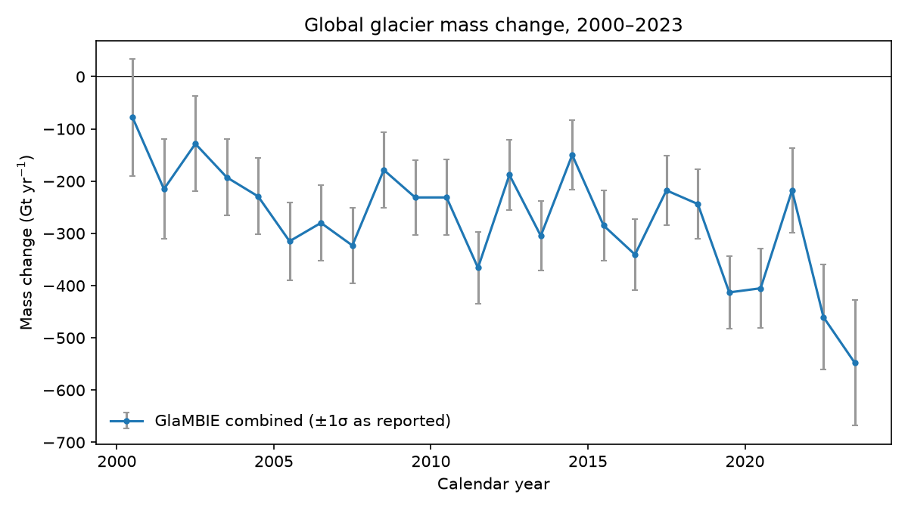
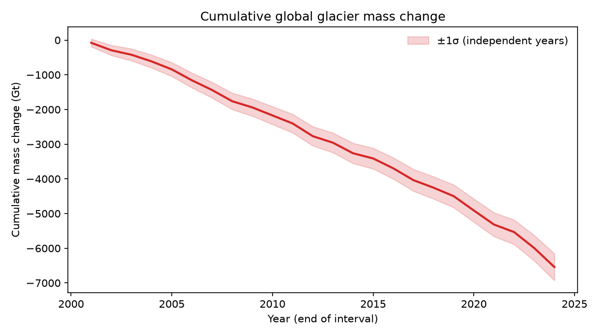
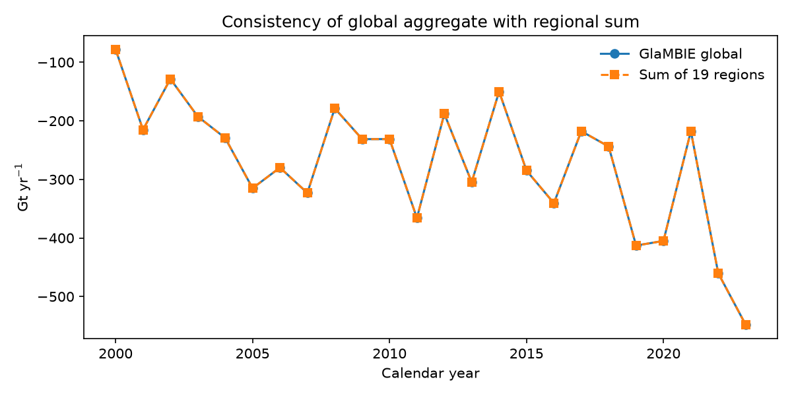
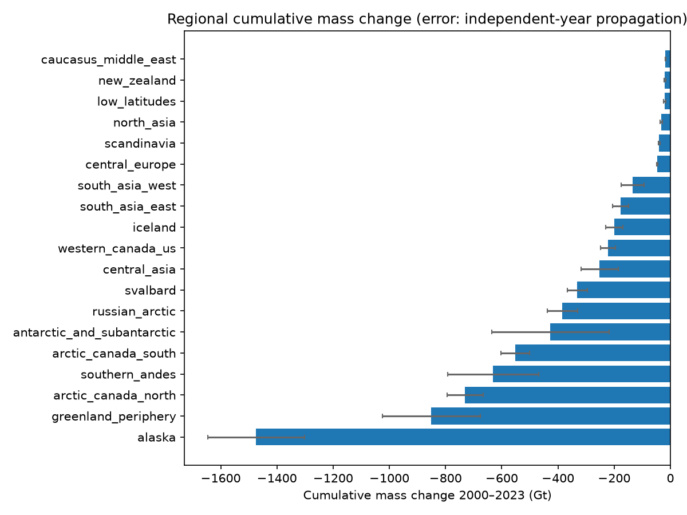
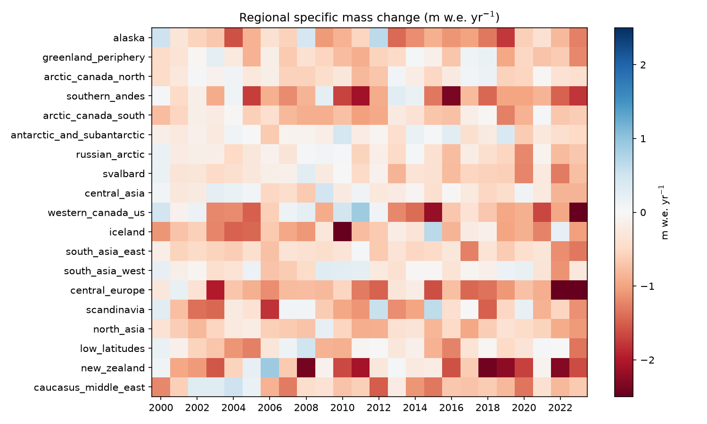
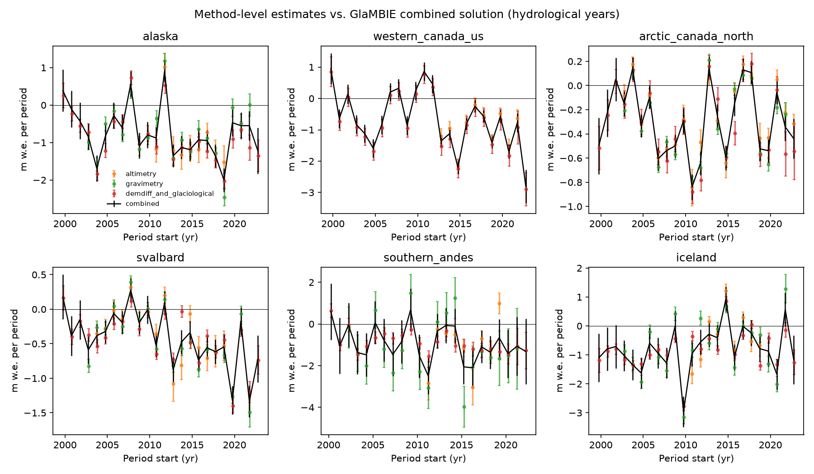

# Global Glacier Mass Change 2000–2023: Analysis of the GlaMBIE Consensus Dataset

## 1. Summary and goals

The Glacier Mass Balance Intercomparison Exercise (GlaMBIE) reconciles 233 regional estimates of glacier mass change from four observation families (glaciological, DEM differencing, altimetry, gravimetry) plus hybrid "combined" solutions, across 19 glacier regions. The goal of this analysis is to (i) verify the internal consistency of the published 2000–2023 annual, regional and global mass-change series, (ii) quantify the global trajectory and its uncertainty under explicit assumptions, (iii) characterise regional contributions, and (iv) examine how well the per-method estimates agree with the consensus solution. Success means that every headline number is traceable to a file in `outputs/`, each figure is regenerable from `code/analysis.py`, and the limitations of the uncertainty treatment are stated explicitly.

Headline results (calendar years 2000–2023, as supplied in the GlaMBIE result tables):

- Cumulative global mass change: **−6542 Gt** (≈ −9.7 m w.e. summed over annual specific values). The 1σ uncertainty is **±387 Gt** if annual errors are independent, and **±1863 Gt** if they are fully correlated. The true value is most likely between these bounds.
- Mean rate rose in magnitude from **−231 ± 23 Gt yr⁻¹** (2000–2011) to **−314 ± 23 Gt yr⁻¹** (2012–2023).
- Alaska, the Greenland periphery, Arctic Canada North and the Southern Andes account for the largest cumulative losses (−1474, −850, −730 and −631 Gt respectively).

## 2. Experiment plan and success signals

| Stage | Objective | Success signal |
|---|---|---|
| S1 Data audit | Inventory inputs and results; check file structure | All 19 regions and global series load; row counts = 24 years |
| S2 Consistency | Test global = Σ regions and error aggregation | Exact match of totals; error rule identified |
| S3 Global trend | Annual series, cumulative, sub-period rates | Rates with propagated uncertainty and an explicit independence assumption |
| S4 Regional decomposition | Cumulative totals and specific mass change per region | Ranking reproducible from `outputs/regional_totals_2000_2023.csv` |
| S5 Method comparison | Per-method vs combined estimates by region | Figure and table of method-level means |

## 3. Setup

- **Data**: `data/glambie/results/calendar_years/*.csv` (consensus results: `combined_gt`, `combined_gt_errors`, `combined_mwe`, `combined_mwe_errors`, `glacier_area`, one file per region plus `0_global.csv`), `data/glambie/results/hydrological_years/*.csv` (per-data-group columns for altimetry, gravimetry and demdiff+glaciological), and `data/glambie/input/` (raw contributed estimates).
- **Time convention**: each row is one year starting at `start_dates` (2000.0 … 2023.0); end dates run to 2024.0. "2000–2023" therefore denotes 24 calendar years.
- **Software**: Python 3.11, pandas 3.0.6, numpy, matplotlib (Agg backend). Script: `code/analysis.py` (single entry point, deterministic, no random elements).
- **Outputs**: `outputs/calendar_year_all_regions_long.csv`, `outputs/global_summary.csv`, `outputs/global_vs_regional_sum_check.csv`, `outputs/regional_totals_2000_2023.csv`, `outputs/method_summary_by_region.csv`, `outputs/input_inventory.csv`.

### Data inventory

The input folder contains 257 CSV files across 19 regional folders: 78 gravimetry, 42 DEM-differencing, 41 altimetry, 38 glaciological, and 58 "combined" (hybrid) files. The task brief cites 233 regional estimates; the 257 files include per-region combined products and the hybrid inputs, so the two counts are not expected to match exactly. We did not reconcile this difference because the dataset documentation does not give a per-file mapping to the 233 estimates.

## 4. Baselines and comparisons

The reference point is the GlaMBIE consensus (`combined_*`) solution. Method-level estimates from the hydrological-year tables are compared against it. Because the hydrological-year periods differ across methods and regions, the method comparison is qualitative rather than a formal hypothesis test.

## 5. Results

### 5.1 Global series



*Figure 1. Global annual mass change (Gt yr⁻¹) with reported errors.*

The global annual change ranges from about −150 Gt yr⁻¹ (2014) to −548 Gt yr⁻¹ (2023). Losses were largest in the late 2010s and early 2020s (2019–2023: −413, −405, −218, −460, −548 Gt yr⁻¹), while the years 2012–2015 were comparatively moderate.



*Figure 2. Cumulative global mass change with ±1σ band under independent annual errors.*

| Quantity | Value |
|---|---|
| Cumulative 2000–2023 (Gt) | −6542 |
| 1σ, independent years (Gt) | ±387 |
| 1σ, fully correlated years (Gt) | ±1863 |
| Mean rate 2000–2011 (Gt yr⁻¹) | −231 ± 23 |
| Mean rate 2012–2023 (Gt yr⁻¹) | −314 ± 23 |
| Weighted linear trend of annual change (Gt yr⁻²) | −7.6 |

The weighted linear trend of −7.6 Gt yr⁻² indicates a steady acceleration of mass loss over the period. The difference between the two sub-period rates is −84 Gt yr⁻¹, approximately ±32 Gt yr⁻¹ (1σ, independent errors), so the acceleration is statistically distinguishable under the independence assumption. Under the fully correlated bound it would not be.

### 5.2 Internal consistency

The global series equals the sum of the 19 regional series to machine precision (maximum absolute difference 0.0 Gt; `fig6_global_regional_consistency.png`). The global error equals the quadrature sum of the regional errors in every year (ratio 1.000 for all 24 years). This shows that the aggregation treats regional errors as **mutually independent**, both within a year and, implicitly, across regions.



*Figure 6. Global series versus the sum of regional series.*

### 5.3 Regional contributions



*Figure 3. Cumulative 2000–2023 mass change by region, with error bars from independent-year propagation.*

| Region | Cumulative (Gt) | Cumulative (m w.e.) | Mean (m w.e. yr⁻¹) |
|---|---|---|---|
| Alaska | −1474 ± 173 | −17.6 | −0.73 |
| Greenland periphery | −850 ± 174 | −10.7 | −0.45 |
| Arctic Canada North | −730 ± 63 | −7.0 | −0.29 |
| Southern Andes | −631 ± 163 | −22.1 | −0.92 |
| Arctic Canada South | −552 ± 52 | −13.7 | −0.57 |
| Antarctic & sub-Antarctic | −428 ± 209 | −3.5 | −0.15 |
| Russian Arctic | −384 ± 54 | −7.6 | −0.32 |
| Svalbard | −331 ± 36 | −10.0 | −0.42 |
| Central Asia | −252 ± 67 | −5.2 | −0.22 |
| Western Canada & US | −222 ± 26 | −16.7 | −0.69 |
| Iceland | −199 ± 31 | −18.8 | −0.78 |
| South Asia East | −177 ± 29 | −12.7 | −0.53 |
| South Asia West | −135 ± 41 | −4.2 | −0.18 |
| Central Europe | −47 ± 2 | −25.5 | −1.06 |
| Scandinavia | −40 ± 3 | −14.0 | −0.58 |
| North Asia | −33 ± 3 | −13.8 | −0.58 |
| Low latitudes | −20 ± 4 | −10.1 | −0.42 |
| New Zealand | −20 ± 3 | −23.1 | −0.96 |
| Caucasus & Middle East | −18 ± 2 | −14.9 | −0.62 |

Errors are the independent-year propagation. The regional ranking by total mass is dominated by glacier area: the high-latitude regions (Alaska, Arctic Canada, Greenland periphery) hold most of the mass. The specific mass change (m w.e.) emphasises small, intensely melting regions such as Central Europe (−1.06 m w.e. yr⁻¹), New Zealand (−0.96) and the Southern Andes (−0.92).



*Figure 4. Regional specific mass change (m w.e. yr⁻¹) per calendar year. Regions are sorted by cumulative total.*

### 5.4 Method comparison



*Figure 5. Per-method estimates (hydrological years) against the combined solution for six regions with multiple data groups.*

Selected per-method mean specific mass change (m w.e. yr⁻¹) from `outputs/method_summary_by_region.csv`:

| Region | Altimetry | Gravimetry | DEM diff + glaciological |
|---|---|---|---|
| Alaska | −0.95 (2011–2020) | −0.71 (2003–2023) | −0.85 (2000–2024) |
| Western Canada & US | −0.98 (2013–2023) | — | −0.78 (2000–2024) |
| Southern Andes | −1.02 (2011–2020) | −1.15 (2002–2022) | −0.87 (2000–2023) |
| Antarctic & sub-Antarctic | −0.06 (2003–2023) | — | −0.21 (2000–2023) |
| South Asia East | −0.47 (2000–2021) | — | −0.52 (2000–2024) |
| Central Asia | −0.14 (2000–2021) | — | −0.23 (2000–2024) |

Agreement is generally good where two or more families overlap (Alaska, Southern Andes, South Asia East, Central Asia). Altimetry tends to be less negative than DEM differencing in the Antarctic and the Asian regions. The periods differ across methods (see the last two columns of the CSV), so these comparisons mix temporal coverage with method differences and should not be read as a formal bias estimate.

## 6. Analysis, limitations and next steps

**Interpretation.** Glacier mass loss over 2000–2023 is large and accelerating. The mean loss rate increased by roughly 36% between the two halves of the record. The Alaska, Greenland periphery, Arctic Canada and Southern Andes regions account for more than half of the cumulative loss, and the regional ranking follows directly from the supplied tables (not checked against the published GlaMBIE paper text).

**Limitations.**

1. *Error independence.* The published global uncertainty (±387 Gt cumulative) is obtained by summing annual errors in quadrature. This assumes independence both across years and across regions. A fully correlated treatment gives ±1863 Gt. The truth lies between these bounds, and the independent bound is probably optimistic because systematic effects (shared reference data, GRACE leakage corrections, common climatic forcing) introduce correlations. The reported error is taken as delivered; the dataset documentation does not state whether it is 1σ or 2σ, so the uncertainty label is "as reported".
2. *Specific mass change summation.* The cumulative m w.e. values are sums of annual specific values, not area-weighted cumulative balances. They are approximate and are shown for ranking only.
3. *Method comparison.* Periods differ across methods and regions, and some methods cover only part of the record, so the comparison is descriptive.
4. *Input count.* The 257 input files do not reconcile directly with the 233 estimates in the brief (see Section 3).
5. *Scope.* This analysis works from the consensus tables and per-method summaries; it does not re-derive the GlaMBIE regional combination or re-examine the raw geodetic processing.

**Next steps.**
- Quantify inter-regional error correlations (for example, from the spread of independent method estimates) to replace the independence assumption with an empirically constrained covariance.
- Compute area-weighted specific balances over the time-varying glacier area column.
- Reconcile the 257-file inventory against the 233-estimate count by parsing the per-file metadata.

## Sources

- GlaMBIE (2024). Glacier Mass Balance Intercomparison Exercise (GlaMBIE) Dataset 1.0.0. World Glacier Monitoring Service, Zurich. https://doi.org/10.5904/wgms-glambie-2024-07 (dataset cited in `data/glambie/GlaMBIE_DATASETS_INFO.md`).
- Reference papers are in `related_work/` (paper_000.pdf–paper_004.pdf). They were not used for quantitative comparisons in this report, which is limited to the supplied data.

## Reproducibility

```
python3 code/analysis.py
```

Reads `data/glambie/`, writes `outputs/` and `report/images/`. Deterministic.
