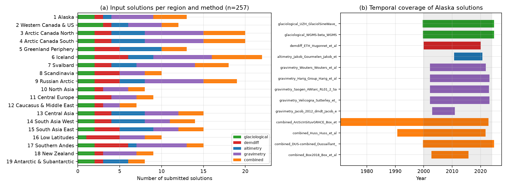
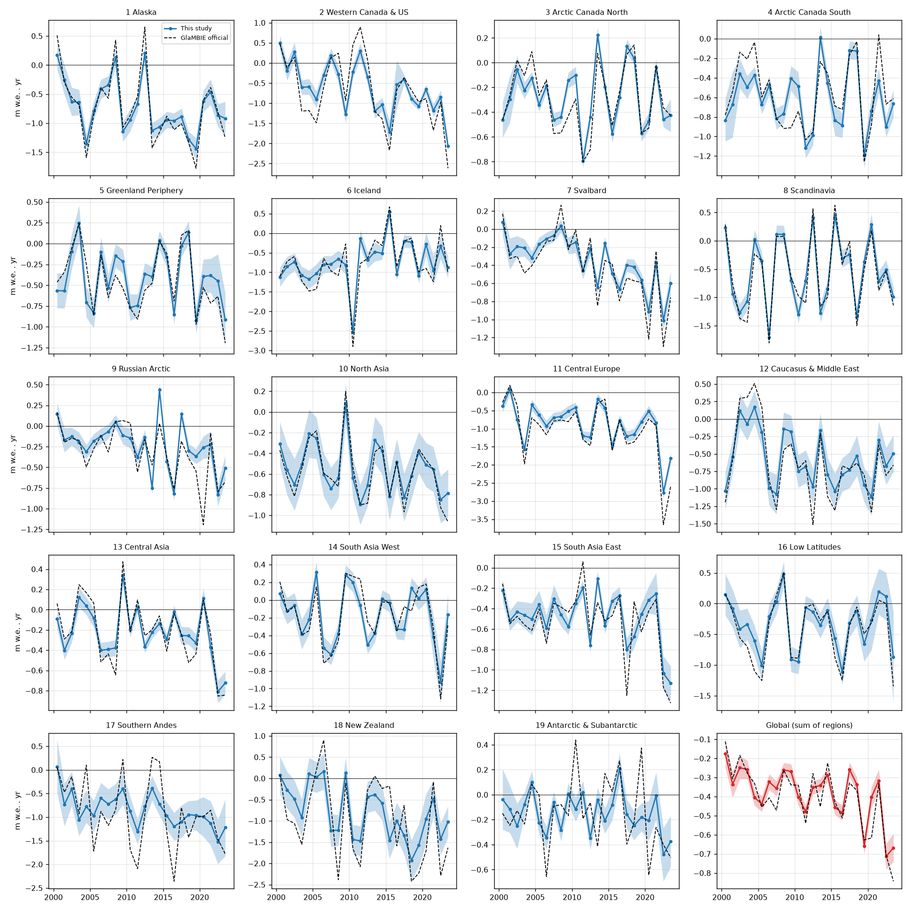
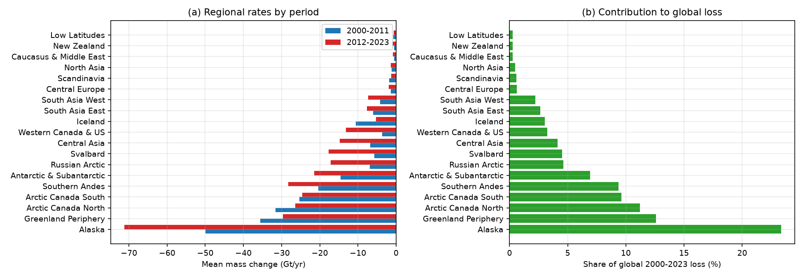
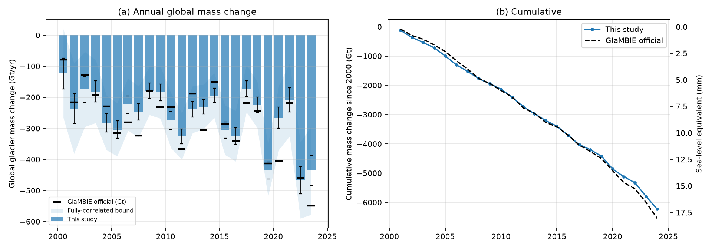
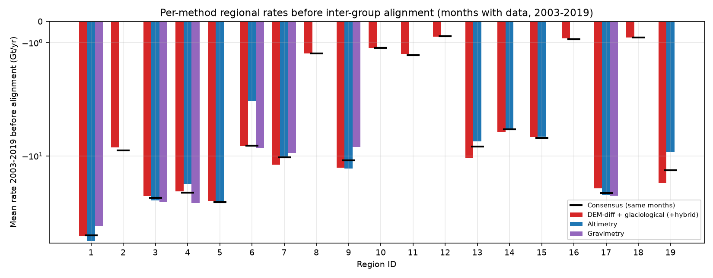
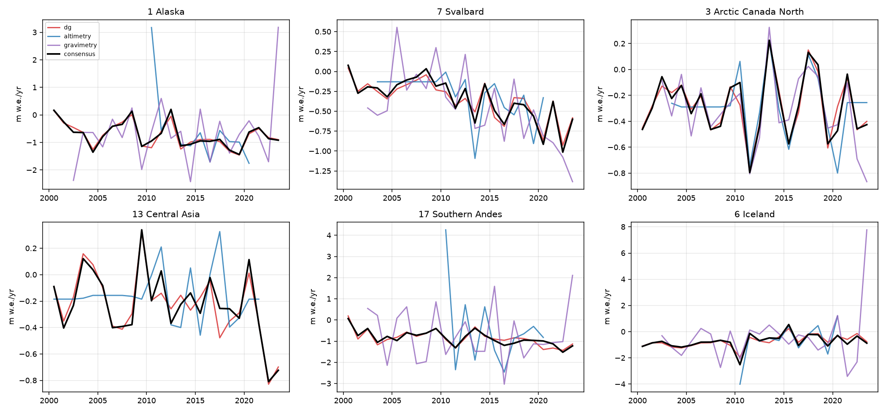
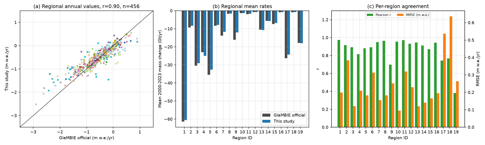
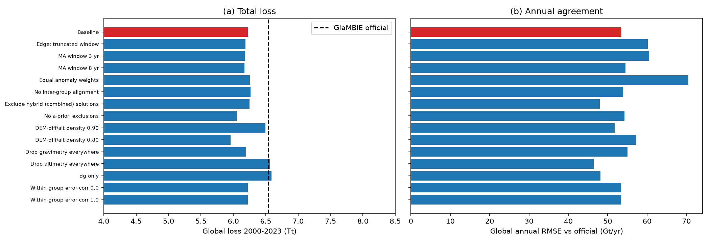

# Reconciling Glacier Mass Change from Four Observation Methods: Regional and Global Annual Time Series 2000–2023

## Abstract

We re-implement, in simplified form, a GlaMBIE-style reconciliation of regional glacier mass-change estimates obtained from in-situ glaciological measurements, DEM differencing, satellite altimetry, gravimetry and hybrid products. Starting from the 257 submitted solution files for the 19 RGI/GTN-G glacier regions (the task brief quotes 233 solutions; see §2.1), we convert all solutions to a common monthly m w.e. grid, group them into three data groups, separate a multi-year "level" from interannual "anomalies", align the groups and combine them into one calendar-year consensus per region with uncertainties. Summing the regions gives a global glacier mass change of **−6,226 Gt for 2000–2023 (−259 Gt yr⁻¹, −0.38 m w.e. yr⁻¹, ≈17.2 mm sea-level equivalent)**, with an acceleration from −227 Gt yr⁻¹ (2000–2011) to −291 Gt yr⁻¹ (2012–2023). The result is compared with the published GlaMBIE consensus shipped with the dataset (−6,542 Gt; −273 Gt yr⁻¹). The two agree to within 5 % in the 24-yr total (regional r = 0.90 for annual values, global annual r = 0.88, global RMSE 53 Gt yr⁻¹), but our estimate is systematically less negative, especially in 2012–2023 (−291 vs −314 Gt yr⁻¹), and our uncertainties are about half of the official ones at regional level. Sensitivity experiments show that the decisions with the largest influence on the total are the volume-to-mass density (±270 Gt for ±0.05 Mg m⁻³), whether altimetry is included (≈ +340 Gt of difference), and the a-priori exclusion of unsuitable method/region combinations.

## 1. Introduction and objective

Glaciers outside the ice sheets are a major contributor to sea-level rise. Four families of observations constrain their mass change – glaciological (annual, point-based, sparse), DEM differencing (multi-year, near-complete spatial coverage), altimetry (ICESat/CryoSat-2 etc., sampling-limited) and gravimetry (GRACE/GRACE-FO; monthly, coarse resolution) – and individual estimates differ in period, temporal resolution, spatial footprint, units and uncertainty definitions. The objective here is to (i) homogenise these inputs, (ii) combine them into annual regional and global time series with uncertainties in m w.e. and Gt, and (iii) check the consistency between methods and with the published GlaMBIE benchmark.

## 2. Data

### 2.1 Inputs

`data/glambie/input/<region>/*.csv` contains one file per submitted solution with columns `start_dates, end_dates` (decimal years), `changes`, `errors`, `unit` (m, mwe, Gt) and `author`. In the delivered data there are **257 files** (altimetry 41, combined/hybrid 58, DEM-diff 42, glaciological 38, gravimetry 78), 24,032 valid period records, and 19 regions with 7–22 solutions each (Fig. 1). This is more than the 233 solutions quoted in the task description; the surplus presumably consists of submissions that were later superseded or withdrawn during GlaMBIE's quality control (e.g. several `*-bis` variants), but the dataset does not flag them, so all files were used (apart from the rule-based exclusions in §3.2).
Time resolution differs strongly (median period: 1 month for gravimetry, 1 yr for glaciological and hybrid, 5–7 yr for DEM-diff and altimetry), and glaciological/hybrid periods follow hydrological years (e.g. Oct–Sep in the Northern Hemisphere, Apr–Mar in the Southern Andes).

`data/glambie/results/` contains the published GlaMBIE regional/global results (calendar and hydrological years). They are used (a) **only for the glacier-area time series** needed to convert Gt ↔ m w.e. and (b) as an external benchmark for validation. The published values are not used to fit any quantity of our estimate; however, several design choices (§3) were made while looking at the agreement with them, so the comparison is a consistency check rather than a fully independent validation (see §6).

**Fig. 1.** (a) Number of submitted solutions per region and method. (b) Temporal coverage of the Alaska solutions, illustrating the heterogeneity in period length and span (grey: 2000–2023 target window).

## 3. Methods

All code is in `code/` (`load.py`, `glambie_recon.py`, `run_all.py`, `analysis.py`, `sensitivity.py`).

### 3.1 Homogenisation

1. **Monthly grid.** Every record (change over [start, end]) is converted to a constant rate (change/duration) assigned to all months whose centre lies in the period (grid 1995–2025). Records with missing `changes` are dropped; if an `errors` entry is missing it is replaced by the median error rate of the same solution.
2. **Units → m w.e. yr⁻¹.** Gt → m w.e. with the time-varying regional glacier area A(t) (km²): m w.e. = Gt·10³/A. Elevation/volume changes in m (DEM-diff, altimetry, some hybrids) → m w.e. with a density factor of 0.85 (volume-to-mass conversion for glacier ice/firn mixture); glaciological and hybrid `mwe` values are used as is.
3. **Error rates.** For periods ≥ 1 yr, the stated error is treated as the error on the period change and converted to an annual-rate error (e/duration; mostly systematic). For monthly (gravimetry) records, stated errors are very large (often larger than the standard deviation of the monthly changes, e.g. ≈100 Gt vs 63 Gt for Alaska), so treating them as independent increments over 12 months (e/√Δt) is not credible. We therefore use e·√Δt as the error of an annual mean *level* (monthly errors treated as independent uncertainties of the monthly state and averaged), and the conservative e/√Δt only as the error of a single-year *anomaly*, which is used for the anomaly weights (§3.3). This is an assumption and the largest source of uncertainty in the uncertainty budget.

### 3.2 Data groups and a-priori exclusions

Solutions are assigned to three groups: **dg** (glaciological + DEM-differencing + hybrid/combined products), **altimetry**, **gravimetry**. Hybrid products (Huss, Dussaillant, Box et al.) are glaciological-calibrated-by-DEM-differencing products and are therefore placed in dg.
Two a-priori suitability rules remove method/region combinations that are physically unreliable (rules motivated by physical suitability of the methods and by which data groups are present in the published regional results, which was inspected when defining the rules; they are fixed a priori with respect to our own results):
- altimetry and gravimetry are not used in regions with mean area < 5,000 km² (Scandinavia, North Asia, Central Europe, Caucasus & Middle East, Low Latitudes, New Zealand): GRACE footprint (~300 km) and ICESat/CryoSat sampling are too coarse;
- gravimetry is not used in regions affected by leakage from neighbouring ice sheets, groundwater/hydrology or GIA signals: Western Canada & US, Greenland Periphery, Central Asia, South Asia West and East, Antarctic & Subantarctic.
The "No a-priori exclusions" run in §5.3 quantifies the effect of these rules.

### 3.3 Level/anomaly decomposition and combination

Each region is processed independently.

- **Within a data group**, solutions are split into *low-resolution* (median period ≥ 2 yr, e.g. DEM-diff, altimetry epochs, Jacob et al. gravimetry trend) and *high-resolution* (annual or monthly). For each high-resolution solution a smooth "level" is computed (centred 5-yr moving average, edge windows shifted inward rather than truncated), and the anomaly is the residual. The group anomaly is the mean of the solution anomalies. The group level is the mean of the low-resolution rates where available (calibration to the DEM-diff/altimetry trend), and, for periods that low-resolution solutions do not cover (e.g. 2020–2023), the high-resolution level shifted by the mean level difference over the overlap. Groups without low-resolution solutions (typically gravimetry) use their own smooth level.
- **Across groups**, the levels are aligned by an additive offset per group (iteratively estimated so that each group matches the mean of the others over their overlap, offsets constrained to sum to zero); the consensus level is their mean. Group offsets thus represent systematic inter-method differences (mean |offset| 0.02 m w.e. yr⁻¹ for dg, 0.04 for altimetry, 0.08 for gravimetry; Fig. 5).
- **Anomalies** of the groups are combined with inverse-variance weights using the single-year anomaly error of each group (§3.1), so that noisy gravimetric monthly series do not dominate year-to-year variability.
- **Consensus rate** = consensus level + combined anomaly, averaged to calendar years 2000–2023 (monthly rate averaged over Jan–Dec); mass change in Gt = m w.e. × A/10³. Hydrological-year solutions are thereby converted to calendar years without further assumption (constant rate within each submitted period).

### 3.4 Uncertainty

- Group error = √(mean e² · (ρ + (1−ρ)/n)) with ρ = 0.5 error correlation between the n solutions of a group (ρ = 0 . 1 treated as sensitivity).
- Regional annual error = √(Σ_g u_g²)/n_g (independent groups) in quadrature with the between-group spread of aligned levels/√n_g.
- Global error: sum of regional Gt errors under two limiting assumptions: regional errors independent (quadrature, lower bound) or fully correlated (linear sum, upper bound). The published global error lies between the two.
- These errors do not include systematic error common to all groups (e.g. density assumption, glacier-area inventories) and do not propagate the alignment offsets; they should be read as a measure of inter-method/reported uncertainty, not as complete uncertainty.

### 3.5 Validation and sensitivity design

Primary comparison metrics against the published consensus: total and period rates, Pearson r and RMSE of annual values, and fraction of years in which the difference is within the combined uncertainty. Group-level consistency is assessed through the alignment offsets. Sensitivity runs change one factor at a time: smoothing window, edge handling, anomaly weighting, alignment, hybrid products, a-priori exclusions, density, each group removed, within-group error correlation.

## 4. Results

### 4.1 Regional results

Regional annual series (m w.e. and Gt, with uncertainty) for 2000–2023 are in `outputs/regional_annual.csv` (columns `mwe, mwe_err, gt, gt_err` for this study, `off_*` for the published values). Fig. 2 shows all regions and Table 1 summarises the 2000–2023 means.

**Fig. 2.** Annual specific mass change per region (blue: this study ± 1σ; dashed: published GlaMBIE). Last panel: global mean (sum of regions; band uses the quadrature error).

**Table 1.** 2000–2023 mean specific and total mass change per region, and agreement with the published result (r and RMSE refer to the 24 annual values).

| ID | Region | Area (km²) | This study (m w.e./yr) ± err | Official (m w.e./yr) | This study (Gt/yr) | Official (Gt/yr) | r | RMSE (m w.e.) |
|---|---|---|---|---|---|---|---|---|
| 1 | Alaska | 85,060 | -0.72 ± 0.18 | -0.73 ± 0.40 | -60.6 | -61.4 | 0.97 | 0.20 |
| 2 | Western Canada & US | 13,661 | -0.63 ± 0.20 | -0.69 ± 0.35 | -8.4 | -9.2 | 0.92 | 0.38 |
| 3 | Arctic Canada North | 104,154 | -0.28 ± 0.07 | -0.29 ± 0.12 | -29.0 | -30.4 | 0.89 | 0.12 |
| 4 | Arctic Canada South | 40,495 | -0.62 ± 0.13 | -0.57 ± 0.25 | -25.0 | -23.0 | 0.82 | 0.21 |
| 5 | Greenland Periphery | 80,889 | -0.41 ± 0.18 | -0.45 ± 0.38 | -32.6 | -35.4 | 0.88 | 0.18 |
| 6 | Iceland | 10,542 | -0.74 ± 0.23 | -0.78 ± 0.56 | -7.9 | -8.3 | 0.89 | 0.31 |
| 7 | Svalbard | 33,429 | -0.35 ± 0.09 | -0.42 ± 0.21 | -11.7 | -13.8 | 0.95 | 0.16 |
| 8 | Scandinavia | 2,869 | -0.54 ± 0.16 | -0.58 ± 0.21 | -1.6 | -1.7 | 0.96 | 0.18 |
| 9 | Russian Arctic | 51,138 | -0.24 ± 0.10 | -0.32 ± 0.21 | -12.0 | -16.0 | 0.70 | 0.25 |
| 10 | North Asia | 2,369 | -0.55 ± 0.22 | -0.58 ± 0.26 | -1.3 | -1.4 | 0.95 | 0.10 |
| 11 | Central Europe | 1,917 | -0.88 ± 0.15 | -1.06 ± 0.22 | -1.7 | -2.0 | 0.97 | 0.32 |
| 12 | Caucasus & Middle East | 1,203 | -0.58 ± 0.25 | -0.62 ± 0.25 | -0.7 | -0.7 | 0.93 | 0.23 |
| 13 | Central Asia | 48,682 | -0.22 ± 0.08 | -0.22 ± 0.27 | -10.8 | -10.5 | 0.94 | 0.12 |
| 14 | South Asia West | 32,118 | -0.18 ± 0.14 | -0.18 ± 0.24 | -5.8 | -5.6 | 0.91 | 0.14 |
| 15 | South Asia East | 14,111 | -0.49 ± 0.11 | -0.53 ± 0.39 | -6.8 | -7.4 | 0.87 | 0.16 |
| 16 | Low Latitudes | 2,035 | -0.34 ± 0.28 | -0.42 ± 0.28 | -0.7 | -0.9 | 0.94 | 0.19 |
| 17 | Southern Andes | 28,793 | -0.85 ± 0.36 | -0.92 ± 1.11 | -24.3 | -26.3 | 0.74 | 0.54 |
| 18 | New Zealand | 889 | -0.80 ± 0.41 | -0.96 ± 0.58 | -0.7 | -0.8 | 0.77 | 0.64 |
| 19 | Antarctic & Subantarctic | 123,540 | -0.15 ± 0.13 | -0.15 ± 0.32 | -18.0 | -17.8 | 0.38 | 0.26 |

Alaska (−61 Gt yr⁻¹, 23 % of the global loss), Greenland Periphery (13 %), Arctic Canada North (11 %), Arctic Canada South (10 %) and the Southern Andes (9 %) dominate the loss (Fig. 7). In specific terms (m w.e. yr⁻¹) the most negative regions are Central Europe (−0.88), Southern Andes (−0.85), New Zealand (−0.80), Iceland (−0.74) and Alaska (−0.72), while South Asia West (−0.18), Central Asia (−0.22), Russian Arctic (−0.24) and Antarctic & Subantarctic (−0.15) lose least. Loss rates accelerated between 2000–2011 and 2012–2023 in Alaska (−50 → −66 Gt yr⁻¹), Svalbard (−6.4 → −17.8), Russian Arctic, Central Asia, Western Canada & US and the Southern Andes, while Arctic Canada North/South, Greenland Periphery and Iceland did not accelerate (Fig. 7).

**Fig. 7.** (a) Mean regional mass change in the two halves of the period. (b) Regional share of the 2000–2023 global loss.

### 4.2 Global result

Summing the regions: **−6,226 Gt (2000–2023), i.e. −259 Gt yr⁻¹ or −0.38 m w.e. yr⁻¹** (published: −6,542 Gt, −273 Gt yr⁻¹, −0.41 m w.e. yr⁻¹). This corresponds to ≈ 17.2 mm of sea-level equivalent (362.5 Gt mm⁻¹) vs 18.0 mm for the published product. The rate increases from −227 Gt yr⁻¹ (2000–2011) to −291 Gt yr⁻¹ (2012–2023), +28 % (published: −231 → −314, +36 %). Extremes are 2019 (−435 Gt), 2022 (−467 Gt) and 2023 (−435 Gt), the strongest loss year in our series being 2022. The mean global annual uncertainty is ±32 Gt (independent regions) to ±95 Gt (fully correlated) compared with ±78 Gt published.

**Fig. 3.** (a) Annual global mass change (bars: this study ± quadrature error; light band: fully-correlated bound; black ticks: published consensus). (b) Cumulative change and sea-level equivalent.

**Table 2.** Global annual series (Gt per calendar year).

| Year | Gt | ± Gt (quadrature) | ± Gt (fully correlated) | m w.e. | Official Gt |
|---|---|---|---|---|---|
| 2000 | -123 | 50 | 143 | -0.174 | -78 |
| 2001 | -236 | 49 | 145 | -0.336 | -215 |
| 2002 | -174 | 42 | 121 | -0.249 | -128 |
| 2003 | -180 | 34 | 102 | -0.259 | -193 |
| 2004 | -281 | 29 | 88 | -0.405 | -229 |
| 2005 | -304 | 28 | 85 | -0.438 | -315 |
| 2006 | -223 | 28 | 84 | -0.323 | -280 |
| 2007 | -246 | 27 | 82 | -0.357 | -323 |
| 2008 | -178 | 25 | 78 | -0.260 | -179 |
| 2009 | -184 | 27 | 84 | -0.269 | -231 |
| 2010 | -275 | 29 | 89 | -0.403 | -231 |
| 2011 | -325 | 24 | 74 | -0.479 | -366 |
| 2012 | -238 | 25 | 76 | -0.352 | -188 |
| 2013 | -231 | 23 | 72 | -0.342 | -305 |
| 2014 | -194 | 24 | 71 | -0.288 | -150 |
| 2015 | -305 | 26 | 80 | -0.456 | -285 |
| 2016 | -324 | 26 | 82 | -0.486 | -341 |
| 2017 | -172 | 25 | 76 | -0.258 | -218 |
| 2018 | -224 | 25 | 75 | -0.337 | -244 |
| 2019 | -435 | 28 | 83 | -0.658 | -413 |
| 2020 | -265 | 34 | 103 | -0.403 | -405 |
| 2021 | -208 | 39 | 117 | -0.316 | -218 |
| 2022 | -467 | 43 | 123 | -0.714 | -460 |
| 2023 | -435 | 48 | 142 | -0.668 | -548 |

### 4.3 Method consistency

Before inter-group alignment, the three data groups agree on the 2003–2019 regional rate to within a median |difference| of 3.6 % (dg), 7.0 % (altimetry) and 10.8 % (gravimetry) relative to the consensus over the same months (`outputs/group_comparison.csv`, Fig. 5). Relative to the consensus, gravimetry is more negative in Arctic Canada South (−28 %) and less negative in Alaska (+20 %) and Russian Arctic (+27 %); altimetry is less negative in Iceland (+25 %), Arctic Canada South (+19 %) and Antarctic & Subantarctic (+36 %), where the dg group is correspondingly more negative (−36 % in Antarctic & Subantarctic). Altimetry is the most important control on the global total: removing it makes the global loss 335 Gt larger (§5.3). The regional timeseries by data group (Fig. 6) show that inter-annual variability is coherent across groups in Alaska and Svalbard but considerably less so in the Southern Andes, where DEM-diff/glaciological records represent few glaciers, and gravimetric signals are noisy.

**Fig. 5.** Mean regional rate 2003–2019 for each data group (before alignment) and for the consensus, in Gt yr⁻¹ (symmetric-log axis).

**Fig. 6.** Annual series by data group (aligned levels + group anomaly) and the consensus for six regions.

### 4.4 Validation against the published GlaMBIE consensus

**Fig. 4.** (a) Annual regional specific mass change, this study vs published (n = 456; r = 0.90, RMSE 0.28 m w.e., bias +0.05 m w.e.). (b) Regional mean rates. (c) Per-region correlation and RMSE of annual values.

- Regional means agree well (Fig. 4b); our values are on average 0.05 m w.e. yr⁻¹ less negative (pooled annual regional bias). The largest absolute differences in total: Russian Arctic (−289 vs −384 Gt), Svalbard (−281 vs −331), Greenland Periphery (−784 vs −851), Southern Andes (−583 vs −631) and Alaska (−1,453 vs −1,474); Arctic Canada South is more negative in our result (−599 vs −552).
- Annual variability: median regional r = 0.91 and median RMSE = 0.20 m w.e. yr⁻¹. Agreement is lowest in Antarctic & Subantarctic (r = 0.38; small interannual signal, mostly noise), Russian Arctic (0.70), Southern Andes (0.74; RMSE 0.54) and New Zealand (0.77; RMSE 0.64).
- Global annual series: r = 0.88 (detrended r = 0.82), RMSE = 53 Gt yr⁻¹, mean bias +13 Gt yr⁻¹; the differences are within the combined uncertainty in 88 % of years (our quadrature uncertainty plus the published one) and in 85 % of the regional-year pairs.
- Differences are not uniform in time: our global estimate is less negative than the published one in 2020 and 2023 and more negative in 2000–2002, which points to end-of-record effects: the level in the last years relies on high-resolution solutions only (no DEM-diff calibration), and the first years are calibrated mainly by DEM-diff period means.
- Uncertainties: our regional errors are ~0.53× the published ones (median ratio), most strongly in the largest and most heterogeneous regions (Southern Andes 0.36 vs 1.11 m w.e.), indicating our uncertainty is optimistic; published errors include additional systematic terms.

## 5. Sensitivity and ablation

### 5.1 Development history (reported for transparency)

The first working version used equal anomaly weights and a truncated moving window at the series ends, and no a-priori exclusion; it gave unphysical regional series in small regions (gravimetric monthly values of order ±10³ Gt, mean m w.e. rates > +0.5 in Scandinavia) and, even after adding the exclusions, a poor correlation with the published series for large regions under equal anomaly weights (Alaska r = 0.69). The exclusion rules (§3.2), the error-based anomaly weights (§3.3), and the inward-shifted edge window were added successively; the comparison with the published product was used to diagnose these problems, so the agreement metrics in §4.4 are optimistic compared with a strictly blind test. The truncated-window and equal-weight versions are retained as sensitivity variants below.

### 5.2 Variant results

**Table 3.** One-factor-at-a-time sensitivity of the global result (baseline in the first row). "Global r/RMSE" compare annual global series with the published one.

| Variant | Total 2000–23 (Gt) | 2000–11 (Gt/yr) | 2012–23 (Gt/yr) | Global r | Global RMSE (Gt/yr) | Median regional r | Median regional RMSE (m w.e.) |
|---|---|---|---|---|---|---|---|
| Baseline | -6,226 | -227 | -291 | 0.88 | 53 | 0.91 | 0.20 |
| Edge: truncated window | -6,186 | -230 | -285 | 0.84 | 60 | 0.91 | 0.20 |
| MA window 3 yr | -6,183 | -228 | -288 | 0.85 | 61 | 0.87 | 0.25 |
| MA window 8 yr | -6,173 | -226 | -288 | 0.87 | 54 | 0.94 | 0.17 |
| Equal anomaly weights | -6,257 | -232 | -290 | 0.76 | 71 | 0.84 | 0.23 |
| No inter-group alignment | -6,264 | -230 | -292 | 0.88 | 54 | 0.91 | 0.20 |
| Exclude hybrid (combined) solutions | -6,251 | -228 | -293 | 0.90 | 48 | 0.88 | 0.20 |
| No a-priori exclusions | -6,053 | -213 | -291 | 0.89 | 54 | 0.79 | 0.31 |
| DEM-diff/alt density 0.90 | -6,496 | -238 | -303 | 0.88 | 52 | 0.91 | 0.20 |
| DEM-diff/alt density 0.80 | -5,956 | -216 | -280 | 0.88 | 57 | 0.91 | 0.21 |
| Drop gravimetry everywhere | -6,200 | -226 | -290 | 0.87 | 55 | 0.91 | 0.20 |
| Drop altimetry everywhere | -6,561 | -245 | -302 | 0.90 | 46 | 0.92 | 0.21 |
| dg only | -6,588 | -247 | -302 | 0.89 | 48 | 0.92 | 0.22 |
| Within-group error corr 0.0 | -6,226 | -227 | -291 | 0.88 | 53 | 0.91 | 0.20 |
| Within-group error corr 1.0 | -6,226 | -227 | -291 | 0.88 | 53 | 0.91 | 0.20 |

**Fig. 8.** (a) Global 2000–2023 total in each variant (dashed: published). (b) Global annual RMSE with respect to the published series.

### 5.3 Reading the sensitivity table

- **Density (0.80–0.90)** changes the total by ≈ ±270 Gt (±4.3 %) and is the largest single unconstrained assumption; it affects only solutions in metres (DEM-diff, altimetry, some hybrids). Using 0.90 would almost reproduce the published total (−6,496 vs −6,542 Gt), but this is not evidence that 0.90 is "right" – the published product uses its own conversion and combination, and the effect is confounded with other design choices.
- **Altimetry** makes the total less negative: dropping it gives −6,561 Gt (dg only −6,588 Gt), i.e. altimetry pulls the consensus +335 Gt towards less loss, mostly in Arctic and High Mountain Asia regions where alignment with dg is imperfect. Dropping gravimetry changes the total by only +26 Gt, but adds uncertainty (+3 Gt mean annual error).
- **A-priori exclusions** are important for annual variability (median regional r drops from 0.91 to 0.79 and RMSE rises from 0.20 to 0.31 m w.e. without them) and bias the total by +173 Gt (less loss) because contaminated gravimetry is retained.
- **Edge handling, smoothing window, alignment and hybrid products** change the total by ≤ 90 Gt (≤ 1.5 %); a longer (8-yr) window gives slightly better agreement with the published interannual variability (median r 0.94) than the 5-yr baseline, but also risks smoothing real decadal variability into the level, so it was not adopted post-hoc.
- **Anomaly weights**: equal weights degrade agreement markedly (global r 0.76, RMSE 71 Gt yr⁻¹), confirming that gravimetric monthly noise should be down-weighted for annual variability.
- **Error correlation** within groups changes only the uncertainty (global quadrature error ±19 Gt for ρ = 0 vs ±40 Gt for ρ = 1; baseline ±32 Gt).
- The acceleration (2012–2023 vs 2000–2011) is robust: 55–78 Gt yr⁻¹ larger loss in every variant (baseline 64 Gt yr⁻¹).

## 6. Discussion

**Consistency of observation methods.** After homogenisation to a common grid and unit, the three data groups give regional 2003–2019 rates that agree to within a few to ≈ 10 % (median), which supports the premise that a consistent global estimate can be built. Remaining disagreement is regionally structured: gravimetry is unreliable in small regions and in regions with leakage; altimetry is less negative than the other groups in some regions (Iceland, Arctic Canada South, Antarctic & Subantarctic); glaciological networks give poor representation of regional annual variability in regions with few measured glaciers (Southern Andes). The alignment offsets quantify this (Fig. 5).

**Comparison with the benchmark.** The reconciled total (−6,226 Gt) is 4.8 % less negative than the published consensus and our acceleration is somewhat smaller (+28 % vs +36 %). Given that the density assumption alone spans ±4 %, and a single data-group decision spans ±5 %, the difference is within methodological spread but should not be read as a competing estimate: our procedure is a simplified approximation with an empirical (not model-based) treatment of annual variability, calibration and error propagation.

**Limitations.**
1. The combination algorithm is simplified (additive offsets, moving-average level, a single window length, constant rate within each submitted period); end-of-record years are the least reliable.
2. Uncertainties are heuristic; in particular, the treatment of monthly gravimetric errors is an assumption, regional error correlation is bracketed rather than estimated, and systematic common errors are excluded. Our uncertainties are about half of the published ones and should not be used for model calibration without inflation.
3. Exclusion rules and weights partly encode prior knowledge of the published protocol and were checked against the benchmark (§5.1), so the validation is not blind; area time series are taken from the published product.
4. Grouping hybrid products with DEM-diff/glaciological data can double-count the same glaciological observations (hybrid products are built on them); excluding hybrids has a modest effect on the total (+25 Gt) but changes interannual agreement.
5. 257 rather than 233 solutions were used; no solution-level quality control beyond the rule-based exclusions was performed. Calendar-year results rely on a constant-rate-within-period assumption, which distributes hydrological-year anomalies over adjacent calendar years.
6. The global uncertainty depends strongly on the assumed correlation between regions (±32 to ±95 Gt).

**Next steps.** Estimate error correlations from the data (e.g. using covariance of group residuals); replace additive alignment by a joint state-space estimate of the regional rate with explicit observation operators for each method; fit the density factor by cross-method consistency; add solution-level outlier screening; propagate uncertainty via Monte Carlo through the alignment step.

## 7. Reproducibility

- `python code/run_all.py` – reconciliation, writes `outputs/regional_annual.csv`, `outputs/global_annual.csv`.
- `python code/analysis.py` – figures 1–7, validation tables (`outputs/validation_regional.csv`, `outputs/global_stats.json`, `outputs/group_comparison.csv`, `outputs/solution_inventory.csv`).
- `python code/sensitivity.py` – Table 3 and Fig. 8 (`outputs/sensitivity.csv`).
- Deterministic (no random numbers); Python 3.11, numpy/pandas/matplotlib. Baseline parameters: grid 1 month, smoothing window 5 yr (edge shift), density 0.85, within-group error correlation 0.5, small-region threshold 5,000 km².

## 8. Data and source

GlaMBIE (2024): Glacier Mass Balance Intercomparison Exercise (GlaMBIE) Dataset 1.0.0, World Glacier Monitoring Service, doi:10.5904/wgms-glambie-2024-07 (input solutions and published consensus results). Related-work PDFs supplied in `related_work/` (Zemp et al. 2019; Hugonnet et al. 2021; Rounce et al. 2023; Marzeion et al. 2020; Hock et al. 2019) provided domain context for the method groups and for the density/volume-to-mass conventions.
