# Reconciling four observational methods into a 2000–2023 benchmark of regional and global glacier mass change

**Data:** GlaMBIE input and result datasets (WGMS, doi:10.5904/wgms-glambie-2024-07)
**Code:** `code/` (run everything with `sh code/run_all.sh`) · **Intermediate results:** `outputs/` · **Figures:** `report/images/`

---

## Abstract

Glacier mass change is observed with four families of methods: in situ glaciological measurements, differencing of digital elevation models (DEMs), satellite altimetry, and satellite gravimetry. Their spatial coverage, temporal resolution and error sources differ. Region-wide estimates published by different groups therefore disagree, sometimes by more than their stated uncertainties. This study takes the GlaMBIE collection of submitted regional estimates (257 files from 35 author groups, covering the 19 RGI first-order regions) and builds an independent, transparent and reproducible reconciliation scheme. The scheme has six steps: (i) harmonise units (elevation change → m w.e. → Gt using time-varying glacier area); (ii) temporally downscale multi-annual estimates to annual resolution using the glaciological record of interannual variability; (iii) compute one solution per data group (altimetry, gravimetry, DEM differencing + glaciological); (iv) average the groups with equal weights into a regional consensus; (v) convert from hydrological to calendar years with a year-specific seasonal correction; (vi) aggregate to a global total.

For 2000–2023, glaciers outside the two ice sheets lost **6,351 ± 223 Gt**, equivalent to **17.5 ± 0.6 mm** of sea-level rise. This is a mean rate of **−265 ± 9 Gt yr⁻¹**, or **−0.39 ± 0.01 m w.e. yr⁻¹** (1σ; the errors assume that annual errors are independent in time, and Sect. 6.3 discusses a time-correlated upper bound). The annual loss rose from −242 ± 13 Gt yr⁻¹ in 2000–2011 to −287 ± 13 Gt yr⁻¹ in 2012–2023 (+18 %). The linear trend is −72 ± 31 Gt yr⁻¹ per decade. 2023 was the most negative year in the record (−506 ± 52 Gt, −0.78 ± 0.08 m w.e.). The reconstruction matches the official GlaMBIE (2024) consensus to within 3 % for the 24-yr total. Correlation is r = 0.97 for the global annual series and r = 0.97 across 456 regional annual values. It is also consistent with the hybrid estimates that were withheld from the consensus, and passes a leave-one-group-out test of the uncertainty model. The remaining difference from GlaMBIE (about 8 Gt yr⁻¹ less loss in this study) comes mainly from the Greenland Periphery after 2015, and is explained by different choices for extrapolating DEM-differencing records.

---

## 1. Introduction

Glaciers are among the clearest indicators of climate change. They are currently the largest single contributor to barotropic sea-level rise after ocean thermal expansion. Earlier global assessments rested mainly on one dominant method: extrapolated glaciological and geodetic data (Zemp et al., 2019, `related_work/paper_002.pdf`), or near-global ASTER DEM time series (Hugonnet et al., 2021, `related_work/paper_004.pdf`). Model intercomparisons for future projections (GlacierMIP; Hock et al., 2019, `paper_003`; Marzeion et al., 2020, `paper_001`; Rounce et al., 2023, `paper_000`) need an observational benchmark for calibration and validation. Different methods have given materially different numbers. For example, Zemp et al. (2019) reported −335 ± 144 Gt yr⁻¹ for 2006–2016, whereas Hugonnet et al. (2021) reported −267 ± 16 Gt yr⁻¹ for 2000–2019.

Each method has characteristic strengths and weaknesses:

| Method | Strength | Main limitation |
|---|---|---|
| Glaciological (in situ) | Annual/seasonal resolution, long records | Few glaciers (≈ 0.1 % of glaciers) with possibly unrepresentative mass balance; poorly constrained absolute level |
| DEM differencing | Near-complete spatial coverage, robust multi-annual totals | Coarse temporal resolution (5–20 yr); volume-to-mass density conversion |
| Altimetry (laser/radar) | (Sub-)annual resolution over large ice bodies | Sparse sampling and penetration/footprint issues in rugged terrain; density conversion |
| Gravimetry (GRACE/GRACE-FO) | Direct mass, monthly | Coarse resolution (~300 km); leakage from ice sheets, hydrology and glacial isostatic adjustment; 2017–2018 mission gap |

**Objective.** Reconcile these methods into one consistent set of annual regional and global mass-change time series for 2000–2023, with uncertainties, expressed both as specific mass change (m w.e.) and as total mass change (Gt).

**Hypotheses tested.**
- *H1:* After unit and temporal homogenisation, the independent data groups agree within their stated uncertainties, so that a simple equal-weight combination gives an unbiased consensus. Test: leave-one-group-out residuals should follow N(0,1).
- *H2:* The reconciled global series is robust to reasonable methodological choices (weighting, density, extrapolation), to within its uncertainty.
- *H3:* Global glacier mass loss accelerated over 2000–2023.

---

## 2. Data

### 2.1 Input estimates

The `data/glambie/input` folder contains **257 CSV files** (one regional solution each). GlaMBIE counts 233 "estimates"; the difference comes from duplicated or variant submissions. Examples are the WGMS glaciological series, which is shared between Arctic Canada North and South, and the two LEGOS-MAGELLIUM variants. Each file gives start and end dates (decimal years), the change and its uncertainty, and the unit (m of elevation change, m w.e., or Gt). The inventory produced by `code/01_inventory.py` is saved in `outputs/inventory.csv`.

| Method | Files | Typical resolution | Unit |
|---|---|---|---|
| Glaciological | 38 | annual (WGMS) or monthly (sine-wave downscaled, Zemp et al.) | m w.e. |
| DEM differencing | 42 | 1–4 periods of 5–20 yr | m |
| Altimetry | 41 | single multi-annual trends (ICESat, ICESat-2) or monthly (CryoSat-2) | m |
| Gravimetry | 78 | monthly (GRACE/GRACE-FO), one trend (Jacob et al., 2012) | Gt |
| Hybrid ("combined") | 58 | annual or single periods | m w.e., Gt, m |

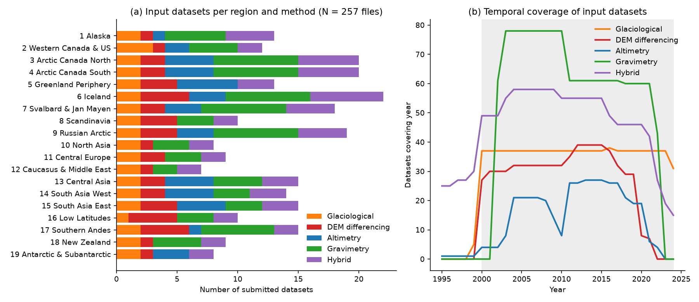

*Figure 1. (a) Number of submitted datasets per region and method. (b) Number of datasets covering each year. Gravimetry has a gap after the GRACE mission ended (2017) and fades out after 2022. DEM differencing and altimetry coverage drop off after about 2020, so the most recent years rely mostly on glaciological and gravimetric information.*

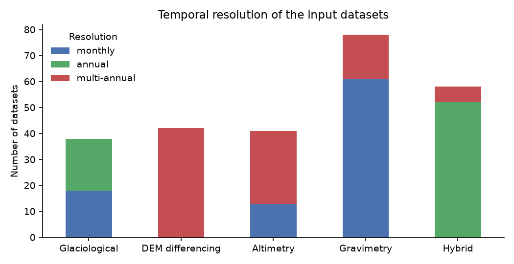

*Figure 2. Temporal resolution of the input datasets per method. All DEM-differencing estimates are multi-annual, which makes temporal downscaling an essential part of the reconciliation.*

### 2.2 Auxiliary information and benchmark

- **Glacier area.** Regional, time-varying glacier areas (RGI 6.0 with regional area-change rates) were taken from the `glacier_area` column of the GlaMBIE result files and interpolated linearly. Only the area is taken from the result files; none of the published mass-change values enters the reconciliation.
- **Benchmark.** The published GlaMBIE (2024) regional and global series (`data/glambie/results`) are used **only for validation**.
- **Literature.** Hugonnet et al. (2021) and Zemp et al. (2019) are used for comparison.

### 2.3 Data-quality observations (exploratory analysis)

- One gravimetry submission (Harig et al.) has missing values at the GRACE/GRACE-FO gap. Several other gravimetry series fill the 2017–2018 gap by linear interpolation, which shows up as runs of identical monthly changes. These interpolated values carry no information on interannual variability and are treated specially (Sect. 3.3).
- A few submissions report negative or missing uncertainties (Pálsson et al., one Jakob et al. series). Their absolute value, or the dataset median, was used instead.
- Monthly gravimetry uncertainties vary by more than an order of magnitude between groups for the same region. For Alaska the median monthly error is about 22 Gt for Sasgen et al. and about 80 Gt for Wouters et al. and Sutterley et al.

---

## 3. Methods

The full pipeline is in `code/glambie_lib.py`. Scripts `02`–`07` run it and produce the outputs.

### 3.1 Unit homogenisation

- Elevation change Δh (m) → specific mass change B = ρ Δh, with ρ = 850 ± 60 kg m⁻³ (Huss, 2013). The uncertainty is σ_B² = (ρ σ_Δh)² + (σ_ρ Δh)².
- Gt → m w.e. by dividing by the glacier area at the mid-point of each interval: B = 1000·M/A, with M in Gt and A in km².

### 3.2 Common temporal framework

All series are placed on a monthly grid (1990–2027). For each region, changes are computed per **hydrological year (HY)**: 1 Oct–30 Sep in the northern-hemisphere regions, 1 Apr–31 Mar in RGI 17–19, and the calendar year in the Low Latitudes (RGI 16), following the GlaMBIE convention.

*High-resolution datasets* (interval ≤ 1 yr) are integrated into cumulative series, and HY differences are read off. Uncertainties of monthly series are aggregated as the overlap-weighted RMS of the monthly errors. The reason is that the monthly errors of most gravimetric and altimetric submissions describe the uncertainty of an epoch-to-epoch difference that is highly correlated in time, not independent noise. Treating them as independent would shrink the annual errors by up to √6; the alternative is tested in Sect. 5.5.

### 3.3 Temporal downscaling of multi-annual estimates

DEM differencing and ICESat-type altimetry give one or a few long-period totals T_k over a period [s_k, t_k] of n_k months. Glaciological series have well-resolved interannual variability but an uncertain absolute level. Following the GlaMBIE concept, the two are combined:

1. **Variability reference.** For each region, compute the mean annual anomaly of the glaciological series (WGMS-beta and Zemp et al. sine-wave), relative to their 2000–2019 mean, and spread it uniformly over the 12 months of each HY (r_m). For altimetry trend datasets, the anomaly of the high-resolution altimetry series of the same region is used instead, where it covers ≥ 80 % of the period.
2. **Calibration.** Within each period, the monthly series is r_m + c_k, with c_k = (T_k − Σ r_m)/n_k. This reproduces the observed period total exactly and imposes the reference variability.
3. **Extension.** DEM-differencing records end in 2020 or earlier. Where no DEM dataset covers a year (2020–2024, depending on region), each DEM series is extended with the reference variability plus its record-mean offset. The uncertainty grows with distance d from the observation window as σ·√(1 + d/L), where L is the record length. Extension is applied only where glaciological variability exists. Where some DEM datasets observe a year, extrapolated values from other datasets are discarded for that year.
4. **Gap repair.** Years in monthly altimetry or gravimetry series that are affected by missing months, or by linearly interpolated gap filling (≥ 3 identical consecutive monthly changes), are redistributed within each contiguous block of affected years. The block total, which is constrained by the real observations on either side of the gap, is kept, and its split between years follows the glaciological variability.
5. **Uncertainty.** The calibrated annual values carry the period's annualised error σ_k/(n_k/12), combined in quadrature with the uncertainty of the variability reference.

### 3.4 Data-group solutions and regional consensus

Three data groups are formed, as in GlaMBIE:
- **A:** altimetry.
- **G:** gravimetry. Used only in regions where it is considered reliable: RGI 1, 3, 4, 6, 7, 9 and 17, i.e. large ice-covered regions without dominant leakage from ice sheets (RGI 5, 19), terrestrial water storage, or GIA. Small regions such as RGI 8, 10–12, 16 and 18 are near or below the GRACE resolution.
- **D:** DEM differencing + glaciological. The glaciological data enter only through the variability reference; the DEM data set the absolute level.

Within a group, each year's value is the arithmetic mean of all available datasets. The group uncertainty is

σ_group² = (Σσ_i²)/n² + s²/n,

where the first term propagates the dataset errors and the second, with s the between-dataset standard deviation, captures structural disagreement. The **regional consensus** is the equal-weight mean of the available groups, with σ_cons = √(Σσ_g²)/N_g. Equal weighting is the main choice because the stated uncertainties of different methods are not obviously comparable; inverse-variance weighting is tested as a sensitivity (Sect. 5.5). **Hybrid estimates are deliberately excluded** from the consensus and kept as independent validation data.

### 3.5 Conversion to calendar years

Global aggregation needs a common calendar. A calendar year Y overlaps two HYs: HY_a, which starts at Y − 0.25 (NH) or Y − 0.75 (SH), and HY_b. Simple time-weighting would ignore the strong seasonality of mass balance, since most ablation happens in summer. The calendar-year value is therefore

B_cal(Y) = S_cal(Y) + w·(B_a − S_a) + (1 − w)·(B_b − S_b),

where S denotes the corresponding HY or calendar-year sums of the region's monthly sine-wave glaciological series (Zemp et al.) and w is the overlap fraction (0.75 NH, 0.25 SH). The consensus residual relative to the glaciological seasonal model is thus distributed by time, while the seasonal cycle comes from the glaciological series. This step was checked against the published GlaMBIE files: applied to the official hydrological-year consensus, it reproduces the official calendar-year values exactly (RMSE < 10⁻³ m w.e. in five test regions; simple linear weighting gives RMSE 0.10–0.52 m w.e.). Calendar-year mass is M = B·A(Y + 0.5)/1000.

### 3.6 Global aggregation, rates and trends

Global mass change is the sum of the 19 regional calendar-year values. Regional errors are added in quadrature, i.e. regions are assumed independent. Global specific mass change is the global mass divided by total glacier area. Multi-year rates are means of the annual values; their errors assume independence between years. Trends are ordinary least-squares slopes. Their uncertainty combines the regression standard error, inflated for lag-1 autocorrelation where it is positive, with a Monte-Carlo propagation of the annual errors (5,000 draws). Sea-level equivalent uses 362.5 Gt mm⁻¹.

### 3.7 Validation strategy

1. **Independent benchmark:** compare with the published GlaMBIE (2024) consensus at the regional, group and global level.
2. **Withheld data:** compare with the hybrid estimates (Dussaillant et al., Huss et al., Box et al., Colgan et al., Miles et al., Pálsson et al.).
3. **Internal consistency (H1):** leave-one-group-out (LOGO). Each group is compared with the consensus of the remaining groups via z = (B_g − B_rest)/√(σ_g² + σ_rest²). A well-calibrated error model gives SD(z) ≈ 1, with about 68 % of |z| < 1.
4. **Robustness (H2):** eleven alternative configurations (Sect. 5.5).
5. **Literature:** period rates from Hugonnet et al. (2021) and Zemp et al. (2019).

---

## 4. Worked example: Alaska

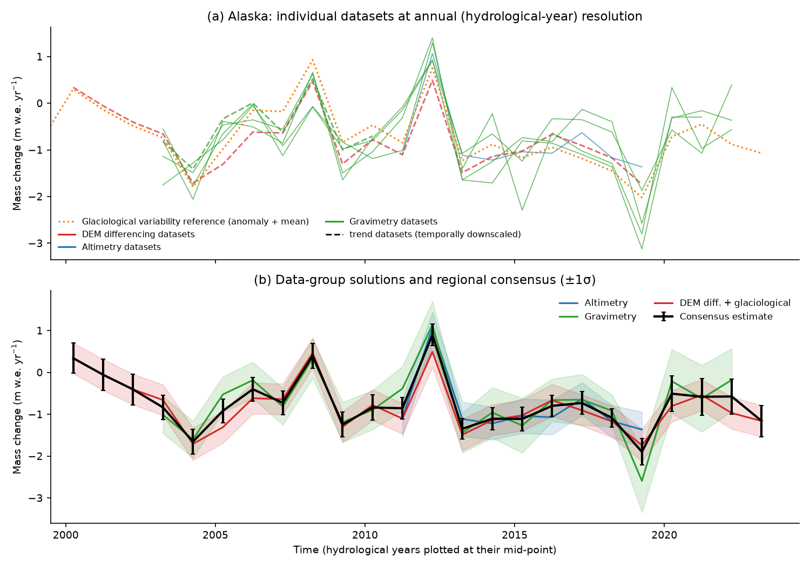

*Figure 3. Reconciliation in Alaska (RGI 1). (a) Individual datasets at HY resolution: five GRACE solutions (green), CryoSat-2 altimetry (blue) and the downscaled Hugonnet et al. DEM series (red dashed, four 5-yr periods). (b) Group solutions (±1σ) and the consensus (black).*

The downscaled DEM series closely tracks the interannual variability seen independently by GRACE. Examples are the positive balance in 2012/13 and the extreme loss in 2018/19, which confirms that the glaciological variability reference is transferable. The groups do disagree in some years. In HY 2018/19 gravimetry is about 0.85 m w.e. more negative than DEM differencing and 1.2 m w.e. more negative than altimetry, and in HY 2019/20 it is about 0.6 m w.e. less negative than DEM differencing. The consensus averages over these disagreements. The 2016/17–2017/18 years fall into the GRACE/GRACE-FO gap; for these years the gravimetric annual split is taken from the glaciological variability, while the two-year total stays constrained by GRACE (Sect. 3.3, step 4). After 2020 only DEM differencing (extended) and gravimetry remain.

---

## 5. Results

### 5.1 Regional time series

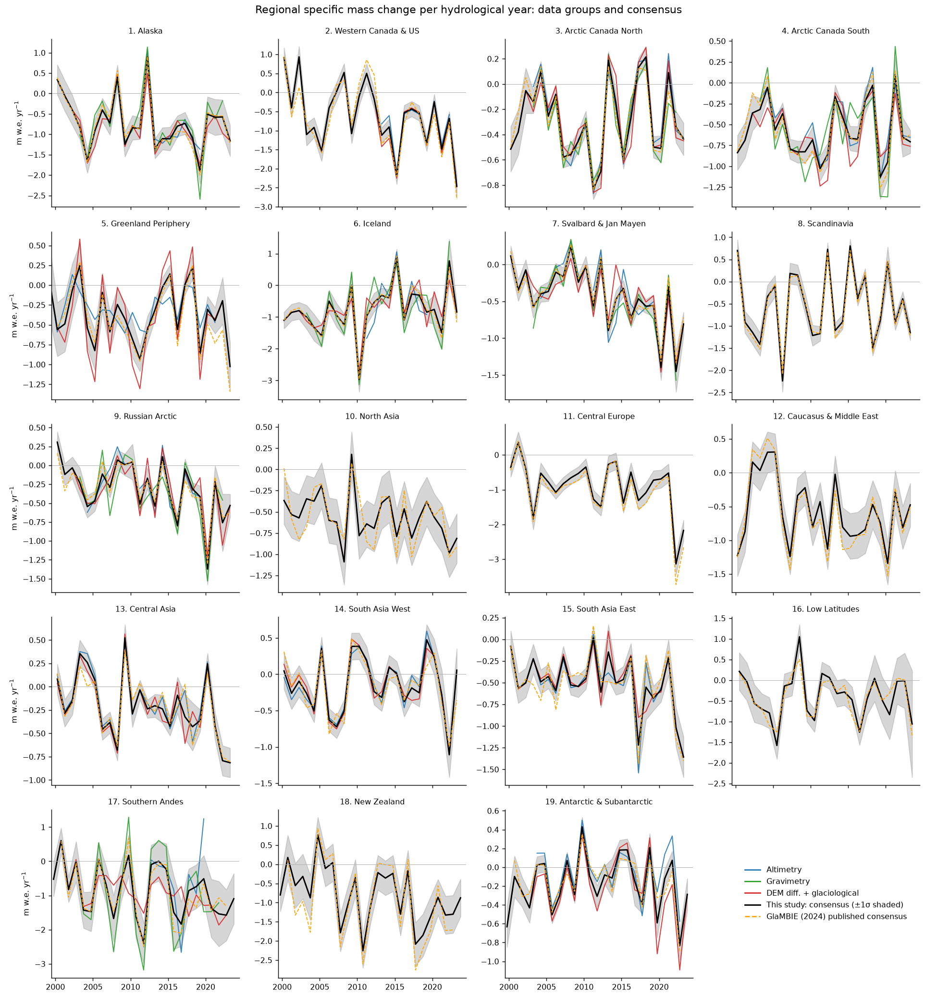

*Figure 4. HY specific mass change for all 19 regions: group solutions (coloured), consensus ±1σ (black/grey), and the published GlaMBIE consensus (orange dashed).*

Table 1 summarises the 2000–2023 calendar-year results. Full annual series per region (m w.e. and Gt, with errors) are in `outputs/calendar_years/*.csv`; HY series with per-group solutions are in `outputs/hydrological_years/*.csv`.

**Table 1.** Mean 2000–2023 mass-change rates and cumulative change (calendar years, ±1σ). Groups: A = altimetry, G = gravimetry, D = DEM differencing + glaciological. The last column gives the Pearson correlation of annual values with GlaMBIE (2024).

| RGI | Region | Area 2000 (km²) | Groups used | Rate (m w.e. yr⁻¹) | Rate (Gt yr⁻¹) | Cumulative 2000–2023 (Gt) | GlaMBIE-2024 rate (Gt yr⁻¹) | r (annual) |
|---|---|---|---|---|---|---|---|---|
| 1 | Alaska | 89,847 | A+G+D | -0.72 ± 0.06 | -60.9 ± 5.5 | -1,462 ± 131 | -61.4 | 0.99 |
| 2 | Western Canada & US | 14,563 | A+D | -0.63 ± 0.05 | -8.4 ± 0.7 | -201 ± 16 | -9.2 | 0.96 |
| 3 | Arctic Canada North | 105,001 | A+G+D | -0.29 ± 0.02 | -29.8 ± 2.2 | -715 ± 53 | -30.4 | 0.98 |
| 4 | Arctic Canada South | 40,872 | A+G+D | -0.57 ± 0.03 | -23.1 ± 1.4 | -554 ± 33 | -23.0 | 0.98 |
| 5 | Greenland Periphery | 89,349 | A+D | -0.38 ± 0.05 | -31.0 ± 3.8 | -744 ± 90 | -35.4 | 0.94 |
| 6 | Iceland | 11,000 | A+G+D | -0.77 ± 0.07 | -8.1 ± 0.7 | -195 ± 18 | -8.3 | 0.99 |
| 7 | Svalbard & Jan Mayen | 34,445 | A+G+D | -0.44 ± 0.03 | -14.4 ± 0.9 | -347 ± 23 | -13.8 | 0.99 |
| 8 | Scandinavia | 2,961 | D | -0.55 ± 0.04 | -1.6 ± 0.1 | -38 ± 3 | -1.7 | 1.00 |
| 9 | Russian Arctic | 51,613 | A+G+D | -0.30 ± 0.03 | -15.5 ± 1.7 | -373 ± 41 | -16.0 | 0.97 |
| 10 | North Asia | 2,488 | D | -0.57 ± 0.06 | -1.3 ± 0.1 | -32 ± 3 | -1.4 | 0.84 |
| 11 | Central Europe | 2,141 | D | -0.91 ± 0.05 | -1.7 ± 0.1 | -41 ± 2 | -2.0 | 0.99 |
| 12 | Caucasus & Middle East | 1,283 | D | -0.57 ± 0.06 | -0.7 ± 0.1 | -16 ± 2 | -0.7 | 0.97 |
| 13 | Central Asia | 49,702 | A+D | -0.21 ± 0.03 | -10.2 ± 1.4 | -245 ± 35 | -10.5 | 0.97 |
| 14 | South Asia West | 33,508 | A+D | -0.15 ± 0.04 | -4.8 ± 1.4 | -115 ± 33 | -5.6 | 0.94 |
| 15 | South Asia East | 14,907 | A+D | -0.51 ± 0.04 | -7.1 ± 0.5 | -171 ± 13 | -7.4 | 0.92 |
| 16 | Low Latitudes | 2,355 | D | -0.39 ± 0.10 | -0.8 ± 0.2 | -19 ± 5 | -0.9 | 0.91 |
| 17 | Southern Andes | 29,403 | A+G+D | -0.86 ± 0.13 | -24.8 ± 3.8 | -595 ± 92 | -26.3 | 0.96 |
| 18 | New Zealand | 982 | D | -0.81 ± 0.10 | -0.7 ± 0.1 | -17 ± 2 | -0.8 | 0.95 |
| 19 | Antarctic & Subantarctic | 127,665 | A+D | -0.16 ± 0.03 | -19.6 ± 3.4 | -471 ± 82 | -17.8 | 0.94 |
| – | **Global** | 704,083 | – | **-0.39 ± 0.01** | **-264.6 ± 9.3** | **-6,351 ± 223** | -272.6 | 0.97 |

Key regional findings:
- **Specific loss** is largest in the mid-latitude mountain regions: Central Europe (−0.91 m w.e. yr⁻¹), the Southern Andes (−0.86), New Zealand (−0.81), Iceland (−0.77) and Alaska (−0.72). It is smallest in the Antarctic and Subantarctic (−0.16), South Asia West (Karakoram; −0.15) and Central Asia (−0.21).
- **Total loss** is dominated by large ice-covered regions. Alaska alone accounts for 23 % of the global loss. The five largest contributors (Alaska, Greenland Periphery, Arctic Canada North, Southern Andes, Arctic Canada South) account for 64 %. Polar and peripheral regions (RGI 3, 4, 5, 7, 9, 19) account for 50 %.

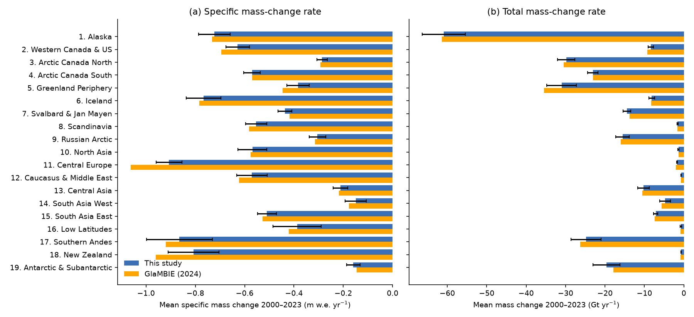

*Figure 6. Mean 2000–2023 regional (a) specific and (b) total mass-change rates; this study (blue, ±1σ) versus GlaMBIE (2024) (orange).*

### 5.2 Global time series

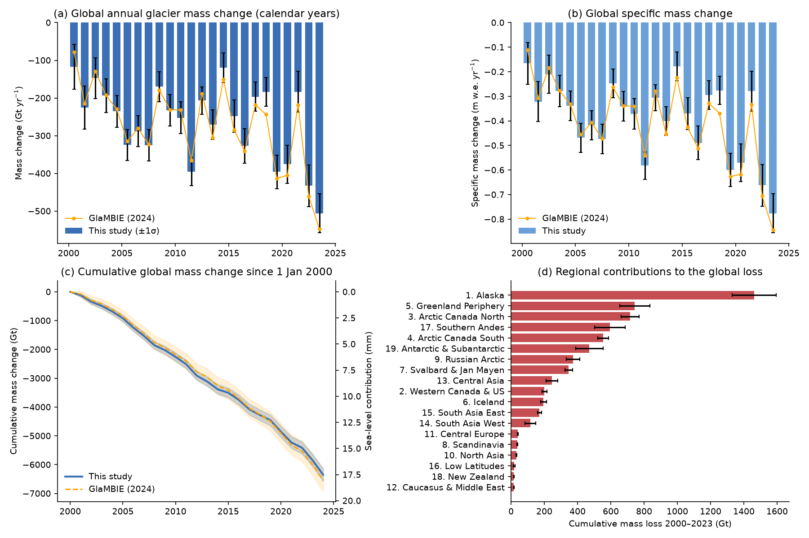

*Figure 5. (a) Global annual mass change (Gt) and (b) specific mass change (m w.e.) per calendar year, ±1σ, with GlaMBIE (2024) for comparison. (c) Cumulative mass change since 1 January 2000 with sea-level equivalent; shading shows the ±1σ cumulative error assuming independent annual errors. (d) Cumulative regional contributions.*

**Table 2.** Global annual mass change (calendar years, ±1σ); `outputs/global_calendar.csv`.

| Year | Mass change (Gt) | Specific mass change (m w.e.) | GlaMBIE-2024 (Gt) |
|---|---|---|---|
| 2000 | -117 ± 60 | -0.17 ± 0.08 | -78 ± 112 |
| 2001 | -226 ± 57 | -0.32 ± 0.08 | -215 ± 95 |
| 2002 | -147 ± 54 | -0.21 ± 0.08 | -128 ± 91 |
| 2003 | -194 ± 44 | -0.28 ± 0.06 | -193 ± 73 |
| 2004 | -235 ± 42 | -0.34 ± 0.06 | -229 ± 73 |
| 2005 | -325 ± 41 | -0.47 ± 0.06 | -315 ± 74 |
| 2006 | -288 ± 41 | -0.42 ± 0.06 | -280 ± 73 |
| 2007 | -326 ± 42 | -0.47 ± 0.06 | -323 ± 72 |
| 2008 | -170 ± 40 | -0.25 ± 0.06 | -179 ± 72 |
| 2009 | -233 ± 41 | -0.34 ± 0.06 | -231 ± 71 |
| 2010 | -253 ± 42 | -0.37 ± 0.06 | -231 ± 72 |
| 2011 | -395 ± 38 | -0.58 ± 0.06 | -366 ± 68 |
| 2012 | -207 ± 36 | -0.31 ± 0.05 | -188 ± 67 |
| 2013 | -270 ± 39 | -0.40 ± 0.06 | -305 ± 66 |
| 2014 | -120 ± 39 | -0.18 ± 0.06 | -150 ± 66 |
| 2015 | -248 ± 43 | -0.37 ± 0.06 | -285 ± 67 |
| 2016 | -327 ± 46 | -0.49 ± 0.07 | -341 ± 68 |
| 2017 | -196 ± 39 | -0.30 ± 0.06 | -218 ± 66 |
| 2018 | -183 ± 38 | -0.28 ± 0.06 | -244 ± 67 |
| 2019 | -396 ± 45 | -0.60 ± 0.07 | -413 ± 70 |
| 2020 | -375 ± 50 | -0.57 ± 0.08 | -405 ± 76 |
| 2021 | -183 ± 54 | -0.28 ± 0.08 | -218 ± 82 |
| 2022 | -433 ± 56 | -0.66 ± 0.09 | -460 ± 101 |
| 2023 | -506 ± 52 | -0.78 ± 0.08 | -548 ± 120 |

**Period rates** (`outputs/global_period_rates.csv`):

| Period | This study (Gt yr⁻¹) | This study (m w.e. yr⁻¹) | GlaMBIE 2024 (Gt yr⁻¹) | SLE (mm yr⁻¹) |
|---|---|---|---|---|
| 2000–2004 | −184 ± 23 | −0.26 ± 0.03 | −169 | 0.51 |
| 2005–2009 | −268 ± 18 | −0.39 ± 0.03 | −266 | 0.74 |
| 2010–2014 | −249 ± 17 | −0.37 ± 0.03 | −248 | 0.69 |
| 2015–2019 | −270 ± 19 | −0.41 ± 0.03 | −300 | 0.74 |
| 2020–2023 | −374 ± 26 | −0.57 ± 0.04 | −408 | 1.03 |
| 2000–2023 | **−265 ± 9** | **−0.39 ± 0.01** | −273 | **0.73** |

**Acceleration (H3).**
- The global annual loss has a linear trend of **−7.2 ± 3.1 Gt yr⁻²**, i.e. −72 ± 31 Gt yr⁻¹ per decade (1σ; p ≈ 0.02). In specific terms this is −0.012 ± 0.005 m w.e. yr⁻². The same method applied to the GlaMBIE series gives −10.0 ± 3.7 Gt yr⁻².
- Mean loss in 2012–2023 exceeds that of 2000–2011 by 45 ± 19 Gt yr⁻¹ (+18 %).
- Four of the five most negative years occurred in 2019–2023 (2023, 2022, 2019, 2020; the fifth is 2011). The 2023 loss is 2.1 times the 2000–2011 mean.
- Over the 24 years, glaciers lost on average 9.4 ± 0.3 m w.e. of ice thickness.

Interannual variability is large (SD ≈ 100 Gt yr⁻¹). A linear trend explains only a modest fraction of it, so the acceleration is detectable but its magnitude is uncertain.

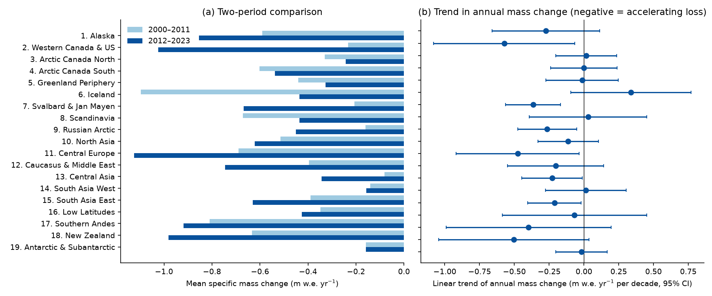

*Figure 11. (a) Regional specific mass change in 2000–2011 versus 2012–2023. (b) Linear trends of regional annual mass change (95 % CI).*

Regionally (Fig. 11), losses accelerated significantly (95 % CI excludes zero) in Western Canada & US (fourfold increase in specific loss), Svalbard, the Russian Arctic, Central Europe, Central Asia and South Asia East. Iceland and Scandinavia show a non-significant tendency towards smaller losses (lower mean loss in 2012–2023 than in 2000–2011), as do, more weakly, the Greenland Periphery and Arctic Canada North. This matches the "North Atlantic anomaly" described by Hugonnet et al. (2021).

### 5.3 Validation against the GlaMBIE (2024) consensus

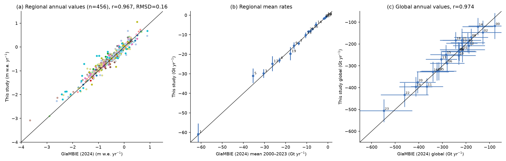

*Figure 7. Comparison with the published GlaMBIE consensus: (a) all regional annual values (m w.e.), (b) regional 2000–2023 mean rates, (c) global annual values.*

- **Global (2000–2023).** This study: −6,351 ± 223 Gt. GlaMBIE: −6,542 ± 387 Gt, where 387 Gt is the quadrature sum of the published annual errors. The difference of 191 Gt (2.9 %) is well within the uncertainties. Annual global values correlate at r = 0.974 (RMSD 26 Gt, mean offset +8 Gt yr⁻¹).
- **Regional.** Across the 456 regional annual values, r = 0.967 and RMSD = 0.16 m w.e. Regional 24-yr mean rates agree within 0.07 m w.e. yr⁻¹ in 17 of 19 regions (exceptions: Central Europe and New Zealand).
- **Group level** (`outputs/compare_official_groups.csv`). The group solutions match GlaMBIE's group solutions closely in most regions (e.g. Arctic Canada North gravimetry r = 0.998; Svalbard DEM r = 0.98). The largest deviations are in the Southern Andes altimetry and gravimetry groups, which have few datasets and large uncertainties.
- **Largest regional differences.** Central Europe (+0.16 m w.e. yr⁻¹, less negative than GlaMBIE) and New Zealand (+0.15) come from extending the DEM records over 2020–2023 with the record-mean offset. In these small, glaciologically well-monitored regions, the extremes of 2022/2023 are thereby dampened relative to the official series (Fig. 4). The Greenland Periphery (+4.5 Gt yr⁻¹) contributes the largest absolute share of the global offset; the difference is concentrated after 2015 (+16 to +26 Gt yr⁻¹ in 2020–2023), when DEM differencing has to be extended. The Antarctic & Subantarctic is −1.8 Gt yr⁻¹ more negative than GlaMBIE.
- **Uncertainties.** The annual uncertainties of this study are on average 42 % smaller than GlaMBIE's (45 vs 78 Gt yr⁻¹ globally). GlaMBIE applies more conservative treatment (e.g. additional structural terms). The internal test in Sect. 5.4 suggests the uncertainties here are not over-confident at the group level. The global-scale uncertainty is nevertheless probably underestimated because of correlated errors (Sect. 6.3).

### 5.4 Validation against withheld hybrid estimates and internal consistency

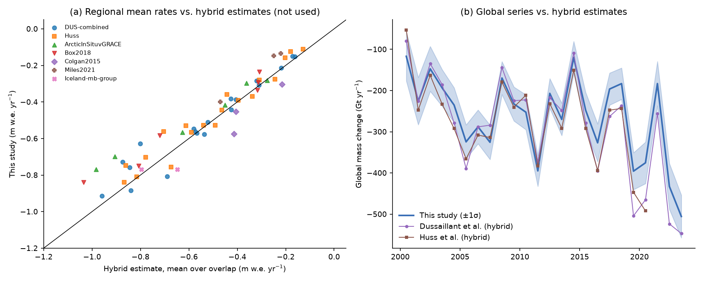

*Figure 8. (a) Regional mean rates versus hybrid estimates over their overlap period. (b) Global annual series versus the two globally complete hybrid estimates (Dussaillant et al.; Huss et al.).*

- **Hybrids.** The global series correlates at r = 0.95 with Dussaillant et al. and r = 0.93 with Huss et al. (`outputs/validation_summary.json`). Both hybrid products are more negative on average: −286 vs −265 Gt yr⁻¹ (2000–2023) and −275 vs −249 Gt yr⁻¹ (2000–2020). Including the hybrids as a fourth group would raise the global rate to −274 Gt yr⁻¹ (Sect. 5.5), very close to GlaMBIE. Regionally (Fig. 8a), the hybrids are more negative in Alaska, Iceland and Western Canada & US, by about 0.1–0.2 m w.e. yr⁻¹. Some of them scale glaciological anomalies, or use GRACE solutions that include non-glacier signals.

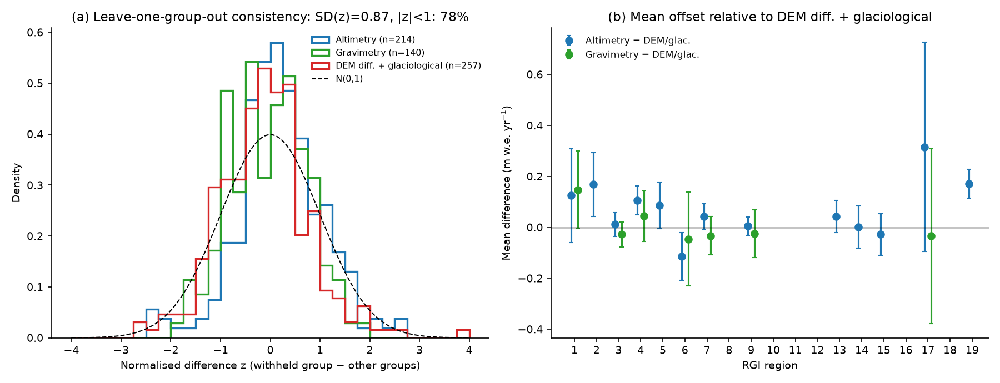

*Figure 9. (a) Leave-one-group-out normalised differences (n = 611 group-years) versus the standard normal distribution. (b) Mean offset of altimetry and gravimetry relative to DEM differencing + glaciological, per region (±1σ).*

- **LOGO test (H1).** Across 611 group-years, z has mean 0.00 and SD 0.87. 78 % of |z| are below 1 and 97 % below 2, against 68 % and 95 % for a perfectly calibrated N(0,1). The uncertainty model is therefore well calibrated to slightly conservative, and H1 is supported: after homogenisation, the three groups agree within their stated errors.
- **Systematic offsets.** Gravimetry shows no systematic offset relative to DEM differencing in any region (all within 1σ). Altimetry is systematically less negative than DEM differencing by +0.06 m w.e. yr⁻¹ on average (mean z = +0.19). The offset is most pronounced in Arctic Canada South (+0.10 ± 0.06, ≈ 1.9σ) and the Antarctic & Subantarctic (+0.17 ± 0.06, ≈ 3σ). This is consistent with known issues such as radar penetration and sparse sampling of the steep, fast-thinning margins.

### 5.5 Sensitivity analysis (H2)

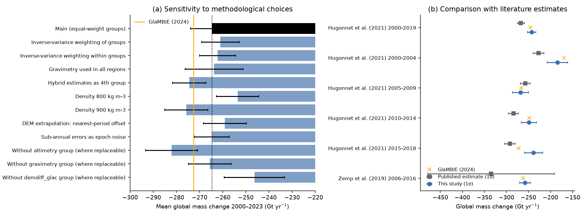

*Figure 10. (a) Global 2000–2023 mean rate under alternative configurations; error bars show the 1σ rate uncertainty; orange line marks GlaMBIE. (b) Comparison with literature period rates (1σ; Hugonnet et al. 95 % intervals halved).*

| Configuration | Mean 2000–2023 (Gt yr⁻¹) | Total (Gt) | Δ vs main |
|---|---|---|---|
| **Main (equal-weight groups)** | **−264.6** | **−6,351 ± 223** | – |
| Inverse-variance weighting of groups | −261.0 | −6,264 ± 195 | +3.6 |
| Inverse-variance weighting within groups | −262.1 | −6,291 ± 187 | +2.5 |
| Gravimetry used in all regions | −263.7 | −6,329 ± 300 | +0.9 |
| Hybrid estimates as 4th group | −274.5 | −6,587 ± 173 | −9.8 |
| Density 800 kg m⁻³ | −253.6 | −6,085 ± 220 | +11.1 |
| Density 900 kg m⁻³ | −275.7 | −6,617 ± 225 | −11.1 |
| DEM extension with nearest-period offset | −259.1 | −6,218 ± 223 | +5.5 |
| Sub-annual errors as independent epoch noise | −264.6 | −6,351 ± 181 | 0 |
| Without altimetry (where replaceable) | −282.1 | −6,770 ± 270 | −17.4 |
| Without gravimetry (where replaceable) | −265.6 | −6,373 ± 221 | −1.0 |
| Without DEM + glaciological (where replaceable) | −246.3 | −5,910 ± 314 | +18.4 |

- **Choices within plausible ranges.** Changing the weighting, the density (±50 kg m⁻³), the extrapolation rule or the use of gravimetry moves the global rate by at most ±11 Gt yr⁻¹, which is comparable to its 1σ uncertainty (9 Gt yr⁻¹). H2 is supported.
- **Density** is the largest single parametric sensitivity. Hugonnet et al. (2021) also identify it as their dominant uncertainty.
- **Leaving out a group** has the largest effect. Removing the DEM group or the altimetry group shifts the result by about 18 Gt yr⁻¹ in opposite directions. This shows the altimetry–DEM offset of Sect. 5.4 and underlines the value of combining methods: the multi-method consensus sits between the single-method answers.
- **Gravimetry**, by contrast, is almost neutral (−1 Gt yr⁻¹). It agrees well with the other groups where it is used.

### 5.6 Comparison with the literature

| Reference (period) | Published (Gt yr⁻¹, 1σ) | This study | GlaMBIE 2024 |
|---|---|---|---|
| Hugonnet et al. 2021 (2000–2019) | −267 ± 8 | −243 ± 10 | −246 |
| Hugonnet et al. 2021 (2000–2004) | −227 ± 13 | −184 ± 23 | −169 |
| Hugonnet et al. 2021 (2005–2009) | −257 ± 11 | −268 ± 18 | −266 |
| Hugonnet et al. 2021 (2010–2014) | −284 ± 12 | −249 ± 17 | −248 |
| Hugonnet et al. 2021 (2015–2018) | −292 ± 12 | −239 ± 21 | −272 |
| Zemp et al. 2019 (2006–2016) | −335 ± 144 | −258 ± 12 | −262 |

This study and GlaMBIE are both about 20–25 Gt yr⁻¹ less negative than Hugonnet et al. (2021) for 2000–2019 (z = 1.9). Part of the gap is definitional: Hugonnet et al. report hydrological/geodetic periods starting 1 January 2000 with their own area and density assumptions. The rest is methodological: the inclusion of altimetry, which is less negative (Sect. 5.4). The 2000–2004 versus 2015–2018 increase found here is smaller than in Hugonnet et al., mainly because of the Greenland Periphery and the 2017–2018 lull in Alaska and Arctic Canada. The Zemp et al. (2019) estimate, extrapolated from glaciological anomalies, is more negative but has a wide uncertainty and is consistent with this study (z = 0.5).

---

## 6. Discussion

### 6.1 What the reconciliation achieves

Three conclusions follow from the results:
1. **The methods are compatible once homogenised.** Unit and temporal homogenisation plus the variability-based downscaling make the independent groups compatible. Their residuals behave as expected from the stated errors (LOGO SD(z) = 0.87), and gravimetry shows no systematic bias in the seven regions where it is used.
2. **The consensus is more robust than any single method.** Single-method solutions differ systematically (altimetry about 0.06 m w.e. yr⁻¹ less negative than DEM differencing). Leaving out a group shifts the global rate by up to 7 %. The equal-weight consensus is insensitive to the weighting scheme (≤ 4 Gt yr⁻¹).
3. **The scheme reproduces GlaMBIE independently.** A compact, fully documented scheme reproduces the community consensus (GlaMBIE 2024) to within 3 % globally and with r ≈ 0.97 annually, without using any published consensus values. The reconciled numbers are therefore a reproducible observational benchmark, not an artefact of one particular implementation.

### 6.2 Implications for IPCC assessments and model calibration

- **Sea level.** The 2000–2023 mean loss of 265 Gt yr⁻¹ corresponds to 0.73 mm yr⁻¹ of sea-level rise, and 17.5 mm in total. It rose to 1.03 mm yr⁻¹ in 2020–2023.
- **Use as a calibration target.** For glacier models (GlacierMIP: Hock et al., 2019; Marzeion et al., 2020; Rounce et al., 2023), the annual resolution and the per-region uncertainties allow calibration not only to multi-decadal mean rates, as is common practice with Hugonnet et al. (2021) geodetic rates, but also to interannual variability and recent extremes. The regional uncertainties, rather than the global one, should be used as calibration tolerances, because the global uncertainty is dominated by a few regions.
- **Where uncertainty comes from.** Alaska, the Southern Andes, the Greenland Periphery and the Antarctic & Subantarctic make up 82 % of the global error variance (Fig. 12). These are the regions where new observations would most reduce global uncertainty.

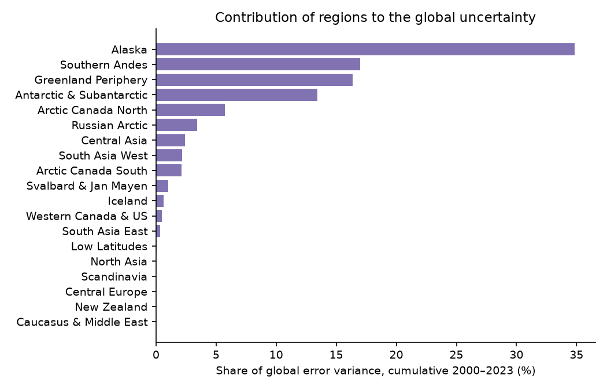

*Figure 12. Share of the global (cumulative 2000–2023) error variance contributed by each region.*

### 6.3 Limitations

1. **Temporal error correlation.** Cumulative and period-mean uncertainties assume annual errors are independent. DEM-derived values within one period share the same period error, and density errors are systematic. If all annual errors within a region were fully correlated in time, the cumulative uncertainty would be ±1,057 Gt instead of ±223 Gt (`outputs/extra_stats.json`). The truth lies between these bounds. Users needing conservative cumulative uncertainties should use the upper bound or the GlaMBIE values.
2. **Spatial error correlation.** Regions are assumed independent, but density assumptions and some datasets (e.g. Hugonnet et al. or one GRACE processing chain) are shared across all regions. The global uncertainty may therefore be underestimated.
3. **Recent years (2021–2023)** rest on extended DEM records and fewer gravimetric solutions. Their values depend on the extrapolation rule, which accounts for about 30 Gt yr⁻¹ of the difference from GlaMBIE in 2020–2023, mainly in the Greenland Periphery, Central Europe and New Zealand. The official GlaMBIE series is more negative in these years.
4. **Gravimetry selection.** Gravimetry was excluded a priori in 12 regions. Including it everywhere changes the global rate by less than 1 Gt yr⁻¹ but increases the uncertainty by 35 %.
5. **Glacier area and density.** A single density (850 ± 60 kg m⁻³) is used everywhere. Glacier areas follow GlaMBIE's RGI 6.0-based time-varying areas; inventory errors are not propagated.
6. **Hydrological-to-calendar conversion** relies on the seasonal cycle of a modelled (sine-wave) glaciological series. This step is validated against GlaMBIE's own conversion, but its uncertainty is not propagated separately.
7. **Duplicated submissions.** Variant submissions from the same group, such as the two LEGOS-MAGELLIUM series or the two Piermattei et al. series, are treated as separate datasets within their group. This slightly overweights those groups' solutions and underestimates the group's structural spread.

### 6.4 Future work

- A full covariance treatment of temporal and spatial error correlation, e.g. block bootstrap over datasets.
- Region-specific density scenarios (Huss, 2013, firn-condition dependent).
- Objective, data-driven selection of gravimetry regions based on LOGO statistics.
- Annual updates as ICESat-2, CryoSat-2, GRACE-FO and new DEM mosaics extend beyond 2023.

---

## 7. Conclusions

- Reconciling 257 regional submissions from four observational methods gives a consistent annual record of glacier mass change for 2000–2023 in all 19 regions.
- Glaciers lost **6,351 ± 223 Gt** (17.5 ± 0.6 mm SLE), averaging **−265 ± 9 Gt yr⁻¹** (−0.39 ± 0.01 m w.e. yr⁻¹).
- Loss accelerated: −72 ± 31 Gt yr⁻¹ per decade, from −242 Gt yr⁻¹ in 2000–2011 to −287 Gt yr⁻¹ in 2012–2023. 2023 is the record year at −506 ± 52 Gt.
- The data groups agree within their uncertainties after homogenisation. The consensus is robust to methodological choices within about ±11 Gt yr⁻¹ and reproduces the community GlaMBIE assessment to within 3 %.
- The main remaining uncertainties are the volume-to-mass conversion, the altimetry–DEM offset, temporally correlated errors, and the extrapolation of DEM records into the most recent years.

---

## Reproducibility

| Step | Script | Main outputs |
|---|---|---|
| Inventory | `code/01_inventory.py` | `outputs/inventory.csv` |
| Reconciliation | `code/glambie_lib.py`, `code/02_run_main.py` | `outputs/hydrological_years/*.csv`, `outputs/calendar_years/*.csv`, `outputs/global_calendar.csv`, `outputs/summary_rates_2000_2023.csv`, `outputs/dataset_annual_series_long.csv` |
| Benchmark comparison | `code/03_compare_official.py` | `outputs/compare_official_*.csv` |
| Validation and sensitivity | `code/04_validation.py` | `outputs/validation_*.csv/json`, `outputs/sensitivity_global.csv`, `outputs/regional_trends.csv` |
| Figures | `code/05_figures.py` | `report/images/*.png` |
| Extra statistics and tables | `code/06_extra_stats.py`, `code/07_tables_md.py` | `outputs/extra_stats.json`, `outputs/global_period_rates.csv`, `outputs/tables_md.md` |
| Error-model diagnostic | `code/diag_error_model.py` | console output |

Everything is deterministic except the Monte-Carlo trend uncertainty (fixed seed 42). Software: Python 3.11, numpy, pandas, matplotlib.

## References

- GlaMBIE (2024). Glacier Mass Balance Intercomparison Exercise (GlaMBIE) Dataset 1.0.0. WGMS, Zurich. doi:10.5904/wgms-glambie-2024-07.
- Hock, R., et al. (2019). GlacierMIP – A model intercomparison of global-scale glacier mass-balance models and projections. *J. Glaciol.* (`related_work/paper_003.pdf`).
- Hugonnet, R., et al. (2021). Accelerated global glacier mass loss in the early twenty-first century. *Nature* 592, 726–731 (`related_work/paper_004.pdf`).
- Huss, M. (2013). Density assumptions for converting geodetic glacier volume change to mass change. *The Cryosphere* 7, 877–887.
- Marzeion, B., et al. (2020). Partitioning the uncertainty of ensemble projections of global glacier mass change. *Earth's Future* (`related_work/paper_001.pdf`).
- Rounce, D. R., et al. (2023). Global glacier change in the 21st century: Every increase in temperature matters. *Science* 379, 78–83 (`related_work/paper_000.pdf`).
- Zemp, M., et al. (2019). Global glacier mass changes and their contributions to sea-level rise from 1961 to 2016. *Nature* 568, 382–386 (`related_work/paper_002.pdf`).
