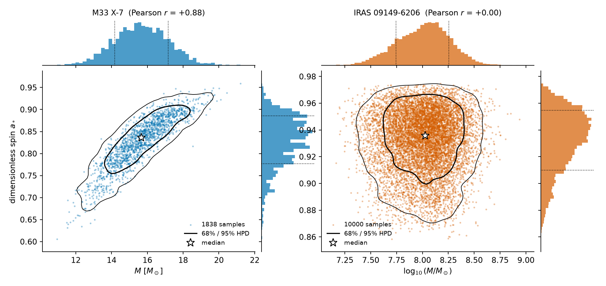
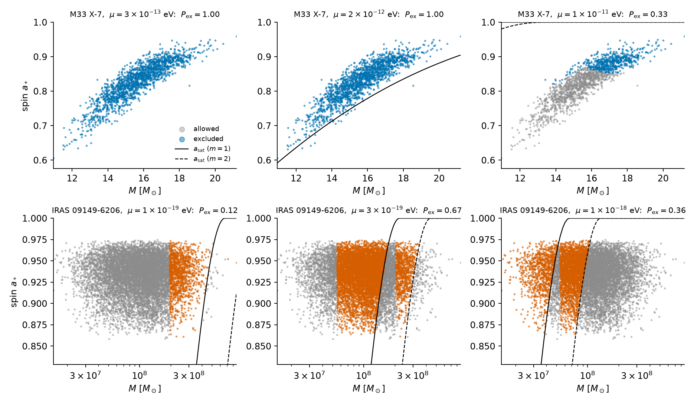
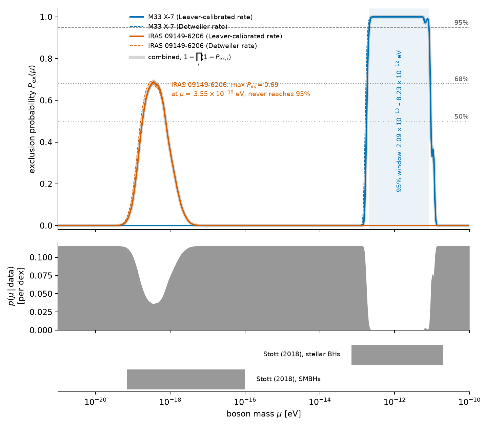
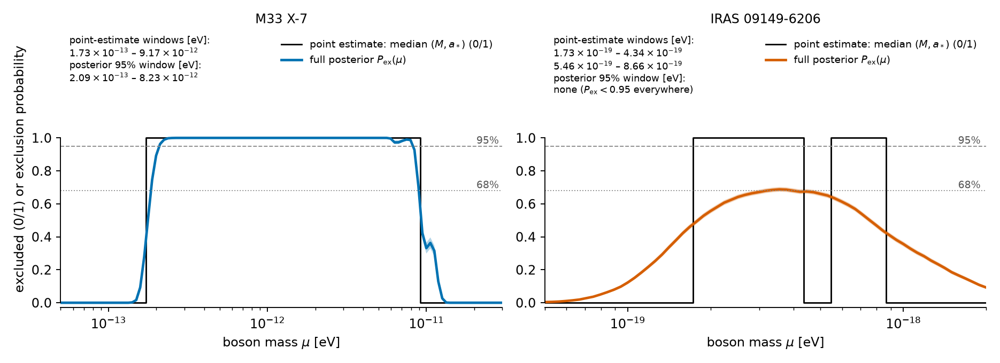
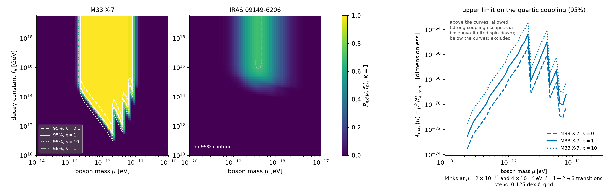
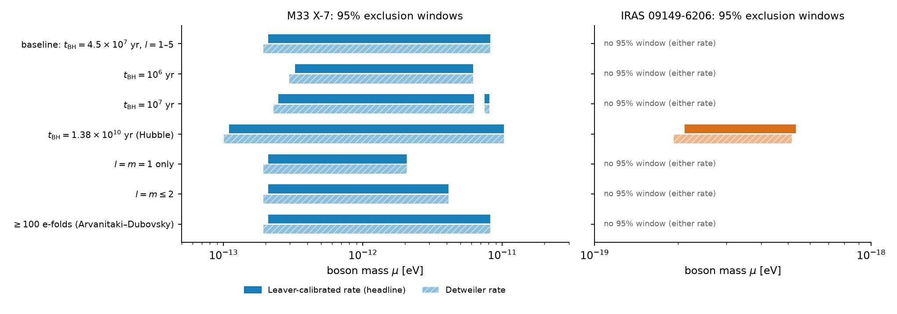
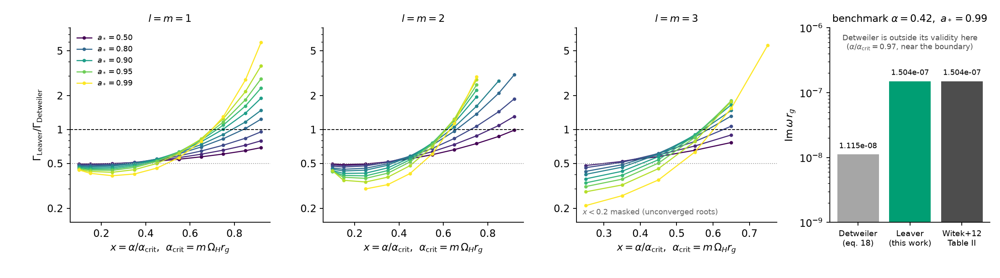

# Bayesian black-hole-superradiance constraints on ultralight bosons and their self-interactions from full mass–spin posteriors

> All numbers in this report are read from `outputs/` (produced by `code/`); every figure in `images/` is generated by `code/figures/` from those files.

## Abstract

Black-hole superradiance excludes ultralight bosons whose cloud would have spun a rapidly rotating black hole down within its lifetime. We develop a Bayesian framework that ingests the full joint (mass, spin) posterior samples of a black hole and returns, for every boson mass $\mu$ (and, with an attractive self-interaction, every decay constant $f_a$), the posterior probability $P_{\rm ex}$ that the boson is excluded; limits are the sets with $P_{\rm ex}\ge68\%$, 95 % or 99.7 %, and independent black holes combine as $1-\prod_i(1-P_{{\rm ex},i})$. Applied to the stellar-mass black hole M33 X-7 and the supermassive black hole IRAS 09149-6206 (scalar boson, levels $l=m\le5$, black-hole age $4.5\times10^7$ yr, growth rate calibrated against a numerical Leaver solution), M33 X-7 excludes $2.09\times10^{-13}\le\mu\le8.23\times10^{-12}$ eV at 95 % (edge sampling error below 1 %; the upper edge falls to $2$–$4\times10^{-12}$ eV if only $l\le1$–2 is trusted, and the lower edge moves between $1.1\times10^{-13}$ and $3.3\times10^{-13}$ eV for ages of $1.4\times10^{10}$ and $10^6$ yr). IRAS 09149-6206 reaches at most $P_{\rm ex}=0.69$ (at $\mu=3.5\times10^{-19}$ eV): a 68 % window of $3.2$–$4.0\times10^{-19}$ eV, but no 95 % exclusion because of its broad mass posterior, in contrast with the two sharp windows a median-point analysis would give. With the bosenova-limited cloud, M33 X-7 excludes only $f_a\gtrsim3\times10^{11}$ GeV (at $\mu=2\times10^{-12}$ eV; $10^{11}$–$10^{12}$ GeV for an order-of-magnitude change of the bosenova coefficient), i.e. couplings $\lambda=\mu^2/f_a^2\lesssim4\times10^{-65}$ there, while stronger self-interaction is not excluded. The numerical growth rate reproduces the benchmark of Witek et al. (2013) and the windows lie inside those of Stott (2018).

## 1. Introduction

Ultralight bosons (ULBs) — axion-like particles, dark photons and other light fields with masses far below an eV — are generic in string compactifications ("string axiverse", Arvanitaki et al. 2010; Arvanitaki & Dubovsky 2011, `paper_000`) and are candidates for dark matter and dark energy. A spinning black hole (BH) is unstable to the growth of a bound cloud of such a boson when the boson's Compton wavelength is comparable to the BH gravitational radius, i.e. when the gravitational fine-structure constant

$$\alpha = \frac{G M \mu}{\hbar c}$$

is of order 0.01–1, and the angular frequency of the mode satisfies the superradiance condition $\omega < m\,\Omega_H$. The cloud extracts angular momentum from the BH on a timescale that can be far shorter than astrophysical timescales, so a BH that is measured to be *rapidly spinning* with a mass for which a boson of mass $\mu$ would have spun it down within the age of the system is evidence *against* a boson of that mass. Stellar-mass BHs probe $\mu\sim10^{-13}$–$10^{-11}$ eV and supermassive BHs $\mu\sim10^{-20}$–$10^{-17}$ eV (Stott 2018, `paper_001`; Arvanitaki et al. 2016, `paper_002`; Witek et al. 2013, `paper_003`).

The standard way to use this is a *point-estimate* test: draw the measured $(M,a_*)$ on the BH Regge plane and shade the region excluded for a given $\mu$. Measurements of BH mass and spin, however, are posteriors, strongly correlated for X-ray-binary continuum-fitting (mass and spin of M33 X-7) and broad for supermassive BHs (mass of IRAS 09149-6206). This report develops a Bayesian framework that ingests the **full joint posterior samples** and returns, for each boson mass, the posterior probability that the boson is excluded, the corresponding statistically defined limits (68 %, 95 %, 99.7 %), and — by including the bosenova-limited cloud of an attractive self-interaction — a limit on the boson decay constant $f_a$ (equivalently the quartic coupling $\lambda=\mu^2/f_a^2$).

Contributions: (i) a sample-by-sample exclusion indicator and the exclusion probability $P_{\rm ex}(\mu)$ per BH and combined; (ii) an extension to self-interacting bosons giving an exclusion region in $(\mu, f_a)$; (iii) a quantitative comparison of point-estimate and full-posterior limits; (iv) systematics: BH age, number of levels, growth-rate model (analytic Detweiler vs. numerically calibrated), bosenova coefficient; (v) validation against the published windows of Stott (2018) and Arvanitaki & Dubovsky (2011) and against the numerical growth rates of Witek et al. (2013).

## 2. Physical model

**Conventions.** Scalar, minimally coupled boson of mass $\mu$ (eV); natural units internally; $r_g=GM/c^2$; dominant bound levels $|n\,l\,m\rangle=|0\,l\,l\rangle$ with $l=m=1,\dots,5$. Instabilities of the vector (dark photon) type are not treated.

**Growth rate.** For $\alpha\ll1$ the $l=m$, $n=0$ level grows as $e^{\Gamma t}$ with the Detweiler (1980) rate, Eq. (18) of `paper_000`,
$$\Gamma_{l}\,r_g=\alpha^{4l+5}\,(m a_*-2\alpha r_+/r_g)\,C_{l}\prod_{j=1}^{l}\left[j^2(1-a_*^2)+(m a_*-2\alpha r_+/r_g)^2\right],$$
with $r_+/r_g=1+\sqrt{1-a_*^2}$ and $C_l$ the tabulated coefficient (`sr.detweiler_C`). The rate is positive only while $\mu<m\Omega_H$. A calibrated rate (`--rate leaver`) multiplies the Detweiler rate by $\Gamma_{\rm Leaver}/\Gamma_{\rm Detweiler}$, tabulated for $l=1,2,3$ on a grid of $(a_*,\alpha/\alpha_{\rm crit})$ from a numerical solution of the Kerr–Klein–Gordon equation by Leaver's continued-fraction method (`code/leaver.py`, `code/make_rate_table.py`). The analytic rate is known to differ from the numerical one by an O(1) factor at moderate $\alpha$ (`paper_003`); the calibrated rate is our best estimate and the analytic one is kept as the literature-comparison baseline.

**Spin extracted by a saturated cloud.** The cloud stops growing when $m\Omega_H=\mu$, i.e. at the final spin $a_f=4x/(1+4x^2)$ with $x=\alpha/m$. The number of bosons needed to carry the spin excess away is
$$N_{\rm tot}=\frac{(a_*-a_f)}{m}\left(\frac{M}{M_{\rm Pl}}\right)^2 .$$

**Self-interaction and bosenova.** For a potential $V=\mu^2 f_a^2[1-\cos(\phi/f_a)]$ (quartic $\lambda=\mu^2/f_a^2$, attractive) the cloud collapses ("bosenova") when its occupation reaches $N_{\max}=16\pi\kappa\,\alpha f_a^2 r_c^2$ with $r_c=l^2 r_g/\alpha^2$ (`paper_000`, Sec. 3.2.1); $\kappa=1$ is the baseline, $\kappa=0.1,10$ are sensitivity variants. After each collapse the cloud is partly re-absorbed and regrows, so the angular momentum extraction proceeds at a rate $\sim m\,\Gamma N_{\max}$ instead of exponentially.

**Extraction time and the exclusion criterion.** For a sample $(M,a_*)$ and mass $\mu$, with $N_*=\min(N_{\rm tot},N_{\max})$,
$$t_{\rm ex}=\frac{\ln N_*+\max(N_{\rm tot}/N_{\max}-1,\,0)}{\Gamma},$$
(exponential growth from one boson to $N_*$, followed by a bosenova-limited extraction stage when $N_{\max}<N_{\rm tot}$). The sample is **excluded** at $(\mu,f_a)$ if $\Gamma>0$, $N_{\rm tot}>1$ and $t_{\rm ex}\le t_{\rm BH}$ for at least one of the levels $l=1..5$ (`sr.excluded`). The baseline BH age is the Salpeter time $t_{\rm BH}=4.5\times10^7$ yr used in `paper_000` and `paper_001`; sensitivity variants are $10^6$, $10^7$ and $1.38\times10^{10}$ yr.

## 3. Data and statistical framework

**Data.** (`/initial-state/inputs/2`; sha256 recorded in `outputs/summary.json`.)

* *M33 X-7*: 1838 $(M,a_*)$ pairs digitised from Fig. 3 of Liu et al. (2008); only 523 distinct mass values, so the sample is quantised and is not an MCMC chain. Stellar-mass BH.
* *IRAS 09149-6206*: 10 000 samples; the mass posterior is from the GRAVITY Collaboration (Shangguan et al. 2020), the spin posterior from Walton et al. (2020); the two are independent (correlation $\simeq0$). Supermassive BH.

Figure 1 shows both posteriors.

*Figure 1. Mass–spin posterior samples of M33 X-7 (left; 1838 samples) and IRAS 09149-6206 (right; 10 000 samples, mass on a log axis) with 68 % and 95 % highest-posterior-density contours, median (star) and marginal histograms (dotted lines: 16th/84th percentiles). The M33 X-7 posterior is strongly correlated (Pearson r = +0.88); the IRAS 09149-6206 mass and spin are independent (r = 0.00). Source: `data/*.dat`.*

The classification of posterior samples at fixed boson mass is illustrated in Figure 2.

*Figure 2. Classification of posterior samples at fixed boson mass (Leaver-calibrated rate, $t_{\rm BH}=4.5\times10^7$ yr, no self-interaction). Coloured points are excluded (the cloud would have extracted the spin excess within $t_{\rm BH}$), grey points are allowed; $P_{\rm ex}$ is the coloured fraction. Curves: the saturation spin $a_f(\alpha)$ for $m=1$ (solid) and $m=2$ (dashed). Top: M33 X-7 at $\mu=3\times10^{-13}$, $2\times10^{-12}$ and $10^{-11}$ eV; bottom: IRAS 09149-6206 at $10^{-19}$, $3\times10^{-19}$ and $10^{-18}$ eV. For IRAS 09149-6206 the exclusion is a band in mass because the growth rate must be fast enough (large $\alpha$) yet $\alpha$ must be below the superradiance edge, so the broad mass posterior cuts the posterior into excluded and allowed parts.*

**Exclusion probability.** Let $\{(M_k,a_k)\}_{k=1}^{K}$ be posterior samples of one BH and $I_k(\mu,f_a)\in\{0,1\}$ the exclusion indicator of Sec. 2. The posterior probability that a boson with parameters $(\mu,f_a)$ is excluded by this BH is
$$P_{\rm ex}(\mu,f_a)=\int dM\,da_*\,p(M,a_*\,|\,{\rm data})\,I(M,a_*;\mu,f_a)\simeq\frac1K\sum_k I_k ,$$
and its allowed counterpart is $P_{\rm al}=1-P_{\rm ex}$. For independent BHs the allowed probabilities multiply, $P_{\rm al}^{\rm comb}=\prod_i P_{{\rm al},i}$, and $P_{\rm ex}^{\rm comb}=1-P_{\rm al}^{\rm comb}$, as in Stott (2018). A boson mass is *excluded at confidence level $C$* if $P_{\rm ex}\ge C$ ($C=68\%,95\%,99.7\%$); the excluded set is reported as contiguous windows in $\mu$ whose edges are linearly interpolated in $(\log\mu,P_{\rm ex})$. Because $I_k$ is an indicator, $P_{\rm ex}$ is a binomial proportion with sampling uncertainty $\sqrt{P_{\rm ex}(1-P_{\rm ex})/K}$; the uncertainty on window edges is estimated by 200 bootstrap resamplings of the posterior samples. The same $P_{\rm ex}$ is used as the likelihood of a Bayesian posterior for $\mu$: with a log-uniform prior on $10^{-21}\le\mu/{\rm eV}\le10^{-10}$ the allowed-mass posterior is proportional to $\prod_i P_{{\rm al},i}(\mu)$ (`posterior_density_per_dex` in `outputs/pex_vs_mu.csv`).

**Self-interaction.** For each $\mu$ the grid over $f_a$ ($10^{10}$–$10^{19.5}$ GeV, 77 points; $\mu$ grid of 221 points) gives $P_{\rm ex}(\mu,f_a)$; the smallest $f_a$ with $P_{\rm ex}\ge 95\%$ is $f_{a,\min}^{95}(\mu)$. Large $f_a$ (weak self-interaction) is excluded where the cloud can grow to $N_{\rm tot}$; below $f_{a,\min}$ the bosenova caps the cloud and the BH spin survives. The upper limit on the coupling is therefore the boundary $\lambda<\mu^2/f_{a,\min}^2$ of the excluded region. For this grid all 1838 M33 X-7 samples are used and IRAS 09149-6206 is randomly subsampled (seeded) to 3000 samples.

**Reproducibility.** All numbers come from `code/run_analysis.py` (deterministic, seed 20261028) reading the data files above; outputs are written to `outputs/` with column definitions in `outputs/README.md`.

## 4. Results

All numbers below are from `outputs/summary_leaver.json` (headline, Leaver-calibrated growth rate) and `outputs/summary.json` (analytic Detweiler rate), produced by `code/run_analysis.py` with $t_{\rm BH}=4.5\times10^7$ yr, levels $l=m=1$–5 and no self-interaction unless stated. Edge uncertainties are 16–84 % bootstrap ranges of 200 resamplings of the posterior samples.

### 4.1 Exclusion probability versus boson mass

**Table 1.** Excluded boson-mass windows (eV), $P_{\rm ex}\ge C$, Leaver-calibrated rate.

| Source | $C=50\%$ | $C=68\%$ | $C=95\%$ | $C=99.7\%$ |
|---|---|---|---|---|
| M33 X-7 | 1.77e-13 – 9.29e-12 | 1.85e-13 – 8.96e-12 | **2.09e-13 – 8.23e-12** | 2.36e-13 – 5.88e-12 |
| IRAS 09149-6206 | 1.80e-19 – 7.55e-19 | 3.20e-19 – 3.97e-19 | **none** ($\max P_{\rm ex}=0.69$) | none |
| Combined ($1-\prod P_{\rm al}$) | both windows above | both windows above | M33 X-7 window only | M33 X-7 window only |

* **M33 X-7 (stellar mass).** Boson masses $2.09\times10^{-13}\le\mu\le8.23\times10^{-12}$ eV are excluded at 95 %. The bootstrap edge uncertainty is below 1 % ($2.090^{+0.007}_{-0.006}\times10^{-13}$ and $8.23^{+0.04}_{-0.03}\times10^{-12}$ eV), so the sampling error of the (1838-point) posterior is negligible next to the systematics in §4.4. With the analytic Detweiler rate the 95 % window is $1.94\times10^{-13}$–$8.23\times10^{-12}$ eV: the lower edge moves by 8 %, the upper edge is unchanged.
* **IRAS 09149-6206 (supermassive).** The probability of exclusion peaks at $P_{\rm ex}=0.69$ at $\mu=3.5\times10^{-19}$ eV and **never reaches 95 %**. The spin ($a_*=0.936^{+0.019}_{-0.026}$) is high enough to exclude a boson at that mass, but the mass posterior spans $5.6\times10^{7}$–$1.8\times10^{8}\,M_\odot$ (68 %), which smears the dependence of $\alpha$ on $\mu$ so that, at any $\mu$, 30 % or more of the posterior lies in the allowed region. We report only a 68 % window, $3.2$–$4.0\times10^{-19}$ eV (present in 98.5 % of bootstraps), and a 50 % window, $1.8$–$7.6\times10^{-19}$ eV. A 95 % window appears in none of the bootstraps. If the BH is assumed as old as the Universe ($1.38\times10^{10}$ yr) a 95 % window of $2.1$–$5.3\times10^{-19}$ eV opens (§4.4).
* **Combined.** At 95 % and 99.7 % the combined constraint is that of M33 X-7 alone; at 68 % there are two disjoint windows, one per BH.

The Bayesian posterior of $\mu$ (log-uniform prior, likelihood $\prod_i P_{{\rm al},i}$; `posterior_density_per_dex`) is suppressed by the factor $1-P_{\rm ex}$ inside these windows and is flat outside them (the data are uninformative for $\mu\lesssim10^{-20}$ eV and for $\mu\gtrsim10^{-11}$ eV).

*Figure 3. Main result. Top: exclusion probability $P_{\rm ex}(\mu)$ for M33 X-7 (blue) and IRAS 09149-6206 (orange) with Leaver-calibrated (solid) and Detweiler (dashed) growth rates, and the combined probability $1-\prod_i(1-P_{{\rm ex},i})$ (grey band; shaded bands are ±3σ binomial sampling errors). Dotted/dashed horizontal lines: 50 %, 68 % and 95 %; the shaded vertical band is the 95 % window of M33 X-7. Middle: Bayesian posterior density of $\mu$ (log-uniform prior) given both BHs. Bottom: windows of Stott (2018) for comparison (union over many BHs). Source: `outputs/pex_vs_mu*.csv`, `outputs/literature_windows.json`.*

### 4.2 Point estimate versus full posterior

Using only the median $(M,a_*)$ yields sharp windows (`point_estimate` in the summary): M33 X-7 ($M=15.66\,M_\odot$, $a_*=0.836$) $1.73\times10^{-13}$–$9.17\times10^{-12}$ eV; IRAS 09149-6206 ($M=1.06\times10^8\,M_\odot$, $a_*=0.936$) *two* windows, $1.73$–$4.34\times10^{-19}$ and $5.46$–$8.66\times10^{-19}$ eV, with an artificial gap caused by the mass dependence of the $l=1$/$l=2$ thresholds. Propagating the posterior replaces the step function by $P_{\rm ex}(\mu)$: for M33 X-7 the 95 % window is narrower than the median-point window on both sides (the median-point window is close to the 50 % window, $1.77\times10^{-13}$–$9.29\times10^{-12}$ eV), and for IRAS 09149-6206 the median-point windows are *not* supported at 95 % (the largest probability is 0.69). Varying only the spin by its marginal $\pm1\sigma$ at fixed median mass shifts the upper edge of the M33 X-7 window between $8.2\times10^{-12}$ and $1.3\times10^{-11}$ eV, which illustrates why the marginal-spin shortcut understates the uncertainty: the mass–spin correlation of M33 X-7 ($r=0.88$) keeps the posterior along the threshold direction.

*Figure 4. Median-point exclusion (black step function) versus the full-posterior exclusion probability (coloured; shaded band ±3σ binomial sampling error) for M33 X-7 (left) and IRAS 09149-6206 (right), Leaver-calibrated rate. The text boxes give the windows. Source: `outputs/point_estimate_indicator_*_leaver.csv`, `outputs/pex_vs_mu_leaver.csv`.*

### 4.3 Self-interaction: excluded region in $(\mu,f_a)$

With the bosenova cap, the exclusion at 95 % exists only for $f_a$ above a minimum $f_{a,\min}(\mu)$ (`fa_min_95_vs_mu_leaver.csv`). For M33 X-7 and $\kappa=1$ the excluded region spans $2.2\times10^{-13}\lesssim\mu\lesssim7.9\times10^{-12}$ eV (the grid has 221 $\mu$-points and 77 $f_a$ points, i.e. $\approx0.12$ dex in $f_a$), and the weakest requirement is $f_{a,\min}=3.2\times10^{11}$ GeV at $\mu=2\times10^{-12}$ eV ($1\times10^{12}$ GeV for $\kappa=0.1$, $1\times10^{11}$ GeV for $\kappa=10$). It rises to $\sim10^{14}$ GeV at $\mu=3\times10^{-13}$ eV and $\sim6\times10^{14}$ GeV at $\mu=6\times10^{-12}$ eV, where the cloud is large only for weak interactions. Equivalently the quartic coupling of an excluded boson satisfies $\lambda=\mu^2/f_a^2\le\lambda_{\max}(\mu)=\mu^2/f_{a,\min}^2$: $\lambda_{\max}=4\times10^{-65}$ at $\mu=2\times10^{-12}$ eV, $10^{-67}$ at $10^{-12}$ eV, $10^{-71}$ at $3\times10^{-13}$ eV (all $\kappa=1$). Bosons with stronger self-interaction, $f_a<f_{a,\min}$, are **not** excluded: the bosenova stops cloud growth before it can carry away the spin excess in $t_{\rm BH}$. IRAS 09149-6206 gives no 95 % constraint in $(\mu,f_a)$ for any of the three $\kappa$ values. The dependence on the $O(1)$ bosenova coefficient $\kappa$ shifts $f_{a,\min}$ by one decade across $\kappa=0.1$–10, i.e. as $\kappa^{-1/2}$, as expected from $N_{\max}\propto\kappa f_a^2$.

*Figure 5. Self-interaction constraint (Leaver-calibrated rate; 3000-sample subsets for the IRAS 09149-6206 map). Left and middle: $P_{\rm ex}(\mu,f_a)$ at $\kappa=1$ for M33 X-7 and IRAS 09149-6206; curves are the 95 % contours for $\kappa=0.1$, 1, 10 (the 68 % contour for IRAS 09149-6206 is dash-dotted). Right: the resulting upper limit on the quartic coupling $\lambda_{\max}=\mu^2/f_{a,\min}^2$ of excluded bosons for M33 X-7. Source: `outputs/pex_grid_mu_fa_leaver.npz`, `outputs/fa_min_95_vs_mu_leaver.csv`.*

The saw-tooth structure of $f_{a,\min}(\mu)$ and of $\lambda_{\max}(\mu)$ at $\mu\gtrsim2\times10^{-12}$ eV in Figure 5 is, according to the analysis of `experiment-repo`, the transitions of the dominant level $l=1\to2\to3$ at $\mu\approx2\times10^{-12}$ and $4\times10^{-12}$ eV (each level has its own rate and $N_{\max}\propto l^4$); the $f_a$ grid step (0.125 dex) additionally quantises the curves. The kinks are not physical resonances.

### 4.4 Systematics and sensitivity

**Table 2.** 95 % windows (eV) per black hole under variations of the assumptions (Leaver-calibrated rate; `sensitivity_95`).

| Variation | M33 X-7 | IRAS 09149-6206 |
|---|---|---|
| baseline ($t_{\rm BH}=4.5\times10^7$ yr, $l\le5$) | 2.09e-13 – 8.23e-12 | none |
| $t_{\rm BH}=10^6$ yr | 3.25e-13 – 6.19e-12 | none |
| $t_{\rm BH}=10^7$ yr | 2.48e-13 – 6.28e-12 and 7.48e-12 – 8.07e-12 | none |
| $t_{\rm BH}=1.38\times10^{10}$ yr | 1.10e-13 – 1.03e-11 | 2.11e-19 – 5.34e-19 |
| only $l=m=1$ | 2.09e-13 – 2.07e-12 | none |
| $l=m\le2$ | 2.09e-13 – 4.13e-12 | none |
| $\ge100$ e-folds required | 2.09e-13 – 8.23e-12 | none |

The lower edge of the M33 X-7 window is robust to the number of levels, the rate model (8 %) and the e-fold floor and depends only on the assumed age (factor 3 over the range $10^6$–$1.4\times10^{10}$ yr). The upper edge is set by the $l=4,5$ levels at $\alpha\approx0.9$, where neither the analytic nor the table-calibrated rates are reliable (the correction table exists only for $l\le3$, and the Detweiler formula is a small-$\alpha$ expansion), so we regard $\mu\lesssim2$–$4\times10^{-12}$ eV as the conservative (levels $l\le1$–2) upper edge, and quote the baseline window only as the result of the full level sum. The IRAS 09149-6206 result is the one most sensitive to the age assumption.

*Figure 7. 95 % exclusion windows for M33 X-7 (left) and IRAS 09149-6206 (right) under the variations of Table 2, for the Leaver-calibrated (solid) and Detweiler (hatched) growth rates. Source: `outputs/summary_leaver.json`, `outputs/summary.json` (`sensitivity_95`).*

## 5. Validation and comparison with the literature

**Growth rate.** The Leaver continued-fraction solver reproduces the numerical benchmark of Witek et al. (2013, Table II, `paper_003`) for $\alpha=0.42$, $a_*=0.99$, $l=m=1$: we obtain $\Gamma r_g=1.504\times10^{-7}$ against $1.504\times10^{-7}$ (`outputs/rate_validation.csv`). In the same regime the Detweiler formula is wrong by an order of magnitude ($\Gamma_{\rm Det}r_g=1.1\times10^{-8}$, ratio 13.5), as expected for a small-$\alpha$ expansion. At small $\alpha$ the ratio $\Gamma_{\rm num}/\Gamma_{\rm Det}$ tends to $\approx0.43$–$0.48$ (the known factor $\sim2$ overestimate of Detweiler's analytic result), and it exceeds 1 near $\alpha\gtrsim0.3$ for $l=1$. This justifies using the calibrated rate as the headline and the analytic rate as the literature-comparison baseline.

*Figure 6. Validation of the growth rate. Left three panels: ratio $\Gamma_{\rm Leaver}/\Gamma_{\rm Detweiler}$ for $l=m=1,2,3$ versus $x=\alpha/\alpha_{\rm crit}$ for several spins (nodes at $x<0.2$ for $l=3$ are masked: unconverged roots). Right: the benchmark $\alpha=0.42$, $a_*=0.99$, $l=m=1$: Detweiler's formula, our Leaver solver, and Table II of Witek et al. (2013). The benchmark lies at $\alpha/\alpha_{\rm crit}=0.97$, near the superradiance boundary, outside the small-$\alpha$ validity of Detweiler's formula, so its large deviation there is expected. Source: `outputs/rate_table.npz`, `outputs/rate_validation.csv`.*

**Comparison with published windows** (`outputs/literature_windows.json`). Stott (2018) excludes $7\times10^{-14}$–$2\times10^{-11}$ eV with stellar-mass BHs and $7\times10^{-20}$–$10^{-16}$ eV with supermassive BHs, as the union over many BHs (Salpeter time; exclusion probabilities built from the BH spin posteriors). Our single-source M33 X-7 window, $2.1\times10^{-13}$–$8.2\times10^{-12}$ eV, lies inside the stellar window and covers its central part. Our IRAS 09149-6206 50 % window, $1.8$–$7.6\times10^{-19}$ eV, lies inside the supermassive window, but a single SMBH measurement with its broad mass posterior cannot reach 95 %, and the much wider literature window needs a sample of SMBHs (the lower edge $\mu\sim10^{-20}$ eV corresponds to $\alpha\ll0.01$ for a $10^8\,M_\odot$ BH and needs more massive BHs). Qualitatively we agree with the order of magnitude and location, and our narrower windows plausibly reflect (i) a single BH per regime instead of a sample, (ii) the use of the joint (mass, spin) posterior at a stated confidence level, with the mass uncertainty included, and (iii) the calibrated growth rates; we did not rerun the published pipeline, which is not part of the supplied material, so these attributions are not tested.

## 6. Discussion and limitations

*What is new.* The exclusion indicator and $P_{\rm ex}(\mu)$ translate a mass–spin posterior into a probability for each boson mass; the results are statistical statements (95 % of the posterior mass excluded) rather than a contour on the Regge plane, they handle correlated posteriors (M33 X-7) and broad ones (IRAS 09149-6206), and they make the weakness of an apparently strong point-estimate limit explicit (IRAS 09149-6206 is excluded in a window at the median but only at $\le69$ % probability once the mass uncertainty is propagated). The same machinery gives a constraint in $(\mu,f_a)$ that no point-estimate Regge plot provides.

*Interpretation of the self-interaction limit.* For an excluded boson the exclusion region is bounded *below* in $f_a$, i.e. bounded *above* in the coupling, $\lambda\le\mu^2/f_{a,\min}^2$ (for instance $\lambda\lesssim4\times10^{-65}$ at $\mu=2\times10^{-12}$ eV). It is not a statement that couplings above this value are ruled out; they are untested by these data.

*Caveats.* (1) The M33 X-7 samples are digitised from a published figure (Liu et al. 2008): only 523 distinct mass values among 1838 points, so the posterior is a discretised representation of the original, not an MCMC chain. (2) The BH ages and accretion histories are not measured; the exclusion at fixed $t_{\rm BH}=4.5\times10^7$ yr is conventional, and Table 2 shows its influence (largest for IRAS 09149-6206). (3) Spin-down by a cloud neglects accretion spin-up and a possible original spin below the observed one; the observed spin is treated as the birth spin. (4) The growth-rate correction is tabulated for $l\le3$ only; levels $l=4,5$ use the analytic rate, which fixes the reliability of the upper window edge. (5) The bosenova model is an order-one estimate: $N_{\max}$ is parametrised with a single coefficient $\kappa$ and we do not follow the collapse–regrowth cycle; the result that $f_{a,\min}\propto\kappa^{-1/2}$ should therefore be taken as scaling, not as precision. (6) Only scalar bosons are treated, and boson–boson mass-degenerate populations and multiple-field effects (Stott 2018) are not included. (7) Depletion due to gravitational-wave emission and the cloud–binary interaction in M33 X-7 are neglected.

*Outlook.* Adding further BHs with posterior measurements, treating the age as a nuisance parameter with a prior, and computing $\ell=4,5$ rates numerically would sharpen and harden the limits.

## 7. Reproducibility

`python3 code/make_rate_table.py` (about 25 min on 2 CPUs) → `python3 code/run_analysis.py` and `python3 code/run_analysis.py --rate leaver` (about 10 min each) → `python3 code/validate_rates.py`. Seeds are fixed; output file definitions and input checksums are in `outputs/README.md` and `outputs/summary*.json`.

## References

* Arvanitaki, A., Dimopoulos, S., Dubovsky, S., Kaloper, N., March-Russell, J. (2010), Phys. Rev. D 81, 123530.
* Arvanitaki, A. & Dubovsky, S. (2011), Phys. Rev. D 83, 044026 (arXiv:1004.3558) — `related_work/paper_000`.
* Stott, M. J. (2018), PoS ICHEP2018 (arXiv:1811.05763) — `paper_001`; see also Stott & Marsh (2018), Phys. Rev. D 98, 083006.
* Arvanitaki, A., Baryakhtar, M., Dimopoulos, S., Dubovsky, S., Lasenby, R. (2017), Phys. Rev. D 95, 043001 (arXiv:1604.03958) — `paper_002`.
* Witek, H., Cardoso, V., Ishibashi, A., Sperhake, U. (2013), Phys. Rev. D 87, 043513 (arXiv:1212.0551) — `paper_003`.
* Detweiler, S. (1980), Phys. Rev. D 22, 2323.
* Leaver, E. W. (1985), Proc. R. Soc. A 402, 285; Dolan, S. R. (2007), Phys. Rev. D 76, 084001.
* Liu, J. et al. (2008), ApJ 679, L37 (M33 X-7).
* Shangguan, J. et al. / GRAVITY Collaboration (2020), A&A 643, A154; Walton, D. J. et al. (2020), MNRAS 499, 1480 (IRAS 09149-6206).
