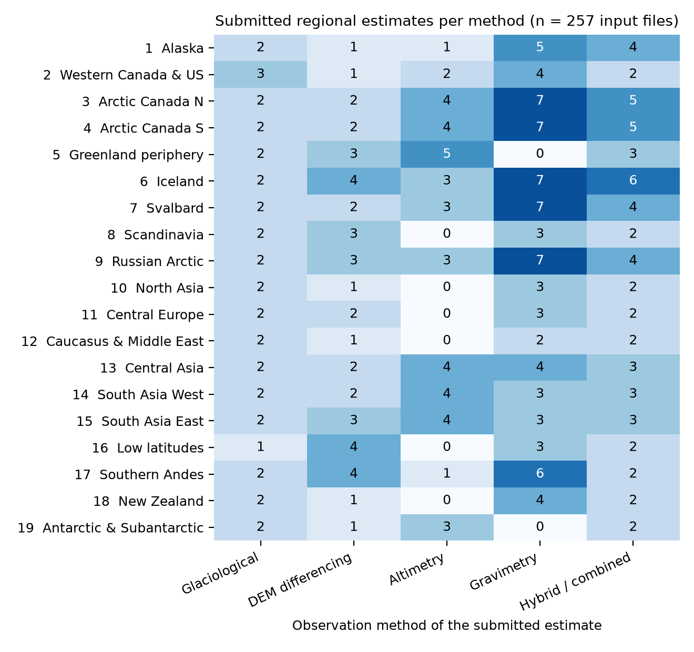
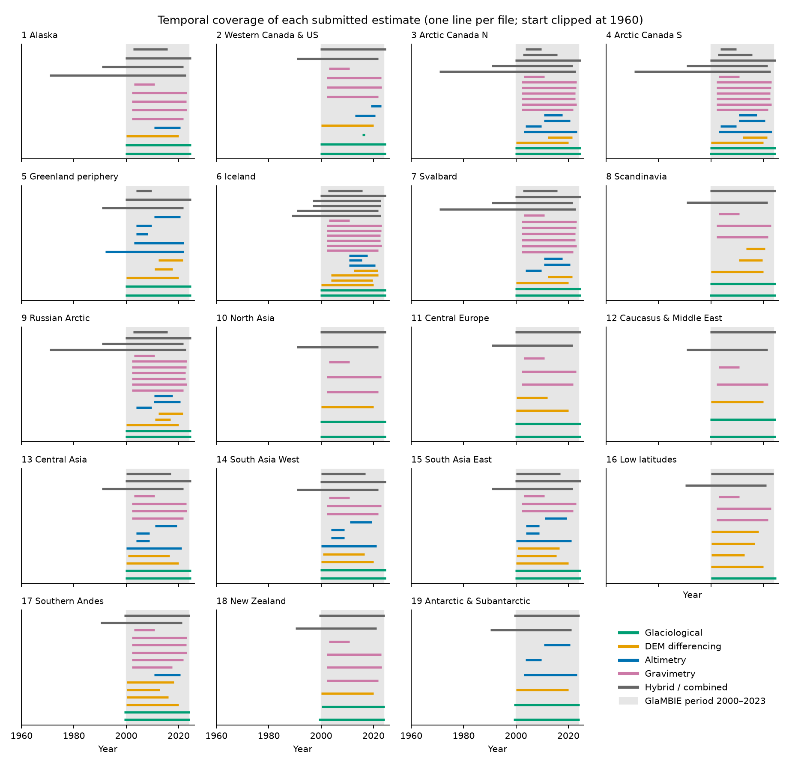
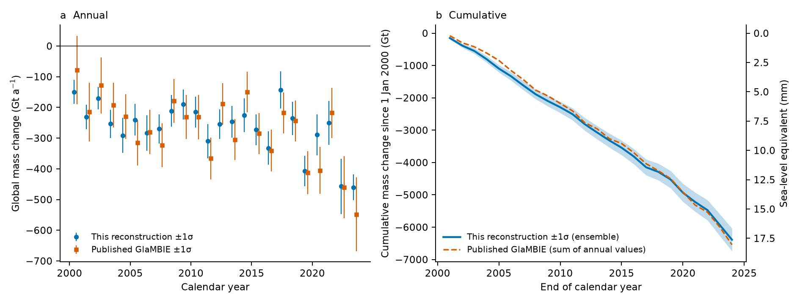
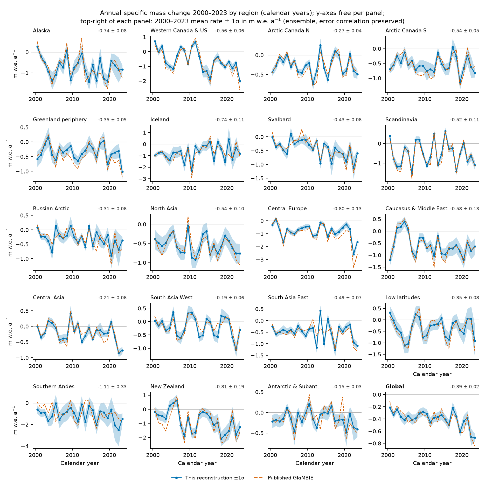
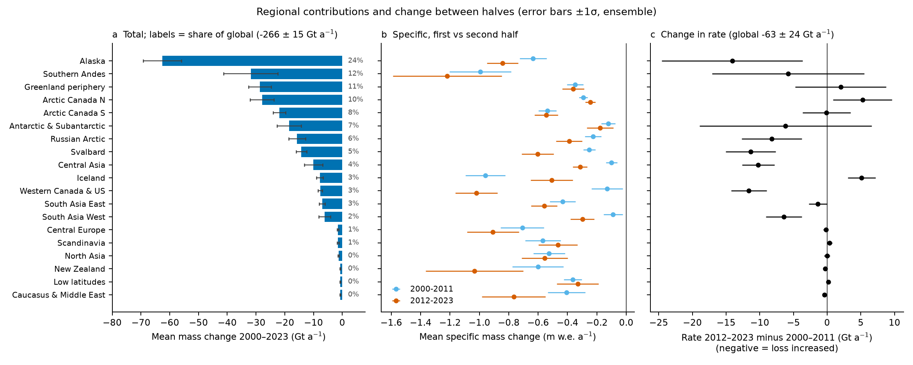
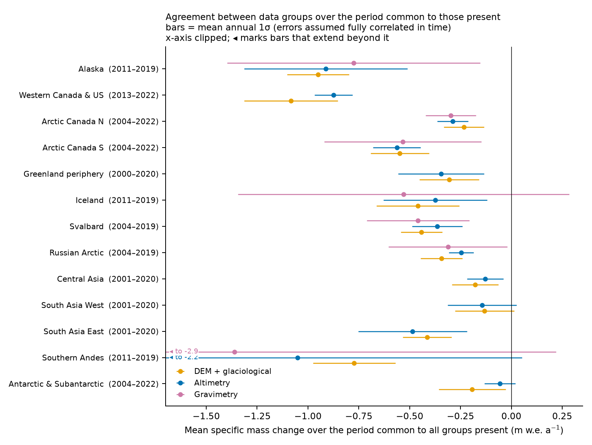
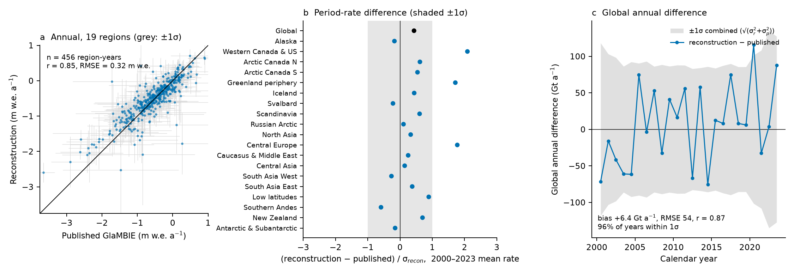
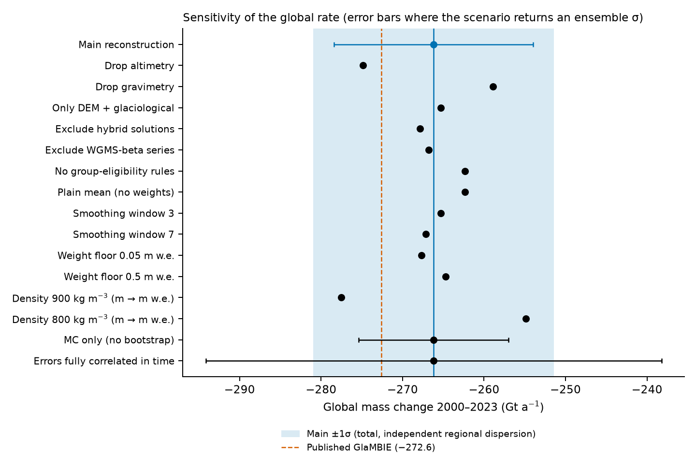

# Regional and global glacier mass change 2000–2023 from 257 submitted observational estimates: an independent reconstruction, uncertainty budget and comparison with the published GlaMBIE consensus

## Abstract

We homogenise 257 regional estimates of glacier mass change for the 19 GTN-G/RGI regions, submitted from four observation methods (glaciological measurements, DEM differencing, satellite altimetry, gravimetry) and hybrid/model-based combinations, into annual regional and global series for 2000–2023 in specific mass change (m w.e.) and total mass change (Gt), with 1σ uncertainties from a 1000-member ensemble that carries the stated error-correlation structure. The reconstruction gives a global loss of **−266 ± 15 Gt yr⁻¹ (−0.39 ± 0.02 m w.e. yr⁻¹)** for 2000–2023, which accumulates to −6389 ± 355 Gt, or 17.6 ± 1.0 mm of sea-level equivalent. The loss rate rose from −235 ± 14 Gt yr⁻¹ (2000–2011) to −298 ± 21 Gt yr⁻¹ (2012–2023), an increase of 63 ± 24 Gt yr⁻¹ (2.6σ in the main run; 1.9σ to 6.7σ across six alternative assumptions on error correlation in time and between regions, the lowest value when the regional inter-group dispersion is treated as fully correlated). Alaska (24 %), the Southern Andes (12 %), the Greenland periphery (11 %) and Arctic Canada North (10 %) contribute 57 % of the global loss; the increase in loss is concentrated in Alaska, Western Canada & US, Svalbard, the Russian Arctic, Central Asia and South Asia West, while Iceland (and, less significantly, Arctic Canada North) lost mass more slowly in the second period. The reconstruction is compared with the published GlaMBIE consensus supplied in the dataset, which was *not* used as input except for yearly glacier areas: the global 2000–2023 rate differs by +6.4 Gt yr⁻¹ (0.4 σ), 96 % of global annual values fall within 1σ of the combined uncertainty, and the regional 2000–2023 rates agree within 1σ of the reconstruction uncertainty in 16 of 19 regions and within 2.1σ in all. The largest differences are in the early years (2000–2004 global rate 50 Gt yr⁻¹ less negative than published, 2.3σ), in the Southern Andes (annual correlation r = 0.28), Western Canada & US, Central Europe and the Greenland periphery. Method groups agree within their uncertainties wherever two or more resolve the same period, and the global 2000–2023 rate stays within 11.3 Gt yr⁻¹ of the main value under 13 alternative processing choices (and changes by 2.6 % when the DEM + glaciological group is removed, for the regions and years where altimetry or gravimetry exist), with the density used to convert elevation to mass change (−255 to −278 Gt yr⁻¹ for 800–900 kg m⁻³) the largest single sensitivity.

## 1 Introduction

Glaciers outside the ice sheets are a major, observationally constrained contributor to sea-level rise, and their regional mass budgets are used to evaluate and calibrate glacier models (Marzeion et al., 2020; Hock et al., 2019; Rounce et al., 2023). Four families of observation each resolve a different part of the problem. Glaciological (in-situ) series resolve annual variability at a few well-observed glaciers but sample the regional area sparsely; geodetic DEM differencing gives multi-year, spatially complete elevation change with high accuracy but coarse time resolution (Hugonnet et al., 2021); satellite altimetry provides sub-annual elevation change along tracks and has to deal with penetration, sampling and conversion to mass; gravimetry gives direct monthly mass change at the cost of coarse resolution and contamination by signals from hydrology and neighbouring ice sheets. Earlier assessments combined subsets of these (Zemp et al., 2019: glaciological and DEM data; Hugonnet et al., 2021: DEM only).

The task addressed here is to reconcile all of them into one consistent, annual 2000–2023 estimate with uncertainty for each of the 19 regions and the globe, in m w.e. and Gt, as a benchmark for assessments and model calibration. The input is the GlaMBIE community dataset (GlaMBIE dataset 1.0.0, DOI 10.5904/wgms-glambie-2024-07; supplied under `data/glambie`), which collects the submissions of the contributing research teams and also contains the published consensus (`results/`) produced by the GlaMBIE team.

We state up front the scope and the limits of this work:

* The GlaMBIE paper that describes the published combination algorithm was not among the supplied related-work files (the five supplied papers are Rounce et al. 2023, Marzeion et al. 2020, Zemp et al. 2019, Hock et al. 2019 and Hugonnet et al. 2021). The method below is therefore an **independent construction** guided by the structure of the data (data groups, flags for annual variability), not a replica of the published algorithm; we do not reproduce the published procedure from memory.
* The published consensus is used **only as a benchmark**, with one exception: the yearly regional glacier area (km²) from `results/` is used to convert between Gt and m w.e. No published mass-change value enters the reconstruction. One expert choice, which data groups are admitted in which region (Section 2.4), is *taken from the groups that the published results contain*, so the agreement reported here is not independent of that choice; its effect is tested in Section 4.5.
* The task text mentions 233 estimates; the supplied input folder contains 257 files. We could not identify which 233 are meant and use all 257 (Section 2.1), with a sensitivity run that removes the 19 `WGMS-beta` files.

## 2 Data and methods

### 2.1 Input data

The input holds one CSV per submitted regional estimate (`input/<region>/*.csv`; columns `start_dates, end_dates, changes, errors, unit, author`) for the 19 regions, 257 files in total. Table 1 and Figures 1–2 give the inventory by region and method; the file-level list is in `outputs/input_inventory.csv`. Method counts are 38 glaciological, 42 DEM-differencing, 41 altimetry, 78 gravimetry and 58 hybrid/combined files (the last group combines methods or uses models; we treat the glaciological and hybrid series as "annually resolved" below). Submitted units are metres of elevation/thickness change (`m`, 86 files), `mwe` (81) and Gt (83 + 7 with a lower-case label). Time resolution ranges from monthly to multi-year (for DEM differencing typically 5-year intervals or a single 2000–2019 interval), and the start of the hydrological year differs by region. Gravimetry is absent for the Greenland periphery and Antarctic & Subantarctic regions; altimetry is absent for several small regions (Scandinavia, North Asia, Central Europe, Caucasus & Middle East, Low latitudes, New Zealand).

**Figure 1.** Number of submitted estimates per region and method (257 input files; the task text quotes 233).

**Figure 2.** Temporal coverage of each submitted estimate (one line per file, coloured by method; grey band = 2000–2023). Many hybrid series start decades earlier, most gravimetry and altimetry series start in 2002–2011, and DEM series cover multi-year blocks.

**Table 1.** Number of submitted estimates per region and method (from `code/figures/tables/T1_inventory_region_by_method.md`).

| # | Region | Glaciological | DEM differencing | Altimetry | Gravimetry | Hybrid / combined | Total |
|--:|:--|--:|--:|--:|--:|--:|--:|
| 1 | Alaska | 2 | 1 | 1 | 5 | 4 | 13 |
| 2 | Western Canada & US | 3 | 1 | 2 | 4 | 2 | 12 |
| 3 | Arctic Canada N | 2 | 2 | 4 | 7 | 5 | 20 |
| 4 | Arctic Canada S | 2 | 2 | 4 | 7 | 5 | 20 |
| 5 | Greenland periphery | 2 | 3 | 5 | 0 | 3 | 13 |
| 6 | Iceland | 2 | 4 | 3 | 7 | 6 | 22 |
| 7 | Svalbard | 2 | 2 | 3 | 7 | 4 | 18 |
| 8 | Scandinavia | 2 | 3 | 0 | 3 | 2 | 10 |
| 9 | Russian Arctic | 2 | 3 | 3 | 7 | 4 | 19 |
| 10 | North Asia | 2 | 1 | 0 | 3 | 2 | 8 |
| 11 | Central Europe | 2 | 2 | 0 | 3 | 2 | 9 |
| 12 | Caucasus & Middle East | 2 | 1 | 0 | 2 | 2 | 7 |
| 13 | Central Asia | 2 | 2 | 4 | 4 | 3 | 15 |
| 14 | South Asia West | 2 | 2 | 4 | 3 | 3 | 14 |
| 15 | South Asia East | 2 | 3 | 4 | 3 | 3 | 15 |
| 16 | Low latitudes | 1 | 4 | 0 | 3 | 2 | 10 |
| 17 | Southern Andes | 2 | 4 | 1 | 6 | 2 | 15 |
| 18 | New Zealand | 2 | 1 | 0 | 4 | 2 | 9 |
| 19 | Antarctic & Subantarctic | 2 | 1 | 3 | 0 | 2 | 8 |
|  | All regions | 38 | 42 | 41 | 78 | 58 | 257 |

### 2.2 Homogenisation

Every solution is converted to specific mass change in m w.e. and mapped to a common annual grid by a single linear operator, so that the error structure can be propagated exactly:

1. **Units.** Gt are converted with the regional glacier area of the target year (`Δh[m w.e.] = Gt / area[km²] × 1000`); `mwe` is used as is; elevation/thickness change in metres is multiplied by 0.85 (a density of 850 kg m⁻³, tested at 800 and 900 kg m⁻³ in Section 3.6). The yearly regional area is the only quantity read from the published results.
2. **Annualisation.** A submitted change over an interval is distributed uniformly over the interval and summed over the overlap with each target year. A year is kept if at least 95 % covered. Two grids are produced. Calendar years are the headline product, because a global sum needs one common year definition (label = start year, so "2000" covers 2000.0–2001.0); all results in Section 3 are on this grid. Region-specific hydrological years (the year start differs by region) are provided as a second product in `outputs/regional_hydrological_years.csv` and `outputs/group_series_hydrological.csv`, and are used only for the group-level comparison with the published series and for matching the literature.
3. **Error structure.** Intervals of at least one year (e.g. 5-year DEM periods) carry one independent error draw per interval, so annual values within a DEM period are fully correlated. Sub-annual (monthly) submissions carry an annual-equivalent error shared by the target year: the submitted monthly errors are of the size of annual errors and the dataset description does not say how they should be combined, so this is an assumption; the opposite assumption, one fully time-correlated error per solution, is run as a sensitivity. Errors are independent between solutions.

### 2.3 Combination within and across data groups

* **Within a group** (altimetry, gravimetry, DEM, annually resolved glaciological + hybrid) the solutions are combined with a weighted fixed-effect model `v[s,y] = μ[y] + b[s]`, with weights `1/(σ² + 0.15²)` (m w.e.), where `b[s]` is a solution-specific offset constrained to sum to zero; this prevents steps in the combined series when the set of contributing solutions changes between years.
* **DEM + glaciological group.** DEM period means set the multi-year level; annual solutions supply the within-period anomalies about their own mean; outside DEM coverage the annual series is shifted by its mean offset to DEM over the five nearest covered years.
* **Across groups.** The consensus is `L + AV`: `L` is the equal-weight fixed-effect combination of the groups' 5-year running means (the level), and `AV` the mean annual anomaly of those groups that resolve annual variability. This avoids damping annual variability by groups that only resolve multi-year means.

### 2.4 Data-group eligibility (expert choice)

Altimetry is admitted in 13 and gravimetry in 7 of the 19 regions (small regions, ice-sheet leakage and hydrological contamination are the usual reasons for excluding them). These decisions cannot be derived from the input files; they are **taken from the groups present for each region in the published results** and are therefore not independent of the benchmark. The sensitivity "no group-eligibility rules" (Section 3.6) admits all groups everywhere.

### 2.5 Uncertainty

A 1000-member ensemble draws (i) all submitted errors with the correlation structure of Section 2.2, and (ii) bootstrap resamples of the solutions inside each group. An inter-group dispersion term (standard error of the group values, added in quadrature) accounts for disagreement between groups; for period rates it uses the group period means. All values are 1σ. Period-rate and cumulative uncertainties come from the ensemble, so they preserve the correlation of errors across years and are not sums of annual errors. Regions are treated as independent when summed to the global series; the alternative (fully correlated regional dispersion terms) is given in Section 3.6. Where only one group covers a region and period (most regions in 2000–2002), the dispersion term is zero and the uncertainty rests on the submitted errors alone, which understates the structural uncertainty there.

### 2.6 Validation design

Three kinds of checks are made: (a) against the published consensus (`results/calendar_years`), by bias, RMSE, correlation, the fraction of years where the difference is within 1σ and 2σ of the combined uncertainty `√(σ_recon² + σ_pub²)`, and by period rates; (b) against the supplied literature (Hugonnet et al., 2021; Zemp et al., 2019), see `outputs/reference_values.csv`; (c) internal consistency: agreement between data groups, and sensitivity of the global rate to processing choices. The published annual errors are annual uncertainties, not period-rate uncertainties; the quadrature sum of them over a period (`rate_gt_err_pub_annual_rss` in `outputs/period_rates_vs_published.csv`) is only a rough scale for the published period-rate uncertainty, and we therefore express rate differences in units of the reconstruction's own σ.

Code: `code/run_all.sh` regenerates every file in `outputs/` from the input data (about 3.5 minutes on one CPU with 1000 ensemble members; software versions in `outputs/environment.txt`); `code/figures/` regenerates the figures and tables of this report from `outputs/`. File-level documentation: `outputs/README.md`, `code/README.md`.

## 3 Results

### 3.1 Global mass change

The reconstructed global glacier mass change for 2000–2023 is **−266.2 ± 14.8 Gt yr⁻¹** (−0.39 ± 0.02 m w.e. yr⁻¹; 0.73 mm yr⁻¹ sea-level equivalent at 362.5 Gt mm⁻¹), a cumulative −6389 ± 355 Gt or 17.6 mm (Table 3, Figure 4b). Annual values range from −143 ± 61 Gt (2017) to −460 ± 42 Gt (2023); 2019, 2022 and 2023 are the three most negative years (−407, −457 and −460 Gt). The mean rate was −234.6 ± 14.1 Gt yr⁻¹ in 2000–2011 and −297.8 ± 21.0 Gt yr⁻¹ in 2012–2023; the difference of −63.3 ± 23.9 Gt yr⁻¹ is 2.6σ. A linear fit to the annual series gives −66.8 ± 16.6 Gt yr⁻¹ per decade (`outputs/acceleration.csv`; ensemble uncertainty only, 19.1 Gt yr⁻¹ per decade with the group-dispersion term, `outputs/acceleration_significance_variants.csv`). In blocks the rate is −219 ± 21 (2000–2004), −239 ± 22 (2005–2009), −250 ± 19 (2010–2014), −278 ± 20 (2015–2019) and −364 ± 35 Gt yr⁻¹ (2020–2023), a monotonic increase of the loss.

**Figure 4.** Global glacier mass change 2000–2023 (calendar years). (a) Annual values with 1σ for this reconstruction and the published GlaMBIE consensus (benchmark, not an input). (b) Cumulative mass change since 1 January 2000 with the 1σ ensemble band (which includes error correlation in time) and the sea-level-equivalent axis; the dashed line sums the published annual values.

**Table 3.** Global annual mass change (from `code/figures/tables/T3_global_annual.md`; 1σ; cumulative uncertainties from the ensemble covariance; the last column is the published GlaMBIE value with its published annual 1σ).

| Year | Gt a⁻¹ | m w.e. a⁻¹ | Cumulative (Gt) | Cumulative SLE (mm) | Published (Gt a⁻¹) |
|--:|--:|--:|--:|--:|--:|
| 2000 | -149 ± 39 | -0.21 ± 0.06 | -149 ± 38 | 0.4 | -78 ± 112 |
| 2001 | -231 ± 40 | -0.33 ± 0.06 | -380 ± 64 | 1.0 | -215 ± 95 |
| 2002 | -170 ± 37 | -0.24 ± 0.05 | -550 ± 86 | 1.5 | -128 ± 91 |
| 2003 | -254 ± 46 | -0.36 ± 0.07 | -804 ± 103 | 2.2 | -193 ± 73 |
| 2004 | -291 ± 56 | -0.42 ± 0.08 | -1095 ± 115 | 3.0 | -229 ± 73 |
| 2005 | -240 ± 52 | -0.35 ± 0.07 | -1335 ± 130 | 3.7 | -315 ± 74 |
| 2006 | -284 ± 58 | -0.41 ± 0.08 | -1618 ± 140 | 4.5 | -280 ± 73 |
| 2007 | -270 ± 48 | -0.39 ± 0.07 | -1889 ± 150 | 5.2 | -323 ± 72 |
| 2008 | -211 ± 52 | -0.31 ± 0.08 | -2100 ± 162 | 5.8 | -179 ± 72 |
| 2009 | -190 ± 49 | -0.28 ± 0.07 | -2290 ± 174 | 6.3 | -231 ± 71 |
| 2010 | -215 ± 50 | -0.32 ± 0.07 | -2505 ± 187 | 6.9 | -231 ± 72 |
| 2011 | -310 ± 55 | -0.46 ± 0.08 | -2815 ± 198 | 7.8 | -366 ± 68 |
| 2012 | -255 ± 48 | -0.38 ± 0.07 | -3069 ± 206 | 8.5 | -188 ± 67 |
| 2013 | -247 ± 52 | -0.37 ± 0.08 | -3316 ± 217 | 9.1 | -305 ± 66 |
| 2014 | -226 ± 55 | -0.34 ± 0.08 | -3541 ± 227 | 9.8 | -150 ± 66 |
| 2015 | -272 ± 50 | -0.41 ± 0.08 | -3814 ± 236 | 10.5 | -285 ± 67 |
| 2016 | -333 ± 54 | -0.50 ± 0.08 | -4146 ± 247 | 11.4 | -341 ± 68 |
| 2017 | -143 ± 61 | -0.22 ± 0.09 | -4289 ± 258 | 11.8 | -218 ± 66 |
| 2018 | -236 ± 54 | -0.36 ± 0.08 | -4525 ± 269 | 12.5 | -244 ± 67 |
| 2019 | -407 ± 49 | -0.62 ± 0.07 | -4932 ± 280 | 13.6 | -413 ± 70 |
| 2020 | -289 ± 67 | -0.44 ± 0.10 | -5221 ± 295 | 14.4 | -405 ± 76 |
| 2021 | -250 ± 71 | -0.38 ± 0.11 | -5472 ± 313 | 15.1 | -218 ± 82 |
| 2022 | -457 ± 90 | -0.70 ± 0.14 | -5928 ± 337 | 16.4 | -460 ± 101 |
| 2023 | -460 ± 42 | -0.71 ± 0.06 | -6389 ± 355 | 17.6 | -548 ± 120 |

### 3.2 Regional mass change

Table 2 gives the regional rates in the two halves and for the full period, and Figure 3 the annual regional series.

**Table 2.** Regional mean rates (Gt yr⁻¹ unless stated; ±1σ ensemble; area in km²; last column: 2012–2023 rate minus 2000–2011 rate; from `code/figures/tables/T2_regional_period_rates.md`).

| # | Region | Area 2000 (km²) | 2000–2011 (Gt a⁻¹) | 2012–2023 (Gt a⁻¹) | 2000–2023 (Gt a⁻¹) | 2000–2023 (m w.e. a⁻¹) | Δrate 2012–23 vs 2000–11 (Gt a⁻¹) |
|--:|:--|--:|--:|--:|--:|--:|--:|
|  | Global | 703,978 | -234.6 ± 14.1 | -297.8 ± 21.0 | -266.2 ± 14.8 | -0.39 ± 0.02 | -63.3 ± 23.9 |
| 1 | Alaska | 89,847 | -55.5 ± 8.0 | -69.6 ± 8.8 | -62.6 ± 6.6 | -0.74 ± 0.08 | -14.1 ± 10.4 |
| 2 | Western Canada & US | 14,563 | -1.8 ± 1.5 | -13.5 ± 1.9 | -7.6 ± 0.8 | -0.56 ± 0.06 | -11.6 ± 2.6 |
| 3 | Arctic Canada N | 105,001 | -30.5 ± 3.0 | -25.3 ± 3.6 | -27.9 ± 4.1 | -0.27 ± 0.04 | 5.3 ± 4.4 |
| 4 | Arctic Canada S | 40,872 | -21.8 ± 2.5 | -21.9 ± 3.2 | -21.9 ± 2.1 | -0.54 ± 0.05 | -0.1 ± 3.6 |
| 5 | Greenland periphery | 89,349 | -29.6 ± 4.8 | -27.6 ± 5.7 | -28.6 ± 4.0 | -0.35 ± 0.05 | 2.0 ± 6.7 |
| 6 | Iceland | 11,000 | -10.4 ± 1.5 | -5.2 ± 1.5 | -7.8 ± 1.2 | -0.74 ± 0.11 | 5.1 ± 2.1 |
| 7 | Svalbard | 34,445 | -8.5 ± 1.4 | -19.9 ± 3.6 | -14.2 ± 1.9 | -0.43 ± 0.06 | -11.3 ± 3.7 |
| 8 | Scandinavia | 2,961 | -1.7 ± 0.4 | -1.3 ± 0.4 | -1.5 ± 0.3 | -0.52 ± 0.11 | 0.3 ± 0.4 |
| 9 | Russian Arctic | 51,613 | -11.6 ± 2.8 | -19.8 ± 4.6 | -15.7 ± 2.9 | -0.31 ± 0.06 | -8.2 ± 4.5 |
| 10 | North Asia | 2,488 | -1.3 ± 0.3 | -1.3 ± 0.4 | -1.3 ± 0.2 | -0.54 ± 0.10 | -0.0 ± 0.4 |
| 11 | Central Europe | 2,141 | -1.4 ± 0.3 | -1.6 ± 0.3 | -1.5 ± 0.2 | -0.80 ± 0.13 | -0.2 ± 0.4 |
| 12 | Caucasus & Middle East | 1,283 | -0.5 ± 0.2 | -0.9 ± 0.3 | -0.7 ± 0.2 | -0.58 ± 0.13 | -0.4 ± 0.3 |
| 13 | Central Asia | 49,702 | -4.9 ± 1.9 | -15.1 ± 2.3 | -10.0 ± 3.2 | -0.21 ± 0.06 | -10.2 ± 2.4 |
| 14 | South Asia West | 33,508 | -2.9 ± 2.1 | -9.4 ± 2.5 | -6.2 ± 2.0 | -0.19 ± 0.06 | -6.4 ± 2.7 |
| 15 | South Asia East | 14,907 | -6.3 ± 1.3 | -7.7 ± 1.2 | -7.0 ± 1.0 | -0.49 ± 0.07 | -1.4 ± 1.4 |
| 16 | Low latitudes | 2,355 | -0.8 ± 0.1 | -0.6 ± 0.3 | -0.7 ± 0.2 | -0.35 ± 0.08 | 0.2 ± 0.3 |
| 17 | Southern Andes | 29,389 | -28.9 ± 6.1 | -34.7 ± 10.6 | -31.8 ± 9.4 | -1.11 ± 0.33 | -5.8 ± 11.3 |
| 18 | New Zealand | 980 | -0.6 ± 0.2 | -0.9 ± 0.3 | -0.7 ± 0.2 | -0.81 ± 0.19 | -0.3 ± 0.3 |
| 19 | Antarctic & Subantarctic | 127,576 | -15.4 ± 5.9 | -21.5 ± 11.0 | -18.5 ± 4.2 | -0.15 ± 0.03 | -6.2 ± 12.8 |

**Figure 3.** Annual specific mass change 2000–2023 by region (calendar years) from this reconstruction (blue, band = 1σ) and the published consensus (orange dashed); y-axes differ between panels. The text in each panel gives the 2000–2023 mean rate with ensemble uncertainty.

Per unit area the Southern Andes (−1.11 ± 0.33 m w.e. yr⁻¹), New Zealand (−0.81 ± 0.19), Central Europe (−0.80 ± 0.13), Alaska (−0.74 ± 0.08) and Iceland (−0.74 ± 0.11) lose most, and the Antarctic & Subantarctic (−0.15 ± 0.03), South Asia West (−0.19 ± 0.06) and Central Asia (−0.21 ± 0.06) least. In absolute terms (Figure 6a) Alaska (−62.6 ± 6.6 Gt yr⁻¹, 24 % of the global loss), the Southern Andes (−31.8 ± 9.4, 12 %), the Greenland periphery (−28.6 ± 4.0, 11 %) and Arctic Canada North (−27.9 ± 4.1, 10 %) dominate; the six smallest regions (Scandinavia, North Asia, Central Europe, Caucasus & Middle East, Low latitudes, New Zealand) together contribute about 2 %.

### 3.3 Change between the two halves of the period

Figure 6c shows the change in rate between 2012–2023 and 2000–2011. Increases in loss exceeding twice their uncertainty occur in Western Canada & US (−11.6 ± 2.6 Gt yr⁻¹), Svalbard (−11.3 ± 3.7), Central Asia (−10.2 ± 2.4) and South Asia West (−6.4 ± 2.7); Alaska (−14.1 ± 10.4) and the Russian Arctic (−8.2 ± 4.5) have the same sign but are within 2σ. Iceland is the one region whose loss declined significantly (+5.1 ± 2.1 Gt yr⁻¹, 2.4σ); Arctic Canada North (+5.3 ± 4.4) and the Greenland periphery (+2.0 ± 6.7) show no significant change, and the Southern Andes and Antarctic & Subantarctic changes (−5.8 ± 11.3, −6.2 ± 12.8) cannot be distinguished from zero. The global change of −63 ± 24 Gt yr⁻¹ is thus the sum of a small number of regional contributions rather than a uniform change: Alaska, Western Canada & US, Svalbard, Central Asia and the Russian Arctic account for −55 Gt yr⁻¹ of it.

**Figure 6.** Regional contributions and change between halves. (a) 2000–2023 total mass change per region with its share of the global loss; (b) specific mass change in 2000–2011 and 2012–2023; (c) change in rate between the halves (negative = loss increased). Bars are 1σ from the ensemble.

### 3.4 Agreement between observation methods

Figure 7 compares the group series (altimetry, gravimetry, DEM + glaciological) over the period common to the groups present in each region, as mean specific mass change with a conservative bar (the mean annual 1σ, i.e. assuming annual errors fully correlated in time). In all 13 regions shown, the intervals of the groups overlap pairwise. The tightest agreement is in Arctic Canada North (−0.29, −0.23 and −0.30 m w.e. yr⁻¹ for altimetry, DEM + glaciological and gravimetry) and Arctic Canada South (−0.56, −0.55, −0.53); the largest absolute spreads are in Western Canada & US (−0.87 altimetry against −1.08 DEM + glaciological) and the Southern Andes (−1.05 altimetry, −0.77 DEM + glaciological, −1.36 gravimetry, the last two bars exceeding ±1 m w.e. yr⁻¹). Gravimetry is the least constraining group in the small or ice-sheet-adjacent regions (bars of ±0.6–0.8 m w.e. yr⁻¹ in Alaska and Iceland). This is a weak test of reconciliation because the bars are wide by construction: it shows that no group is incompatible with the consensus, not that the consensus is correct. Compared with the published per-group series (hydrological years; `outputs/validation_groups_summary.csv`, per region in `outputs/validation_groups_by_region_wide.csv`), the reconstructed group series have a median correlation of r = 0.89 (minimum 0.73, 19 regions) for DEM + glaciological, 0.79 (minimum 0.48, 7 regions) for gravimetry and 0.76 (minimum 0.19, 13 regions) for altimetry; the median RMSE is 5.1, 7.4 and 10.4 Gt yr⁻¹ and the mean bias +1.9, −0.7 and +0.9 Gt yr⁻¹, respectively. The DEM + glaciological group is thus reproduced best and altimetry worst; the altimetry minimum is Western Canada & US (r = 0.19 for nine years).

**Figure 7.** Agreement of the data groups over the period common to the groups present in each region (period in brackets; mean specific mass change ± mean annual 1σ).

### 3.5 Validation against the published consensus

**Annual values.** Over the 19 regions and 24 years (456 region-years) the reconstruction correlates with the published values at r = 0.85 (RMSE 0.32 m w.e.; Figure 5a). The global annual series has bias +6.4 Gt yr⁻¹ (reconstruction less negative), RMSE 54 Gt yr⁻¹, r = 0.87, and 96 % of years within 1σ (100 % within 2σ) of the combined uncertainty (Table 4; Figure 5c). The reconstruction's mean annual global uncertainty (53 Gt) is smaller than the published one (78 Gt). Coverage computed with the combined uncertainty cannot by itself show that either uncertainty is calibrated.

**Period rates.** The 2000–2023 global rate is −266.2 ± 14.8 Gt yr⁻¹ against −272.6 Gt yr⁻¹ published (difference +6.4, 0.43σ); for 2000–2019 −246.6 ± 14.9 against −245.6; for 2000–2011 −234.6 ± 14.1 against −230.7; for 2012–2023 −297.8 ± 21.0 against −314.5 (+16.6, 0.8σ). Regionally (Figure 5b), 16 of 19 regions agree within 1σ of the reconstruction; the exceptions are Western Canada & US (−7.6 against −9.2 Gt yr⁻¹, 2.1σ), Central Europe (−1.54 against −1.97, 1.8σ) and the Greenland periphery (−28.6 against −35.4, 1.7σ), in all of which the reconstruction is less negative. Three of 19 beyond 1σ is fewer than expected for independent unit-normal differences, but the σ used is the reconstruction's alone. The reconstruction is less negative than the published value in 14 of 19 regions, a systematic tendency of about +6 Gt yr⁻¹ globally that we do not explain.

**Where the two differ.** (i) *Early years.* The 2000–2004 global rate is −219 ± 21 Gt yr⁻¹ against −169 published (−50 Gt yr⁻¹, 2.3σ of the reconstruction), whereas 2005–2009 (−239 against −266), 2015–2019 (−278 against −300) and 2020–2023 (−364 against −408) differ by 1.1–1.2σ with the reconstruction less negative. In 2000–2004 the series rests mostly on DEM + glaciological solutions (gravimetry starts about 2002, and altimetry in a few regions about 2003; Figure 2), so the group-dispersion term is close to zero, and this is the period in which the reconstruction's uncertainty is least reliable. (ii) *Southern Andes.* The mean is −31.8 against −26.3 Gt yr⁻¹, but the annual correlation is only r = 0.28 (RMSE 24 Gt yr⁻¹), the lowest of any region; the region has a large uncertainty (±9.4 Gt yr⁻¹) and the data groups differ most there (Figure 7). (iii) The Russian Arctic and South Asia East have r = 0.67 for annual values although their means agree. (iv) Central Europe has only 58 % of years within 1σ; its small reconstructed uncertainty (about 0.25 Gt yr⁻¹) may be too small.

**Figure 5.** Reconstruction against the published consensus. (a) Annual specific mass change per region (456 region-years, grey = ±1σ). (b) Difference in the 2000–2023 mean rate in units of the reconstruction's σ (shading = ±1σ). (c) Global annual difference with the combined ±1σ band.

**Table 4.** Validation against the published annual series by region (calendar years 2000–2023; "within 1σ" = share of years with |difference| below the combined 1σ; from `code/figures/tables/T4_validation_vs_published.md`).

| Region | Mean recon. (Gt a⁻¹) | Mean published (Gt a⁻¹) | Bias (Gt a⁻¹) | RMSE (Gt a⁻¹) | r | RMSE (m w.e.) | within 1σ | within 2σ |
|:--|--:|--:|--:|--:|--:|--:|--:|--:|
| Global | -266.2 | -272.6 | +6.4 | 54.3 | 0.87 | 0.08 | 96% | 100% |
| Alaska | -62.6 | -61.4 | -1.2 | 26.7 | 0.86 | 0.32 | 88% | 100% |
| Western Canada & US | -7.6 | -9.2 | +1.6 | 3.5 | 0.96 | 0.27 | 96% | 100% |
| Arctic Canada N | -27.9 | -30.4 | +2.5 | 11.8 | 0.91 | 0.11 | 83% | 100% |
| Arctic Canada S | -21.9 | -23.0 | +1.1 | 7.4 | 0.87 | 0.18 | 88% | 100% |
| Greenland periphery | -28.6 | -35.4 | +6.8 | 15.9 | 0.88 | 0.20 | 100% | 100% |
| Iceland | -7.8 | -8.3 | +0.5 | 4.9 | 0.76 | 0.47 | 92% | 100% |
| Svalbard | -14.2 | -13.8 | -0.4 | 5.9 | 0.88 | 0.18 | 88% | 100% |
| Scandinavia | -1.5 | -1.7 | +0.2 | 0.5 | 0.97 | 0.18 | 92% | 100% |
| Russian Arctic | -15.7 | -16.0 | +0.3 | 12.5 | 0.67 | 0.24 | 79% | 100% |
| North Asia | -1.3 | -1.4 | +0.1 | 0.3 | 0.86 | 0.15 | 100% | 100% |
| Central Europe | -1.5 | -2.0 | +0.4 | 0.7 | 0.95 | 0.40 | 58% | 96% |
| Caucasus & Middle East | -0.7 | -0.7 | +0.0 | 0.2 | 0.97 | 0.16 | 96% | 100% |
| Central Asia | -10.0 | -10.5 | +0.5 | 5.9 | 0.93 | 0.12 | 100% | 100% |
| South Asia West | -6.2 | -5.6 | -0.5 | 5.8 | 0.87 | 0.18 | 92% | 100% |
| South Asia East | -7.0 | -7.4 | +0.4 | 4.0 | 0.67 | 0.28 | 83% | 100% |
| Low latitudes | -0.7 | -0.9 | +0.1 | 0.4 | 0.94 | 0.20 | 100% | 100% |
| Southern Andes | -31.8 | -26.3 | -5.5 | 24.3 | 0.28 | 0.84 | 92% | 100% |
| New Zealand | -0.7 | -0.8 | +0.1 | 0.4 | 0.89 | 0.44 | 92% | 100% |
| Antarctic & Subantarctic | -18.5 | -17.8 | -0.6 | 23.7 | 0.72 | 0.19 | 92% | 100% |

**Comparison with the supplied literature.** *Hugonnet et al. (2021).* They report −267 Gt yr⁻¹ for 2000–2019 for glaciers outside the ice sheets from DEM data (a 95 % interval of ±16 Gt yr⁻¹, ≈ ±8 at 1σ; `outputs/reference_values.csv`). Our 2000–2019 rate, −246.6 ± 14.9 Gt yr⁻¹, is 20 Gt yr⁻¹ less negative (about 1.2σ of the two uncertainties combined), and the published GlaMBIE value (−245.6) is 21 Gt yr⁻¹ less negative as well. The gap does not come from combining groups: the DEM + glaciological group alone gives −246.1 Gt yr⁻¹ and the weighted mean of all DEM solutions −247.8 Gt yr⁻¹, whereas the Hugonnet et al. solution alone, passed through our unit conversion and areas, gives −265.5 Gt yr⁻¹, in line with the published −267 (`outputs/dem_group_vs_hugonnet_2000_2019.csv`). The gap therefore appears to come from the other DEM submissions in the dataset (one to four per region, Table 1), which on average give a smaller loss than the Hugonnet et al. series; we have not identified which regions drive it, do not know which of the solutions is closer to the truth, and have not tested weighting by area coverage or solution quality. Their acceleration of 48 ± 16 Gt yr⁻¹ per decade (95 % interval, 2000–2019) compares with our linear trend of 66.8 ± 19.1 Gt yr⁻¹ per decade (1σ, 2000–2023), which includes the very negative 2022–2023 years; the periods differ and we claim no discrepancy.

*Zemp et al. (2019).* For 2006–2016 (hydrological years) they obtained −267 ± 19 Gt yr⁻¹ (95 %) for the total excluding the Greenland periphery and Antarctic & Subantarctic, and −332 ± 144 Gt yr⁻¹ (95 %; −335 in the abstract) for all 19 regions. With the matched ten hydrological years starting 2006.25–2007.0 (region-specific; `outputs/zemp2019_matched_hydrological_2006_2016.csv`), our values are −215.6 ± 12.4 Gt yr⁻¹ for the subset and −252.1 ± 14.3 Gt yr⁻¹ for all regions; the published GlaMBIE series over the same window gives −216.1 and −260.3 Gt yr⁻¹. Matching the years therefore reduces the shift only slightly (from 58 to 51 Gt yr⁻¹ for the subset): our subset total is 3.3σ (combined, with Zemp's 95 % interval halved) less negative than Zemp et al., the all-region total 1.1σ because of Zemp's large uncertainty. The published GlaMBIE shows the same shift, so it is a property of the underlying data, not of our construction: the submitted solutions give a smaller loss than the 2019 assessment. Regionally, differences above 2σ are the Greenland periphery (−28.4 against −51 Gt yr⁻¹; the published GlaMBIE gives −39.7) and Central Europe (−1.29 against −2); the largest absolute differences are in Arctic Canada North (−36.5 against −60, 0.6σ because the Zemp 95 % interval is ±84), Alaska (−61.5 against −73) and the Greenland periphery. We have not investigated why the Greenland-periphery estimates differ most between our reconstruction, the published consensus and Zemp et al.

### 3.6 Sensitivity of the global rate

**Figure 8.** Sensitivity of the global 2000–2023 rate (Gt yr⁻¹) to processing choices; error bars where the scenario returns an ensemble σ. The shading is the main ±1σ; the dashed line is the published consensus (−272.6).

Removing a group, excluding hybrids or the 19 `WGMS-beta` series, dropping the eligibility rules, using an unweighted mean, changing the smoothing window (3 or 7 years) or the weight floor (0.05 or 0.5 m w.e.) changes the global 2000–2023 rate by between −8.7 (dropping altimetry: −274.8) and +7.3 Gt yr⁻¹ (dropping gravimetry: −258.9), all inside the main 1σ; the DEM + glaciological group alone gives −265.3. The conversion density has the largest effect: −277.5 (900 kg m⁻³) and −254.9 Gt yr⁻¹ (800 kg m⁻³). The two halves are more sensitive: the 2000–2011 rate ranges from −219.7 (no eligibility rules) to −244.9 Gt yr⁻¹ (900 kg m⁻³), and the 2012–2023 rate from −285.6 to −310.1 Gt yr⁻¹ (`outputs/robustness_scenarios.csv`). Regarding uncertainty, dropping the bootstrap reduces the ensemble σ of the global 2000–2023 rate from 12.2 to 9.2 Gt yr⁻¹, and treating each solution's errors as fully correlated in time raises it to 28.0 Gt yr⁻¹; treating the regional group-dispersion terms as fully correlated rather than independent raises the total 2000–2023 uncertainty from 14.8 to 21.7 Gt yr⁻¹ (2012–2023: 21.0 to 31.2; `outputs/robustness_global_uncertainty.csv`). The reported ±14.8 Gt yr⁻¹ is therefore a lower-middle estimate: plausible alternative error assumptions give 1σ between about 9 and 28 Gt yr⁻¹. **Significance of the acceleration.** Table 5 recomputes the half-difference (−63.3 Gt yr⁻¹) and the linear trend (−66.8 Gt yr⁻¹ per decade) under six assumptions on error correlation (from `outputs/acceleration_significance_variants.csv`; this rerun of the ensemble gives 2.7σ rather than 2.6σ for the main case because of ensemble sampling noise). Assuming each solution's errors are fully correlated in time *increases* the significance of the difference (to 4.0σ), because a persistent bias cancels in a difference of two rates, while treating the regional group-dispersion terms as fully correlated lowers it (to 1.9σ, or 2.3σ with the correlation in time as well). The acceleration is thus significant at about 2σ or more under every assumption tested, between 1.9σ and 6.7σ, with the lower values arising when a shared between-group disagreement is allowed to act in the same direction in all regions.

**Table 5.** Significance of the global acceleration under alternative error-correlation assumptions (σ_total includes the group-dispersion term; significance = |value| / σ_total).

| Errors in time | Regional group dispersion | Half-difference σ (Gt yr⁻¹) | Half-difference significance | Trend σ (Gt yr⁻¹ per decade) | Trend significance |
|:--|:--|--:|--:|--:|--:|
| independent between intervals (main) | independent (main) | 23.3 | 2.7σ | 19.1 | 3.5σ |
| independent between intervals (main) | fully correlated | 32.9 | 1.9σ | 27.3 | 2.5σ |
| independent between intervals (main) | none | 19.6 | 3.2σ | 16.0 | 4.2σ |
| fully correlated in time per solution | independent (main) | 15.6 | 4.0σ | 12.4 | 5.4σ |
| fully correlated in time per solution | fully correlated | 28.1 | 2.3σ | 23.0 | 2.9σ |
| fully correlated in time per solution | none | 9.4 | 6.7σ | 6.7 | 10.0σ |

**Removing the DEM + glaciological group.** The group that carries the 2000–2002 period cannot be dropped for those years, so we compare the main combination with a combination of altimetry and gravimetry only, for the regions that have either and the years where both products exist (`outputs/robustness_drop_demdiff_glaciological.csv`). For the 13 such regions in 2013–2020 the combined rate is −256.1 Gt yr⁻¹ without the group against −263.0 with it (+6.9 Gt yr⁻¹, 2.6 %). Among individual regions the largest relative changes are in the Antarctic & Subantarctic (−8.0 against −15.7 Gt yr⁻¹, ratio 0.51, where only altimetry exists), South Asia West (ratio 1.24) and the Southern Andes (ratio 1.11); the other regions change by less than 13 %. The global rate in the years and regions where independent groups exist is therefore insensitive to the DEM + glaciological group; for 2000–2002 and for regions without altimetry or gravimetry this test cannot be done.

## 4 Discussion

**Consistency of the methods.** The group series agree within their (conservative) uncertainties wherever two or more groups cover the same period, and dropping altimetry or gravimetry moves the global rate by less than 9 Gt yr⁻¹ (3 % of the loss), well within its 1σ; dropping the DEM + glaciological group changes the rate by 2.6 % where the other groups allow the test (2013–2020, regions with altimetry or gravimetry; not possible for 2000–2002). At the global level the observational record is therefore not sensitive to which group is retained; the one choice that matters more is physical rather than methodological, the density assumed for volume-to-mass conversion of elevation-change series (±11 Gt yr⁻¹ for 800–900 kg m⁻³), which applies to the DEM and altimetry data and for which the dataset provides no regional or temporal information. The disagreement that does exist is regional and in the sparse-data regions (Southern Andes, Western Canada & US, Greenland periphery, Alaska gravimetry) and early in the record.

**Agreement with the published consensus, and what it does not show.** An independent construction reproduces the published global rate to 0.4σ and the global annual series with 96 % of years within 1σ of the combined uncertainty. That agreement is evidence that the published result is not an artefact of one particular algorithm. It is weaker evidence than it looks for three reasons: the data-group eligibility was taken from the published product; area weights come from it; and both products use the same submitted solutions, so a bias common to all submissions (for example a shared density, glacier-area, or penetration assumption) would be reproduced by both. Differences between the two are larger than expected from the stated uncertainties in the first five years (−50 Gt yr⁻¹, 2.3σ) and, to a lesser degree, in three regions.

**Acceleration.** The loss rate increased from −235 to −298 Gt yr⁻¹ between the two halves (−63 ± 24 Gt yr⁻¹), and the last four years (−364 ± 35 Gt yr⁻¹, driven by 2022–2023) were the most negative of the record. The significance of the increase in the half-difference is 2.6σ in the main run and between 1.9σ and 6.7σ under the alternative error-correlation assumptions of Table 5, so it does not depend on a single assumption but is not strongly significant if inter-group disagreement is shared across regions; the regional pattern shows that it is carried by a few regions and not by a uniform increase. Compared with Hugonnet et al. (2021) (−48 ± 16 Gt yr⁻¹ per decade, 95 % interval, for 2000–2019) the linear trend we obtain for 2000–2023 is larger, but the periods differ and we do not claim a discrepancy.

**Use as a benchmark.** The regional and global series in `outputs/regional_calendar_years.csv` (Gt and m w.e., 1σ) and the period rates with ensemble σ in `outputs/period_rates.csv` are suitable for model calibration at the 5- to 12-year scale; annual regional values should be used with the annual uncertainty and with the knowledge that the annual correlation with the published series is 0.28–0.97 depending on the region (Table 4). The reconstruction is not a replacement for the published consensus. The latter was produced by the project team with the full method and with expert knowledge of the submissions, whereas we constructed the combination from the data alone.

**Limitations.**
1. All 257 files are used; the 233 quoted in the task could not be identified. Removing the 19 `WGMS-beta` series changes the global rate by 0.6 Gt yr⁻¹.
2. The group-eligibility rule is taken from the published results (Section 2.4). Without it the global rate is −262.4 Gt yr⁻¹ but the 2000–2011 rate becomes −219.7, so the early-period rate depends on it.
3. The interpretation of sub-annual errors, the 0.15 m w.e. weight floor, and the independence of regions in the global sum are assumptions; their effect on the uncertainty is a factor of about two (Section 3.6).
4. Uncertainties from before 2003 rest on one data group in most regions and are probably too small.
5. We do not model leakage, firn/penetration, or glacier-area change beyond the yearly area used for conversion, and cannot correct for biases shared by all submissions.
6. The comparison with Zemp et al. (2019) uses matched hydrological years but their regional uncertainties are 95 % intervals halved to approximate 1σ; the unexplained shift of our (and the published) estimates relative to theirs (51 Gt yr⁻¹ for the subset, 3.3σ) and the Greenland-periphery difference are not resolved. The difference with Hugonnet et al. (2021) is traced to the other DEM submissions but not to individual solutions.
7. No independent validation data (for example withheld glaciological series) were available, so the validation is against the published product and the literature only.

## 5 Conclusions

From 257 submitted regional estimates we obtain annual 2000–2023 regional and global glacier mass change with a reproducible, documented uncertainty ensemble: −266 ± 15 Gt yr⁻¹ globally (−0.39 ± 0.02 m w.e. yr⁻¹; 17.6 ± 1.0 mm sea-level equivalent in total), with a loss rate that increased by 63 ± 24 Gt yr⁻¹ from 2000–2011 to 2012–2023. The estimate is consistent with the published GlaMBIE consensus (difference 0.4σ globally) and with Hugonnet et al. (2021) within about 1.2σ; it is, like the published consensus, less negative than Zemp et al. (2019) for 2006–2016 (by 3.3σ for the total excluding the Greenland periphery and Antarctica, 1.1σ for all regions), a shift that the published consensus shares, which points to the submitted data rather than to the combination (not proven); it is robust to the removal of any one data group where the test is possible, and is most sensitive to the density used for volume-to-mass conversion. It differs from the published series in the first five years and in a small number of regions, which we flag rather than tune away, and it is not independent of the published product in its choice of data groups per region.

## Data and code availability

All inputs are the supplied GlaMBIE dataset (`data/glambie`); no external data were used. Outputs: `outputs/` (columns in `outputs/README.md`). Code: `code/` (`run_all.sh` reproduces all outputs; `code/figures/` the figures and Tables 1–4).

## References

Hock, R., et al. (2019). GlacierMIP – A model intercomparison of global-scale glacier mass-balance models and projections. *Journal of Glaciology* (supplied as `related_work/paper_003.pdf`).

Hugonnet, R., et al. (2021). Accelerated global glacier mass loss in the early twenty-first century. *Nature* (supplied as `related_work/paper_004.pdf`).

Marzeion, B., et al. (2020). Partitioning the uncertainty of ensemble projections of global glacier mass change. *Earth's Future* (supplied as `related_work/paper_001.pdf`).

Rounce, D. R., et al. (2023). Global glacier change in the 21st century: Every increase in temperature matters. *Science* (supplied as `related_work/paper_000.pdf`).

Zemp, M., et al. (2019). Global glacier mass changes and their contributions to sea-level rise from 1961 to 2016. *Nature* (supplied as `related_work/paper_002.pdf`).

GlaMBIE dataset 1.0.0 (WGMS), doi:10.5904/wgms-glambie-2024-07 (as given in the supplied dataset documentation).
