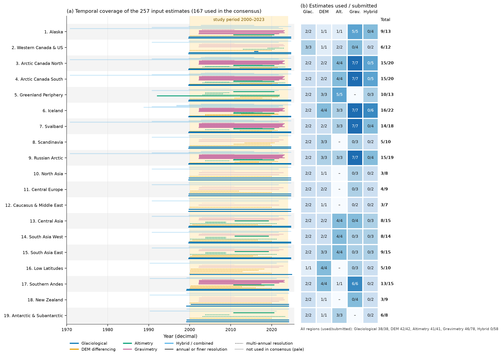
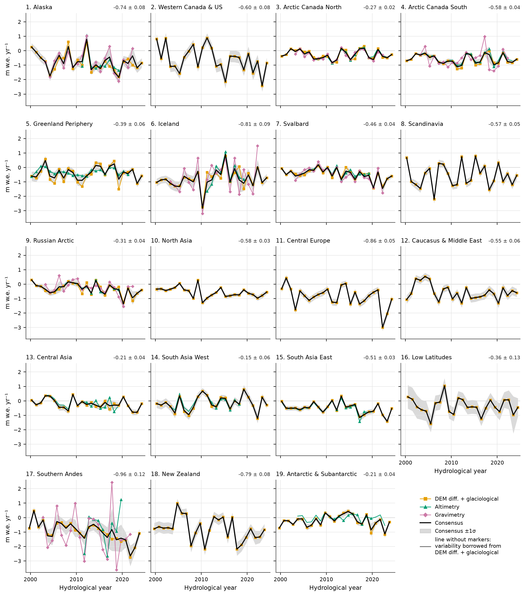
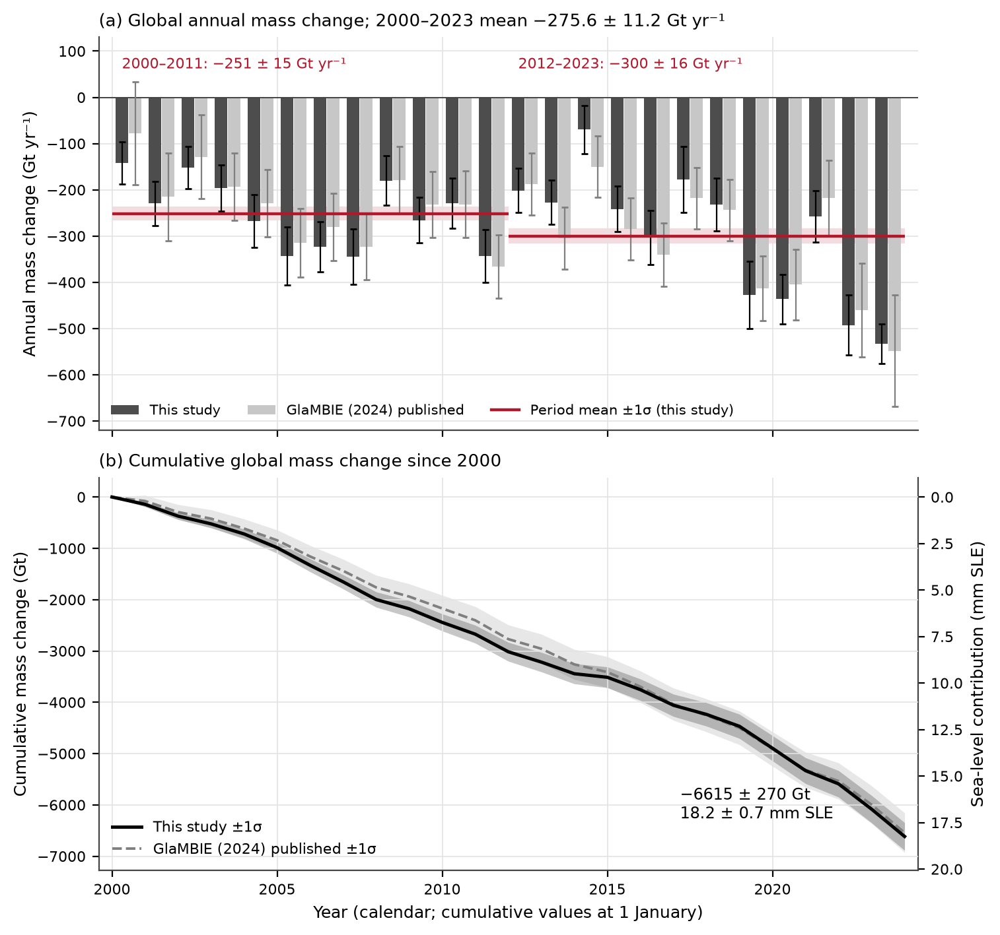
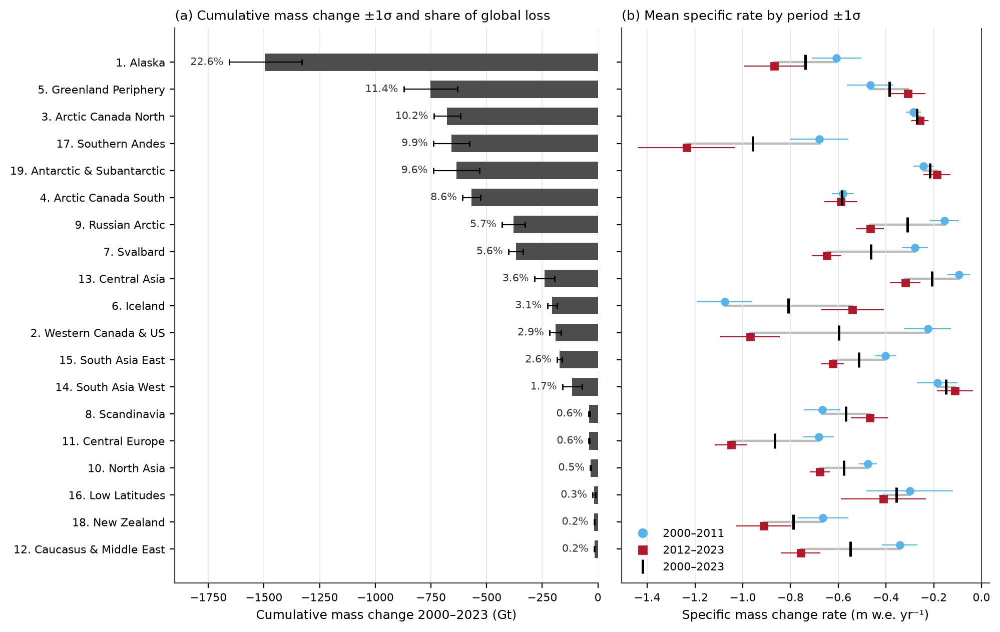
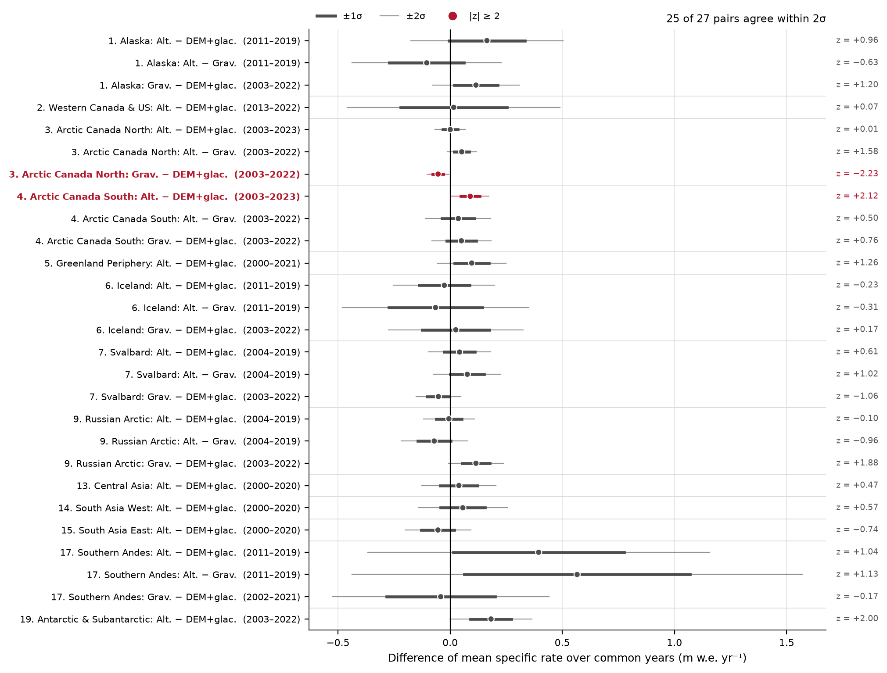
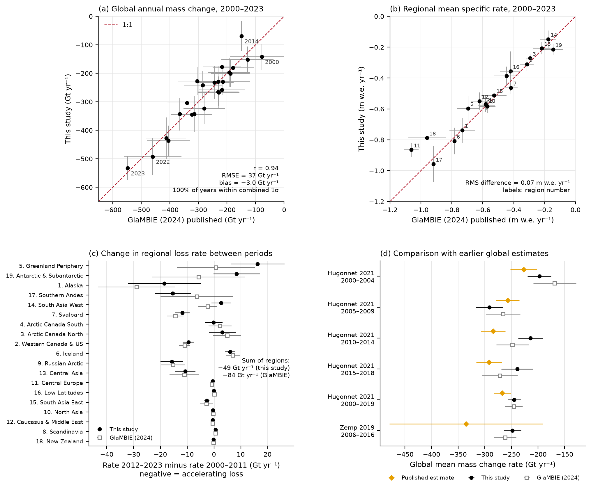
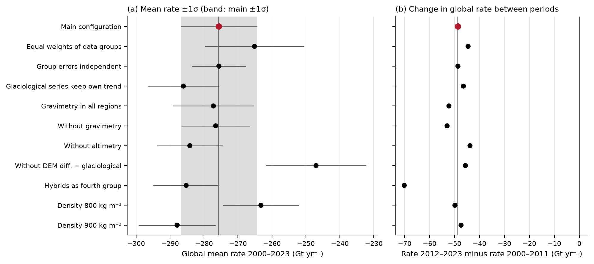

# Reconciling observational estimates of glacier mass change, 2000–2023: an independent reconstruction from the GlaMBIE input ensemble

## Abstract

We reconcile the regional glacier mass-change estimates collected by the Glacier Mass Balance Intercomparison Exercise (GlaMBIE) — 257 submitted series from glaciological measurements, DEM differencing, satellite altimetry, gravimetry and hybrid products for the 19 GTN-G first-order regions — into annual regional and global time series for 2000–2023, expressed as specific mass change (m w.e.) and total mass change (Gt) with 1σ uncertainties. Inputs are homogenised to a common unit, area and annual grid, combined within three data groups (altimetry; gravimetry; DEM differencing + glaciological) by random-effects least squares, and combined across groups per region and hydrological year before conversion to calendar years and summation to the global total. Glaciers outside the ice sheets lost **6615 ± 414 Gt** between 2000 and 2023 (−9.81 ± 0.62 m w.e.), a mean rate of **−276 ± 17 Gt yr⁻¹** (−0.41 ± 0.03 m w.e. yr⁻¹), equivalent to **18.2 ± 1.1 mm** of global mean sea-level rise; these intervals combine propagated random error with the structural spread across alternative combination choices. The loss rate increased from −251 ± 20 Gt yr⁻¹ in 2000–2011 to −300 ± 22 Gt yr⁻¹ in 2012–2023 (an increase of 49 ± 24 Gt yr⁻¹, +19 %), with a linear trend of −93 ± 40 Gt yr⁻¹ per decade; the four largest annual losses all fall in 2019–2023 (−533 ± 43 Gt in 2023). Alaska alone contributes 23 % of the loss; the other Arctic regions (Arctic Canada, Greenland Periphery, Iceland, Svalbard, Russian Arctic) and the Antarctic & Subantarctic together contribute a further 54 %. Our independent reconstruction reproduces the published GlaMBIE (2024) consensus within uncertainties: the 2000–2023 global rate differs by 3 Gt yr⁻¹ (−276 vs −273 Gt yr⁻¹), annual global values agree with r = 0.94 and RMSE 37 Gt, and every annual difference lies within the combined 1σ. Remaining differences are concentrated in sparsely observed regions (Antarctic & Subantarctic, Southern Andes, Central Europe, New Zealand) and in the allocation of loss between 2000–2011 and 2012–2023, and are explained by choices — weighting, uncertainty propagation, the role of glaciological series — that are documented and tested in a sensitivity analysis.

## 1. Introduction

Glaciers distinct from the Greenland and Antarctic ice sheets cover roughly 706,000 km² and are, after thermal expansion, one of the largest present-day contributors to sea-level rise; they also regulate regional runoff and drive glacier-related hazards (Zemp et al., 2019; Hugonnet et al., 2021). Their mass change is observed by four families of methods with very different sampling characteristics:

- **Glaciological (in situ) measurements** — stake and pit surveys on a few hundred glaciers, annual (sometimes seasonal) resolution but sparse and biased towards small, accessible glaciers;
- **DEM differencing** — differences of digital elevation models over multi-year periods; near-complete spatial coverage but coarse temporal resolution, and a volume-to-mass density conversion is needed;
- **Satellite altimetry** — laser and radar elevation-change time series (ICESat, CryoSat-2, ICESat-2); sub-annual resolution but spatially sampled, and also requiring a density conversion;
- **Gravimetry** — GRACE/GRACE-FO mass anomalies; monthly and directly in mass, but at a few hundred kilometres resolution and sensitive to signal leakage, glacial isostatic adjustment and hydrology, hence unreliable for small or ice-sheet-adjacent regions.

Hybrid ("combined") products merge two or more of these. Before GlaMBIE, assessments had to choose between estimates that disagreed by more than their stated uncertainties. Zemp et al. (2019) combined glaciological series (for interannual variability) with DEM differencing (for the long-term trend) and obtained a global loss of 335 ± 144 Gt yr⁻¹ for 2006–2016 and a 27 ± 22 mm sea-level contribution over 1961–2016. Hugonnet et al. (2021) produced a globally complete DEM-differencing estimate of 267 ± 16 Gt yr⁻¹ (0.74 ± 0.04 mm yr⁻¹ of sea-level rise) for 2000–2019 with an acceleration of 48 ± 16 Gt yr⁻¹ per decade. Observed mass change is also the calibration target of global glacier models (Hock et al., 2019; Marzeion et al., 2020; Rounce et al., 2023); Rounce et al. (2023), calibrated on Hugonnet et al. (2021), project losses of 26 ± 6 % to 41 ± 11 % of the 2015 glacier mass by 2100 for +1.5 °C to +4 °C of warming, and model spread dominates projection uncertainty until mid-century (Marzeion et al., 2020). Any bias in the observational target therefore propagates into projections, which is why a reconciled, uncertainty-quantified benchmark matters.

This study reconciles the full GlaMBIE input ensemble into annual 2000–2023 regional and global series of specific and total mass change with uncertainties. We ask: (i) do the methods agree within their uncertainties once homogenised to a common unit, grid and area; (ii) what is the reconciled regional and global loss and how has it changed over time; and (iii) how closely does an independent reconstruction, built only from the input submissions, reproduce the published GlaMBIE (2024) consensus, and where and why does it differ?

## 2. Data

The GlaMBIE dataset (GlaMBIE, 2024; DOI 10.5904/wgms-glambie-2024-07) supplies, for each of the 19 regions, the submitted estimates as CSV files with start and end dates (decimal years), change, uncertainty, unit and citation. The unit is elevation change (`m`, requiring a density conversion), specific mass change (`mwe`) or mass change (`Gt`). The dataset description cites 233 regional estimates; the input folder holds **257 files**, all of which we read (`outputs/reconciliation/inputs_inventory.csv`). By source they comprise 38 glaciological, 42 DEM-differencing, 41 altimetry, 78 gravimetry and 58 hybrid series. The difference of 24 cannot be resolved from the supplied material. The 233 appears only in the task statement; the dataset's own documentation (`GlaMBIE_DATASETS_INFO.md`, `input/GlaMBIE_INPUT_DATASETS_INFO.md`) gives no total, and states only that each CSV file is "one solution submitted for a specific region". One possible reading is that some submissions are counted once although they are split into several regional files, for example joint Arctic Canada North/South solutions; but the files carry no flag that would identify such splits. We therefore report the counts of the files actually read. Every file is used either in the consensus (167) or as a comparison or sensitivity input (90), so no submission was discarded. Conclusions that would depend on the exact count were not drawn.

Temporal resolution ranges from monthly (most altimetry and gravimetry series) through annual (glaciological and many hybrid series) to multi-year (DEM differencing, ICESat-era altimetry). Gravimetry starts in 2002 (GRACE) and the CryoSat-2 altimetry series in 2010–2011, so for 2000–2002 the record rests on DEM differencing and glaciological data (Figure 1). Data density is highest in the Arctic (Arctic Canada, Iceland, Svalbard, Russian Arctic: 18–22 series each) and lowest in North Asia, Caucasus & Middle East and the Antarctic & Subantarctic (7–8 series), where no altimetry or no gravimetry is available.

The published GlaMBIE results (`data/glambie/results/`, per region in hydrological and calendar years, and global in calendar years) are used **only** for two purposes: as the reference against which our reconstruction is validated, and as the source of the time-varying regional glacier area (RGI 6.0 with area-change rates) needed to convert between m w.e. and Gt, so that both reconstructions share the same area convention.

**Figure 1 – Input data overview.** (a) Temporal coverage of each regional mass-change estimate submitted to GlaMBIE (one line per submission), grouped by GTN-G first-order region and coloured by observation method. Solid lines mark estimates whose median period is annual or shorter; dashed lines mark multi-annual estimates. Pale lines are submissions not used in the consensus: hybrid estimates (comparison only) and gravimetry outside regions 1, 3, 4, 6, 7, 9 and 17 (sensitivity test only). The shaded band is the 2000–2023 study period. (b) Number of estimates used / submitted per region and method, with regional totals. The data folder holds 257 submissions; the dataset description cites 233.

## 3. Methods

The full implementation is in `code/` (`code/run_all.py`, `code/analysis/homogenise.py`, `code/analysis/reconcile.py`); column definitions are in `code/README.md`. All uncertainties are 1σ.

### 3.1 Homogenisation

Elevation changes are converted to m w.e. with a volume-to-mass density of 850 ± 60 kg m⁻³, the density uncertainty being added in quadrature. Conversions between m w.e. and Gt use the time-varying regional glacier area at the mid-point of each period. Monthly series are summed to annual hydrological years (1 October–1 October in the Northern Hemisphere; 1 April–1 April in regions 17–19; the calendar year in the Low Latitudes). For monthly series, uncertainties are treated as epoch errors: the error of an interval change is the root-mean-square of the monthly increment errors rather than an accumulated sum. For annual or longer periods, independent errors are combined in quadrature.

### 3.2 Within-group combination

Following GlaMBIE, submissions are grouped into three data groups: altimetry; gravimetry; and DEM differencing + glaciological. Hybrid submissions are not used in the consensus but are compared with it (§5.3). Gravimetry is retained only in the seven regions where GlaMBIE retained it (Alaska, Arctic Canada North and South, Iceland, Svalbard, Russian Arctic, Southern Andes). In the other regions, signal leakage and small glacier areas make it unreliable, and its inclusion is tested as a sensitivity variant. Of the 257 files, 167 enter the consensus: 52 as annual series, 77 as multi-year trends and 38 as annual variability only. The remaining 58 hybrid and 32 gravimetry files are used only for comparison and sensitivity.

Within each region and group, an annual series z_y is estimated by random-effects weighted least squares:
- Series that resolve individual years and whose level is informative (altimetry, gravimetry) enter as x_y = z_y + b_i, where b_i is a rate bias of submission i.
- Multi-year periods (DEM differencing, ICESat-era altimetry, trend-only gravimetry) enter as Σ f_y z_y + L b_i = v, with f_y the fraction of year y covered and L the period length.
- Glaciological series provide **annual variability only**, with a free offset per series. This follows Zemp et al. (2019): in situ series capture interannual variability well but are not regionally representative in level. Because the series derive from the same WGMS glaciers, their errors are inflated by √n.

The bias b_i ~ N(0, τ²) is a submission-level random effect with τ estimated by moments, so that no single submission fixes the group level. When residuals exceed the stated errors, the covariance is inflated by the Birge ratio. Where a group's own series do not resolve individual years (for example, ICESat trends over 2003–2009), the annual variability of the DEM-differencing + glaciological group is borrowed with its error doubled. Per-group diagnostics (Birge ratio, τ, number of level-setting submissions) are in `outputs/reconciliation/group_diagnostics.csv`.

### 3.3 Regional consensus

For each region and hydrological year, the consensus is the inverse-variance weighted mean of the available groups. Its variance is the weighted mean of the group variances plus the weighted variance of the group values. Errors are therefore not reduced by averaging: the groups share the area, density and glaciological-variability assumptions, so they are not independent. The spread between groups enters as an additional term.

Figure 2 shows, for every region, the resulting annual series of each data group and the regional consensus.

**Figure 2 – Regional annual specific mass change by data group.** Annual specific mass change (m w.e. yr⁻¹) per hydrological year (1 Oct–30 Sep in the northern hemisphere; 1 Apr–31 Mar in regions 17–19; calendar year in region 16), plotted at the middle of each year. Coloured lines are the three data groups (DEM differencing + glaciological, altimetry, gravimetry). Markers show years resolved by a group's own series; lines without markers are years in which the group's multi-annual change was distributed using the interannual variability of the DEM differencing + glaciological group. The black line and grey band are the regional consensus ±1σ. Where only DEM differencing + glaciological data exist (regions 8, 10, 11, 12, 16, 18), the consensus equals that group. The number at top right is the 2000–2023 mean rate ±1σ (m w.e. yr⁻¹, calendar years). All panels share the same y-axis.

### 3.4 Calendar years and global aggregation

Each hydrological year is distributed over its months with the seasonal anomaly of the glaciological sine-wave series (which sums to zero within the year), and the monthly shares of the two overlapping hydrological-year errors are summed linearly. The global series is the sum of the 19 regions per calendar year, with regional errors added in quadrature (regions treated as independent). Global specific mass change is the global Gt divided by the global glacier area. Sea-level equivalent uses 362.5 Gt per mm.

### 3.5 Period statistics and validation design

Period totals and rates (2000–2023, 2000–2011, 2012–2023) combine annual errors in quadrature, as GlaMBIE does. Since adjacent years share systematic errors, we also report the fully correlated (linear-sum) bound; the true uncertainty lies between the two. Acceleration is quantified by the difference between the two 12-year rates and by the slope of a weighted least-squares fit to the annual global mass change, whose error is inflated for excess scatter and lag-1 autocorrelation of the residuals and combined with the structural spread of the slope across configurations. An ordinary (unweighted) least-squares fit with the same autocorrelation adjustment is reported as the alternative. The validation (§5) has four parts:
1. comparison with the published GlaMBIE regional and global series, in hydrological and calendar years;
2. pairwise agreement between data groups within regions;
3. comparison of each hybrid submission with the consensus;
4. comparison with Hugonnet et al. (2021) and Zemp et al. (2019) over identical periods, plus a sensitivity analysis of ten alternative configurations.

## 4. Results

### 4.1 Global mass change

Annual global glacier mass change was negative in every year of 2000–2023 (Figure 3; `outputs/reconciliation/global_calendar_years.csv`; also tabulated in `outputs/tables/t2_global_annual.csv`). It ranged from −69 ± 52 Gt (2014) to −533 ± 43 Gt (2023), or −0.10 to −0.82 m w.e.

| Period | Total (Gt) | Rate (Gt yr⁻¹) | Rate (m w.e. yr⁻¹) | Sea-level contribution (mm) |
|---|---:|---:|---:|---:|
| 2000–2023 | −6615 ± 270 | −275.6 ± 11.2 | −0.409 ± 0.017 | 18.2 ± 0.7 |
| 2000–2011 | −3015 ± 184 | −251.3 ± 15.3 | −0.364 ± 0.022 | 8.3 ± 0.5 |
| 2012–2023 | −3599 ± 197 | −299.9 ± 16.4 | −0.454 ± 0.025 | 9.9 ± 0.5 |

*Table 1. Global glacier mass change (sum of 19 regions, calendar years). Errors are random only and assume independent annual errors; with the structural uncertainty added (§4.1) the 2000–2023 values are ± 414 Gt, ± 17.3 Gt yr⁻¹, ± 0.026 m w.e. yr⁻¹ and ± 1.1 mm, and 2000–2011 / 2012–2023 rates ± 19.6 / ± 22.4 Gt yr⁻¹; the fully correlated bounds are ± 1309 Gt, ± 54.6 Gt yr⁻¹ and ± 3.6 mm for 2000–2023. Source: `outputs/reconciliation/summary_global.json`, `outputs/validation/headline_uncertainty.json`.*

**Figure 3 – Global glacier mass change, 2000–2023.** (a) Annual global mass change (Gt yr⁻¹, calendar years, sum of the 19 regions) from this study (dark) and as published by GlaMBIE (2024) (light), with ±1σ error bars. Red lines and bands are this study's mean rates ±1σ for 2000–2011 and 2012–2023. (b) Cumulative mass change since 1 January 2000. Bands are ±1σ, accumulated in quadrature over years (√Σσ²), as in GlaMBIE. The right axis converts to global mean sea-level contribution with 362.5 Gt mm⁻¹. Period uncertainties treat annual errors as independent; the fully correlated bound is given in `summary_global.json`.

Over 2000–2023, glaciers lost 6615 ± 270 Gt, a mean thinning of 9.8 ± 0.4 m w.e. across the glacierised area, or 18.2 ± 0.7 mm of sea-level rise (random error only). Adding the structural uncertainty — the standard deviation of the central values over the main and seven alternative combination configurations (§5.4), combined in quadrature — gives the headline values **−6615 ± 414 Gt**, **−275.6 ± 17.3 Gt yr⁻¹** (−0.409 ± 0.026 m w.e. yr⁻¹) and **18.2 ± 1.1 mm** (`outputs/validation/headline_uncertainty.json`). For the sub-periods the combined values are −251.3 ± 19.6 and −299.9 ± 22.4 Gt yr⁻¹. The loss accelerated:
- The mean rate rose by 49 ± 24 Gt yr⁻¹ (+19 %) from 2000–2011 to 2012–2023, about 2σ with the combined uncertainty. Structural choices change this difference little (structural SD 9 Gt yr⁻¹) because every variant accelerates.
- The linear trend of annual mass change is −9.3 ± 4.0 Gt yr⁻², i.e. −93 ± 40 Gt yr⁻¹ per decade. This is a weighted least-squares fit to the annual values; its error is inflated for excess scatter (Birge ratio 1.8) and for lag-1 autocorrelation of the residuals (0.31, effective sample size 13 of 24), and combined with the structural spread of the slope. An unweighted fit gives −82 ± 40 Gt yr⁻¹ per decade (`headline_uncertainty.json`, key `trend_of_annual_global_mass_change`).
- The five most negative years of the record are 2023, 2022, 2020, 2019 and 2007, four of them after 2018, with 2023 the most negative (−533 ± 43 Gt, −0.82 ± 0.07 m w.e.).
- Interannual variability is large: 2014 (−69 Gt) and 2017 (−178 Gt) were years of low loss within the later period.

### 4.2 Regional mass change

Table 2 and Figure 4 summarise the regional results (`outputs/reconciliation/summary_regional.csv`). In absolute terms, losses are dominated by the large, maritime and Arctic regions:
- Alaska: −62.2 ± 6.8 Gt yr⁻¹, 22.6 % of the global loss.
- Greenland Periphery: −31.3 ± 5.0 Gt yr⁻¹.
- Arctic Canada North: −28.2 ± 2.5 Gt yr⁻¹.
- Southern Andes: −27.4 ± 3.4 Gt yr⁻¹.
- Antarctic & Subantarctic: −26.5 ± 4.3 Gt yr⁻¹.
- Arctic Canada South: −23.7 ± 1.7 Gt yr⁻¹.

These six regions account for 72 % of the global loss.

Specific mass change identifies where glaciers thin fastest. The most negative regions are the Southern Andes (−0.96 ± 0.12 m w.e. yr⁻¹), Central Europe (−0.87 ± 0.05), Iceland (−0.81 ± 0.09), New Zealand (−0.79 ± 0.08) and Alaska (−0.74 ± 0.08). The least negative are South Asia West (−0.15 ± 0.06), Central Asia (−0.21 ± 0.04), the Antarctic & Subantarctic (−0.22 ± 0.04) and Arctic Canada North (−0.27 ± 0.02). Every region lost mass in both sub-periods. Specific losses in 2012–2023 exceeded those in 2000–2011 in 13 of 19 regions, most strongly in:
- Western Canada & US: −0.23 to −0.97 m w.e. yr⁻¹;
- Russian Arctic: −0.16 to −0.47;
- Svalbard: −0.28 to −0.65;
- Central Asia: −0.10 to −0.32;
- Southern Andes: −0.68 to −1.24.

Loss decreased in Iceland (−1.08 to −0.54 m w.e. yr⁻¹), the Greenland Periphery (−0.47 to −0.31), Scandinavia (−0.67 to −0.47), the Antarctic & Subantarctic (−0.24 to −0.19), South Asia West (−0.19 to −0.11) and, marginally, Arctic Canada North (−0.29 to −0.26). The North Atlantic part of this pattern is consistent with the regional deceleration around Iceland and southeast Greenland reported by Hugonnet et al. (2021).

| Region | Area 2000 (km²) | Rate 2000–2023 (Gt yr⁻¹) | Rate 2000–2023 (m w.e. yr⁻¹) | Cumulative 2000–2023 (Gt) | Rate 2000–2011 (Gt yr⁻¹) | Rate 2012–2023 (Gt yr⁻¹) | Share of global loss (%) |
|---|---:|---:|---:|---:|---:|---:|---:|
| 01 Alaska | 89,847 | −62.2 ± 6.8 | −0.74 ± 0.08 | −1493 ± 164 | −53.0 ± 9.0 | −71.5 ± 10.2 | 22.6 |
| 02 Western Canada & US | 14,563 | −8.0 ± 1.1 | −0.60 ± 0.08 | −191 ± 26 | −3.2 ± 1.4 | −12.7 ± 1.6 | 2.9 |
| 03 Arctic Canada North | 105,001 | −28.2 ± 2.5 | −0.27 ± 0.02 | −678 ± 59 | −29.8 ± 3.3 | −26.7 ± 3.7 | 10.2 |
| 04 Arctic Canada South | 40,872 | −23.7 ± 1.7 | −0.58 ± 0.04 | −568 ± 40 | −23.6 ± 1.9 | −23.7 ± 2.8 | 8.6 |
| 05 Greenland Periphery | 89,349 | −31.3 ± 5.0 | −0.39 ± 0.06 | −751 ± 121 | −39.5 ± 8.4 | −23.2 ± 5.6 | 11.4 |
| 06 Iceland | 11,000 | −8.6 ± 0.9 | −0.81 ± 0.09 | −206 ± 22 | −11.6 ± 1.2 | −5.5 ± 1.3 | 3.1 |
| 07 Svalbard & Jan Mayen | 34,445 | −15.4 ± 1.4 | −0.46 ± 0.04 | −369 ± 33 | −9.5 ± 1.8 | −21.3 ± 2.0 | 5.6 |
| 08 Scandinavia | 2,961 | −1.6 ± 0.2 | −0.57 ± 0.05 | −39 ± 4 | −1.9 ± 0.2 | −1.3 ± 0.2 | 0.6 |
| 09 Russian Arctic | 51,613 | −15.8 ± 2.1 | −0.31 ± 0.04 | −380 ± 51 | −8.0 ± 3.1 | −23.7 ± 2.9 | 5.7 |
| 10 North Asia | 2,488 | −1.4 ± 0.1 | −0.58 ± 0.03 | −33 ± 2 | −1.2 ± 0.1 | −1.6 ± 0.1 | 0.5 |
| 11 Central Europe | 2,141 | −1.6 ± 0.1 | −0.86 ± 0.05 | −39 ± 2 | −1.4 ± 0.1 | −1.9 ± 0.1 | 0.6 |
| 12 Caucasus & Middle East | 1,283 | −0.7 ± 0.1 | −0.55 ± 0.06 | −16 ± 2 | −0.4 ± 0.1 | −0.9 ± 0.1 | 0.2 |
| 13 Central Asia | 49,702 | −10.0 ± 1.9 | −0.21 ± 0.04 | −240 ± 45 | −4.7 ± 2.3 | −15.3 ± 3.0 | 3.6 |
| 14 South Asia West | 33,508 | −4.8 ± 1.8 | −0.15 ± 0.06 | −116 ± 44 | −6.2 ± 2.8 | −3.5 ± 2.3 | 1.7 |
| 15 South Asia East | 14,907 | −7.2 ± 0.5 | −0.51 ± 0.03 | −172 ± 11 | −5.8 ± 0.6 | −8.5 ± 0.6 | 2.6 |
| 16 Low Latitudes | 2,355 | −0.7 ± 0.3 | −0.36 ± 0.13 | −17 ± 6 | −0.7 ± 0.4 | −0.8 ± 0.3 | 0.3 |
| 17 Southern Andes | 29,403 | −27.4 ± 3.4 | −0.96 ± 0.12 | −657 ± 81 | −19.7 ± 3.6 | −35.1 ± 5.8 | 9.9 |
| 18 New Zealand | 982 | −0.7 ± 0.1 | −0.79 ± 0.08 | −16 ± 2 | −0.6 ± 0.1 | −0.8 ± 0.1 | 0.2 |
| 19 Antarctic & Subantarctic | 127,665 | −26.5 ± 4.3 | −0.21 ± 0.04 | −636 ± 104 | −30.7 ± 5.2 | −22.3 ± 6.9 | 9.6 |
| **Global (sum)** | 704,083 | **−275.6 ± 11.2** | **−0.41 ± 0.02** | **−6615 ± 270** | −251.3 ± 15.3 | −299.9 ± 16.4 | 100 |

*Table 2. Regional mass-change rates and totals (calendar years, 1σ, annual errors independent). Source: `outputs/reconciliation/summary_regional.csv`; annual series in `outputs/reconciliation/regional_calendar_years.csv` (calendar years) and `regional_hydrological_years.csv` (hydrological years).*

**Figure 4 – Regional contributions, 2000–2023.** (a) Cumulative mass change 2000–2023 (Gt) per region ±1σ, ranked, with each region's share of the global loss. (b) Mean specific mass change rate (m w.e. yr⁻¹) for 2000–2011 (circles), 2012–2023 (squares) and 2000–2023 (bars) ±1σ. The grey connector shows the change between the two periods. Calendar years.

### 4.3 Agreement between observation methods

Where two data groups overlap in a region (Figure 5; 27 region–group pairs, `outputs/validation/group_agreement.csv`), their mean rates over the common period differ by less than 2σ in 25 cases. The two exceptions, and one borderline case, are:
- gravimetry vs DEM differencing + glaciological in Arctic Canada North (−0.054 ± 0.024 m w.e. yr⁻¹, z = −2.2);
- altimetry vs DEM differencing + glaciological in Arctic Canada South (+0.090 ± 0.042, z = 2.1);
- borderline: altimetry vs DEM differencing + glaciological in the Antarctic & Subantarctic (+0.18 ± 0.09, z = 2.0).

Annual variability agrees less well than mean rates. Where altimetry and DEM differencing + glaciological overlap over long periods, the annual series correlate strongly (r = 0.95–0.998 in Western Canada & US, Arctic Canada North and South, and South Asia West and East). Gravimetry correlates less well with the other groups (r = 0.25–0.88). In the Southern Andes, annual series from different groups are essentially uncorrelated (r = 0.06–0.51) and differ by 1.3–1.7 m w.e. rms, so the annual consensus there is weakly constrained even though the mean rates agree. Within-group dispersion beyond stated errors was modest: the Birge ratio exceeded 1.1 only for altimetry in Svalbard (1.17), Central Asia (1.76), South Asia East (1.29) and the Antarctic & Subantarctic (2.38), and for DEM differencing + glaciological in South Asia West (1.15) (`outputs/reconciliation/group_diagnostics.csv`).

**Figure 5 – Agreement between data groups.** Difference of the mean specific rates (m w.e. yr⁻¹) of each pair of data groups over their common hydrological years (in brackets). Thick bars are ±1σ and thin bars ±2σ of the difference; z = difference / σ. Red pairs disagree at |z| ≥ 2. Regions with a single data group (8, 10, 11, 12, 16, 18) have no pair.

## 5. Validation and comparison

### 5.1 Against the published GlaMBIE consensus

Our reconstruction was built only from the input submissions, and the published GlaMBIE results were not used in the combination (they supplied only the area series). Globally, the two series have the following agreement (Figure 6a, 3; `outputs/reconciliation/summary_global.json`, `outputs/validation/vs_glambie_global_pairs.csv`):
- **Rate:** the 2000–2023 rates are −275.6 ± 11.2 (ours, random error; ± 17.3 combined) and −272.6 ± 16.1 Gt yr⁻¹ (GlaMBIE), and the cumulative losses −6615 ± 270 and −6542 ± 387 Gt. Both differences are 1 %.
- **Annual values:** they agree with r = 0.94 (Gt) and 0.95 (m w.e.), a bias of −3 Gt and an RMSE of 37 Gt (0.055 m w.e.). All 24 annual differences lie within the combined 1σ.
- **Uncertainty:** our mean annual global uncertainty (55 Gt) is about 30 % smaller than GlaMBIE's (78 Gt), mainly in 2000 (45 vs 112 Gt) and 2021–2023, where the published uncertainty grows as data become sparser.

The main global difference is in the split between sub-periods. We obtain more loss in 2000–2011 (−251 ± 15 vs −231 ± 23 Gt yr⁻¹) and less in 2012–2023 (−300 ± 16 vs −314 ± 23 Gt yr⁻¹). Our acceleration between the periods is therefore smaller: +49 Gt yr⁻¹ (+19 %) against GlaMBIE's +84 Gt yr⁻¹ (+36 %). The largest annual differences are in 2000 (−142 vs −78 Gt), 2013 (−227 vs −305 Gt) and 2014 (−69 vs −150 Gt).

Regionally (Figure 6b; `outputs/validation/vs_glambie_regional.csv`, calendar years):
- **Rates:** the 2000–2023 rates agree within 0.1 m w.e. yr⁻¹ in 17 of 19 regions.
- **Annual series:** they correlate with r ≥ 0.90 in 13 regions. 90–100 % of annual differences (m w.e.) lie within the combined 1σ in 17 regions, and 83 % and 88 % in North Asia and Central Europe.
- **Central Europe and New Zealand:** our mean rates are less negative than GlaMBIE's by 0.20 and 0.17 m w.e. yr⁻¹. Both regions rest essentially on the DEM differencing + glaciological group with few submissions, and the outcome depends on how the dense in situ record is weighted against geodetic trends.
- **Antarctic & Subantarctic:** we obtain −26.5 ± 4.3 Gt yr⁻¹ against −17.8 Gt yr⁻¹ (−0.22 vs −0.15 m w.e. yr⁻¹). The region has only one level-setting DEM-differencing submission, its altimetry is internally inconsistent (Birge ratio 2.4), and the large area turns a small specific difference into 9 Gt yr⁻¹. It accounts for most of the 3 Gt yr⁻¹ global difference, partly offset by less negative rates in the Greenland Periphery (−31.3 vs −35.4 Gt yr⁻¹) and Arctic Canada North (−28.2 vs −30.4 Gt yr⁻¹).
- **Weakly correlated regions:** North Asia (r = 0.71), Southern Andes (r = 0.73) and South Asia East (r = 0.80) have the lowest annual correlations. In these regions annual variability comes mostly from glaciological series of a few glaciers, and the two reconstructions treat it differently.

Per data group (`outputs/validation/vs_glambie_groups.csv`), our group series reproduce GlaMBIE's with median r = 0.94, a median bias of 0.02 m w.e. and a median RMSE of 0.17 m w.e.

**Figure 6 – Validation and comparison.** (a) Annual global mass change of this study against the published GlaMBIE (2024) series (calendar years, ±1σ), with the 1:1 line and annual agreement statistics. (b) Regional mean specific rates 2000–2023 (calendar years) against GlaMBIE, labelled by region number; error bars are period errors from annual errors in quadrature. (c) Change of each region's mean rate between 2000–2011 and 2012–2023 (Gt yr⁻¹; negative = accelerating loss) for this study and GlaMBIE, ordered by the size of their difference. This study's global acceleration is weaker (−49 vs −84 Gt yr⁻¹). The difference comes mostly from Greenland periphery (+16 Gt yr⁻¹ relative to GlaMBIE), Antarctic & Subantarctic (+14), Alaska (+10) and South Asia West (+5), partly offset by the Southern Andes (−9). (d) Global mean rates of Hugonnet et al. (2021) and Zemp et al. (2019) for their published periods, compared with this study and GlaMBIE over the same calendar years (±1σ; Zemp et al. as published). All published values are quoted as given in those papers; they are not recomputed here.

### 5.2 Against independent prior estimates

`outputs/validation/prior_estimates.csv` (Figure 6d) compares global rates over identical calendar years:
- **Hugonnet et al. (2021), 2000–2019:** they report −267 ± 16 Gt yr⁻¹; we obtain −245 ± 12 Gt yr⁻¹ (z = 1.1) and GlaMBIE −246 ± 17 Gt yr⁻¹. Both reconciled estimates are slightly less negative than the DEM-differencing-only estimate, which is consistent with Hugonnet et al. being one of several inputs to the DEM-differencing group.
- **Hugonnet et al. (2021), 5-year periods:** agreement is within 1.4σ except for 2010–2014. There Hugonnet et al. report −284 ± 23 and we obtain −214 ± 23 Gt yr⁻¹ (z = 2.1), driven by the low-loss years 2013–2014. Hugonnet et al. found a steady acceleration of 48 ± 16 Gt yr⁻¹ per decade over 2000–2019. Our 2000–2023 trend of −93 ± 40 Gt yr⁻¹ per decade is steeper, which is consistent with the very negative years 2019–2023 being included, but the two trends are not significantly different given its uncertainty.
- **Zemp et al. (2019), 2006–2016:** they report −335 ± 144 Gt yr⁻¹; we obtain −248 ± 16 Gt yr⁻¹, within their uncertainty (z = 0.6). The reconciliation reduces the uncertainty of that period by an order of magnitude.

### 5.3 Hybrid submissions

The 52 hybrid submissions that overlap the consensus (`outputs/validation/hybrid_vs_consensus.csv`) agree with it in annual variability (median r = 0.91, median rms difference 0.27 m w.e.). They are slightly more negative on average: the mean-rate difference has a median of −0.02 m w.e. yr⁻¹, and 71 % of hybrids are more negative than the consensus. Adding the hybrids as a fourth group would raise the global 2000–2023 rate to −285 Gt yr⁻¹ (§5.4). Since hybrids reuse the same primary observations, we keep them out of the main estimate to avoid double counting.

### 5.4 Sensitivity to combination choices

`outputs/validation/sensitivity_global.csv` gives the 2000–2023 global rate under ten alternative configurations (Table 3, Figure 7):

| Variant | Rate 2000–2023 (Gt yr⁻¹) | Rate 2000–2011 | Rate 2012–2023 | Trend (Gt yr⁻¹ decade⁻¹) |
|---|---:|---:|---:|---:|
| Main | −275.6 ± 11.2 | −251.3 | −299.9 | −93 |
| Equal weights between groups | −265.1 ± 14.6 | −242.8 | −287.4 | −96 |
| Independent group errors | −275.6 ± 8.0 | −251.3 | −299.9 | −71 |
| UZH glaciological series with own trend | −286.1 ± 10.5 | −262.8 | −309.3 | −99 |
| Gravimetry in all regions | −277.2 ± 11.9 | −251.1 | −303.4 | −99 |
| No gravimetry | −276.6 ± 10.1 | −250.1 | −303.1 | −88 |
| No altimetry | −284.2 ± 9.7 | −262.3 | −306.1 | −92 |
| No DEM differencing + glaciological | −247.0 ± 14.8 | −224.2 | −269.8 | −89 |
| Hybrids as a fourth group | −285.3 ± 9.7 | −250.2 | −320.4 | −96 |
| Density 800 kg m⁻³ | −263.3 ± 11.2 | −238.3 | −288.2 | −93 |
| Density 900 kg m⁻³ | −287.9 ± 11.3 | −264.2 | −311.6 | −92 |

*Table 3. Sensitivity of the global rates to combination choices.*

**Figure 7 – Sensitivity of the global result.** (a) Global mean mass change rate 2000–2023 (Gt yr⁻¹, ±1σ) under eleven variants of the reconciliation; the grey band is the main configuration ±1σ. (b) Change of the global rate between 2000–2011 and 2012–2023 under the same variants.

All variants give a 2000–2023 loss between −247 and −288 Gt yr⁻¹ and an increase in loss rate from the first to the second period in every case. The largest single sensitivities are:
- removing the DEM differencing + glaciological group (−28 Gt yr⁻¹ less loss);
- the density assumption (±12 Gt yr⁻¹ for ±50 kg m⁻³);
- equal rather than inverse-variance group weights (−10 Gt yr⁻¹).

Each of these is comparable to, or larger than, the stated 1σ of the main estimate, so structural uncertainty is at least as important as the propagated random error. The inclusion of gravimetry outside the seven retained regions changes the global rate by less than 2 Gt yr⁻¹. Regional sensitivities are in `outputs/validation/sensitivity_regional.csv`.

## 6. Discussion

**A consistent picture across methods.** Once homogenised to a common unit, area and annual grid, the observation methods agree on regional mean rates to within 2σ in 25 of 27 overlapping cases. The reconciled global series is robust to reasonable changes in the combination: it stays within 11 % of the main estimate across all sensitivity variants and within 1 % of the independently computed GlaMBIE consensus. This supports using a multi-method consensus, rather than any single method, as the observational benchmark. The combination draws on complementary strengths: DEM differencing for the long-term level, altimetry and gravimetry for annual resolution where available, and glaciological series for interannual variability before the satellite gravimetry and CryoSat-2 eras.

**Acceleration.** All configurations show increasing loss. The magnitude of the acceleration, however, depends on how annual variability is attributed to years, and our between-period increase (+19 %) is about half of GlaMBIE's (+36 %). Both reconstructions agree on the loss total and on the extreme recent years (2019–2023), but differ in 2000 and 2013–2014. In those years the annual signal rests mainly on the glaciological variability transferred onto the geodetic trend, and on the seasonal correction from hydrological to calendar years. We traced where the difference arises (Figure 6c) by taking, for each region, the change in mean rate between 2000–2011 and 2012–2023 in each reconstruction (calendar-year pairs in `outputs/validation/vs_glambie_regional_pairs.csv`). Of the 35 Gt yr⁻¹ by which our increase is smaller, the Greenland Periphery accounts for 16 Gt yr⁻¹, the Antarctic & Subantarctic 14, Alaska 10 and South Asia West 5, partly offset by a stronger increase in ours in the Southern Andes (−9 Gt yr⁻¹). In these regions GlaMBIE's consensus behaves more like an equal-weight mean of the data groups, whereas our inverse-variance weighting favours the DEM differencing + glaciological group, whose annual variability is smoother. Equal group weights alone do not reproduce GlaMBIE's increase, however: the equal-weight variant gives +45 Gt yr⁻¹ between the periods (Table 3), against GlaMBIE's +84 Gt yr⁻¹. A claim about the rate of acceleration should therefore carry this structural uncertainty. The trend of −93 ± 40 Gt yr⁻¹ per decade is a statistical fit to annual values and not a physical acceleration constant.

**Uncertainties.** Our period uncertainties assume independent annual errors, as GlaMBIE's do. The fully correlated bound is about five times larger (±55 vs ±11 Gt yr⁻¹ for 2000–2023), and the truth lies between the two because density, area and calibration errors persist from year to year. The density assumption alone shifts the global rate by ±12 Gt yr⁻¹. The structural spread across combination choices (SD 13 Gt yr⁻¹ for 2000–2023) is of the same size as the random error (11 Gt yr⁻¹); the headline intervals therefore combine both (±17 Gt yr⁻¹; `outputs/validation/headline_uncertainty.json`). A narrower definition that excludes the two leave-one-group-out variants gives ±13.6 Gt yr⁻¹. Treating regions as independent at the global level probably understates the global uncertainty for the same reason.

**Limitations.**
1. The exact GlaMBIE algorithm (weighting between groups, seasonal correction) is not in the supplied material, so our method is an independent reconstruction. Its differences from the reference are a result, not an error to be tuned away; we deliberately did not fit our choices to the published series.
2. Sparse regions — Antarctic & Subantarctic (one level-setting submission), North Asia, Caucasus & Middle East, New Zealand — rest on very few independent estimates, and their annual series rest largely on a handful of monitored glaciers.
3. The Antarctic & Subantarctic difference of 9 Gt yr⁻¹ from GlaMBIE shows that large-area, poorly observed regions can dominate global differences.
4. The area series is taken from the GlaMBIE result files and is therefore shared with the reference. This makes the Gt comparison independent only in the specific mass change.
5. The supplied input count (257 files) differs from the cited 233 estimates (§2); we used all files, and no result depends on the count.

**Use as a benchmark.** For model calibration, the regional annual series in m w.e. (`outputs/reconciliation/regional_calendar_years.csv` and `regional_hydrological_years.csv`) with their 1σ errors are the appropriate targets. Models calibrated on a single geodetic product (e.g. Rounce et al., 2023, on Hugonnet et al., 2021) inherit a 2000–2019 global rate about 20 Gt yr⁻¹ more negative than the reconciled one. The regions with low inter-method annual correlation (Southern Andes, North Asia, South Asia East) should be weighted in calibration on their multi-year rates rather than their annual values.

## 7. Conclusions

1. Reconciling 167 of 257 GlaMBIE submissions from four observation methods gives a global glacier mass loss of 6615 ± 414 Gt over 2000–2023 (−276 ± 17 Gt yr⁻¹; −0.41 ± 0.03 m w.e. yr⁻¹), equivalent to 18.2 ± 1.1 mm of sea-level rise (random and structural uncertainty combined).
2. Loss increased from −251 ± 20 Gt yr⁻¹ (2000–2011) to −300 ± 22 Gt yr⁻¹ (2012–2023), an increase of 49 ± 24 Gt yr⁻¹, with the largest annual losses in 2019–2023 (−533 ± 43 Gt in 2023).
3. Alaska, the Greenland Periphery, Arctic Canada, the Southern Andes and the Antarctic & Subantarctic dominate the absolute loss. The Southern Andes, Central Europe, Iceland and New Zealand thin fastest.
4. The methods agree on regional mean rates to within 2σ in 25 of 27 overlapping cases. An independent reconstruction reproduces the published GlaMBIE consensus to within 1 % globally and within all annual uncertainties, with differences confined to sparsely observed regions and to the split of loss between sub-periods.
5. Structural choices (density, group weighting, use of glaciological trends) matter as much as the propagated random error, and should accompany the benchmark when it is used for IPCC assessments and model calibration.

## Reproducibility

From the workspace root, `python code/run_all.py` (NumPy and pandas; about one minute) reads `data/glambie/input/*/*.csv` and the area series in `data/glambie/results/`, and regenerates `outputs/reconciliation/` and `outputs/validation/`. Figures and tables are regenerated with `python code/figures/make_all.py`, which writes to `report/images/` and `outputs/tables/`. Every number in this report is taken from the files cited next to it.

## References

- GlaMBIE (2024). Glacier Mass Balance Intercomparison Exercise (GlaMBIE) Dataset 1.0.0. World Glacier Monitoring Service, Zurich. https://doi.org/10.5904/wgms-glambie-2024-07
- Hock, R., et al. (2019). GlacierMIP – A model intercomparison of global-scale glacier mass-balance models and projections. *Journal of Glaciology*, 65(251), 453–467. https://doi.org/10.1017/jog.2019.22
- Hugonnet, R., et al. (2021). Accelerated global glacier mass loss in the early twenty-first century. *Nature*, 592, 726–731. https://doi.org/10.1038/s41586-021-03436-z
- Marzeion, B., et al. (2020). Partitioning the uncertainty of ensemble projections of global glacier mass change. *Earth's Future*, 8, e2019EF001470. https://doi.org/10.1029/2019EF001470
- Rounce, D. R., et al. (2023). Global glacier change in the 21st century: Every increase in temperature matters. *Science*, 379, 78–83.
- Zemp, M., et al. (2019). Global glacier mass changes and their contributions to sea-level rise from 1961 to 2016. *Nature*, 568, 382–386. https://doi.org/10.1038/s41586-019-1071-0
